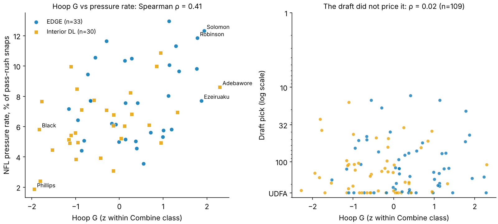
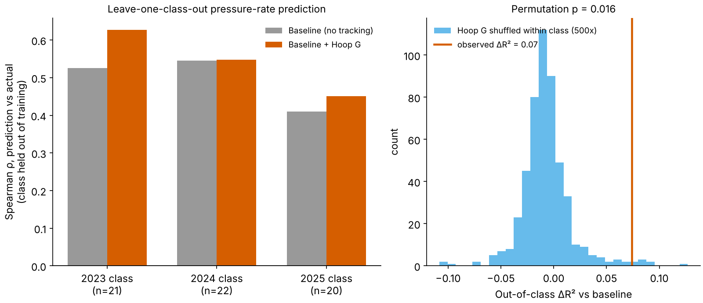
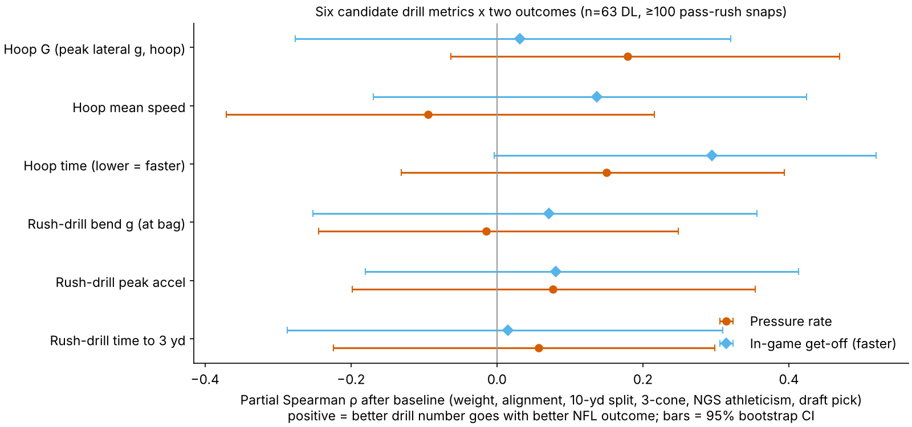
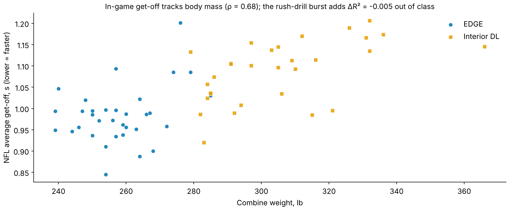

# Hoop G: Measuring Bend at the Combine and Finding It in NFL Pressure Rate

## The question a defensive line coach would ask

Scouts say "bend" when an edge rusher can flatten his path around the tackle's outside shoulder without losing speed or drifting wide. The Combine's Run-the-Hoop drill exists to test exactly that: the player sprints a figure-eight around two hoops on the ground, staying low and tight to the arc. Yet the drill produces no official number. Only a scout's eye grades it.

With 10 Hz tracking, bend becomes physics. Turning on a curve at speed *v* with radius *r* takes a lateral (centripetal) acceleration of *v²/r*. A player who holds a tight arc at speed is generating more of it. We define:

**Hoop G** = the highest lateral acceleration a player holds for 0.5 s anywhere on the hoop drill, in units of g. We compute it from Savitzky–Golay-smoothed x/y positions as |v × a| / |v|, average it over a player's attempts, and standardize it within each Combine class. Drill medians shift between Combines, although the shift is small here: 0.03 g between class medians.

Across 119 hoop attempts by 109 defensive linemen the median Hoop G is 0.62 g (10th–90th percentile 0.57–0.68 g), reached at about 3.5 yd/s. Figure 1 shows the gap between the extremes.

We ask two pre-stated questions about the DL/EDGE group:

1. Does Hoop G relate to **NFL pressure rate** (pressures per pass-rush snap) beyond what a team already knows without tracking?
2. Do the Combine's **pass-rush drill** burst numbers relate to **in-game get-off** beyond the same baseline?

## Data and design

- **Players.** 118 DL from the 2023–2025 classes. Of these, 63 ran the hoop drill and logged at least 100 regular-season pass-rush snaps. That cohort has 33 EDGE and 30 interior players, split 21/22/20 across the three classes, with a median of 342 rush snaps. Regular season is filtered through `games.csv`. Pressure rate is total pressures divided by total pass-rush snaps across 2023–2025. Get-off is the snap-weighted season average.
- **Baseline without tracking.** This is what a front office already has: Combine weight, EDGE vs interior alignment, the official 10-yard split, the official 3-cone, the NGS athleticism score and log draft pick (UDFA = 262). Splits and 3-cones are standardized within class. When missing (24 of 118 splits, 75 of 118 3-cones), we impute them from weight and alignment only, never from the outcome.
- **Out-of-class validation.** We train on two classes and predict the third, with a ridge model whose penalty is chosen inside the training fold. We compare the baseline against baseline + Hoop G and add two uncertainty checks: a player-level bootstrap (2,000 draws) and a 500-shuffle permutation test that scrambles Hoop G within class.

## Finding 1: Hoop G tracks pressure rate, and the draft ignored it

On its own, Hoop G has a Spearman ρ = 0.41 with NFL pressure rate (n = 63, p = 0.001). The link holds within each role: ρ = 0.33 for EDGE and 0.45 for interior players. That is about as strong as the official 10-yard split (ρ = 0.44, n = 49). The 3-cone is stronger (ρ = 0.54) but exists for only 25 of these players.

The draft did not price it. Across all 109 DL with a hoop rep, Hoop G is unrelated to draft slot (ρ = 0.02, p = 0.85). Figure 2 shows both relationships.

Hoop G is not just a "light and fast" proxy, but it is partly one. It correlates −0.44 with weight and 0.50 with a faster 10-yard split (n = 86). The real question is whether it survives the baseline.

## Finding 2: a small, real-looking increment out of class, with honest error bars

**In-sample.** With all six baseline features held fixed, one standard deviation of Hoop G adds **+0.77 percentage points** of pressure rate (95% CI 0.13–1.42, HC1 errors, p = 0.019). In-sample R² rises from 0.31 to 0.37. Over a 400-rush-snap season, +1 sd is about 3.1 extra pressures. The cohort median rate is 6.8%.

**Out of class**, which is the test that matters (Figure 3):

| Model (ridge, leave-one-class-out) | Out-of-class R² | Spearman ρ (pooled) |
|---|---|---|
| Draft pick only | -0.01 | n/a |
| Baseline (no tracking) | 0.09 | 0.36 |
| Baseline + Hoop G | 0.16 | 0.41 |

- **ΔR² = 0.07.** The bootstrap 95% CI is −0.01 to 0.15, and 96% of draws are positive.
- **Permutation p = 0.016.** Only that fraction of within-class shuffles of Hoop G does as well as the real values.
- **Every held-out class improves.** Rank correlation rises from 0.53 to 0.63 for 2023, 0.54 to 0.55 for 2024 and 0.41 to 0.45 for 2025.

The rank-based partial correlation tells the same story more conservatively. After residualizing both sides on the baseline it is 0.18 (bootstrap CI −0.06 to 0.47).

**Multiple comparisons.** We are open that Hoop G was the strongest of six candidate drill metrics we built from the hoop and pass-rush drills, checked against two outcomes (Figure 4). After the baseline, none of the 12 bootstrap intervals clears zero. The largest other effect is |ρ| = 0.29 (hoop time vs get-off). Hoop G had the largest pressure-rate effect of the six, and it was the only one we carried into the out-of-class test. The permutation test does not correct for that selection, so read the result as "promising, replicate on 2026" rather than "proven."

## Finding 3: in-game get-off is a body-mass story, and the rush drill adds nothing

The second question is a useful negative result. NFL get-off (seconds from the snap until the rusher gets moving, as provided in the play-level data) is largely set by size and alignment. It correlates 0.68 with Combine weight (Figure 5), and the official 10-yard split correlates 0.67 (n = 49).

The pass-rush-drill peak acceleration does relate to faster get-off on its own (ρ = 0.40, n = 63, consistent with the ρ ≈ −0.31 reported earlier on the unsigned scale). After the baseline that falls to a partial ρ of 0.08 (CI −0.18 to 0.41). Out of class the baseline already reaches R² = 0.41, and adding the rush-drill metric changes it by −0.005. Weight plus alignment alone reach 0.37.

The drill's "burst" number is mostly a heavier-is-slower signal that the scale already provides. The rush drill is also noisy: peak acceleration repeats at ρ = 0.34 across a player's two attempts (n = 106).

## Named players

| Player | Class | Role | Pick | Hoop G (g) | z | NFL pressure % | vs baseline (pp) | Rush snaps |
|---|---|---|---|---|---|---|---|---|
| Adetomiwa Adebawore | 2023 | IDL | 110 | 0.69 | +2.3 | 8.6 | +0.4 | 511 |
| Javon Solomon | 2024 | EDGE | 168 | 0.73 | +1.9 | 12.3 | +5.7 | 211 |
| Donovan Ezeiruaku | 2025 | EDGE | 44 | 0.68 | +1.9 | 7.7 | -1.4 | 402 |
| Chop Robinson | 2024 | EDGE | 21 | 0.72 | +1.8 | 11.8 | +1.3 | 726 |
| Tuli Tuipulotu | 2023 | EDGE | 54 | 0.67 | +1.8 | 9.8 | +2.2 | 1486 |
| Darius Robinson | 2024 | IDL | 27 | 0.55 | -1.8 | 2.4 | -4.2 | 459 |
| Yahya Black | 2025 | IDL | 164 | 0.54 | -1.8 | 5.8 | +1.9 | 189 |
| Jordan Phillips | 2025 | IDL | 143 | 0.54 | -1.9 | 1.9 | -1.6 | 215 |

*"vs baseline" = actual pressure rate minus the in-sample baseline prediction.*

What a scout would take from the table:

- **Javon Solomon** (pick 168) has the highest Hoop G among EDGEs and beats his baseline expectation by 5.7 points.
- **Tuli Tuipulotu** turned his bend into a starting role over 1,486 rush snaps.
- **Chop Robinson** is the first-round example where bend and pick agreed.
- **Darius Robinson**, a first-rounder at 0.55 g, has the lowest pressure rate in the table.

The pattern also shows up where the draft ignored the trait. Seven cohort players had Hoop G at least 1 sd above their class and were drafted after pick 100. Their median pressure rate is 8.6%, against 5.8% for all cohort players taken after pick 100. They include Cedric Johnson, Jack Sawyer, Austin Booker and Warren Brinson.

## How a team would use it

Hoop G is a **day-three tiebreaker**, not a first-round driver. Among rushers with similar size, speed and grades, the one who holds a tighter arc at speed has produced more pressure in this sample, and the market has not been paying for it. It costs nothing to compute from a drill every DL already runs. It also gives position coaches a concrete number (g held on the arc) to track during pre-draft workouts.

## Limitations

- **Small n.** The cohort has 63 players, with 20–22 per held-out class. The out-of-class ΔR² bootstrap interval (−0.01 to 0.15) includes zero, and the rank partial correlation's interval (−0.06 to 0.47) does too.
- **Metric selection.** Hoop G was chosen from six candidates after exploration, so the permutation p-value is optimistic. The 2026 class is the real test.
- **Measurement reliability.** Only 10 players ran the hoop twice. Split-half reliability within one rep is 0.26 (Spearman–Brown 0.41), so single-rep noise attenuates any true relationship. Pressure rate itself repeats year to year at ρ = 0.64 (n = 40).
- **Sensitivity.** The partial correlation is 0.14 with a ≥50-snap cutoff (n = 75), 0.21 at ≥200 snaps (n = 47) and 0.25 without the 2025 class, which has only one NFL season (n = 43).
- **Context the tracking cannot see.** Game tracking holds only cohort players: no ball, no opponents. Pressure rate therefore mixes scheme, stunts and opponent quality. Snap counts also reflect coaches' choices, which may themselves respond to bend.
- **Imputation.** The 3-cone is missing for most DL, so the baseline's 3-cone is largely a weight/alignment imputation. A team with complete private testing might close some of the gap.
- **Scope.** All of this is DL-only. We do not claim the method transfers to OL kick-slide or DB hip-turn drills.
