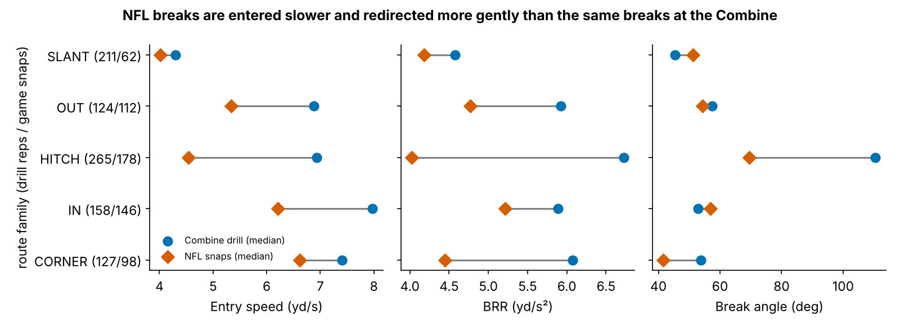
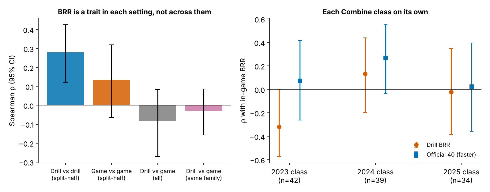
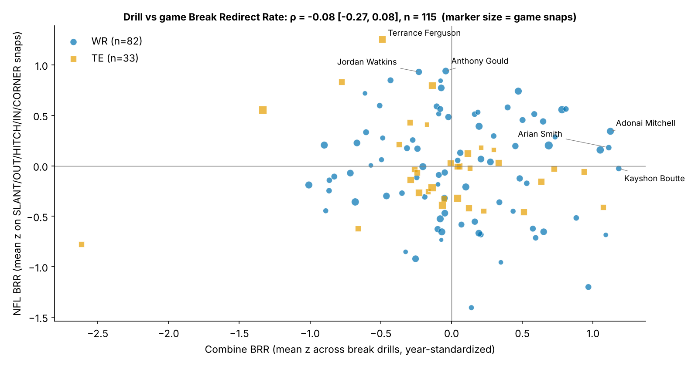
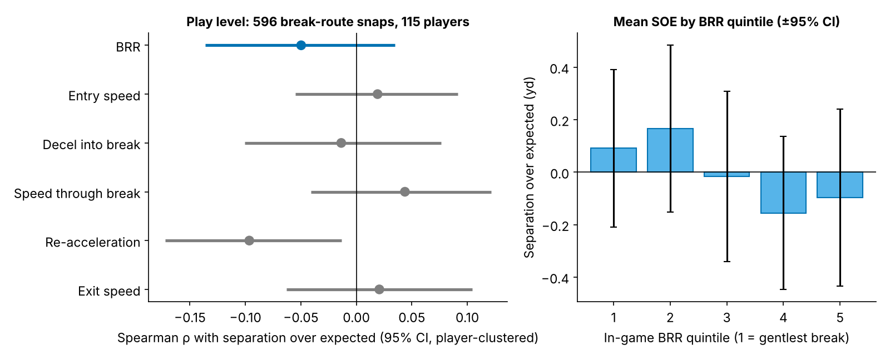
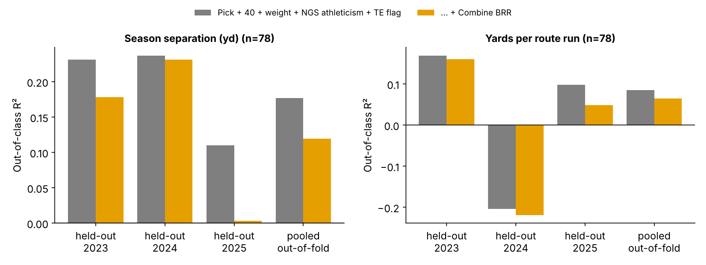

# Break Redirect Rate: the Combine route drills measure a real cutting trait, but not the one receivers use on Sundays

## Summary

- **Metric.** *Break Redirect Rate* (BRR, yd/s²) is the average size of a receiver's acceleration vector over the 1.0 s centred on his break. One number covers braking into the cut, the turn itself and re-accelerating out of it. The same code computes it from 10 Hz x/y in Combine route drills and on NFL snaps of the matching route family (SLANT, OUT, HITCH, IN, CORNER).
- **NFL breaks are not Combine breaks.** On the median NFL snap, BRR is 74% of the Combine value and the receiver enters the break at 5.3 yd/s rather than 6.8 yd/s. Hitches are the extreme case: NFL hitches turn 70° where the Combine curl/comeback/hook turns 110°, at 60% of the drill BRR.
- **Translation is near zero.** For 115 WR/TE with both measurements, drill BRR vs in-game BRR gives ρ = -0.08 [-0.27, 0.08]. Matching on route family gives ρ = -0.03 [-0.16, 0.09] over 303 player-family pairs. Even after correcting for measurement noise, the latent correlation is unlikely to exceed 0.16.
- **Baseline.** Pick, official 40, weight and NGS athleticism explain season separation out-of-class (R² 0.18). Adding drill BRR lowers this to 0.12, and the drop is negative in all three held-out classes.
- **Use.** BRR is worth measuring on NFL (or college) tracking, where about 39 break snaps make it a stable player trait. It should not be read off the Combine route drills.

## Why break mechanics

"Sinks his hips", "doesn't round his breaks" and "sudden out of the cut" are kinematic claims about how quickly the velocity vector changes direction. Combine tracking can measure this directly in 10 route drills, and NFL tracking can measure it on every route. Earlier single-drill correlations with season production in this repo were weak. This candidate asks a narrower, matched question. **Does the way a player breaks at the Combine reappear when he runs the same break in the NFL, and does that break create separation?**

## The metric: Break Redirect Rate

The definition is shared between drills and games:

1. Velocity and acceleration vectors come from Savitzky–Golay derivatives of x/y. The provided `a` is unsigned and `dis` under-counts, so neither is used.
2. The break is the first point after 1.5 yd of travel, entered above 2.5 yd/s, where heading changes by at least 30° between −0.6 s and +0.6 s. The sharpest frame in the next 0.8 s is kept.
3. **BRR** is the mean |acceleration| over ±0.5 s around that point. The components are also kept: entry, apex and exit speed, deceleration into the apex, and re-acceleration out of it.

BRR uses only the receiver's own trajectory, so it works on game tracking without ball or defenders. In drills, the window stops when the ball (if tracked) comes within 1 yd of the receiver. In games, it runs from the snap to 0.6 s after the pass. The break was found in 96% of 926 drill reps and 90% of 665 NFL break-route snaps.

**Standardization.** Drill BRR is z-scored within drill × Combine year, because drill medians drift by up to 2–3 sd between years. Each player's Combine BRR is his mean z across a median of 7 break drills. Game BRR is z-scored within route family × position group, so tight ends are compared only with tight ends.

## Data and design

- **Combine:** 149 players (106 WR, 43 TE) from the 2023–2025 classes with at least one detected break. The drill-to-family mapping is slant and slot strike → SLANT; speed out → OUT; curl, comeback and hook → HITCH; dagger and TE in → IN; slot sail and TE corner → CORNER.
- **NFL:** the repo's regular-season tracking sample, 12 targeted-pass plays per player. That gives 596 break-route snaps with a detected break across 115 players, or 5.2 per player. Half of each player's sample is his highest-|EPA| plays, so every play-level result is repeated on the random half only.
- **Separation over expected (SOE):** separation at pass release minus a linear model of context. The model uses route, throw depth, cushion, man/zone, alignment, time to throw, down, distance and target. It is fitted leave-one-Combine-class-out, so no player's own snaps enter his expectation, and it reaches an out-of-fold R² of 0.20. The model never sees the receiver's movement.
- **Season outcomes:** route-weighted average separation and yards per route run (YPRR) over all regular-season snaps, for 78 players with at least 150 routes.
- **Uncertainty:** 2,000-sample bootstrap 95% CIs, resampled by player whenever plays are pooled.

## Result 1: NFL breaks are gentler than Combine breaks

In every family the NFL receiver enters the break slower and changes velocity more gently than he did in shorts in Indianapolis. Slants are closest, at 91% of drill BRR. OUT routes reach 81% and CORNER routes 73%. Hitches are the extreme: the Combine curl, comeback and hook ask for a 110° stop-and-return, while the median NFL hitch turns only 70° and keeps 60% of the drill BRR. The drills test a maximum-effort, uncovered break that NFL routes rarely call for.

## Result 2: BRR is a trait in each setting, but not across them

- **At the Combine:** a player's BRR on one half of his break drills agrees with the other half at ρ = 0.28 [0.12, 0.43] (n = 145). The Spearman–Brown reliability of the full composite is 0.44, and the mean pairwise correlation between drills is 0.21. Some players really do redirect harder across different drills.
- **In NFL games:** split-half ρ is 0.13 [-0.06, 0.32] at 5.2 snaps per player, which works out to a per-snap reliability of 0.057. Reaching a reliability of 0.7 takes about 39 break snaps, well within one season for a starter.
- **Across settings:** the drill-to-game correlation sits near zero. It is negative in the 2023 class (ρ = -0.32), slightly positive in 2024 (0.13) and flat in 2025 (-0.02). No class supports a positive link.

## Result 3: drill BRR does not predict game BRR; the stopwatch is no better

The two route-drill numbers are the worst predictors. Drill BRR gives ρ = -0.08 and drill speed-through-break gives -0.19 [-0.37, 0.00]. The official shuttle comes closest at ρ = 0.29 [0.00, 0.55], but only 45 players ran it. The 40 (0.13), weight (0.16), NGS athleticism (0.06) and draft slot (-0.03) are all weak.

Is this just noise? The game sample caps the observable correlation at 0.32, so a weak result alone would prove little. Two checks argue against noise:

- **More game snaps.** Building game BRR from every detected break on every route type (8.1 snaps per player, reliability 0.41) still gives ρ = -0.10 [-0.27, 0.07]. With the ceiling raised to 0.42, the upper end of that interval implies a latent correlation of at most 0.16.
- **Matched route families.** Comparing each player's speed-out with his NFL OUTs, his curl/comeback with his hitches, and so on gives ρ = -0.03 [-0.16, 0.09] over 303 pairs.

| Player | Pos, class | Combine BRR (z) | NFL BRR (z) | NFL break snaps | Official 40 |
|---|---|---|---|---|---|
| Kayshon Boutte | WR, 2023 | 1.18 | -0.03 | 4 | 4.50 |
| Adonai Mitchell | WR, 2024 | 1.12 | 0.34 | 8 | 4.34 |
| Arian Smith | WR, 2025 | 1.11 | 0.18 | 4 | 4.36 |
| Terrance Ferguson | TE, 2025 | -0.49 | 1.25 | 7 | 4.63 |
| Anthony Gould | WR, 2024 | -0.04 | 0.94 | 7 | 4.39 |
| Jordan Watkins | WR, 2025 | -0.23 | 0.93 | 6 | 4.37 |

The three best Combine redirectors had ordinary NFL BRR, and the three sharpest NFL breakers were average or below in the drills. Each game value rests on 4–8 snaps: an illustration, not a ranking.

## Result 4: in-game BRR does not by itself create separation

Even if the drills did transfer, would a sharper break help? Across 596 NFL break-route snaps, BRR has ρ = -0.05 [-0.14, 0.03] with separation over expected. The gentlest-break quintile averages +0.09 yd SOE and the sharpest -0.10 yd. Among the components, re-acceleration is slightly negative (ρ = -0.10 [-0.17, -0.01]), and speed through the break is slightly positive but within noise (0.04 [-0.04, 0.12]). On the random half of the sample alone (n = 315), speed through the break gives ρ = 0.04 and BRR gives -0.08.

Separation at the throw likely depends more on timing, leverage and coverage than on cutting violence; a receiver who must re-accelerate hard has usually lost speed he should have kept. Six components were tested, so the single interval that excludes zero should be treated as a hypothesis.

## Result 5: out-of-class prediction of season outcomes

| Outcome | Baseline R² | + Combine BRR | ΔR² [95% CI] | ρ (drill BRR, outcome) |
|---|---|---|---|---|
| Season separation | 0.18 | 0.12 | -0.06 [-0.24, 0.03] | 0.08 [-0.14, 0.31] |
| Yards per route run | 0.09 | 0.06 | -0.02 [-0.29, 0.14] | 0.20 [-0.04, 0.41] |

For YPRR, drill BRR has a weak marginal correlation (0.20). It disappears once the model knows the pick, the 40 and the player's size, and out-of-class it costs accuracy in every held-out class. Swapping in the in-game BRR also adds nothing to season separation (ΔR² -0.02) or YPRR (0.01), consistent with Result 4.

## What a team can take from this

1. **Don't grade receivers' route running from Combine route-drill kinematics.** The drills produce a consistent number, but it describes how a player runs choreographed, uncovered, full-speed breaks, not how he breaks in an NFL route.
2. **NFL break intensity is a measurable player trait, given enough snaps.** About 39 break snaps (half a season for a starter) make BRR reliable on game tracking. That is where to measure it, including on college tracking where available.
3. **Separation is not mainly a cutting-force problem.** Within a route family, sharper redirection did not buy separation at the throw. Look at stems, timing and leverage before "suddenness".
4. **Of the pre-draft numbers, the shuttle tracks NFL break intensity best**, though on only 45 players. It makes a better proxy than any route-drill kinematic.

## Limitations

- **Game sample.** The full NFL tracking was not on disk for this run, so game BRR uses the repo's 12-play-per-player sample (5.2 break snaps per player). Half of those plays were chosen for high |EPA|, though the random half gives the same answers. The headline null should be re-run on every route a player ran; this is the main open risk.
- **Break detection.** The detector picks the first sharp turn. Double moves, option routes and stems with a release move can be mis-assigned, and route labels come from charting. About 10% of game break-route snaps and 4% of drill reps had no detectable break.
- **Single attempts and few TE drills.** Most drills have one rep per player. TE drill families have 40–60 reps, and the TE corner drill was rarely detected.
- **Context model.** The SOE model is linear and fits only 0.20 R². Defender identity, leverage and QB timing are not in the data, so some real break value may be hidden in the context residual.
- **Multiplicity.** BRR was chosen as the headline after exploratory looks at six components. Five families and several baselines were examined, and every interval is reported.
- **Small samples for outcomes.** With 78 season players (20 from the 2025 class) and a minimum detectable ρ of 0.26 at n = 115, small true effects of drill BRR cannot be excluded. Large ones can.

## Reproducibility

`uv run python writeup/candidates/round_01/cand_2/analysis.py` reads only `data/processed/*.parquet`, regenerates every figure, and writes every number quoted here to `numbers.json`. It runs in about one minute.
