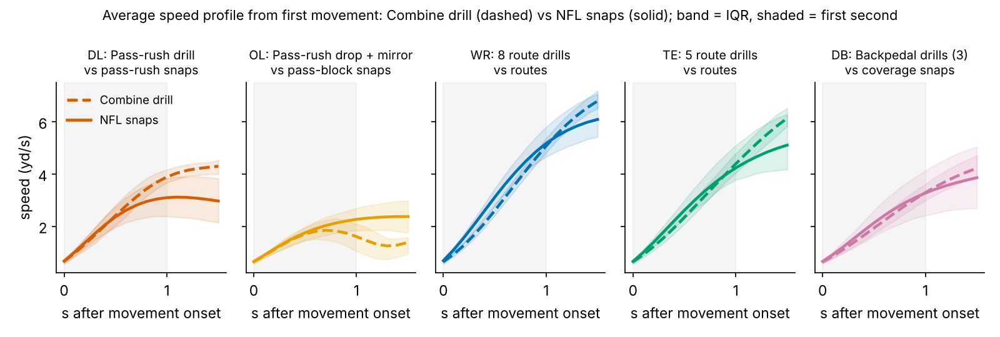
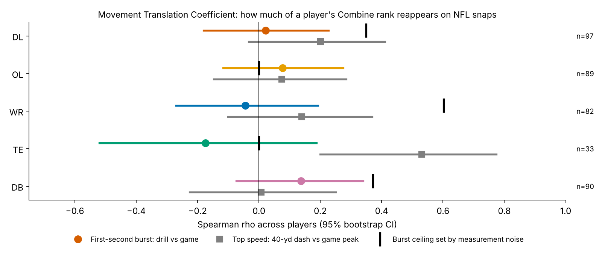
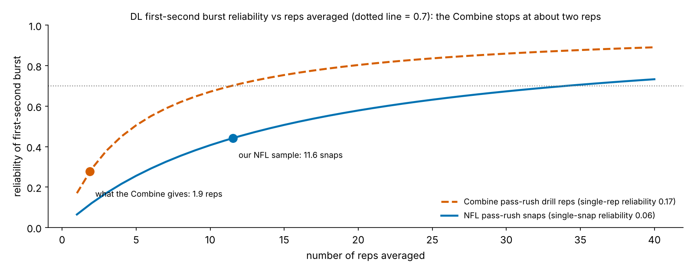
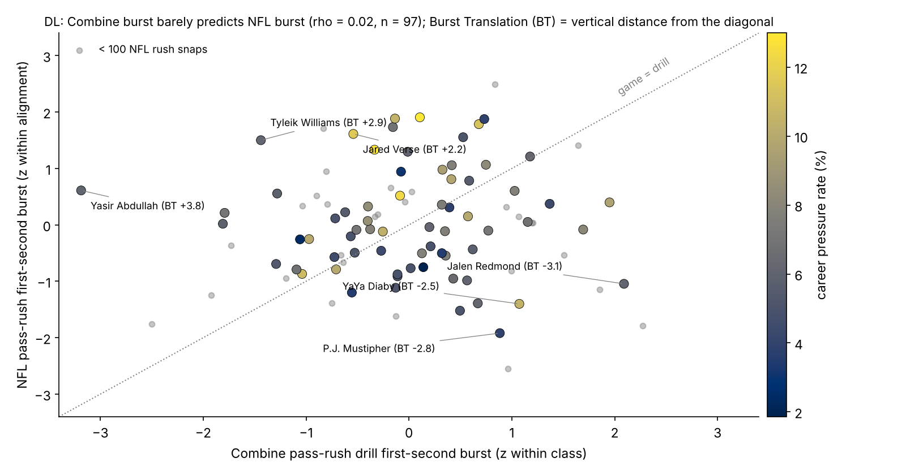
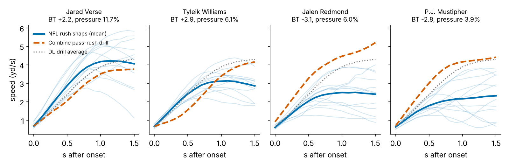
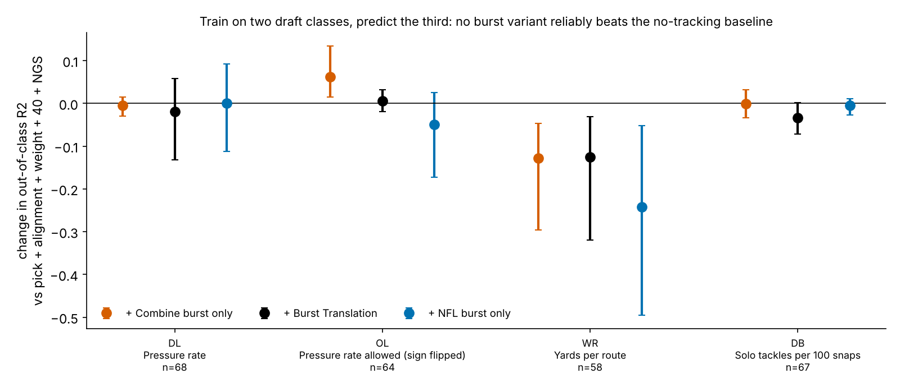

# Lost in Translation: a Player's Combine Burst Does Not Reappear in His First Second on NFL Snaps

## Summary

- **Question.** Does a prospect "play as fast as he tests"? For each player we compare his first second of movement in a Combine position drill with the same profile on NFL snaps of the matching type (pass rushes, pass sets, routes, coverage drops).
- **Metric.** *Burst Translation* (BT) is his NFL first-second burst minus his Combine first-second burst, both computed by the same function from 10 Hz tracking and standardized within position. Positive BT means he is quicker off the mark on Sundays than in Indianapolis.
- **Headline.** In all five position groups, drill ranks do not carry over to game ranks. For defensive linemen, Combine pass-rush-drill burst vs NFL pass-rush burst gives ρ = 0.02 [−0.18, 0.23] (n = 97). Measurement noise alone would still allow ρ up to 0.35. Top speed is the only part of the profile that travels: tight ends reach 0.53 (n = 28) and DL 0.20.
- **Production.** No burst variant (Combine, NFL or the translation gap) improves the out-of-class prediction of NFL production over a no-tracking baseline of draft pick, alignment, weight, official 40 and NGS score. For DL pressure rate, BT changes out-of-class R² by −0.019 [−0.132, 0.058].
- **Why.** One drill rep has burst reliability 0.17 and the Combine gives about two; 0.7 would take about 11 reps. Measure this trait from college or early NFL tracking, not from the drill.

## Why a translation metric

Public audits find that Combine tracking adds about zero R² beyond stopwatch times and draft slot. One reason may be that drills happen in a setting nothing like a game: no snap count, no blocker, no leverage. So the prior question is "does drill X measure the movement the player makes on Sundays?" A drill that fails that test cannot predict production through movement, however it is modelled. A translation metric answers it one player at a time.

## The metric

**One function, two sources.** For every Combine rep and every NFL snap, we find movement onset: the first frame at or above 1.0 yd/s, backed up by at most 0.3 s while speed stays above 0.5 yd/s. In games, the search starts at `ball_snap`. Reps and snaps where the player is already moving at clip start or at the snap are dropped. This measures movement after onset, not reaction time. *First-second burst* is the mean speed over the 1.0 s after onset, which equals yards covered in that second.

**Matched movement types.** Each group is paired with the drills that imitate its game movement:

- DL: pass-rush drill vs pass-rush snaps
- OL: pass-rush drop and mirror drills vs pass-block snaps
- WR: 8 route drills vs routes
- TE: 5 route drills vs routes
- DB: three backpedal drills vs coverage snaps

**Standardization.** Drill medians shift by up to 2–3 sd between Combines. Drill burst is therefore z-scored within drill × Combine year and averaged per player. Game burst is z-scored within group × lined-up position, so an EDGE is compared with EDGEs and a 3-technique with interior linemen. Both player means are then re-standardized within the group, and **BT = game z − drill z**. Tracking contains no ball and no opponents, so every game number refers only to the player's own movement.

## Data and design

- **Players.** 510 prospects from the 2023–2025 classes, with no QBs or RBs. Of these, 392 have both a matched drill rep and at least one usable NFL snap: 2,243 drill reps and 4,208 snap curves (92% of the 4,573 sampled snaps).
- **NFL snaps.** Up to 12 regular-season snaps of the matching type per player (filtered through `games.csv`): six random, six of his highest-|EPA| snaps. Every result is re-run on the random six.
- **Outcomes.** These are career regular-season numbers, oriented so that higher is better:
  - DL: pressure rate (≥100 rush snaps)
  - OL: pressure rate allowed, sign flipped (≥150 blocks)
  - WR and TE: yards per route
  - DB: solo tackles per 100 snaps
- **Baseline without tracking.** This is what a front office already has: log draft pick (UDFA = 262), share of snaps at the wide alignment, weight, official 40 (z within class) and NGS athleticism score.
- **Validation.** Fit on two draft classes, predict the third, pool the out-of-class R²; 2,000 player-level bootstrap draws for CIs. Correlations are Spearman; "beyond pick" is a partial rank correlation controlling for pick and alignment.
- **Reliability.** ICC(1) across a player's reps, stepped up (Spearman–Brown) to the reps he has. The *noise ceiling* √(rel_drill × rel_game) is the largest correlation two noisy measures of one trait could show.

## Finding 1: the average shapes tell a football story

On average, a defensive lineman's NFL rush tracks his drill for about 0.6 s and then flattens at 3.11 yd/s, 1.1 s after onset. In the drill he keeps accelerating to 4.30 yd/s by 1.5 s (Figure 1). That gap is the blocker. Over the first second, DL keep 91% of their drill burst.

Every other group is quicker on Sundays: WR first-second burst is 112% of the drill value (3.03 vs 2.71 yd/s), OL pass sets 112%. Drills are run at a controlled tempo; game starts are not.

## Finding 2: individual ranks do not carry over

| Group | n | Drill reps / NFL snaps per player | Reliability drill / NFL | Burst ρ, drill vs game [95% CI] | Noise ceiling | Top-speed ρ (40 vs game peak) | BT vs outcome beyond pick: ρ (p), n |
|---|---|---|---|---|---|---|---|
| DL | 97 | 1.9 / 11.6 | 0.28 / 0.44 | 0.02 [−0.18, 0.23] | 0.35 | 0.20 | 0.16 (0.202), 68 |
| OL | 89 | 3.0 / 11.3 | −0.34 / 0.09 | 0.08 [−0.12, 0.27] | 0.00 | 0.07 | 0.16 (0.198), 64 |
| WR | 82 | 8.2 / 10.7 | 0.64 / 0.56 | −0.04 [−0.27, 0.19] | 0.60 | 0.14 | −0.14 (0.305), 58 |
| TE | 33 | 5.5 / 10.2 | −0.17 / 0.30 | −0.17 [−0.52, 0.19] | 0.00 | 0.53 | 0.27 (0.231), 21 |
| DB | 90 | 4.7 / 9.3 | 0.44 / 0.32 | 0.14 [−0.07, 0.34] | 0.37 | 0.01 | 0.07 (0.595), 67 |

Receivers are the cleanest test: both sides are reliable (0.64, 0.56), the ceiling is 0.60, yet ρ = −0.04. The drill start is simply not the start used against press or off coverage. OL and TE drill bursts have negative reliability (the averaged drills disagree more than players differ), so there is nothing to translate.

Top speed is the exception, and it is the one Combine profile feature that repeats: the two 40 attempts correlate at 0.99 (n = 375). A Combine feature can travel only if it is reliable to begin with.

## Finding 3: why the drill fails, in reps

A single NFL snap is noisier than a drill rep, because stunts, double teams and play action move every snap. But snaps pile up: a starting edge rusher gets 34 pass-rush snaps in one or two games, while the Combine stops at two reps. Neither the drill as run nor our 12-snap sample can rank players precisely, so the observed ρ must be read against the 0.35 ceiling, not against 1.

## Finding 4: DL, the group with the clearest signal

DL is the one group where something on the NFL side tracks production. Beyond pick and alignment, NFL first-second burst correlates with pressure rate at ρ = 0.25 [−0.01, 0.47] (p = 0.043, n = 68), while Combine burst sits at 0.06. BT inherits a weaker version of that link: 0.16 (p = 0.202).

Named cases (Figure 5):

- **Jared Verse** (pick 19, BT +2.2, pressure 11.7%): below average in the drill (−0.54), among the quickest on NFL rushes (+1.61). The drill undersold him.
- **Tyleik Williams** (pick 28, BT +2.9, 6.1%): same pattern, modest pressure. A fast first second is not a win.
- **Jalen Redmond** (UDFA, BT −3.1, 6.0%) and **P.J. Mustipher** (UDFA, BT −2.8, 3.9%): quick in the drill (+2.09, +0.88), slow off the NFL snap.
- **YaYa Diaby** (pick 82, BT −2.5, 10.5%): the counter-example, a power rusher who wins after first contact.

The top BT quartile averages a 7.4% pressure rate and the bottom quartile 6.1% (n = 68). The difference is real but small, and it does not survive the out-of-class test.

## Finding 5: out-of-class, nothing beats the baseline

For DL the baseline reaches out-of-class R² 0.20 (n = 68). Adding NFL burst changes it by 0.000 [−0.113, 0.092], BT by −0.019, Combine burst by −0.004. NGS **get-off** (snap to first movement) correlates with NFL burst at −0.42; get-off adds 0.073 to the baseline, and NFL burst on top of it adds −0.009 [−0.086, 0.057]. What matters in the first second is the *reaction* get-off already captures, not the movement after it.

In the other groups:

- WR: every burst variant hurts out of class (BT −0.126 [−0.319, −0.031]).
- DB: changes are near zero.
- OL: the one exception is Combine drill burst, +0.063 [0.014, 0.134], positive in all three held-out classes, with *quicker* drill burst going with *more* pressure allowed. Out of 15 group × measure tests, and from a composite with negative reliability, this is a lead to replicate, not a finding.

## A trap worth knowing: best-effort speed and opportunity

A natural "plays to his speed" stat, his three fastest snap peaks over his Combine top speed, appears to predict snaps per season beyond pick for OL (ρ = 0.49), DB (0.31) and TE (0.38) on all 12 sampled snaps. On the six random snaps it becomes −0.09, −0.00 and −0.42. A starter's highest-|EPA| snaps come from a much larger pool and are faster, so any max-of-plays statistic grows with opportunity; compute it on a fixed number of random snaps. BT is not moved by this selection: the random-half re-run gives DL drill-vs-game ρ = 0.00 and BT vs pressure 0.14 (p = 0.254).

## What a team can use

1. **Do not read burst off the Combine position drills as run.** Two reps cannot rank players, and even the reliable WR drills measure a different start. Top speed from the 40 is what carries over.
2. **Measure translation early in the NFL.** About 34 rush snaps make DL first-second burst reliable; BT then shows whether the Combine athlete is showing up (Verse vs Redmond). It diagnoses style, not production.
3. **For pass rush, get-off stays the number.**

## Limitations

- **Small NFL sample.** About 11 snaps per player, half chosen by |EPA|; game-side reliability 0.44 for DL, lower elsewhere. Full game tracking is the first thing to re-run on.
- **Onset is defined by speed.** The metric deliberately excludes reaction time. Players moving at the snap are dropped, which removes most motion snaps for WR.
- **Matched drills are approximate.** The pass-rush drill has no blocker; backpedal drills are coach-cued. TE and OL composites have negative reliability, so their coefficients are uninformative.
- **Multiplicity.** We report 5 groups × 3 measures and two burst windows were explored before 1.0 s was fixed. The DL p = 0.043 does not survive correction.
- **No opponents or ball.** Burst cannot be split by who won the rep. Alignment is controlled; stunts, double teams and play-action are not.
- **Short careers.** The 2025 class has one season; noisy outcomes cap every R² here.

*Reproducible: `uv run python writeup/candidates/round_01/cand_3/analysis.py` writes every number in this text to `numbers.json` and every figure.*
