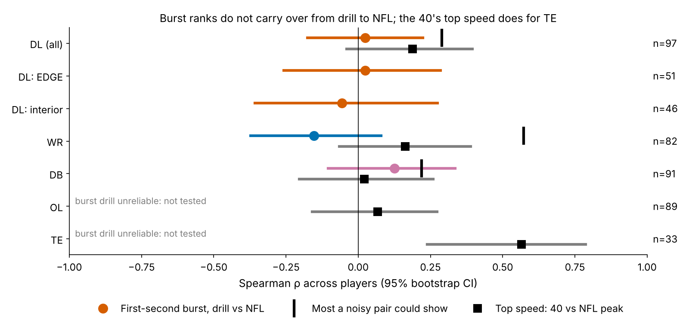
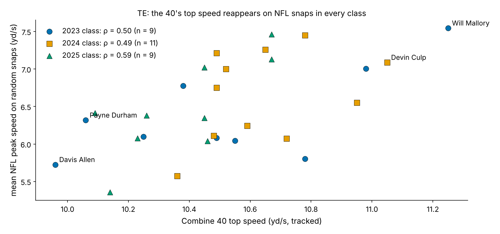

# Combine Burst Does Not Translate: Drill Quickness Doesn't Predict How a Pass Rusher Gets Off the Ball on NFL Snaps

Does the first second a defensive lineman shows in the Combine pass-rush drill reappear on his NFL pass rushes? It does not: drill burst vs NFL burst gives ρ = 0.02 [−0.18, 0.22] (n = 97), and the result is the same for EDGE players, interior players and the pre-contact half-second. What carries over is the 40's top speed (tight ends ρ = 0.57, positive within each of the three classes), so scouts should shrink drill burst heavily and judge get-off on game snaps.

![Figure 1. Six defensive linemen, chosen by rule: the two largest and two smallest Burst Translation values and the two highest pressure rates among the rest. Dashed = his Combine pass-rush drill; blue = his random NFL rushes (thin) and their mean (thick); yellow = the first second, which defines burst. Box: raw z → shrunk z for the drill and NFL, Burst Translation (BT) and shrunk career pressure rate. Verse and Redmond are mirror images; Will Anderson leads the group in pressure with an ordinary drill.](figures/fig1_player_cards.png)

## Why pass rushers, and why now

Get-off is the trait teams pay for in edge rushers, and the Combine pass-rush drill is the only place a prospect shows it on tracking before the draft. If drill burst is the same trait as NFL burst, it belongs on the board. Public audits have found that Combine tracking adds about zero R² beyond stopwatch times and draft slot. That leaves two possibilities: the drill measures the right movement too noisily, or it measures a different movement. Same-player comparisons with game tracking can tell these apart, and that is the question here.

## The metric

**Burst Translation (BT)** is how much more ground a player covers in the first second after he starts moving on an NFL snap than in the matching Combine drill, relative to his position group.

Both sides use one function on 10 Hz tracking, and both are shrunk toward the group mean according to how many reps a player has (Appendix). BT is in true-score standard deviations: +1 means one sd quicker on Sundays than in Indianapolis.

**Data.** 510 prospects (2023–2025 classes). We use 2,243 matched drill reps and 2,166 NFL snap curves from the *random* half of the repo's game sample. The ETL drew each player's six highest-|EPA| snaps and then six random ones; the high-|EPA| half appears only as a sensitivity check. DL pass rushes are compared with the pass-rush drill, WR routes with 8 route drills, and DB coverage snaps with 3 backpedal drills. OL and TE drill composites have negative reliability (drill-side −0.34 and −0.17), so we do not compute burst for them and use only their 40.

## Finding 1: the drill's first second is not the game's first second

- **DL.** ρ = 0.02 [−0.18, 0.22], against a noise ceiling of 0.29. The null holds within alignment (EDGE 0.02, n = 51; interior −0.06, n = 46). It also holds in the 0–0.5 s window, before most rushers reach a blocker (0.03 [−0.18, 0.22]), so the plateau at contact does not explain it. Using all 12 snaps gives 0.03.
- **WR.** The cleanest test, because both sides are reliable (ceiling 0.57). Game burst is adjusted for alignment, man/zone and press/off, and still ρ = −0.15 [−0.37, 0.08]. Corrected for noise, the true-score correlation is −0.20 [−0.59, 0.20]. Dont'e Thornton (pick 108) shrinks to +2.2 in the drills and −0.5 on routes; Tyler Scott (pick 133) is the reverse (−0.9, +1.6).
- **DB.** ρ = 0.13 [−0.10, 0.34] with the same controls. Jaylon Jones (pick 221: +1.1 drill, −0.5 game) and Jason Taylor (pick 234: −1.3, +0.4) are the extremes.

| Group | Single-rep reliability, drill / NFL snap | Reps for 0.7, drill / NFL | Combine gives | Burst ρ [95% CI] |
|---|---|---|---|---|
| DL (n = 97) | 0.17 / 0.07 | 11 / 31 | 1.9 | 0.02 [−0.18, 0.22] |
| WR (n = 82) | 0.18 / 0.16 | 11 / 12 | 8.2 | −0.15 [−0.37, 0.08] |
| DB (n = 91) | 0.14 / 0.03 | 14 / 90 | 4.7 | 0.13 [−0.10, 0.34] |

## Finding 2: a shrunk, ranked board of DL burst

Raw z-score differences overstate how much players differ, because one drill rep is mostly noise. A random-intercept model (Appendix) keeps a median 0.29 of each player's drill deviation and 0.31 of his NFL deviation. That cuts the spread of BT from 1.40 to 0.76 sd. The table shows the ends of the shrunk board (pressure is beta-binomial shrunk by rush snaps).

| Player (pick, role) | Drill z raw → shrunk | NFL z raw → shrunk | BT | Pressure % (rush snaps) |
|---|---|---|---|---|
| Yasir Abdullah (136, EDGE) | −3.2 → −1.7 | +1.2 → +0.7 | +2.4 | 7.5 (149) |
| Jared Verse (19, EDGE) | −0.5 → −0.3 | +2.7 → +1.5 | +1.8 | 11.4 (1236) |
| Tyleik Williams (28, interior) | −1.4 → −0.8 | +1.2 → +0.7 | +1.4 | 6.3 (245) |
| Will McDonald (15, EDGE) | −0.1 → 0.0 | +2.4 → +1.3 | +1.4 | 10.4 (1109) |
| Yahya Black (164, interior) | −1.8 → −1.0 | +0.3 → +0.1 | +1.1 | 6.2 (189) |
| P.J. Mustipher (UDFA, interior) | +0.9 → +0.3 | −1.7 → −1.0 | −1.3 | 5.4 (129) |
| Dylan Horton (109, EDGE) | +0.5 → +0.3 | −1.8 → −1.0 | −1.3 | 5.9 (532) |
| Cam Horsley (UDFA, interior) | +1.9 → +1.0 | −0.7 → −0.6 | −1.6 | 6.2 (11) |
| Zion Logue (197, interior) | +2.3 → +1.3 | −1.1 → −0.6 | −1.8 | 5.3 (58) |
| Jalen Redmond (UDFA, interior) | +2.1 → +1.2 | −1.4 → −0.8 | −2.0 | 6.2 (596) |

Scouting read: Verse and McDonald were ordinary in the drill and are among the quickest rushers on Sundays. Logue and Redmond were explosive in Indianapolis and are below average off the ball on NFL rushes. The "quicker in Indianapolis" end is mostly interior and late-round. Their drill burst would have flagged them as sleepers, and it was the wrong flag.

## Finding 3: the production link is suggestive and does not survive correction

The no-tracking baseline is draft pick, EDGE share of snaps, weight, official 40 and NGS athleticism score. It is fit on two draft classes and predicts the third. The outcome is pressure rate shrunk by rush snaps, with no snap cut, and the fit is weighted by its reliability. Out of class it reaches R² 0.34; pick alone gives 0.03 and pick plus EDGE share 0.36.

- **NFL burst** adds 0.016 (repeated-draw range −0.127 to 0.068). It improves 2 of 3 held-out classes, with permutation p = 0.051 and Holm-adjusted p = 0.866.
- **BT** adds 0.005 (−0.108 to 0.041), p = 0.116. **Combine drill burst** adds 0.001.
- **After NGS get-off** is in the model, NFL burst adds −0.005. NFL burst and get-off overlap (ρ = −0.34), and get-off itself mostly follows body weight (ρ = 0.72).

Across all 18 tests in this writeup, one survives Benjamini–Hochberg correction, and it is the top-speed result below.

## Finding 4: what does translate is top speed

The 40 is the one Combine movement that is measured reliably: two attempts correlate at 0.99 (n = 375). For tight ends it reappears on NFL snaps, with ρ = 0.57 [0.24, 0.79] (n = 29, Holm p = 0.025). Within each class it is 0.50, 0.49 and 0.59. Calibrated on two classes and applied to the third, it explains R² 0.30 of NFL peak speed (bootstrap −0.46 to 0.50; ~9 TEs per class). Will Mallory (pick 162; 11.2 yd/s top speed, 7.5 yd/s mean game peak) and Devin Culp (246; 11.1, 7.1) carry their speed onto the field; Davis Allen (175; 10.0, 5.7) and Payne Durham (171; 10.1, 6.3) play to their slower 40. The honest caveat is that the official 40 time does as well (0.29); the stopwatch already holds this signal. For DL the link is weaker (0.19 [−0.04, 0.40]).

## What a team can use

1. **Rule for scouts.** Treat a Combine pass-rush-drill burst as reliability 0.28. Shrink it about 70% toward the position mean, as in the table, and never let it move a player more than his 40 would. Read DL burst from game tracking only after at least 31 random rush snaps (college or NFL), which is when it reaches 0.7.
2. **Drill protocol.** One pass-rush rep has reliability 0.17. Three reps would give 0.38, five 0.5 and 11 the 0.7 that a number needs before it ranks players. The backpedal drills need 14. If time is fixed, cut the backpedal and second pass-rush rep and spend it on the 40, whose top speed is the one movement that both repeats and reappears.
3. **For pass rush, get-off and alignment carry the information.** EDGE share alone takes the baseline from 0.03 to 0.36.

## Limitations

- **Game sample.** About six random snaps per player from the repo sample; the full 2.3 GB game tracking was not on disk. NFL single-snap reliability for DL is only 0.07, so this null should be re-run on full tracking before it is final.
- **No opponents or ball.** We cannot isolate clean releases, stunts or double teams. Alignment is controlled, and the pre-contact window is the closest proxy we have for an unblocked first step.
- **The drill has no blocker.** That is the construct question itself. The pre-contact result says the mismatch starts before contact.
- **Outcomes.** Careers are short (the 2025 class has one season, and its held-out baseline R² is −0.276). DB coverage outcomes are not in the data, so WR and DB results are translation only.
- **Multiplicity and forking paths.** The 1.0 s window was fixed in round 1 after viewing 0.5/1.0/1.5 s. All 18 tests are reported with Holm/BH; one survives.

## Appendix: metric details

Onset is the first frame at or above 1.0 yd/s, backed up by up to 0.3 s while speed stays above 0.5 yd/s. In games the search starts at the snap. Reps already moving at clip start or at the snap are dropped, so the metric excludes reaction time. Burst is the mean speed over the 1.0 s after onset. Drill burst is z-scored within drill × Combine year. Game burst is residualized on alignment (plus man/zone and press/off, cushion ≤3 yd, for WR, TE and DB). Player means are empirical-Bayes posteriors from a one-way random-intercept model (ANOVA variance components), divided by the between-player sd. Pressure uses a beta-binomial prior by EDGE/interior (prior weight 148 and 152 rush snaps). Correlations are Spearman with 2,000 player bootstraps. The noise ceiling is √(rel_drill × rel_NFL) at the reps observed.

*Reproducible: `uv run python writeup/candidates/round_01/revised/analysis.py` writes every number here to `numbers.json` and every figure.*
