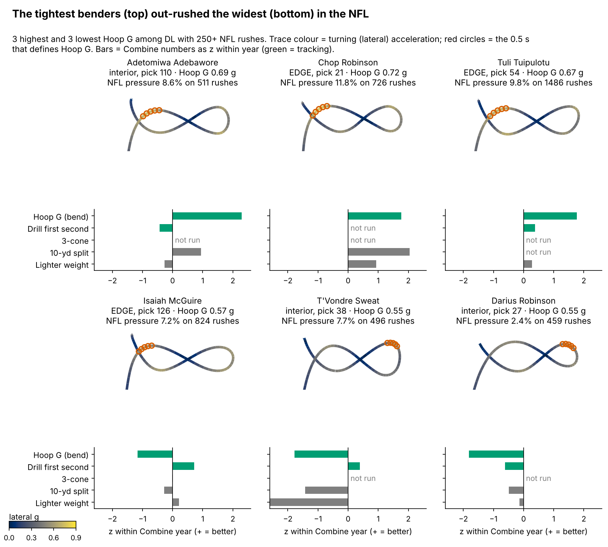
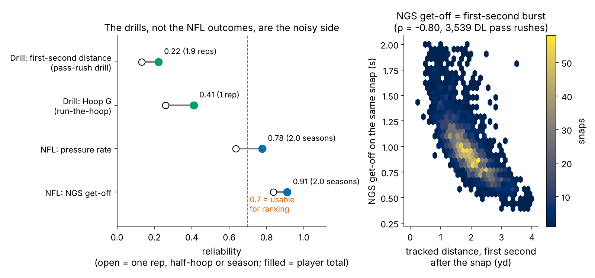
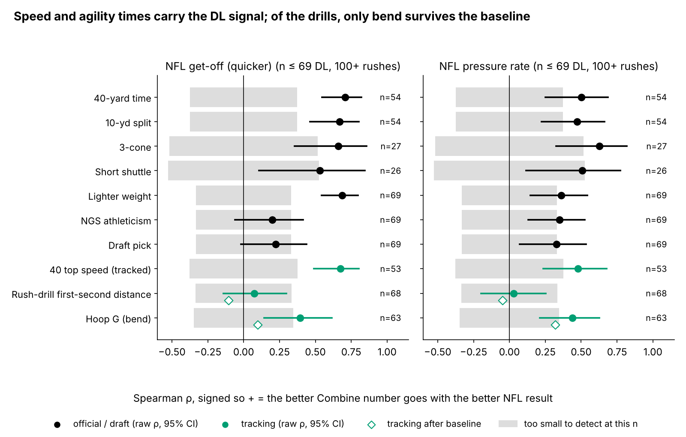
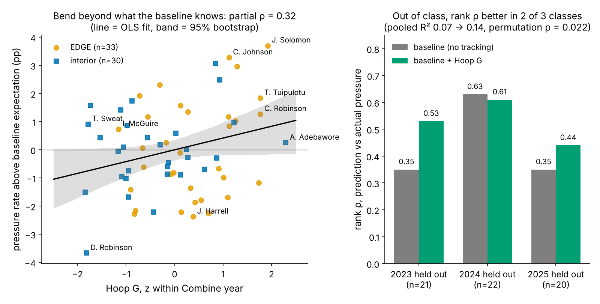
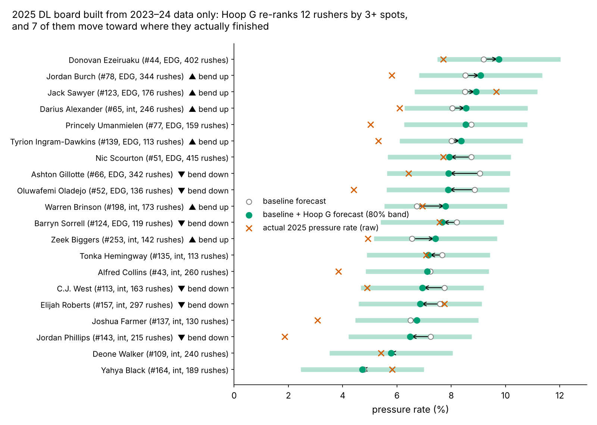

# Bend Shows Up on Sundays; Drill Burst Can't Be Measured Yet

A pass rusher who is a tenth of a second slow off the ball reaches the quarterback later, and NFL get-off goes with pressure even after size, speed and draft slot are accounted for (ρ = 0.36 [0.16, 0.55], n = 69). Teams therefore want the Combine to tell them who will get off and who will bend. We tracked both traits through the 10 Hz Combine drills for 118 defensive linemen from the 2023–2025 classes. **Bend reappears:** Run-the-Hoop "Hoop G" goes with NFL pressure beyond a no-tracking baseline (partial ρ = 0.32 [0.06, 0.57], n = 63) and improves rank forecasts for held-out classes. **Burst does not, but this sample cannot settle it.** With two noisy reps, the pass-rush drill's first second could only reveal a true link of 0.78 or more, so its null tells you about the drill, not the player.

## The two traits and how we measure them

**Bend: Hoop G.** In Run-the-Hoop, the player sprints a figure-eight around two hoops on the ground. Turning at speed *v* on a radius *r* takes a sideways (centripetal) force of *v²/r*. Hoop G is the largest sideways acceleration a player holds for half a second, in g. Tight and fast scores high; wide or slow scores low. The 119 runs have a median of 0.62 g (10th–90th percentile 0.57–0.68).

**Burst: first-second distance.** This is how many yards a player covers in the first second after he starts moving. In the pass-rush drill the clock starts at his first movement, so reaction time is excluded. On NFL snaps it starts at the snap.

**NFL get-off** is the Next Gen Stats time from the snap until the rusher gets going, recorded on every pass rush. It is the full-season version of our burst measure: on the 3,539 sampled DL rushes where we have both, the tracked first-second distance correlates −0.80 with NGS get-off on the same snap (Figure 2, right).

**NFL pressure** comes from the league's play-level charting, which flags whether a rusher pressured the passer and how quickly. We cannot rebuild it from the tracking sample, which has no ball and no opponents. Pressure rate is pressures per pass-rush snap, filtered to regular-season games. It is shrunk toward one pooled DL mean (8.1%, prior weight 117 rushes). We deliberately do not use separate EDGE and interior priors, because those would build alignment into the outcome.

All drill numbers are standardized within Combine year. The main cohort is the 69 DL with 100+ NFL rushes (36 EDGE, 33 interior, median 297 rushes).

## Why round 1's burst null was uninformative, and what fixes it

Round 1 measured NFL burst from about six tracked snaps per player, and a single tracked snap is mostly noise (reliability 0.18 for first-second distance), so a null there meant little. NGS get-off removes that limit. It covers every rush, it repeats season to season at 0.84 (40 player pairs), and it reaches 0.91 over a typical career here. Pressure rate repeats at 0.64. **The outcomes are measurable. The drills are the weak side.** One pass-rush-drill rep has reliability 0.13 (101 players with two reps), and the 1.9 reps a player has give 0.22. It would take 16 reps to reach the 0.7 needed to rank players. Hoop G is better: 0.41 from a single run, and 4 runs would reach 0.7.

## Finding 1: the stopwatch already carries most of the DL signal

The known signal holds. For pressure, the 3-cone gives ρ = 0.63 (n = 27), the shuttle 0.51 (n = 26), the 40 0.50 and the 10-yard split 0.47 (n = 54). For get-off it is mostly a size story: lighter players get off faster (ρ = 0.69). The tracked 40 top speed is as strong as the official 40, but adds nothing beyond it (out-of-class ΔR² −0.092, n = 53). Teams have the stopwatch already, so the question is what tracking adds on top of it.

**Baseline without tracking:** Combine weight and the 10-yard split and 3-cone (all year-standardized), the NGS athleticism score, log draft pick and NFL EDGE share. Missing times (3-cone missing for 42 of 69) are imputed from weight and EDGE share inside each training fold, never from the outcome. Validation is leave-one-class-out: fit on two classes, predict the third.

## Finding 2: bend adds to pressure; drill burst adds nothing detectable

| Test (cohort, 100+ rushes) | Partial ρ after baseline [95% CI] | Smallest detectable, observed / true | Out-of-class ΔR² [95% CI], permutation p | Verdict |
|---|---|---|---|---|
| Hoop G → pressure (n = 63) | 0.32 [0.06, 0.57] | 0.36 / 0.64 | +0.073 [−0.086, 0.214], p = 0.022 | lead |
| Drill first second → NGS get-off (n = 68) | −0.11 [−0.33, 0.13] | 0.35 / 0.78 | −0.006 [−0.040, 0.026], p = 0.405 | cannot detect |
| Drill first second → pressure (n = 68) | −0.05 [−0.33, 0.19] | 0.35 / 0.84 | not run | cannot detect |
| Hoop G → NGS get-off (n = 63) | 0.10 [−0.20, 0.38] | 0.36 / 0.59 | not run | weight explains it |

*"True" is the smallest real effect we could detect after measurement noise on both sides attenuates it.*

**Bend.** One sd of Hoop G is worth +0.64 pressure-rate points (95% CI 0.17 to 1.12) beyond the baseline, or about 2.9 extra pressures over a 450-rush season. The effect is the same for EDGE and interior players (0.33 each, n = 33 and 30). It holds at a 50-rush cut (0.26, n = 75) and a 200-rush cut (0.33, n = 47). It also holds without EDGE share in the baseline (partial 0.31; out-of-class ΔR² +0.103). Out of class, R² rises from 0.07 to 0.14 and improves in all three held-out classes. Rank correlation improves in two of three: 2023 0.35 → 0.53, 2024 0.63 → 0.61, 2025 0.35 → 0.44. Across the four tests in the table, Holm-adjusted p = 0.063. Hoop G is unrelated to draft slot (ρ = 0.01, n = 109), so the draft has not priced it in. Lighter players bend better (ρ = −0.44 with weight), which is why weight is in the baseline.

**Burst.** Drill first-second distance does not move NGS get-off or pressure beyond the baseline. We cannot rule out a real link. The equivalence test against |ρ| < 0.30 only reaches p = 0.060, and any real effect below about 0.78 would be invisible with drill reliability at 0.22. The verdict is conditional: *with two reps, the drill cannot detect a link.* One exploratory lead turned up after looking, so treat it as a hypothesis. The drill's first second does track the **tracked** first second on 20 random NFL snaps (partial ρ = 0.33 [0.09, 0.54], n = 68). The link is concentrated in EDGE players (0.42, n = 42; interior 0.03, n = 43). NGS get-off weights the snap reaction, which the drill excludes. So the drill may capture post-start acceleration rather than get-off.

**Opportunity and injury.** Pressure rate is only defined for players who get on the field. Hoop G does not predict NFL rush snaps per season (ρ = 0.05, n = 109) or games per season (0.04), while draft pick does (0.71). Among hoop runners, 57% of above-average benders and 58% of below-average benders reached 100 rushes. The data have no injury list, so games missed for injury and games missed for being benched look the same. Neither is related to bend.

## A 2025 draft-room card, built blind

This is the card a team would have had in April 2025. Adding Hoop G lifts the forecast-to-actual rank correlation from 0.35 to 0.44 (n = 20). It moves 12 rushers by three or more spots, and 7 of them move toward where they finished. Warren Brinson (pick 198) and Zeek Biggers (pick 253) are bend-up late picks. Ashton Gillotte, Oluwafemi Oladejo and Jordan Phillips are bend-down, and all three finished below their baseline forecast. Levels run high, because rookies pressure less than the 2023–24 average (forecast mean 7.6% vs actual 6.7%), so **use the card for order, not for levels**. Fold R² for 2025 is negative for both models (baseline −1.18) for the same reason.

Named examples from the full cohort (Figure 1): Chop Robinson (pick 21, 0.72 g) is the first-round case where bend and pick agreed, at 11.8% pressure. Tuli Tuipulotu (pick 54, 0.67 g) sustained 9.8% over 1,486 rushes. Darius Robinson (pick 27, 0.55 g) is the low-bend first-rounder, at 2.4%. Javon Solomon (pick 168) has the largest gain over his baseline expectation in Figure 4.

## What a team can use

1. **Run the hoop, then shrink it.** Read one Hoop G run as reliability 0.41, so a +2 sd run counts as about +0.8 sd of true bend. Use it as a tiebreaker among rushers with similar size and times, for EDGE and interior alike. About 4 timed runs per prospect would make it a ranking number.
2. **Do not read get-off off the Combine pass-rush drill.** It needs 16 reps to reach usable reliability. For college players, use the stopwatch (10-yard split, 3-cone) and film. For NFL players, NGS get-off is reliable after one season.
3. **What would change my mind.** Hoop G has been tested only on these three classes. If the 2026 class (about 20 rushers with 100+ snaps) shows a partial ρ of −0.18 or lower, the pooled interval includes zero and Hoop G should come off the board.

## Limitations

- **Not an independent replication.** Hoop G was the strongest of six drill metrics screened in round 1 on these same players. The stricter outcome and the added sensitivity checks do not remove that selection. The permutation p (0.022) does not correct for it, and the Holm p (0.063) does not clear 0.05. The 2026 class is the real test.
- **Small n.** 63 players, about 20 per held-out class. The out-of-class ΔR² interval includes zero.
- **Thin drill data.** Only 10 players ran the hoop twice, so its reliability comes from split halves of single runs. The 3-cone exists for 27 of the 69 cohort players, so most baseline 3-cones are imputed.
- **No ball or opponents in the tracking.** Pressure comes from league charting and mixes in scheme, stunts and blocker quality. The burst lead uses 20 random snaps per player and was found after looking.
- **Short careers.** The 2025 class has one season, which is why its level forecasts are off.

## Appendix: methods

Positions are Savitzky–Golay smoothed (window 7, order 2). Sideways acceleration is |v × a|/|v|, averaged over a rolling 0.5 s, and Hoop G is its maximum. Movement onset is the first frame at or above 1.0 yd/s, backed up by up to 0.3 s while speed is at least 0.5 yd/s. Reps already moving at clip start are dropped. Partial ρ is Spearman computed on baseline-residualized ranks, with 2,000 player bootstraps. Smallest detectable effects use Fisher z at 80% power and two-sided α = 0.05, with six covariates. True-scale values divide by √(drill reliability × outcome reliability). Out-of-class models are OLS with imputation fit on the training classes only. The permutation test uses 1,000 within-class shuffles. The 2026 rule pools Fisher z with weights n − 9.

*Reproducible: `uv run python writeup/candidates/round_02/cand_1/analysis.py` writes every number to `numbers.json` and draws every figure.*
