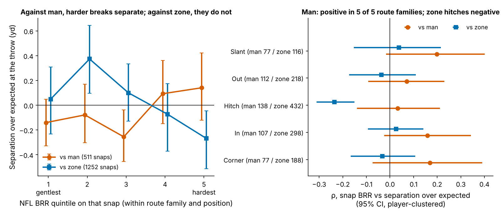
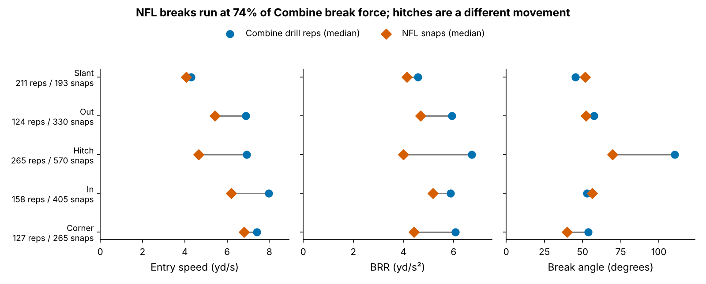

# Break Force Beats Man Coverage, but the Combine Can't See It

## Why this matters

A Day-2 receiver costs a team a starter-quality pick. He is often sold on "suddenness": he sinks his hips, doesn't round his breaks, and explodes out of the cut. Combine tracking now records ten route drills at 10 Hz, so it is tempting to grade suddenness from those drills. If the drill number doesn't carry into the NFL, that grade is noise priced as a trait. This entry measures one break number the same way in the drill and in NFL games. It then asks two questions: does the number carry over, and does it win anything on Sundays?

## Summary

- **Metric.** *Break Redirect Rate* (BRR, yd/s²) measures how hard a receiver changes his velocity in the second around his break. Braking, turning and re-accelerating all count. The same code computes it on Combine route drills and on NFL snaps of the matching route family (slant, out, hitch, in, corner).
- **Lead: break force pays only against man coverage.** On 1,763 NFL break snaps by 115 WR/TE, a harder break goes with more separation over expected against man (ρ = 0.09 [0.01, 0.17]) and less against zone (ρ = −0.09). The gap of 0.18 [0.08, 0.28] holds up on the random half of the sample and after correcting for 18 tested contrasts.
- **The Combine drill cannot be linked to it.** Combine BRR vs NFL BRR gives ρ = −0.13 [−0.31, 0.04] (n = 115, 15.3 break snaps each). This sample could easily miss a modest true link: power to detect a true correlation of 0.3 is only 25%. But the estimate landed on the wrong side of zero, so a true link of 0.3 or more is unlikely (one-sided p = 0.004). After allowing for uncertainty in both reliabilities, the 95% upper bound on the true correlation is 0.08.
- **Use.** Give the route-drill kinematics zero weight. Grade break force on tape or tracking against man, and don't reward a hard stop on a zone hitch.

## The metric

1. Speed and acceleration come from smoothed derivatives of the x/y position.
2. The **break** is the first sharp turn (≥ 30° within ±0.6 s) after 1.5 yd of travel, entered above 2.5 yd/s.
3. **BRR** is the average size of the acceleration over the 1.0 s centred on the break.

BRR needs only the receiver's own path, so it works on game tracking without the ball or defenders. The break was found in 96% of 926 drill reps and 89% of 1,988 NFL break-route snaps. Drill values are standardized within drill × Combine year, because drill medians drift between years. Game values are standardized within route family × position, so tight ends are compared only with tight ends.

**Data.** The Combine side covers 149 WR/TE from the 2023–2025 classes, with a median of 7 break drills each. The NFL side is the repo's regular-season tracking sample: up to 40 plays per player, half of them random and half the highest-|EPA| plays. The random half is the stored ETL flag, and every finding is repeated on it. **Separation over expected (SOE)** is separation at the throw minus a context model. The context model uses route, depth, cushion, man/zone, alignment, time to throw, down and distance. It is fitted leave-one-class-out (out-of-fold R² 0.21) and never sees the receiver's movement.

## Finding 1 (lead): break force wins against man, not zone

Against man coverage, the hardest-breaking fifth of snaps averaged +0.14 yd of separation over expected, against −0.14 yd for the gentlest fifth. That is about 10.1 inches. Against zone, the pattern reverses: from +0.05 yd to −0.27 yd. Zone hitches drive the reversal (ρ = −0.23), consistent with "find the window and settle" rather than "snap it off". Against man, the correlation is positive in all 5 route families.

How much to trust it:

- It replicates on the random half: a man-minus-zone gap of 0.27, compared with 0.11 on the high-|EPA| half.
- It is the strongest of 18 contrasts tested (6 break components × man/zone, slot/wide and sample half). Its Holm-adjusted p is 0.018. Only one other contrast survives adjustment: entry speed, slot vs wide.
- The effect sits **between** players rather than within them. A player's own harder-than-usual breaks gain him almost nothing (within-player ρ = 0.03 against man). This points to a trait, which is what scouting is for.

The effect is small, so treat this as a lead, not a rule.

## Finding 2: Combine BRR cannot be linked to NFL BRR

BRR is a real, if noisy, trait in each setting. Combine halves (disjoint drills) agree at ρ = 0.28, a reliability of 0.44. NFL halves agree at 0.23, a reliability of 0.37 at 15 snaps, or 0.037 per snap. Between the two settings the link vanishes, at ρ = −0.13 [−0.31, 0.04]. Matching each player's speed-out to his NFL outs, his curls to his hitches, and so on gives −0.07 over 436 player-family pairs.

None of the 11 subsets in Figure 3 has a CI above zero. That covers random vs high-|EPA| snaps, slot vs wide, man vs zone and each Combine class. The official 40 (ρ = 0.06) and shuttle (ρ = 0.12, n = 45) are no better.

**Read this as conditional.** With these reliabilities, the smallest observed correlation this sample detects 80% of the time is 0.26, which corresponds to a true correlation of 0.64. So the sample cannot *detect* a modest link. It can, however, *bound* one. A true correlation of 0.3 would show up as 0.12 on average, and the sample produced −0.13. The bootstrap that resamples players, and so carries uncertainty in both reliabilities, puts the 95% upper bound on the true correlation at 0.08.

## Finding 3: NFL breaks are not Combine breaks

NFL breaks run at 74% [72, 76] of Combine BRR, entered at 5.3 yd/s rather than 6.8. The hitch is a different movement altogether: the Combine curl, comeback and hook turn 110°, while the NFL hitch turns 70°, at 59% of the drill force.

## Season outcomes, out of class

| Outcome (78 players, ≥ 150 routes) | Baseline R² | + Combine BRR | ΔR² [95% CI] | 2025 fold: base → + BRR |
|---|---|---|---|---|
| Season separation | 0.18 | 0.13 | −0.05 [−0.22, 0.08] | 0.18 → 0.08 |
| Yards per route run | 0.11 | 0.08 | −0.02 [−0.35, 0.12] | 0.12 → 0.07 |

The baseline uses no tracking: draft slot, the 40 and weight (both standardized within year × position), NGS athleticism and a TE flag. The model is a ridge, trained on two classes and scored on the third. The outcomes are stable enough to predict, with season-to-season ρ of 0.62 for separation and 0.54 for YPRR (46 player pairs). Adding Combine BRR lowers out-of-class accuracy, including in the 2025 fold.

## Draft-room card

| Input | WR | TE | What would change my mind |
|---|---|---|---|
| Combine route-drill BRR | Record it, weight 0. Drill→NFL ρ = −0.05 [−0.26, 0.17], n = 82 | Weight 0. ρ = −0.35 [−0.63, 0.03], n = 33 | A new class, scored with this code, shows ρ ≥ 0.12 with its CI above 0 |
| Break force vs man (tape or college tracking) | Primary route trait. Snap ρ with SOE 0.10 [0.00, 0.19] | Secondary. ρ = 0.10 [−0.08, 0.28] | Effect gone on a fresh season of random snaps |
| Hard stop vs zone (hitches) | Do not reward it. ρ = −0.10 [−0.17, −0.04] | Neutral. ρ = −0.04 [−0.14, 0.08] | — |
| Snaps before trusting a player's BRR | 61 break snaps for reliability 0.7 | Same | — |

**Disagreement flag.** For 19 of 115 players, the shrunk Combine and NFL scores differ by more than their combined 80% interval. Kayshon Boutte (pick 187) had the best Combine BRR in the cohort, at 1.67 sd [0.92, 2.43], but an ordinary NFL BRR of 0.26 [−0.75, 1.27] over 16 snaps. Jonathan Mingo (pick 39) was average in the drills (−0.03) and among the sharpest NFL breakers (1.34 [0.38, 2.30], 20 snaps). Terrance Ferguson (pick 46), a tight end, shows the same pattern: −0.37 in the drills and 1.76 [0.75, 2.77] in the NFL. A typical NFL interval is ±1.01 sd at 15 snaps, so these cards flag players for film review; they are not rankings.

**Scout takeaway.** "Sudden in the drills" is not evidence of sudden on Sundays. Against man, the hardest-breaking snaps gain about 10.1 inches of separation over the gentlest. Find the receiver who breaks hard against man on tape, not in Indianapolis.

## Limitations

- **Game sample.** The game side has up to 40 plays per player, which gives 15.3 break snaps and a game reliability of 0.37. Every player interval is wide, and the non-transfer result is a bound conditional on the measured reliabilities, not proof of no link.
- **No defenders or ball in game tracking.** Man/zone comes from charted coverage. Leverage, press and the defender's own break are unseen, so a confound inside the man-coverage effect remains possible.
- **Break detection.** The detector takes the first sharp turn, so double moves and option routes can be mis-assigned. 11% of NFL break-route snaps had no detectable break.
- **Multiplicity and forking paths.** BRR was the round-1 metric. The man/zone split was one of 18 contrasts and was chosen after looking, and all 18 are disclosed.
- **Opportunity and injury.** Injury data are not available. Per-snap metrics avoid volume effects, but season outcomes need 150 routes, which drops injured and buried players, and only 20 of the 78 season players come from the 2025 class.
- **The drills.** Most drills have a single rep per player, the TE drills are small, and the drills are uncovered and choreographed, which may be exactly why they don't transfer.

## Appendix: statistics

- Reliability: Combine split-half ρ = 0.28 [0.12, 0.43] (n = 145) and mean inter-drill ρ = 0.21. NFL split-half ρ = 0.23 [0.04, 0.40].
- Power: power to detect a true correlation of 0.3 is 25%, and 58% for 0.5. The equivalence test against a true correlation of 0.3 gives p = 0.004. The point estimate of the true correlation is −0.33, with a 95% upper bound of 0.08.
- Man vs zone, snap level: man 0.09 [0.01, 0.17], zone −0.09 [−0.14, −0.03]. On the random half alone, man 0.16 and zone −0.12.
- Shrinkage: empirical Bayes on the z scale, with per-unit reliabilities of 0.21 per drill and 0.037 per snap, reported in true-score sd units.
- Reproduce: `uv run python writeup/candidates/round_02/cand_2/analysis.py` (about two minutes, reads `data/processed` only). Every quoted number is written to `numbers.json`.
