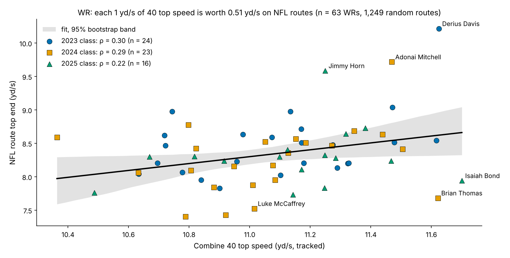
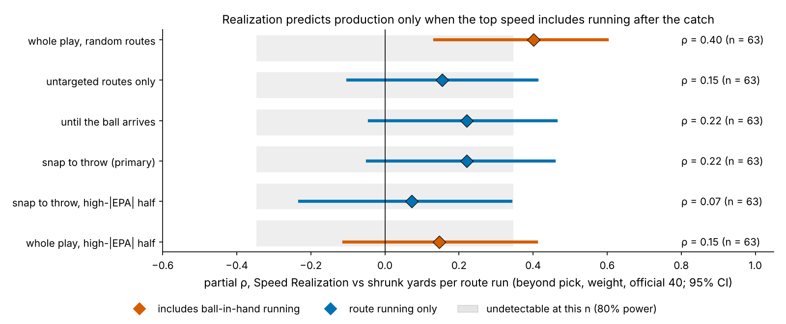
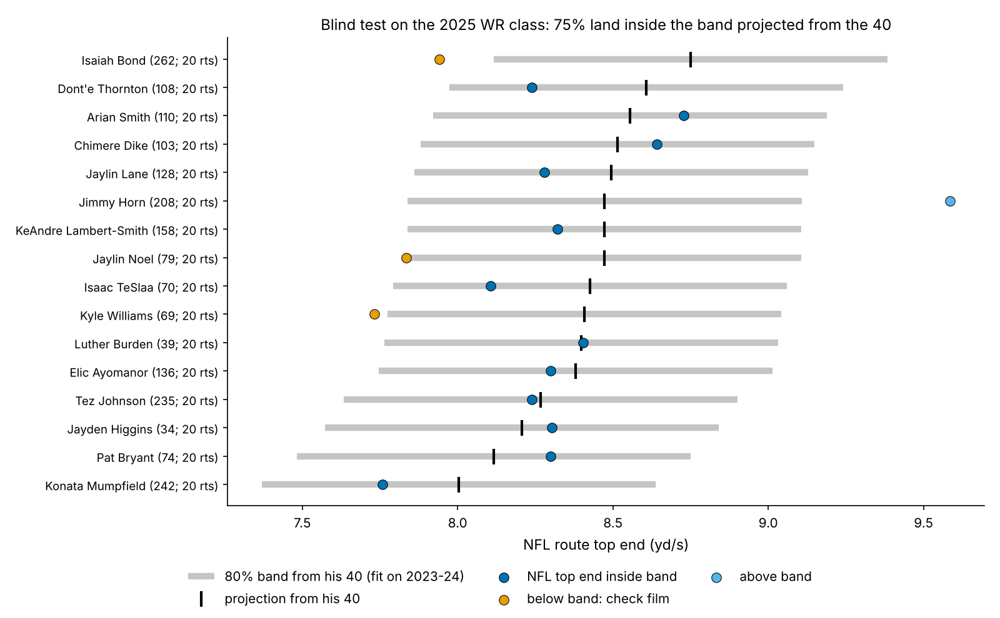

# Does He Play to His 40?

"Plays faster than he times" can move a receiver a full round, and so can the reverse. Get it wrong and a team pays Day-2 money for speed that never shows up on Sundays. We measured it for 510 prospects from the 2023–2025 classes by comparing each player's Combine 40 with his own NFL snaps.

**What we found.** The 40 reappears in only one phase of NFL movement, top speed, and the clearest case is receivers (ρ = 0.28 [0.00, 0.51], positive in all three classes). Whether a receiver "plays to his 40" seems to predict yards per route run (ρ = 0.40). That link is the only one of 27 tests that survives correction, but it disappears once running after the catch is removed. **Measure play speed without the ball, or you count production twice.**

## The question and what the data allow

Public audits find that Combine tracking adds about zero R² beyond stopwatch times and draft slot. That leaves two open questions a front office actually asks: does the movement a prospect shows in Indianapolis reappear on NFL snaps, and does the size of that carry-over say anything about production?

The repo's game tracking holds up to 40 regular-season snaps per player: 20 drawn at random and 20 with the highest |EPA|. Only cohort players are tracked (no ball, no opponents), so every game measure is compared with the player himself. League event tags give the snap, the throw and the ball's arrival. We use the random half for every estimate and the high-|EPA| half only as a replication.

## The metric

We measure three phases of the same movement on both sides, each from the player's first step:

- **Start:** distance covered in the first second (burst).
- **Drive:** distance covered in the first 2.5 seconds.
- **Top end:** top speed. On NFL snaps this is the mean of his three fastest random snaps, measured from the snap to the throw.

Each NFL snap is compared only with snaps from the same alignment, and for receivers the same route type. A go route is never compared with a hitch. Combine values are standardized within Combine year.

**Speed Realization (SR)** is a receiver's NFL route top end as a share of his Combine 40 top speed. The median WR realizes 75% (10th–90th percentile 70–81%): an 11.1 yd/s 40 becomes 8.3 yd/s on a typical receiver's fastest routes before the ball is thrown.

**Data.** We have 14,034 sampled plays (6,604 random) and 738 tracked 40s from 413 players. Each player needs at least 10 random snaps of the movement, and the median player has 20. The 40's top speed repeats at 0.99 between attempts, its first second at only 0.40. NFL route top end has a reliability of 0.46 over 20 routes.

## Finding 1: the 40 reappears at top speed, not at the start

| Group (NFL movement) | n | NFL reliability, start / top | ρ start | ρ top end | Smallest detectable ρ |
|---|---|---|---|---|---|
| WR (routes) | 63 | 0.59 / 0.46 | −0.12 | 0.22 | 0.35 |
| DB (coverage snaps) | 62 | 0.10 / 0.33 | 0.04 | 0.31 | 0.35 |
| DL (pass rushes) | 68 | 0.59 / 0.13 | 0.15 | 0.03 | 0.33 |
| OL (snaps) | 60 | 0.29 / 0.29 | 0.04 | −0.13 | 0.35 |
| TE (routes) | 20 | 0.52 / 0.09 | −0.09 | 0.34 | 0.59 |

*ρ = partial Spearman, adjusted for weight; NFL side adjusted for alignment and route.*

- **The first second does not carry over in any group.** NFL burst is measurable (reliability 0.59 for WR and DL), so the weak link is on the Combine side, where the 40's first second repeats at only 0.40.
- **DL drive speed looks like translation, but it is mostly size and alignment.** Unadjusted, a DL's 40 drive distance tracks his rush drive distance at 0.52. Comparing like alignments cuts it to 0.17, and adjusting for weight to 0.04. Heavy linemen run slower 40s (ρ = −0.66) and line up inside, where rushes are short.
- **Top end is where the 40 shows up.** DB is similar to WR (0.31 [0.03, 0.54]), but the data hold no coverage outcome. We pick WR, the clearest group with a production outcome tied to the movement.

For receivers the 40's top speed ranks NFL route top end at ρ = 0.28 [0.00, 0.51] (within-class permutation p = 0.0120). By class it is 0.30, 0.29 and 0.22, and it replicates on the high-|EPA| half (0.32 [0.07, 0.56]). Each extra yd/s in the 40 is worth 0.51 yd/s on routes (95% CI 0.10 to 1.07; 0.39 to 0.62 when fit without each class in turn). It ranks receivers but does not pin down levels: calibrated on two classes and applied to the third, it explains R² 0.02 [−0.13, 0.20]. **The stopwatch already holds this signal.** Beyond the official 40, tracked top speed adds a partial ρ of 0.03, and out of class it adds 0.005 R² (p = 0.214).

## Finding 2: "plays to his 40" predicts production only with the ball in his hands

Measured over the whole play, realization tracks yards per route run at a partial ρ of 0.40 [0.13, 0.60] (Holm p = 0.030). That is the only one of 27 tests in this writeup that survives correction. It is the trap. On 31% of the snaps that set a receiver's whole-play top end he was the target, against 17% of all his routes. The speed partly *is* the catch-and-run.

Remove the ball and the link fades:

- **Untargeted routes only:** 0.15.
- **Until the ball arrives:** 0.22.
- **Snap to throw (primary):** 0.22 [−0.05, 0.46].
- **High-|EPA| half:** 0.07.

None reaches the 0.35 this sample can detect. Only the high-|EPA| replication is statistically equivalent to "no more than ±0.3" (TOST p = 0.033). The primary estimate cannot rule out a moderate effect (p = 0.257), so the honest verdict is "cannot detect", not "no link".

Out of class the pattern repeats. The model is fit on two classes and scored on the third, weighted by how reliable each player's yards per route is. Its baseline is pick, weight, official 40, NGS athleticism score and slot share. Adding whole-play realization gains 0.046 R² (permutation p = 0.064). Adding snap-to-throw realization gains −0.001 (p = 0.289), and untargeted-route realization 0.000.

**The trap is not specific to receivers.** A DL's NFL rush drive distance tracks his pressure rate beyond pick, EDGE share, weight and 40 at 0.23 [−0.01, 0.45]. Leaving out the sampled snaps on which he got pressure cuts that to 0.11. In-game speed partly records how the snap turned out.

## What a team can use

1. **A draft-room band, not a ranking.** For a 2027 receiver, project NFL route top end from his 40 top speed, with an 80% band of ±0.63 yd/s. In the blind 2025 test, 75% of receivers landed inside the 80% band, so it is close to calibrated. It ranks them only loosely (ρ = 0.22). Kyle Williams (pick 69), Jaylin Noel (79) and Isaiah Bond (262) fell below the band, and Jimmy Horn (208) above it. A receiver whose college film shows route speed below the band is a "times faster than he plays" flag worth a second tape session.
2. **Measure "plays fast" off the ball.** Use snap-to-throw speed on routes adjusted for type, from at least 10 random routes. Reaching a reliability of 0.7 takes about 55 routes. Never use full-play or post-catch speed as a trait: it double-counts production.
3. **Don't pay for the tracked 40 here.** The official 40 carries the same top-speed signal.
4. **What would change our mind.** Next season will show whether this holds:
   - If snap-to-throw realization reaches a partial ρ above 0.35 with yards per route on next season's data, realization becomes a production signal.
   - If fewer than 60% of the 2025 class stay inside their bands, the 40 projection is miscalibrated and should be dropped.

## Limitations

- **Sample.** We have 20 random snaps per player. A top end from the three fastest of 20 has reliability 0.46, which caps any correlation at about 0.67. The full league tracking is not available here.
- **No ball or opponents.** Coverage, leverage and route depth enter only through route-type and alignment comparisons. Snap to throw lasts a median 2.6 s, so the primary top end partly measures acceleration on quick-game routes.
- **Forking paths.** We explored a sprint acceleration–speed profile, which we dropped because its NFL side did not repeat between halves of a player's snaps. We also tried several snap aggregations and four top-speed windows. We chose snap-to-throw as primary after exploratory runs had already shown production results for several windows, so all four windows are reported in Figure 4 rather than only the best one. The whole-play result is the only one that survives correction, and it is the contaminated one.
- **Outcomes.** Yards per route is shrunk toward the mean with a 144-route prior and repeats season to season at 0.59 (n = 42). Quarterback quality, injuries and depth-chart opportunity enter only through routes run. The 2025 class has one season. Draft pick alone (R² 0.157 out of class) beats the full baseline (0.065), a sign of over-fitting at n = 63; without slot share the baseline reaches 0.130 and realization still adds −0.011.
- **Groups.** There is no DB coverage outcome, and the TE n of 20 is too small for any verdict.

## Appendix: method details

**First movement and windows.** First movement is the first frame at or above 1.0 yd/s, backed up to 0.3 s while speed stays above 0.5 yd/s. In games the search starts at the snap. The NFL window runs from the snap to the throw, sack or handoff (5 s if none).

**Adjustment and year-standardization.** Each snap value has the mean of its group × alignment (× route for WR/TE) subtracted, and the group mean added back. Combine phases are z-scored within position × Combine year and rescaled to yd/s.

**Correlations and power.** Correlations are partial Spearman (rank residuals) with 1,000 player bootstraps. Permutation tests shuffle within class. The noise ceiling is √(Combine reliability × NFL reliability). The detectable-effect bands use Fisher z at α = 0.05 and 80% power, and TOST uses bounds of ±0.3.

**Outcome model.** Yards per route uses normal–normal empirical-Bayes shrinkage by routes. The DL pressure rate is the league's charted pressures per pass-rush snap, shrunk the same way. All 27 tests are corrected with Holm and BH.

*Reproducible: `uv run python writeup/candidates/round_02/cand_3/analysis.py` writes every number to `numbers.json` and every figure.*
