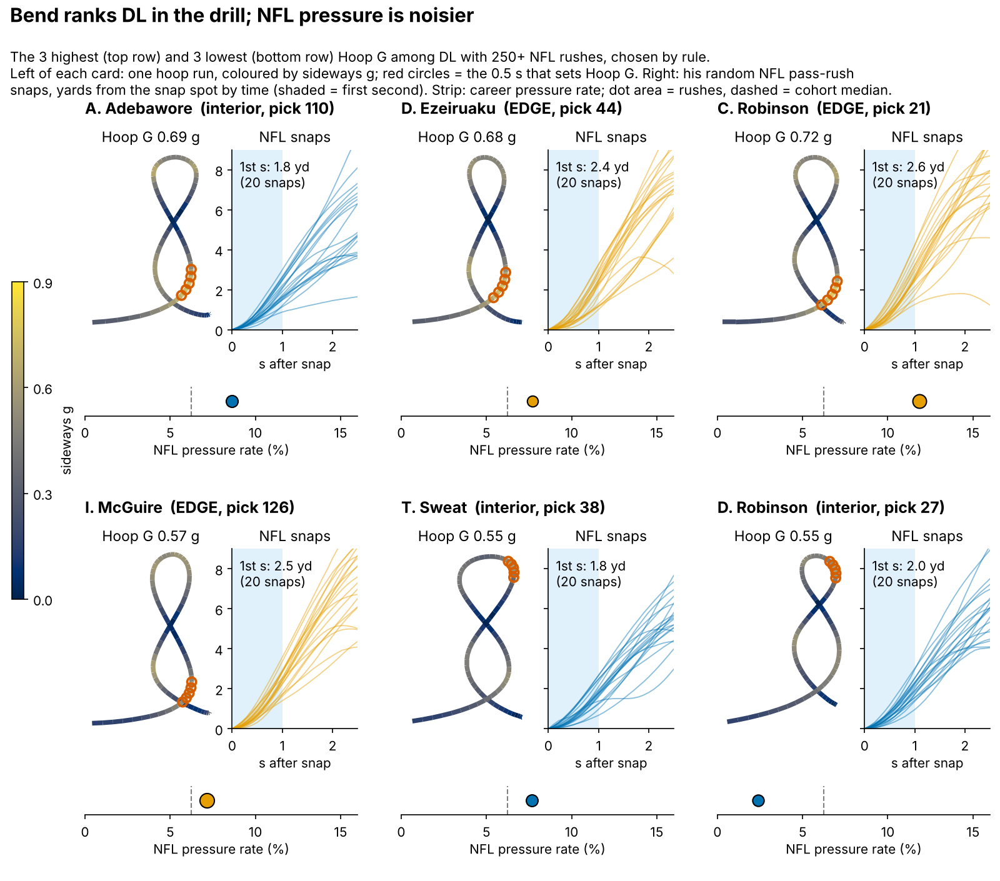
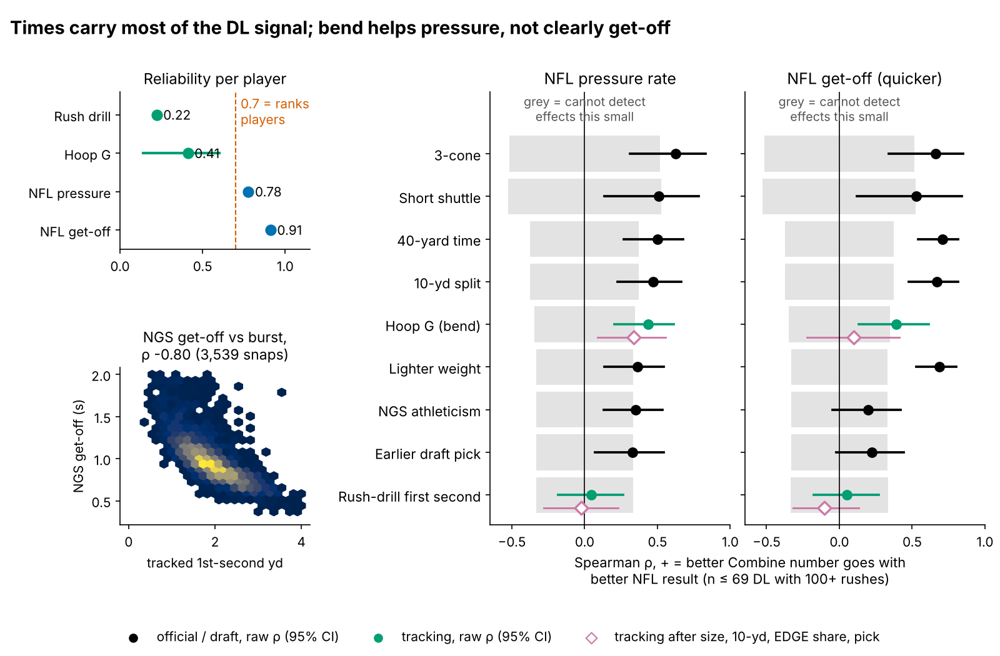
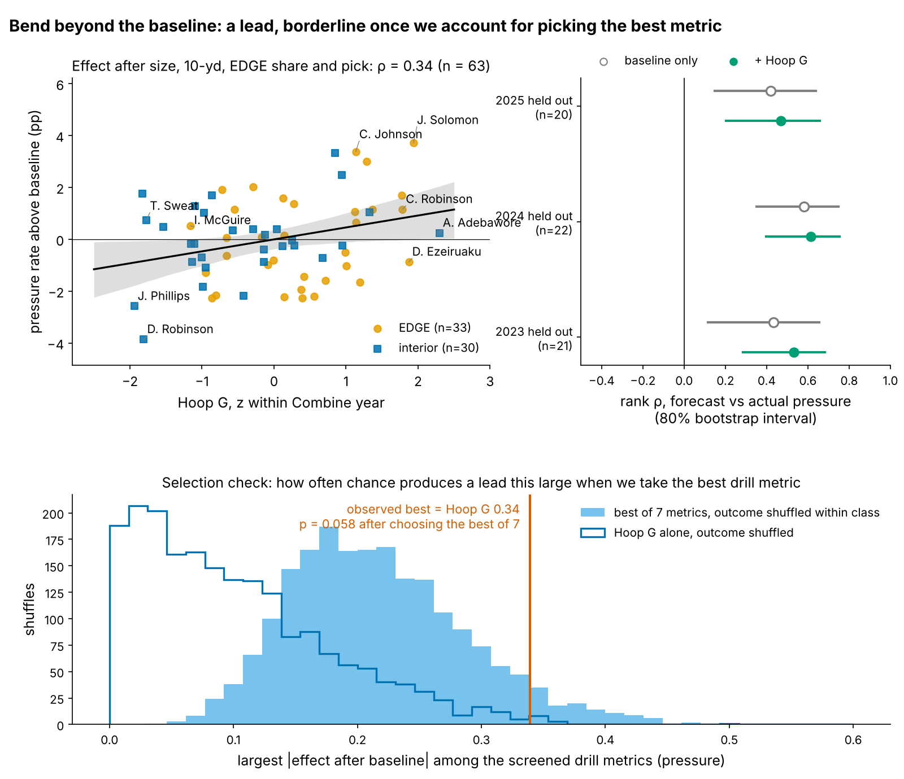
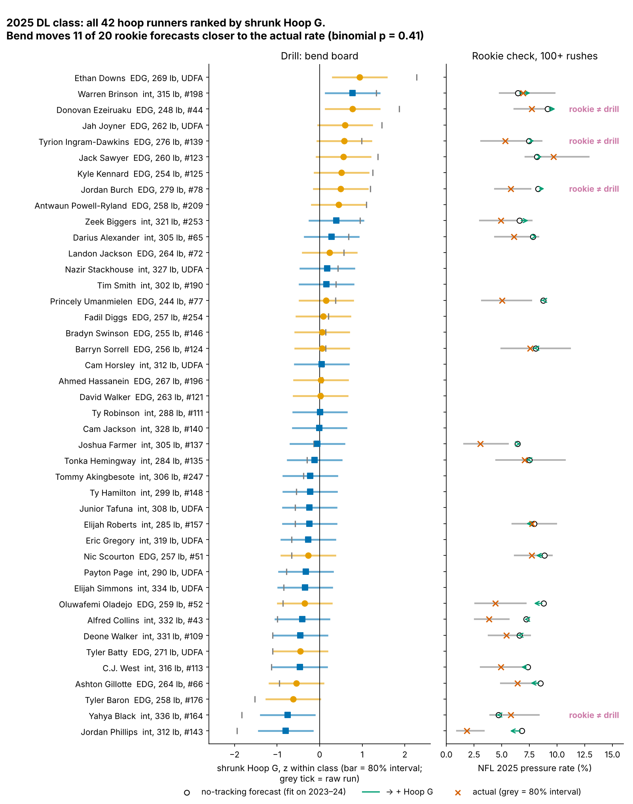

# Bend Is a Lead: Run-the-Hoop "Hoop G" and NFL Pass-Rush Pressure

Combine bend, measured by how hard a rusher can turn at speed in Run-the-Hoop, goes with higher NFL pressure rate beyond weight, 10-yard split, alignment and draft slot (63 defensive linemen, 2023–2025 classes). It holds up, borderline, after accounting for having picked the best of seven drill metrics, and the corrected effect is small. The pass-rush drill's first-second burst cannot be judged: two noisy reps are too few to detect anything.

## What Hoop G measures, in football terms

**Hoop G is the hardest sideways push a rusher sustains for half a second while rounding the hoops, in g.** It is the drill version of turning the corner: dipping under a tackle's hands and staying on a tight arc to the quarterback without drifting wide or slowing down. A rusher who has to widen his path or throttle down to make the turn scores low. The median run is 0.62 g (10th–90th percentile 0.57–0.68), taken at about 3.5 yd/s on a 1.8-yard radius.

In the NFL, bend only pays off when the rush asks for it. A wide-9 end lives on the arc. A 4i or 3-technique mostly rushes straight through a gap, apart from stunts and loops. Stance, alignment and scheme also shape pressure, and so do blocker quality and how fast the quarterback gets rid of the ball. None of these are in our data, so they are caveats on every number below.

## Data, outcome and baseline

The cohort is the 69 DL with 100+ regular-season pass rushes (36 EDGE, 33 interior, median 297 rushes); 63 of them ran the hoop. Pressure comes from league play-level charting and is shrunk toward one pooled DL mean (8.1%, prior weight 117 rushes). All drill numbers are standardized within Combine year.

**Baseline without tracking:** log draft pick, weight, 10-yard split and NFL EDGE share. Missing splits (15 of 69) are filled from weight and EDGE share inside each training fold, never from the outcome. Every "out-of-class" number fits on two classes and predicts the third.

## Finding 1: the stopwatch already carries most of the DL signal

The 3-cone (ρ = 0.63, n = 27), 40, 10-yard split and weight all track pressure, as teams already know. Get-off is mostly a size story. Of the tracking metrics, only Hoop G clears the band of effects we could not detect, and only for pressure. Its effect on get-off after the baseline (0.10) sits inside that band.

## Finding 2: bend adds to pressure; the selection check shrinks it

| Test (DL with 100+ rushes) | n | Effect after size, times and draft slot [95% CI] | Smallest effect we could see | Out-of-class R² gain [95% CI] | Verdict |
|---|---|---|---|---|---|
| Hoop G → pressure | 63 | 0.34 [0.09, 0.56] | 0.36 | +0.075 [−0.253, 0.335] | lead |
| … best of 7 drill metrics, chosen inside each fold | 63 | shrunk for selection: 0.12 | — | +0.080, permutation p = 0.025 | lead, smaller |
| Hoop G → NGS get-off | 63 | 0.10 [−0.22, 0.41] | 0.36 | — | cannot detect |
| Drill first second → NGS get-off | 68 | −0.10 [−0.32, 0.13] | 0.34 | — | cannot detect |
| Drill first second → pressure | 68 | −0.02 [−0.28, 0.23] | 0.34 | — | cannot detect |

**Bend.** One sd of Hoop G goes with +0.64 pressure points beyond the baseline (95% CI 0.19 to 1.09), about 2.9 extra pressures in a 450-rush season. It holds for EDGE (0.31) and interior (0.42) rushers. Adding Hoop G improves held-out rank forecasts in all three classes, but the per-class intervals overlap (Figure 3).

**Selection.** Hoop G was the best of six drill metrics screened earlier on these same players. So we reran the whole screen, seven metrics including drill burst. If we shuffle pressure within each class and take the best metric each time, chance beats the observed lead in 5.8% of shuffles (p = 0.058). When the best metric is chosen on two classes only and tested on the third, Hoop G wins every fold and the held-out gain holds (+0.080, p = 0.025). Shrinking all seven estimates toward their common mean pulls Hoop G's effect from 0.34 to 0.12, or about 1.0 extra pressure per season. **Read the lead as real but small until new classes confirm it.**

**Imputation.** With the 14 players missing a 10-yard split dropped instead of filled, the effect falls to 0.22 [−0.10, 0.49] (n = 49) and the out-of-class gain disappears (+0.003). Ridge and mixed-model refits agree with the main fit (Table 2). The lead therefore depends partly on players without official splits.

## What a team can use

1. **Shrink one run before you use it.** A single hoop run has reliability 0.41, so the board value is 0.41 × the raw z-score, ±0.63 for an 80% interval. Two runs narrow it, and about 4 would make Hoop G a ranking number.
2. **Use it as a tiebreaker, not a grade.** Among rushers with similar size, times and draft range, the better bender is the better bet. It moves 11 of 20 rookie forecasts closer to the actual rate (binomial p = 0.41), so it does not reorder a class by itself.
3. **Flag disagreement.** Four 2025 rushers have a clear drill score (|shrunk| ≥ 0.4) that their rookie pressure contradicts. In April the same column would carry the scouts' film grade.

**The arithmetic for three 2025 rushers** (class mean 0.61 g, sd 0.039 g):

- **Ethan Downs** (undrafted, 269 lb) ran 0.70 g, z = +2.3. Shrunk: 0.41 × 2.3 = +0.94 (80% interval 0.31 to 1.57), so the board reads 0.648 g. He tops the board with only 7 NFL rushes: a free look at a late add, not a projection.
- **Donovan Ezeiruaku** (pick 44, 248 lb): 0.68 g, z = +1.9, shrunk +0.77 [0.14, 1.40]. The no-tracking forecast said 9.1% pressure. He produced 7.7% on 402 rushes, so he carries a disagreement flag. Bend says keep rushing him off the edge. The film should show whether the tackle is getting hands on him first.
- **Jordan Phillips** (312 lb): 0.54 g, z = −1.9, shrunk −0.80 [−1.43, −0.17], last on the board. Forecast 6.8%, actual 1.9% on 215 rushes. A heavy interior player who cannot bend still has value as a gap-control 2i/shade, but not as a pass-rush bet.

Hoop G is unrelated to draft slot (ρ = 0.02), so the draft has not priced it in. Lighter rushers bend better (ρ = −0.44 with weight), which is why weight is in the baseline.

## Why drill burst is hard to measure

NGS get-off is a good burst outcome. It matches tracked first-second distance snap by snap (ρ = −0.80 on 3,539 rushes) and repeats season to season at 0.84. The drill is the weak side. One pass-rush-drill rep has reliability 0.13, and a player's 1.9 reps give 0.22, so a real link would need a true correlation near 0.77 before we could see it. Ranking players on drill burst would take about 16 reps. The drill's first second does track the tracked first second on 20 random NFL snaps (ρ = 0.32), but not on the top-EPA half (0.11). Its EDGE-versus-interior gap is descriptive only (Table 2).

## Pre-registered test

One hypothesis, fixed in `analysis.py` before the data exist: **among 2026- and 2027-class DL with 100+ rushes by the end of the 2027 season (about 40 players), Hoop G's effect on shrunk pressure rate after the four-covariate baseline is above zero (one-sided α = 0.05).** No other metric, outcome or cohort rule will be tested. Power is 0.65 if the true effect is the observed 0.34, but only 0.17 at the selection-shrunk 0.12. An estimate at or below zero takes Hoop G off the board.

## Limitations

- **Selection.** The best-of-seven test (p = 0.058) does not clear 0.05. The nested test does, but only 63 players stand behind it.
- **Small n and wide intervals.** About 20 players per held-out class. The out-of-class gain interval includes zero, and the complete-case fit is weaker.
- **Thin drill data.** Only 10 players ran the hoop twice (reliability 0.37 [−0.11, 0.73]). The split-half reliability of 0.41 has a 95% CI of 0.14 to 0.60, so the smallest real effect we could see ranges from 0.52 to 1.00.
- **No ball, opponents, scheme or injury data.** Pressure mixes in blockers, stunts, alignment and quarterback timing. Missed games for injury and for benching look the same.
- **Short careers.** The 2025 class has one season, so its board is for order, not levels.

## Appendix

| Check (Hoop G → pressure unless noted) | n | Estimate [95% CI] | Out-of-class R² gain |
|---|---|---|---|
| 6-covariate baseline (+3-cone, NGS score), imputed | 63 | 0.31 [0.04, 0.53] | +0.070 |
| Same, ridge | 63 | — | +0.086 |
| Same, 3-cone and 10-yd missing dropped | 22 | 0.04 [−0.72, 0.72] | too few |
| Mixed model, class random intercept (pp per sd) | 63 | 0.63 [0.20, 1.07] | — |
| 50+ / 200+ rushes | 75 / 47 | 0.27 / 0.31 | +0.085 / +0.055 |
| Hoop G alone, within-class permutation | 63 | p = 0.006 | p = 0.021 |
| Best of 14 (7 metrics × pressure, get-off) | 63 | p = 0.095 | — |
| Holm over the four Table 1 tests | — | p = 0.035 | — |
| Drill first second → tracked first second, EDGE − interior | 42 / 43 | 0.40 [−0.03, 0.79] | descriptive |
| Equivalence test, drill burst vs \|ρ\| < 0.3 (pressure / get-off) | 68 | p = 0.013 / 0.054 | — |

Methods: positions Savitzky–Golay smoothed (window 7, order 2); sideways acceleration |v × a|/|v| averaged over 0.5 s. Effects are Spearman partial correlations on baseline-residualized ranks with 2,000 player bootstraps. The out-of-class interval refits the full leave-one-class-out loop on 1,000 within-class resamples. Permutation tests use 2,000 within-class shuffles. Selection shrinkage is empirical Bayes on Fisher-z estimates of the seven screened metrics. Smallest detectable effects use Fisher z at 80% power, two-sided α = 0.05.

*Reproducible: `uv run python writeup/candidates/round_02/revised/analysis.py` writes every number to `numbers.json` and draws every figure.*
