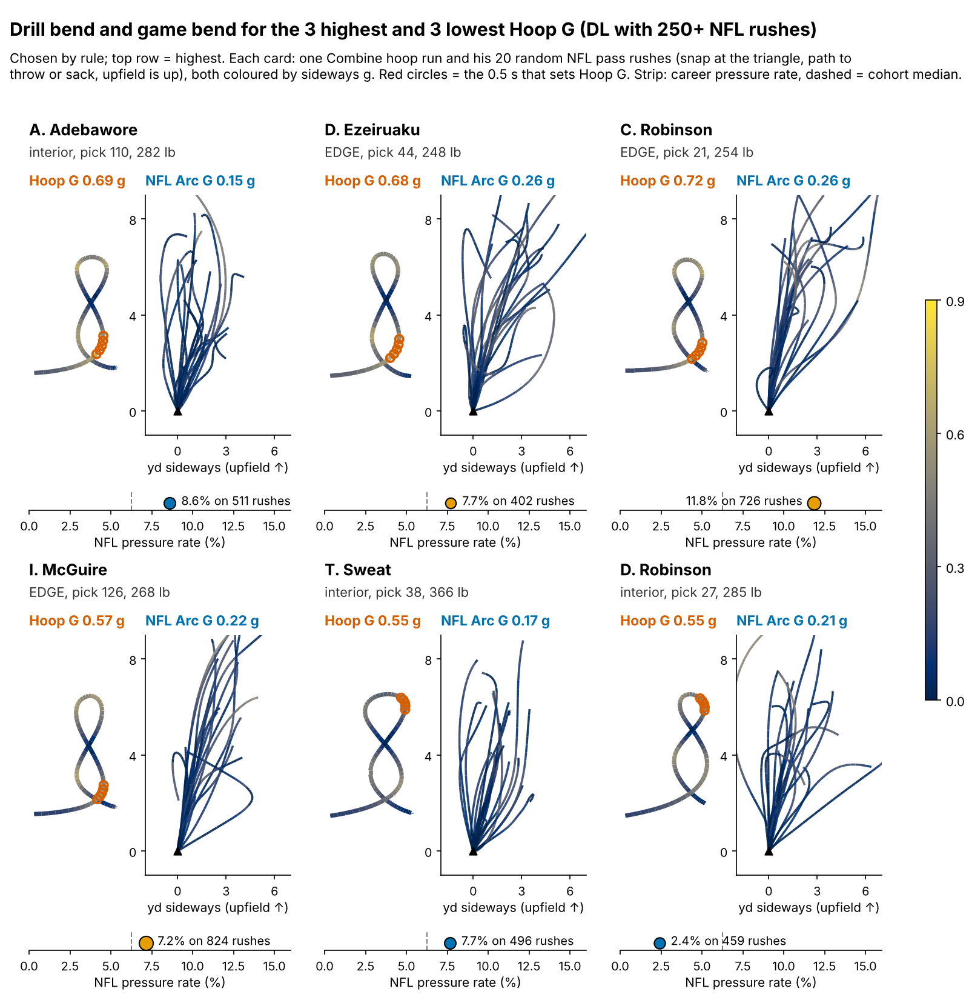
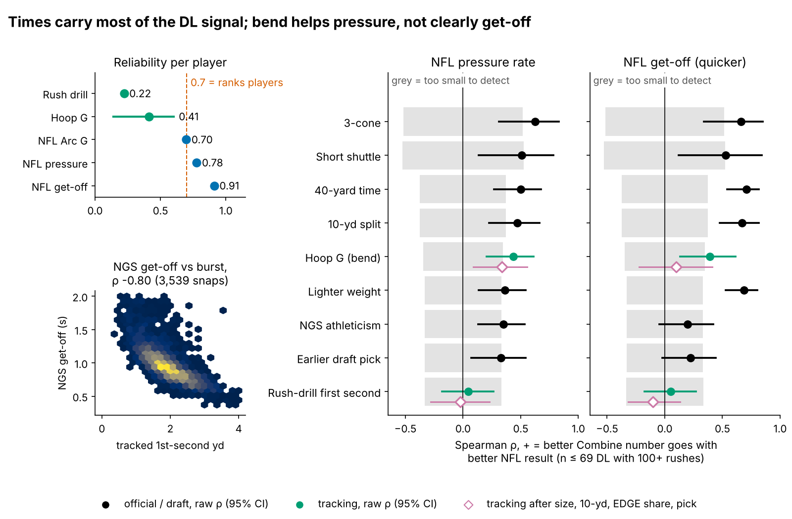
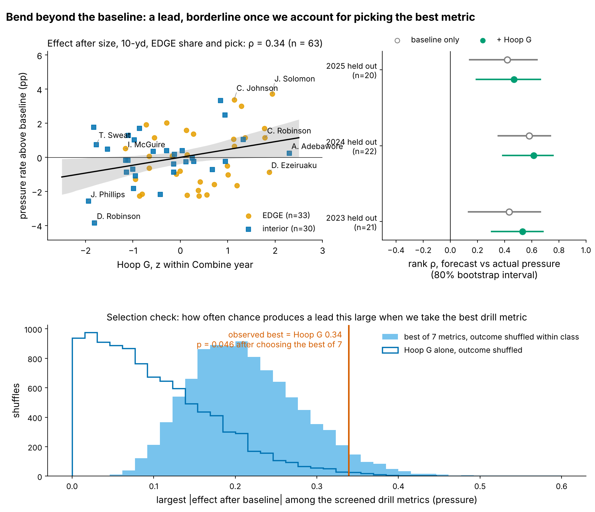
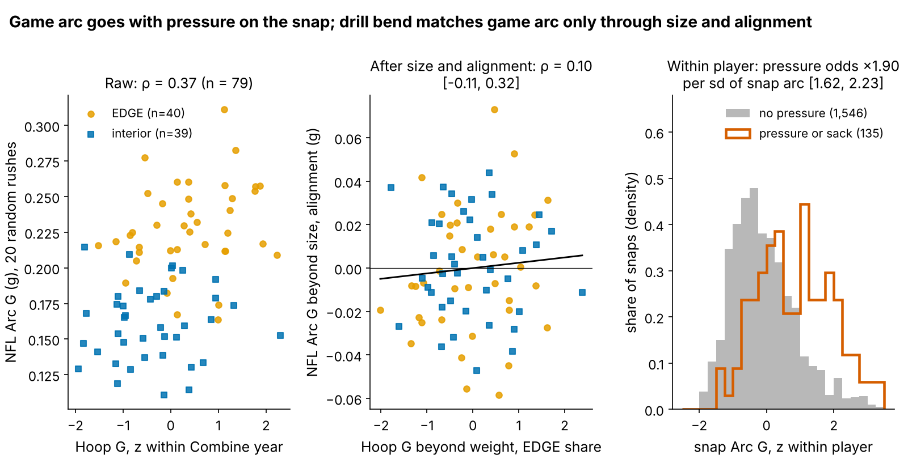

# Bend Is a Lead: Run-the-Hoop "Hoop G" and NFL Pass-Rush Pressure

Combine bend, measured as how hard a rusher can turn at speed in Run-the-Hoop, goes with a higher NFL pressure rate. That holds after weight, 10-yard split, alignment and draft slot are accounted for (63 defensive linemen, 2023–2025 classes). The lead survives the correction for having picked the best of seven drill metrics, but only just, and the corrected effect is small. It also does not show up as more arc on NFL snaps. The pass-rush drill's first-second burst cannot be judged, because two noisy reps cannot detect anything.

## What we measure, in football terms

**Hoop G is the hardest sideways push a rusher holds for half a second while rounding the hoops, in g.** It is the drill version of turning the corner: dipping under a tackle's hands and staying on a tight path to the quarterback without drifting wide or slowing down. A rusher who has to widen or throttle down to make the turn scores low. The median run is 0.62 g (10th–90th percentile 0.57–0.68), at about 3.5 yd/s on a 1.8-yard radius.

**NFL Arc G is the same quantity measured on Sundays.** It is the hardest sideways push held for half a second between the snap and the throw or sack, averaged over a player's 20 random sampled pass rushes. Only turning above 2 yd/s counts. It compares the player's path with itself, so it needs no ball or opponents (Figure 1).

Bend pays off when the rush calls for it: a wide-9 end lives on the arc, while a 3-technique mostly rushes through a gap. Scheme, blockers and quarterback timing also shape pressure, and none of them are in our data.

## Data, outcome and baseline

The cohort is the 69 DL with 100+ regular-season pass rushes (36 EDGE, 33 interior, median 297 rushes). Of these, 63 ran the hoop. Pressure comes from league play-level charting. It is shrunk toward one pooled DL mean (8.1%, prior weight 117 rushes). All drill numbers are standardized within Combine year.

**Baseline without tracking:** log draft pick, weight, 10-yard split and NFL EDGE share. Missing splits (15 of 69) are filled from weight and EDGE share inside each training fold, never from the outcome. Every "out-of-class" number is fit on two classes and predicts the third.

## Finding 1: the stopwatch already carries most of the signal

The 3-cone (ρ = 0.63, n = 27), 40, 10-yard split and weight all track pressure, as teams already know. Of the tracking metrics, only Hoop G clears the band of effects too small to detect, and only for pressure. Its get-off effect after the baseline (0.10) sits inside that band.

## Finding 2: bend adds to pressure, and the selection check shrinks it

| Test (DL with 100+ rushes) | n | Effect after size, times and draft slot [95% CI] | Smallest effect we could see | Out-of-class R² gain [95% CI] | Verdict |
|---|---|---|---|---|---|
| Hoop G → pressure | 63 | 0.34 [0.09, 0.56] | 0.36 | +0.075 [−0.249, 0.326] | lead |
| … best of 7 drill metrics, chosen inside each fold | 63 | shrunk for selection: 0.12 | — | +0.080, permutation p = 0.031 | lead, smaller |
| Hoop G → NFL Arc G (after weight, EDGE share) | 79 | 0.10 [−0.11, 0.32] | 0.31 | — | not through arc |
| Hoop G → NGS get-off | 63 | 0.10 [−0.22, 0.41] | 0.36 | — | cannot detect |
| Drill first second → NGS get-off | 68 | −0.10 [−0.32, 0.13] | 0.34 | — | cannot detect |

**Bend.** One sd of Hoop G goes with +0.64 pressure points beyond the baseline (95% CI 0.19 to 1.09), about 2.9 extra pressures in a 450-rush season. The effect holds for EDGE (0.31) and for interior rushers (0.42). It improves held-out rank forecasts in all three classes, though the per-class intervals overlap (Figure 3).

**Selection.** Hoop G was the best of six drill metrics screened earlier on these players, so we reran the screen with seven, adding drill burst, over 10,000 within-class shuffles of pressure. Chance beat the observed lead in 4.6% of shuffles (p = 0.046), right at the usual line. When the best metric is chosen on two classes and tested on the third, Hoop G wins every fold and the held-out gain holds (+0.080, p = 0.031). Shrinking all seven estimates toward their common mean pulls Hoop G from 0.34 to 0.12, or about 1.0 extra pressure per season. **Read the lead as real but small until new classes confirm it.**

**Imputation.** If the 14 players without an official 10-yard split are dropped instead of filled, the effect falls to 0.22 [−0.09, 0.49] (n = 49) and the out-of-class gain disappears (+0.003). Ridge and mixed-model refits agree with the main fit (Appendix). The lead leans partly on players without official splits.

## Finding 3: the hoop does not show up as more arc on Sundays

NFL Arc G is a good pass-rush measure. Over 20 random rushes it has a reliability of 0.70 (86 players). Within a player, his higher-arc snaps are his pressure snaps: the odds of pressure rise ×1.90 per sd of arc [1.62, 2.23] on 1,681 snaps with play length held fixed. Part of that is a rusher finishing toward the quarterback after a win, so it is not causal.

Hoop G and Arc G correlate at 0.37 [0.17, 0.55] (n = 79). Almost all of that is size and alignment: Arc G fingerprints where a man lines up (ρ = 0.80 with EDGE share, −0.77 with weight). Once both are removed, Hoop G vs Arc G falls to 0.10 [−0.11, 0.32]. It is 0.07 on the top-EPA half, and 0.21 [−0.11, 0.51] among EDGE players only. An equivalence test rules out an observed |ρ| of 0.3 or more (p = 0.036). On the true-score scale, though, the smallest detectable link is 0.59, so a moderate real link is still possible. Hoop G's pressure effect is unchanged when Arc G is added to the baseline (0.32 [0.05, 0.54]).

**Football reading:** whatever Hoop G captures beyond size, it is not "turns tighter on Sundays." Balance and control through contact are plausible candidates that this tracking cannot see. Until that is pinned down, Hoop G is a statistical lead and not a mechanism.

## What a team can use

1. **Shrink one run before you use it.** A single hoop run has reliability 0.41, so the board value is 0.41 × the raw z-score, with an 80% interval of ±0.63. About four runs would make Hoop G a ranking number.
2. **Use it as a tiebreaker, not a grade.** It moves 11 of 20 rookie forecasts closer to the actual rate (binomial p = 0.41), so it does not reorder a class by itself.
3. **Flag disagreement with tape.** Four 2025 rushers have a clear drill score (|shrunk| ≥ 0.4) that their rookie pressure contradicts, and two have one that their NFL Arc G contradicts. Send those players back to film.

**The arithmetic for three 2025 rushers** (class mean 0.61 g, sd 0.039 g):

- **Ethan Downs** (undrafted, 269 lb) ran 0.70 g, z = +2.3. Shrunk, that is 0.41 × 2.3 = +0.94 [0.31, 1.57], so the board reads 0.648 g. With 7 NFL rushes, he is a free look, not a projection.
- **Donovan Ezeiruaku** (pick 44, 248 lb): 0.68 g, z = +1.9, shrunk +0.77 [0.14, 1.40]. The no-tracking forecast said 9.1% pressure, and he produced 7.7% on 402 rushes. His NFL arc beyond size is above average, matching the drill, so his gap looks like finishing the rush rather than bend.
- **Jordan Phillips** (312 lb): 0.54 g, z = −1.9, shrunk −0.80 [−1.43, −0.17], last on the board. His forecast was 6.8% and he produced 1.9% on 215 rushes. He fits a gap-control role, not a pass-rush bet.

Hoop G is unrelated to draft slot (ρ = 0.02), so the draft has not priced it in.

## Why drill burst is hard to measure

NGS get-off is a good burst outcome. It matches tracked first-second distance snap by snap (ρ = −0.80 on 3,539 rushes) and repeats season to season at 0.84. The drill is the weak side. One pass-rush-drill rep has reliability 0.13, and a player's 1.9 reps give 0.22. A real link would therefore need a true correlation near 0.77 before we could see it, and ranking players on drill burst would take about 16 reps.

## Pre-registered test

One hypothesis, fixed before the data exist. **Among 2026- and 2027-class DL with 100+ rushes by the end of the 2027 season (about 40 players), Hoop G's effect on shrunk pressure rate after the four-covariate baseline is above zero (one-sided α = 0.05).** No other metric, outcome or cohort rule will be tested. Power is 0.65 if the true effect is the observed 0.34, but only 0.17 at the selection-shrunk 0.12. An estimate at or below zero takes Hoop G off the board.

## Limitations

- **Selection.** The best-of-seven p (0.046) sits on the line and moves with Monte Carlo noise. The nested test clears 0.05, but only 63 players stand behind it.
- **Small n and wide intervals.** About 20 players per held-out class. The out-of-class gain interval includes zero, and the complete-case fit is weaker.
- **Thin drill data.** Only 10 players ran the hoop twice (reliability 0.37 [−0.11, 0.73]). The split-half reliability of 0.41 has a 95% CI of 0.14–0.60, so the smallest detectable true effect ranges from 0.52 to 1.00.
- **Game tracking is a sample.** Arc G uses 20 random rushes per player, with no blockers, ball or opponents, so a wide arc forced by a tackle looks the same as a chosen one. Pressure comes from charting. Injury and benching cannot be separated.
- **Short careers.** The 2025 class has one season: its board is for order, not levels.

## Appendix

| Check (Hoop G → pressure unless noted) | n | Estimate [95% CI] | Out-of-class R² gain |
|---|---|---|---|
| 6-covariate baseline (+3-cone, NGS score), imputed | 63 | 0.31 [0.04, 0.54] | +0.070 |
| Same, ridge | 63 | — | +0.086 |
| Same, 3-cone and 10-yd missing dropped | 22 | 0.04 [−0.67, 0.71] | too few |
| Mixed model, class random intercept (pp per sd) | 63 | 0.63 [0.20, 1.07] | — |
| 50+ / 200+ rushes | 75 / 47 | 0.27 / 0.31 | +0.085 / +0.055 |
| Hoop G alone, within-class permutation | 63 | p = 0.007 | p = 0.025 |
| Best of 14 (7 metrics × pressure, get-off) | 63 | p = 0.088 | — |
| NFL Arc G → pressure after baseline | 69 | 0.14 [−0.07, 0.36] | — |
| Drill first second → pressure | 68 | −0.02 [−0.28, 0.23] | — |
| Drill first second → tracked first second, random / top-EPA snaps | 68 | 0.32 / 0.11 | descriptive |

Methods: positions are Savitzky–Golay smoothed (window 7, order 2), and sideways acceleration is |v × a|/|v| averaged over 0.5 s, for both the drill and NFL snaps. Effects are Spearman partial correlations on baseline-residualized ranks, with 2,000 player bootstraps. The out-of-class interval refits the whole leave-one-class-out loop 1,000 times. Within-player odds use a logit with play length, and 500 bootstrap resamples of whole players. Selection shrinkage is empirical Bayes on Fisher-z estimates.

*Reproducible: `uv run python writeup/candidates/round_03/cand_1/analysis.py` (about 6 minutes) writes every number to `numbers.json` and draws every figure.*
