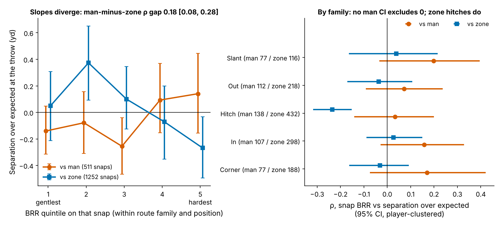
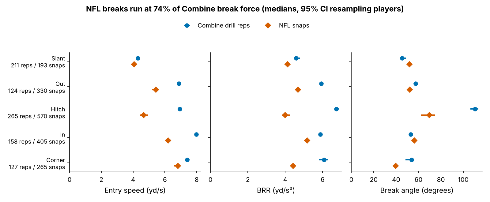

# Hard Breaks Beat Man, Not Zone, and No Drill Can See It

Scouts pay for "suddenness": the receiver who plants, turns and goes without rounding the break. Combine tracking now records route drills at 10 Hz, so suddenness looks measurable. We built one break number, scored it the same way in Indianapolis and on NFL snaps of the same routes, and asked two questions. Does it win on Sundays? Does the Combine predict it? Short answers: only against man coverage, and no.

## Summary

- **Metric.** *Break Redirect Rate* (BRR) is how violently a receiver changes his velocity in the half-second either side of his break, in yd/s². Braking, turning and re-accelerating all count. A rounded break scores low; a plant-and-go scores high.
- **Lead: against man, a harder break goes with more separation; against zone it goes with less.** On 1,763 NFL break snaps by 115 WR/TE, the man-minus-zone gap is 0.18 [0.08, 0.28] in ρ. That survives a best-of-18 permutation correction (p = 0.005) and goes the same way in every NFL season and Combine class. When we re-run the whole 18-contrast screen blind inside leave-one-class-out, it does not reappear: the held-out gap is 0.02 [−0.07, 0.11]. This is a lead for 2026, not a rule.
- **The Combine drill cannot be linked to NFL break force.** ρ = −0.13 [−0.31, 0.04] (n = 115). A true correlation of 0.3 or more is unlikely (equivalence p = 0.004).
- **Use.** Give route-drill kinematics zero weight. Coach and grade hard breaks against man. Don't reward a hard stop on a zone hitch.

## The metric

1. Speed and acceleration come from smoothed derivatives of the receiver's x/y position.
2. The **break** is the first sharp turn (≥ 30° within ±0.6 s) after 1.5 yd of travel, entered above 2.5 yd/s.
3. **BRR** is the average size of the acceleration vector over the 1.0 s centred on the break. It sums decel into the break, the turn itself and re-acceleration out of it. The individual components are tested separately below.

BRR needs only the receiver's own path, so it works on game tracking that has no ball and no defenders. The break was found in 96% of 926 drill reps and 89% of 1,988 NFL break-route snaps (slant, out, hitch, in, corner). Drill values are standardized within drill × Combine year. Game values are standardized within route family × position, so tight ends are compared only with tight ends.

**Data.** The Combine side has 149 WR/TE from the 2023–2025 classes, with a median of 7 break drills each. Drills map to game families: speed-out to out; curl, comeback and hook to hitch; and so on. The NFL side is the repo's regular-season sample: up to 40 plays per player, half random and half the highest-|EPA|. **Separation over expected (SOE)** is separation at the throw minus a context model. The model uses route, depth, cushion, man/zone, alignment, time to throw, and down and distance. It is fitted leave-one-class-out (R² 0.21), and receiver movement never enters it.

## Finding 1: break force pays against man, not zone

Against man, the hardest-breaking fifth of snaps averaged +0.14 yd over expected, against −0.14 for the gentlest fifth: about 10.1 inches. Against zone the sign flips, from +0.05 to −0.27 yd. Zone hitches drive the flip (ρ = −0.23). That fits the coaching point of "find the window and settle" rather than "snap it off" against zone. No single family's man-coverage CI excludes zero. The evidence is the gap, not any one route.

The football reading: against man, the defender mirrors the receiver, so a violent redirect is what buys the cushion. Against zone, the defender plays the area, and a hard stop can carry the receiver past the window.

## Finding 2: how far to trust the lead

We tested 18 contrasts: 6 break components (BRR, entry, apex and exit speed, decel, re-accel) × 3 splits (man/zone, slot/wide, random/high-|EPA| half). The BRR man-zone split was the strongest of the 18.

- **Selection-corrected in sample.** The labels were shuffled within player 1,000 times. The observed best of 18 (|z| = 3.46) beat the shuffled best-of-18 at p = 0.005.
- **Fixed contrast, new seasons.** The gap is 0.23, 0.07 and 0.24 in the 2023, 2024 and 2025 NFL seasons. It is positive in all three Combine classes, and on the random half it is 0.27.
- **Blind re-screen.** Picking the best contrast on two classes and scoring it on the third chose BRR man-zone in 1 of 3 folds; it ranked 2nd in the other two. The pooled held-out gap is 0.02 [−0.07, 0.11] (permutation p = 0.333), about 10% of the in-sample estimate. We treat that shrunken figure as the honest effect size.
- **Beyond a no-tracking baseline.** We gave each snap the player's own 40, weight, draft slot and NGS athleticism score, each interacted with coverage. Snap BRR still adds +0.11 yd of SOE per sd against man [0.01, 0.22] and −0.17 against zone. The interaction is 0.28 [0.12, 0.44]. Out of class it adds only 0.3 points of R²: a direction, not a forecast.
- **Not yet a gradeable trait.** We split each player's break snaps in half. BRR from one half does not predict his man-coverage SOE on the other half: ρ = 0.00 [−0.18, 0.18] for 91 players, at 2.6 man snaps per half.

## Finding 3: Combine BRR cannot be linked to NFL BRR

BRR is a real but noisy trait in each setting. Combine halves made of disjoint drills agree at ρ = 0.28, a reliability of 0.44. NFL halves agree at 0.23, a reliability of 0.37 at 15.3 snaps. Across the two settings the link is ρ = −0.13 [−0.31, 0.04]. Matching each drill to its own game family gives −0.07 over 436 player-family pairs. None of the 11 subsets has a CI above zero. The official 40 (ρ = 0.06) is no better.

**Conditional on these reliabilities**, the sample cannot detect a modest link: power for a true 0.3 is 25%. It can bound one, though. A true 0.3 would show up as 0.12, and we observed −0.13. A bootstrap that resamples players and so carries both reliabilities puts the 95% upper bound on the true correlation at 0.08.

Part of the reason is that NFL breaks are a different movement. They run at 74% [72, 76] of Combine BRR and are entered at 5.3 yd/s instead of 6.8. The Combine curl, comeback and hook turn 110°; the NFL hitch turns 70°, at 59% of the drill force.

## Season outcomes, out of class

| Outcome (78 players, ≥ 150 routes) | Baseline R² | + Combine BRR | ΔR² [95% CI] | 2025 fold: base → + BRR |
|---|---|---|---|---|
| Season separation | 0.18 | 0.13 | −0.05 [−0.23, 0.06] | 0.18 → 0.08 |
| Yards per route run | 0.11 | 0.08 | −0.02 [−0.25, 0.16] | 0.12 → 0.07 |

The baseline uses no tracking: a ridge on draft slot, the 40 and weight (both year × position standardized), NGS athleticism and a TE flag. It is trained on two classes and scored on the third. Both outcomes are stable year to year, with ρ of 0.62 for separation and 0.54 for YPRR. Adding Combine BRR lowers out-of-class accuracy.

## Draft room

| Input | Weight | Evidence | What would change it |
|---|---|---|---|
| Combine route-drill BRR | 0 | WR ρ = −0.05 [−0.26, 0.17], n = 82; TE −0.35 [−0.63, 0.03], n = 33 | A new class scored with this code shows ρ ≥ 0.12 with its CI above 0 |
| Hard breaks vs man (tape) | Coaching cue; tiebreaker only | Snap-level gap 0.18 in sample, 0.02 under a blind re-screen | The 2026 test below |
| Hard stop vs zone hitch | Do not reward | Zone-hitch ρ = −0.23 | — |
| Snaps before trusting a player's BRR | — | 61 break snaps for reliability 0.7 (we have 15.3) | — |

**Film-review flags (Fig. 1).** For 19 of 115 players, the shrunk Combine and NFL scores disagree by more than their combined 80% interval. Figure 1 shows the three largest gaps each way among the 18 flagged players with 12+ NFL snaps.

- **Drill flatters the film.** KeAndre Lambert-Smith (pick 158) had a drill BRR of 1.30 sd and an NFL BRR of −1.03 over 14 snaps. Puka Nacua (pick 177) had 1.49 in the drills and −0.62 over 25 NFL snaps. Nacua is a reminder that break force is one way to win, not the only one.
- **Film beats the drill.** Tight end Terrance Ferguson (pick 46) had −0.37 in the drills and 1.76 [0.75, 2.77] over 16 NFL snaps. Tucker Kraft (pick 78) scored −1.02 from only two drill reps.

At ±1.01 sd per player, these are prompts to watch tape, not rankings.

**Pre-registered 2026 test (one hypothesis).** Use the same code, unchanged, on 2026 regular-season random-sample break snaps. If the man-minus-zone BRR gap in ρ is greater than 0 with one-sided p < 0.05, the cue stays. If it is ≤ 0, we drop it.

## Limitations

- **Selection.** BRR was chosen in round 1, and the man/zone split was found after looking. It survives a best-of-18 correction in sample but not a blind re-screen; the honest held-out effect is near zero.
- **Game sample.** Up to 40 plays per player gives 15.3 break snaps and only 2.6 man snaps per half. Half the plays are high-|EPA| picks. Player intervals are wide, and the Combine null is a bound conditional on the measured reliabilities, not proof of no link.
- **No defenders or ball in game tracking.** Coverage is charted. Press, leverage and the defender's own break are unseen, so a confound inside the man effect, such as route tree or quarterback, is possible.
- **Break detection.** The detector takes the first sharp turn, so double moves and option routes can be mis-assigned; 11% of NFL break snaps had no detectable break.
- **Opportunity and injury.** No injury data. Season outcomes need 150 routes, which drops buried and injured players; only 20 of 78 come from 2025.
- **Drills.** Most drills are a single rep, the TE samples are small, and the drills are uncovered and choreographed. That may be why they don't transfer.

## Appendix: statistics

| Quantity | Estimate |
|---|---|
| Combine split-half ρ (reliability) | 0.28 [0.12, 0.43] (0.44), n = 145 |
| NFL split-half ρ (reliability; per snap) | 0.23 [0.04, 0.40] (0.37; 0.037) |
| Snap ρ, BRR vs SOE: man / zone | 0.09 [0.01, 0.17] / −0.09 [−0.14, −0.03] |
| Holm-adjusted p, BRR man-zone (bootstrap) | 0.018; one other contrast survives (entry speed, slot-wide) |
| Best-of-18 null 95th percentile of \|z\| | 2.86 (observed 3.46) |
| Fixed gap by class 2023 / 2024 / 2025 | 0.09 / 0.27 / 0.20 |
| Cross-fit, zone SOE partial on baseline | 0.11 [−0.03, 0.25] |
| Power for true 0.3 / 0.5; equivalence p vs 0.3 | 25% / 58%; 0.004 |
| True-correlation point estimate; 95% upper bound | −0.33; 0.08 |
| Shrinkage | Empirical Bayes on the z scale, reliability 0.21 per drill and 0.037 per snap |

Reproduce: `uv run python writeup/candidates/round_03/cand_2/analysis.py` (about four minutes, `data/processed` only). Every quoted number is written to `numbers.json`.
