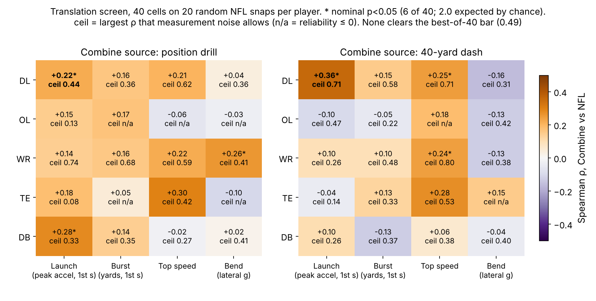
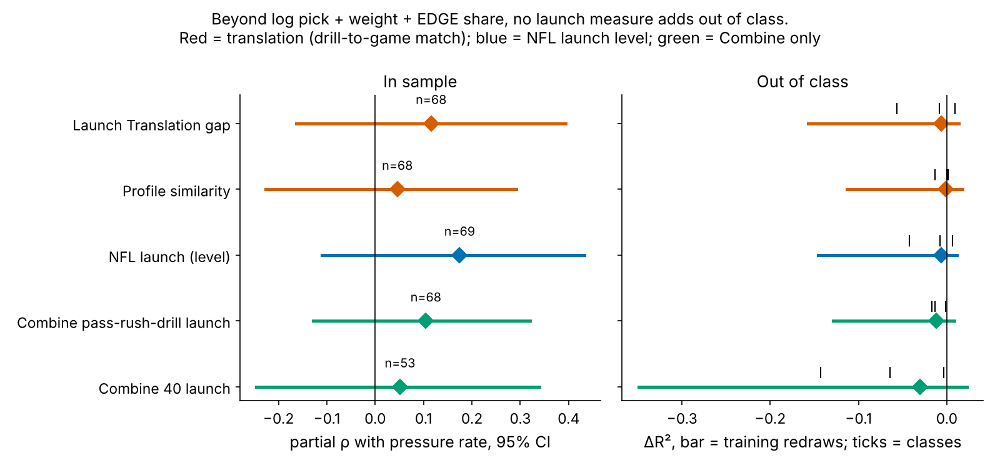

# The First Step Travels, the Gap Doesn't Pay: Launch Translation for NFL Pass Rushers

We measured one movement, a defensive lineman's push in his first second, with the same code at the Combine and on 20 random NFL rushes per player. The Combine launch does show up on Sundays. Rushers push almost as hard as in the drill, and the order of who launches hardest partly carries over, with the 40 previewing it better than the pass-rush drill. But whether a rusher "plays to his Combine" says nothing about his pressure rate once you know his draft slot, weight and role.

## The question and the metric

Public audits find Combine tracking adds about zero R² beyond stopwatch times and draft slot. That leaves two possibilities: the drill movement does not reappear in games, or it reappears and still does not matter. Testing the same player in both settings separates the two.

**Launch** (coach definition): how hard a player pushes off over his first three steps. Formally, it is the peak forward acceleration (yd/s²) in the first second after he starts moving, computed by one function on 10 Hz tracking from the Combine (pass-rush drill and 40) and from NFL snaps (clock starts at the snap). **Launch Translation (LT)** is his shrunk NFL launch minus his shrunk Combine-drill launch, in true-score sd. **Launch Retention** is the same comparison in physical units: NFL launch as a percentage of drill launch.

**Data.** 510 prospects from the 2023–2025 classes. We use 3,189 drill reps and 6,578 *random* NFL snaps; the top-|EPA| half of the repo's sample is only a replication check. For DL this means 219 pass-rush-drill reps, 166 40-yard reps and 1,622 rushes, a median of 20 per player. NFL launch is adjusted for alignment, Combine launch is z-scored within drill × year, and both are empirical-Bayes shrunk by reps (Appendix).

**Is the game metric real?** On single DL rushes, launch correlates with NGS get-off time at ρ = −0.59 (n = 1,622). Twenty rushes give a player reliability of 0.67. With six snaps it would be 0.39, too noisy to see translation at all.

## Finding 1: launch is where translation is clearest, and it is the DL group

We screened every group and feature the data allow (Fig 2); OL drill reliabilities are negative and TE samples small. DL launch is the one movement that is positive from *both* Combine sources: the pass-rush drill gives ρ = 0.22 [0.02, 0.41] (n = 85) and the 40 gives ρ = 0.36 [0.14, 0.54] (n = 69, p = 0.003). It is the clearest cell, but it is not proof. Its best-of-40 permutation p is 0.276, so we treat it as a lead and carry the selection forward.

What translates, in football units:

- **The first push is nearly the same.** The median NFL rush launches at 4.2 yd/s², against 4.4 in the drill. Median retention is 95% (10th–90th percentile 84–106%). What differs is after the first second: drill curves keep climbing, while NFL curves flatten at contact (Fig 1).
- **Noise hides much of it.** One pass-rush-drill rep has reliability 0.18, so a player's single rep keeps only 18% of its deviation after shrinkage. Corrected for noise on both sides, drill-to-NFL launch is 0.47 [0.04, 1.41] (the interval passes 1 because drill reliability is so low), and the 40 gives 0.41 [0.05, 0.79]. True Combine launch and true NFL launch correlate at about 0.4–0.5.
- **The stopwatch already knows.** The official 40 time ranks NFL launch at ρ = 0.39 (n = 70), and the 10-yard split at 0.34. Beyond official 40 and weight, tracked 40 launch adds a partial ρ of 0.18 [−0.06, 0.41], and drill launch adds 0.09 [−0.11, 0.30].
- **EDGE vs interior.** Within role the drill link weakens (EDGE 0.12, n = 42; interior 0.14, n = 43). Part of the pooled link is lighter EDGE players launching harder in both places.
- **Replication.** On the top-|EPA| snaps, 40 launch holds at 0.28 and drill launch falls to 0.08.

## Finding 2: the match between drill and game does not explain pressure

The outcome is career pressure rate, beta-binomial shrunk by rush snaps within role, for the 69 DL with 100+ rushes (median 297). The baseline uses no tracking: log pick, weight and EDGE share, all complete with no imputation. It reaches out-of-class R² 0.38. We tested five per-player measures. Two are translation measures (the LT gap and profile similarity, which is the correlation between the shapes of his drill and NFL acceleration curves). One is the NFL launch level. Two are Combine-only (drill launch and 40 launch).

- **The LT gap**: partial ρ 0.12 [−0.16, 0.39]. Out of class it adds ΔR² −0.006 and improves 1 of 3 classes. Once the NFL launch level is known, the gap carries nothing (−0.02 [−0.24, 0.21]).
- **Profile similarity**: 0.05 [−0.23, 0.29], ΔR² −0.001.
- **NFL launch level**: raw ρ 0.42 [0.19, 0.61] with pressure, but 0.17 [−0.11, 0.43] beyond the baseline and ΔR² −0.006. It moves with weight (ρ 0.36 between lighter body and harder launch). Beyond NGS season get-off it falls to 0.12.
- **Combine launch**: drill 0.10, 40 0.05. Both are negative out of class.

None survives the best-of-4 within-class permutation (smallest p 0.501). The chain explains the public audits' "about zero": each link is moderate, and their product is 0.09 via the drill.

Most of a player's individual gap is noise. LT varies 0.87 sd across players, but each player's own posterior sd is 1.01. Only 5 of 85 players have a 90% interval that excludes zero.

| Player (pick, role, class) | Drill launch | NFL launch | LT | Retention % | Pressure % (rushes) |
|---|---|---|---|---|---|
| Jordan Burch (78, EDGE, 2025) | −0.9 ± 0.8 | +1.3 ± 0.6 | +2.1 | 117 | 6.8 (344) |
| Yasir Abdullah (136, EDGE, 2023) | −1.7 ± 0.8 | +0.3 ± 0.6 | +1.9 | 106 | 7.5 (149) |
| Maason Smith (48, interior, 2024) | +0.3 ± 0.8 | +2.2 ± 0.6 | +1.9 | 101 | 4.6 (433) |
| Byron Young (77, EDGE, 2023) | +0.0 ± 0.9 | +1.8 ± 0.6 | +1.8 | 114 | 11.1 (1,501) |
| Ruke Orhorhoro (35, interior, 2024) | +0.1 ± 0.8 | +1.6 ± 0.6 | +1.4 | 98 | 7.9 (498) |
| Dante Stills (213, interior, 2023) | +0.4 ± 0.8 | −0.7 ± 0.6 | −1.0 | 85 | 5.7 (914) |
| Austin Booker (144, EDGE, 2024) | +0.8 ± 0.8 | −0.6 ± 0.6 | −1.4 | 94 | 8.2 (535) |
| Brenton Cox (UDFA, EDGE, 2023) | +0.7 ± 0.8 | −0.9 ± 0.6 | −1.6 | 93 | 9.3 (201) |
| Eric Watts (UDFA, EDGE, 2024) | −0.3 ± 0.8 | −2.0 ± 0.6 | −1.6 | 91 | 5.7 (225) |
| P.J. Mustipher (UDFA, interior, 2023) | +0.3 ± 0.9 | −1.6 ± 0.6 | −1.9 | 76 | 5.4 (129) |

*Table 1. Five highest and five lowest LT in the pressure cohort (launch in true-score sd, ± posterior sd).*

The scouting read: Byron Young was ordinary in Indianapolis and is among the hardest launchers on Sundays, and he produces (11.1% on 1,501 rushes). Maason Smith launches even harder but pressures at 4.6%, because launch without hands and counters does not finish. Austin Booker and Brenton Cox play below their drill and still pressure above the cohort median of 7.1%. The top five by LT average 7.6% pressure and the bottom five 6.9%. The gap does not sort production.

## What a team can use

1. **Draft room.** For first-step quickness, trust the official 40 and the 10-yard split. Tracked launch from the pass-rush drill keeps 18% of a one-rep deviation (31% with two reps) and adds nothing beyond 40 time and weight. Ten drill reps would be needed for reliability 0.7. If Combine time is fixed, a second 40 is worth more than a second rush-drill rep.
2. **Pro personnel and coaching.** Do not flag a young rusher for "not playing to his Combine". The gap is mostly measurement noise, and given his Sunday launch it carries no pressure information. Grade the level from about 20 random rushes (reliability 0.67), and treat it as a description of his get-off, not a forecast of pressures.
3. **Where the first step stops mattering.** Launch is matched within 5% in the NFL. Production differences start after contact, at about one second, and no Combine drill measures that.
4. **One pre-registered 2026 test.** For 2023–2025 DL with 100+ 2026 rushes, NFL launch from 20 random 2026 rushes will show a positive partial ρ with 2026 pressure beyond the same baseline. We drop the lead if the estimate is ≤ 0. Power is only 0.29 at the observed 0.17, and the detectable effect at this n is 0.34. A null would be uninformative; we say so in advance.

## Limitations

- **Sample.** Twenty random rushes per player come from the repo's game sample. Reliability is 0.67, not 1. The top-|EPA| half was excluded because it over-represents sacks; the drill link does not replicate there (0.08).
- **No ball, no opponents.** Launch is measured from first movement, so snap reaction is excluded and contact time is unknown. Stunts, double teams and play-action cannot be separated.
- **Construct.** The drills have no blocker, and the 40 has no stance change. The 40 clip starts about 0.3 s before the laser, which onset detection absorbs.
- **Selection.** The DL launch cell was chosen from a 40-cell screen (best-of-40 p 0.276). The five production tests are reported in full.
- **Confounding.** Weight drives both launch and pressure. Role is coded by EDGE share of NFL snaps, which is itself a coaching decision made after the draft.
- **Outcomes.** Pressure is charted and carries scheme. The 2025 class has one season, and careers are short.

## Appendix: methods and statistics

Onset is the first frame at or above 1.0 yd/s, backed up while speed stays at or above 0.5 yd/s. Launch is the peak first difference of Savitzky–Golay-smoothed speed over the next 1.0 s. Reps already moving at the window start are dropped. Single-rep reliability uses one-way ANOVA variance components. Player means are posterior means (λ = τ²/(τ² + σ²/k)), divided by τ. True-score correlations are disattenuated by Spearman–Brown reliability with 500 player bootstraps. Partial correlations are rank-based, with 2,000 bootstraps. The best-of-k p values permute game means across players (screen) or pressure within class (production). Leave-one-class-out fits are weighted by the pressure shrinkage weight (prior 149 EDGE and 152 interior rush snaps).

| Test | Estimate [95% CI] | n | p | best-of-k p |
|---|---|---|---|---|
| Drill → NFL launch | 0.22 [0.02, 0.41] | 85 | 0.042 | 0.887 (k = 40) |
| 40 → NFL launch | 0.36 [0.14, 0.54] | 69 | 0.003 | 0.276 (k = 40) |
| LT gap → pressure, partial | 0.12 [−0.16, 0.39] | 68 | 0.359 | 0.740 (k = 4) |
| Similarity → pressure, partial | 0.05 [−0.23, 0.29] | 68 | 0.717 | 0.986 (k = 4) |
| NFL launch → pressure, partial | 0.17 [−0.11, 0.43] | 69 | 0.161 | 0.501 (k = 4) |
| Drill launch → pressure, partial | 0.10 [−0.13, 0.32] | 68 | 0.406 | 0.814 (k = 4) |

*Table 2. All primary tests.*

*Reproducible: `uv run python writeup/candidates/round_03/cand_3/analysis.py` writes every number to `numbers.json` and every figure.*
