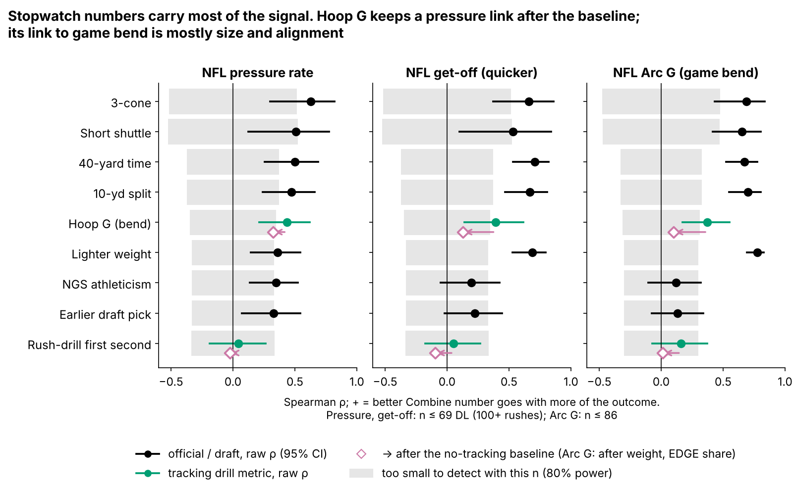
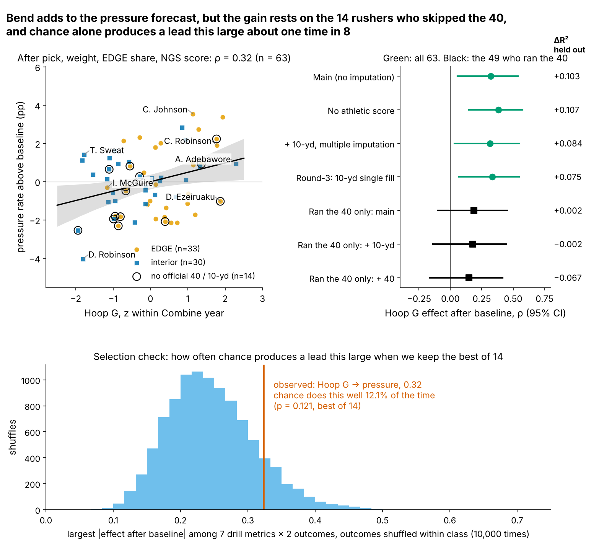
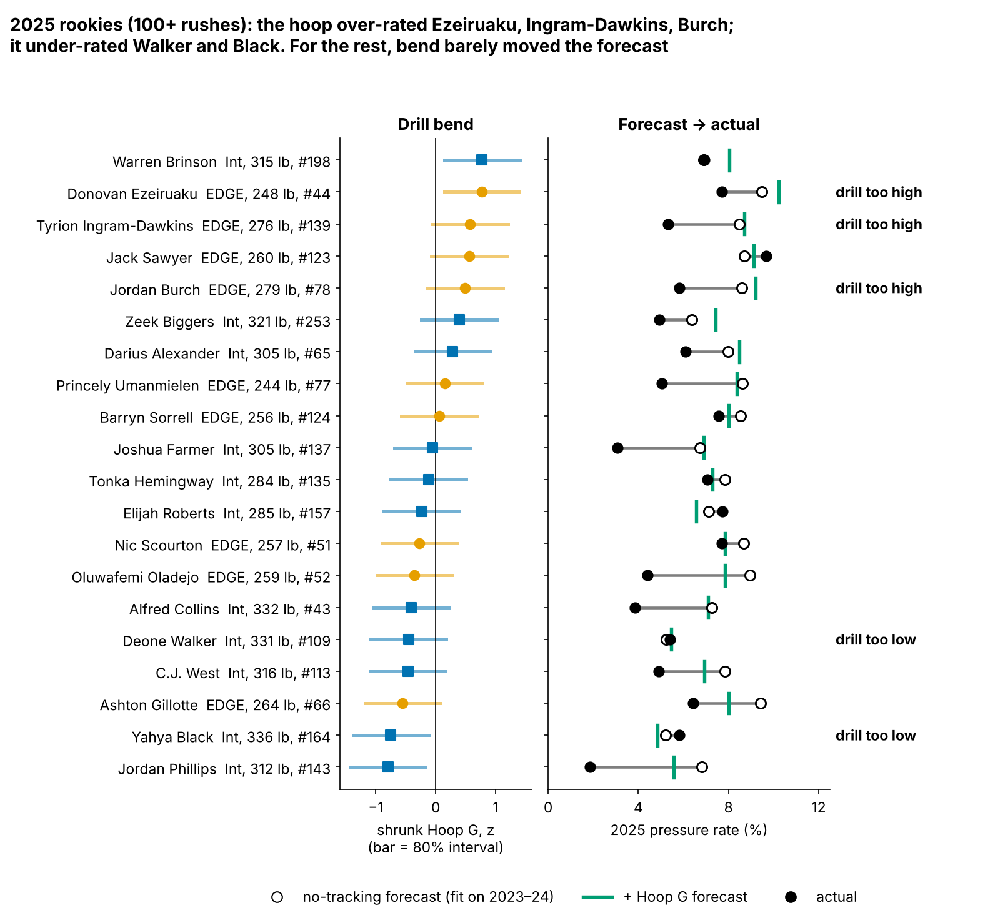

# Bend Is a Lead, Not a Grade: Run-the-Hoop "Hoop G" and NFL Pass-Rush Pressure

Defensive linemen who turn tighter at speed in the Combine's Run-the-Hoop drill earned more NFL pressure than their size, athletic score, alignment and draft slot predicted (63 linemen, 2023–2025 classes). Once we correct for having tried 14 drill-and-outcome pairs, the edge is under one extra pressure a season, and chance can still explain it. Use it to break ties. The pass-rush drill's burst cannot be judged from two noisy reps.

**Why this matters.** Pressure is the most valuable thing a defensive lineman produces, and the Combine's tracked DL drills are almost unused. The 3-cone is already priced into the draft, but Hoop G is not (ρ = 0.02 with draft slot). Tracked drills are new, so the 2026 and 2027 classes give a clean test, and we pre-register one below.

## What we measure, in football terms

**Hoop G is the hardest sideways push a rusher holds for half a second while rounding the hoops, in g.** It is the drill version of turning the corner: dipping under a tackle's hands without drifting wide or slowing down. A typical run peaks at 0.62 g, about 3.5 yd/s on a 1.8-yard radius. **NFL Arc G** applies the same formula to a player's 20 random sampled NFL pass rushes, from the snap to the throw or sack. It needs no ball or opponents.

## Data and baseline

The cohort is the 69 DL with 100+ regular-season pass rushes (36 EDGE, 33 interior, median 297 rushes); 63 of them ran the hoop. Pressure comes from play-level charting, shrunk toward the DL mean (8.1%). Drill numbers are standardized within Combine year. **Exclusions:** 46 of 109 hoop runners have fewer than 100 rushes (injury, depth, or rookies without snaps). Hoop G is unrelated to playing time (ρ = 0.05 with rushes per season), so the cut does not select on bend.

**Baseline without tracking:** log draft pick, weight, NGS athleticism score and NFL EDGE share. All four are recorded for every player, so nothing is imputed. Every "out-of-class" number is fit on two Combine classes and predicts the third.

## Finding 1: the stopwatch carries most of the signal

The 3-cone (ρ = 0.63, n = 27), 40 and weight track pressure, as teams know. Only Hoop G, among tracking metrics, clears the too-small-to-detect band, and only for pressure. Hoop G and NFL Arc G correlate at 0.37, but that falls to 0.10 once weight and EDGE share are removed: bend in the drill is not "turns tighter on Sundays." Hoop G's pressure link is unchanged with Arc G in the baseline (0.30). Balance through contact, which this tracking cannot see, is a plausible carrier.

## Finding 2: bend adds to pressure, and honest checks shrink it

| Test | n | Effect after baseline [95% CI] | Out-of-class R² gain | Verdict |
|---|---|---|---|---|
| Hoop G → pressure | 63 | 0.32 [0.06, 0.54] | +0.103 | lead |
| Same, only the 49 who ran the 40 (+ official 10-yd) | 49 | 0.18 [−0.14, 0.45] | −0.002 | no forecast gain |
| Best of 14, re-chosen inside each fold | 63 | shrunk: 0.09 | +0.024 (p = 0.091) | not significant |
| Hoop G → NFL Arc G | 79 | 0.10 [−0.11, 0.32] | — | not through game bend |
| Drill first second → NGS get-off | 68 | −0.10 [−0.31, 0.13] | — | cannot detect |

**Bend.** One sd of Hoop G goes with +0.69 pressure points beyond the baseline, about 3.1 extra pressures in a 450-rush season. The baseline's held-out R² rises from 0.085 to 0.188 on the same 63 rows. The gain is positive in all three held-out classes, and still positive in 3 of 3 when we train on one class and predict the other two.

**Selection, the headline check.** Hoop G was the best of seven drill metrics screened against pressure and get-off: 14 tests. Shuffling outcomes within class 10,000 times, chance produced a best-of-14 lead this large 12.1% of the time (**p = 0.121**). Re-choosing the pair on two classes and testing on the third, Hoop G-on-pressure wins 2 of 3 folds and the held-out gain shrinks to +0.024. Shrinking all 14 estimates toward their mean takes Hoop G from 0.32 to 0.09, or about 0.8 extra pressures a season.

**Imputation, the share that survives.** 14 of the 63 rushers have no official 40 or 10-yard split (10 EDGE, 9 from 2025). They carry much of the link: ρ = 0.51 inside that group versus 0.14 among the 49 who ran. On those 49, adding the official 10-yard split leaves Hoop G at 0.18, about 56% of the full-sample effect. The forecast gain is gone: held-out R² is 0.102 for the baseline alone and 0.101 with Hoop G on identical rows. Filling the splits by multiple imputation instead gives 0.32 and +0.084. **So the in-sample link half survives, and the forecast gain survives only where the 40 is missing.** A hypothesis to test: the hoop matters most for rushers who skip the 40.

## Rush type and down

The effect is not just wide-9 arc: 0.30 for EDGE players, 0.37 for interior players. On the 1260 random sampled snaps of the hoop runners, the odds of pressure per sd of Hoop G are ×1.03 [0.76, 1.46] when he aligns on the edge and ×1.16 [0.85, 1.50] inside, ×1.14 on true passing downs (2nd and 8+, 3rd or 4th and 5+) and ×1.05 on other downs. Every interval includes no effect, and only 37% of the sampled pressures came on passing downs, so the snaps cannot say where the edge lives.

## How sure is the drill?

A single hoop run has reliability 0.41 [0.14, 0.60]; the 10 players who ran twice give 0.37. Corrected for that noise, the true-score effect is 0.57 [0.15, 1.00]: compatible with a modest trait or a strong one. For a ranking, the shrunk 2025 board agrees with plausible true orders at ρ = 0.65 [0.31, 0.82], and its top five stay in the true top five 46% of the time.

## What a team can use

1. **Ask for 3–4 hoop runs.** One run is mostly noise; three runs reach reliability 0.68 and four 0.74, enough to rank.
2. **Shrink one run before using it, and re-test outliers.** Ethan Downs (undrafted, 269 lb) ran 0.70 g, z = +2.3, the best in his class. Shrunk, that is 0.41 × 2.3 = +0.94 [0.31, 1.57]. With 7 NFL rushes, he is a free look: get a second run before moving him up.
3. **Use it as a tiebreaker, and send disagreements to film.** Rookie pressure contradicted a clear drill score for 5 players (Figure 4), most clearly Donovan Ezeiruaku: a top-three hoop, 7.7% pressure against a 9.5% forecast. Jordan Phillips (312 lb) ran last, at −0.80, and produced 1.9% against 6.8%. He fits a gap-control role, not a pass-rush bet.

**2025 board, top 8 and bottom 4 of 42** (full board in `board_2025.csv`; 80% intervals):

| # | Player | Role | Wt | Pick | Runs | Shrunk Hoop G z | Rookie pressure (rushes) |
|---|---|---|---|---|---|---|---|
| 1 | Ethan Downs | EDGE | 269 | UDFA | 1 | +0.94 [+0.31, +1.57] | 7 rushes |
| 2 | Warren Brinson | Interior | 315 | 198 | 2 | +0.77 [+0.14, +1.41] | 6.9% on 173 |
| 3 | Donovan Ezeiruaku | EDGE | 248 | 44 | 1 | +0.77 [+0.14, +1.40] | 7.7% on 402 |
| 4 | Jah Joyner | EDGE | 262 | UDFA | 1 | +0.60 [−0.03, +1.23] | no NFL rushes |
| 5 | Tyrion Ingram-Dawkins | EDGE | 276 | 139 | 2 | +0.58 [−0.06, +1.21] | 5.3% on 113 |
| 6 | Jack Sawyer | EDGE | 260 | 123 | 1 | +0.56 [−0.07, +1.19] | 9.7% on 176 |
| 7 | Kyle Kennard | EDGE | 254 | 125 | 1 | +0.51 [−0.12, +1.14] | 50 rushes |
| 8 | Jordan Burch | EDGE | 279 | 78 | 1 | +0.49 [−0.14, +1.12] | 5.8% on 344 |
| 39 | Ashton Gillotte | EDGE | 264 | 66 | 2 | −0.55 [−1.18, +0.08] | 6.4% on 342 |
| 40 | Tyler Baron | EDGE | 258 | 176 | 1 | −0.62 [−1.26, +0.01] | 68 rushes |
| 41 | Yahya Black | Interior | 336 | 164 | 1 | −0.75 [−1.38, −0.12] | 5.8% on 189 |
| 42 | Jordan Phillips | Interior | 312 | 143 | 1 | −0.80 [−1.43, −0.17] | 1.9% on 215 |

## Why drill burst is hard to measure

NGS get-off is a sound outcome (ρ = −0.80 with tracked first-second distance per snap). The drill is the weak side: a player's 1.9 pass-rush reps have reliability 0.22, and ranking would take about 16 reps.

## Pre-registered test

**Among 2026- and 2027-class DL with 100+ rushes by the end of the 2027 season (about 40 players), Hoop G's effect on shrunk pressure rate after the four-covariate baseline is above zero (one-sided α = 0.05).** No other metric, outcome or cohort rule will be tested. An estimate at or below zero takes Hoop G off the board.

## Limitations

- **Selection.** The best-of-14 p (0.121) does not clear 0.05, and the nested re-selection does not either. This is a lead.
- **Missing 40s.** The forecast gain comes from 14 players without an official 40; those who skip it are not a random group.
- **Small n.** About 20 players per held-out class; every out-of-class interval includes zero. Only 10 players ran the hoop twice.
- **Game tracking is a sample.** Arc G and the snap splits use 20 random rushes per player, with no blockers, ball or opponents. Scheme and quarterback timing are not in the data.
- **Short careers.** The 2025 class has one season: its board is for order, not levels.

## Appendix: statistics

| Check (Hoop G → pressure unless noted) | n | Estimate [95% CI] | Out-of-class R² gain [95% CI] |
|---|---|---|---|
| Main baseline | 63 | 0.32 [0.06, 0.54] | +0.103 [−0.161, 0.357] |
| No athletic score (pick, weight, EDGE share) | 63 | 0.38 [0.15, 0.57] | +0.107 [−0.183, 0.369] |
| + 10-yd split, multiple imputation (20 draws) | 63 | 0.32 [0.03, 0.55] | +0.084 [−0.209, 0.318] |
| Ran the 40: main / + official 40 | 49 | 0.19 / 0.15 | 0.002 / −0.067 |
| Mixed model, class intercept (pp per sd) | 63 | 0.66 [0.22, 1.10] | — |
| Train on one class, predict two | 42 per split | — | +0.141 (range 0.078 to 0.206) |
| Hoop G alone / best of 7 for pressure | 63 | p = 0.009 / 0.070 | — |
| True-score effect, 10 repeat runners | 63 | 0.61 [0.15, 1.00] | — |
| NFL Arc G reliability; within-player pressure odds per sd | 86 | 0.70; ×1.90 [1.65, 2.20] | — |

Methods: Savitzky–Golay smoothing (window 7, order 2); sideways acceleration |v × a|/|v| averaged over 0.5 s, identical for drill and NFL snaps. Effects are Spearman partial correlations of baseline-residualized ranks (2000 player bootstraps); out-of-class intervals refit the whole loop. Imputation draws parameters and residuals from weight, EDGE share, NGS score and Hoop G, never the outcome. Snap odds: logit with the player's baseline expectation and play length, whole-player bootstrap.

*Reproducible: `uv run python writeup/candidates/round_03/revised/analysis.py` writes every number to `numbers.json` and draws every figure.*
