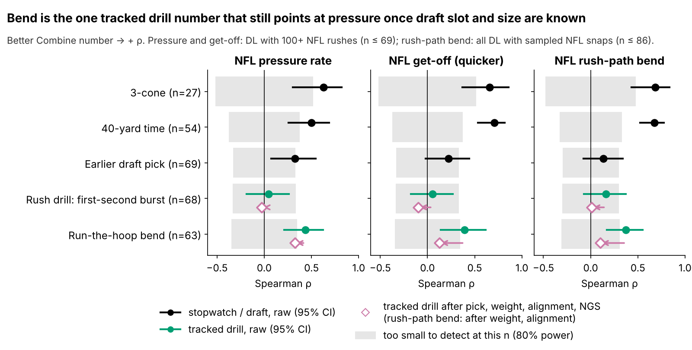
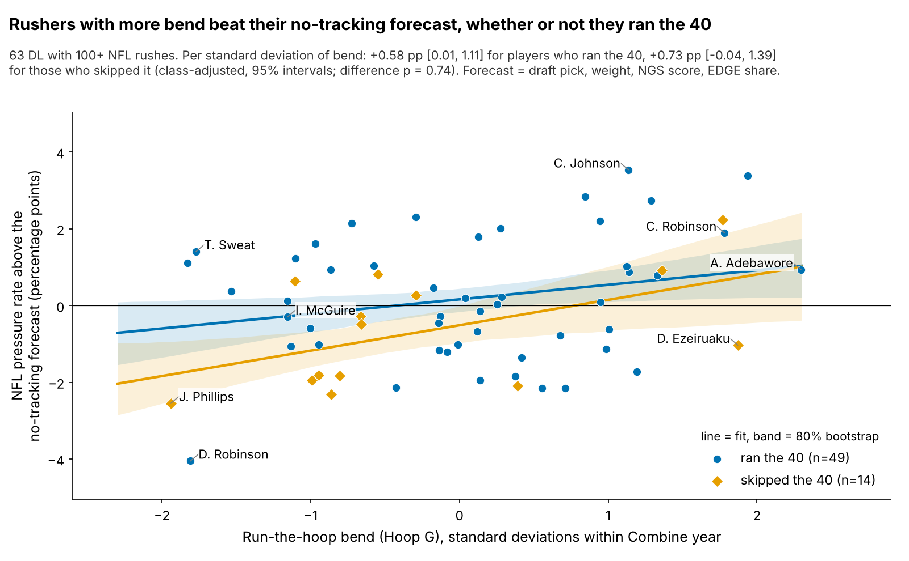
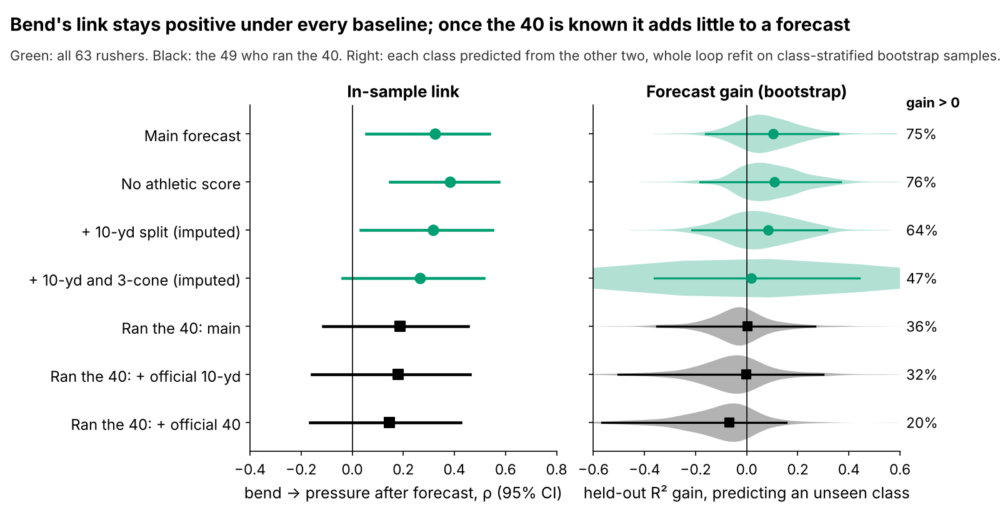
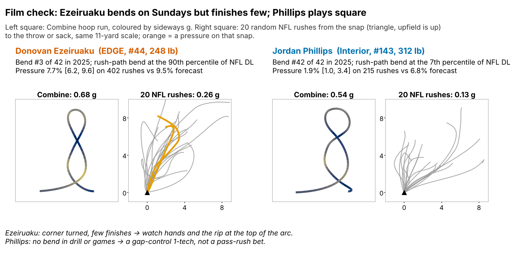
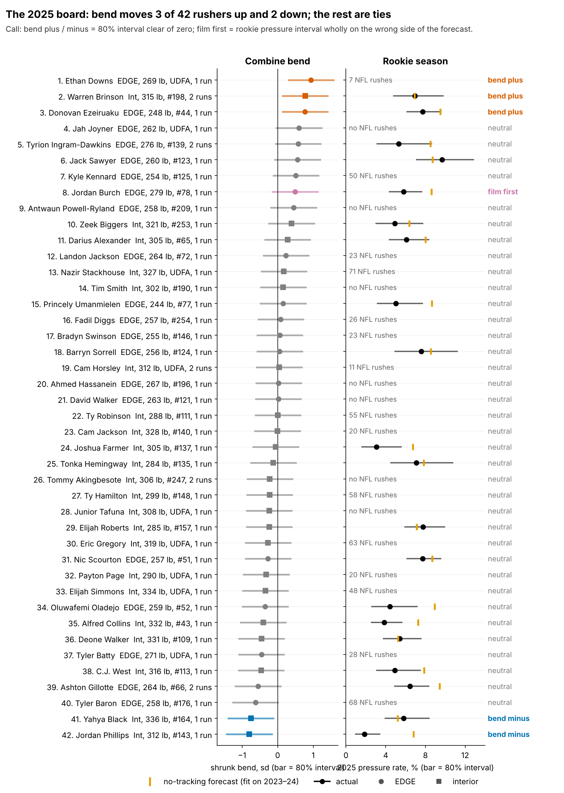

# Bend as a Tiebreaker: Run-the-Hoop "Hoop G" and NFL Pass-Rush Pressure

Defensive linemen who turned tighter at speed in the Combine's Run-the-Hoop drill produced more NFL pressure than their draft slot, size and athletic score predicted (63 linemen, 2023–2025 classes). After correcting for the 14 drill-and-outcome pairs we screened, plan on about 0.8 extra pressures a season per standard deviation of bend. That is what moving up from pick 100 to pick 76 buys. Use it to break ties.

**Why DL, and why now.** Pressure is what a defensive lineman is paid for, and DL is the one position where Combine numbers already predict NFL production (3-cone ρ = 0.63). If tracked drills add anything, it should show here first. The 2023 Combine was the first with tracked position drills, and three classes now have NFL snaps.

## Hoop G in coaching terms

**Hoop G is the hardest sideways push a rusher holds for half a second while rounding the hoops, measured in g.** It is the drill version of bending the corner: dip the inside shoulder, keep speed through the turn around the tackle's outside hip, and rip through without drifting wide. A typical run peaks at 0.62 g, about 3.5 yd/s on a 1.8-yard radius. **NFL rush-path bend** applies the same formula to a player's 20 random sampled NFL pass rushes, from the snap to the throw or sack. It needs no ball or opponents.

We also tested the pass-rush drill's first-second burst, but it cannot rank players. A player's 1.9 reps have reliability 0.22, and ranking would take about 16 reps. The NGS get-off it should predict is sound (ρ = −0.80 with tracked first-second distance per snap), so the limit is the drill.

## Data and baseline

The cohort is the 69 DL with 100+ regular-season pass rushes (36 EDGE, 33 interior, median 297 rushes); 63 of them ran the hoop. Pressure rate comes from play-level charting, pulled toward the DL mean (8.1%) for small samples. Drill numbers are standardized within Combine year.

**Who is left out.** 46 of 109 hoop runners have fewer than 100 rushes. They played a median 1.0 games a season against 14.0 for the cohort, so injury, depth and rookie snap counts drive the cut. Bend is unrelated to playing time (ρ = 0.05). Adding games per season to the baseline leaves the effect at 0.32.

**Baseline without tracking:** log draft pick, weight, NGS athleticism score and NFL EDGE share. All four exist for every player, so nothing is imputed. The 10-yard split and 3-cone are missing for many rushers, so they enter as imputed variants (Figure 4). With both added, the link weakens to 0.26 [−0.04, 0.51]. Every "held-out" number is fit on two Combine classes and tested on the third.

## Finding 1: the stopwatch carries most of the signal

The 3-cone and 40 track pressure, as teams already know. Among tracked drill numbers, only bend keeps a pressure link after the baseline. Drill bend is not "turns tighter on Sundays", though: its link to NFL rush-path bend (0.37) falls to 0.10 once weight and alignment are removed. Balance through contact, which this tracking cannot see, is a plausible carrier.

## Finding 2: bend adds pressure, but less than one a season

| Test | n | Estimate [95% CI] | Read |
|---|---|---|---|
| Bend → pressure, after baseline | 63 | ρ 0.32 [0.06, 0.54] | real in-sample link |
| Per sd of bend: ran the 40 / skipped it | 49 / 14 | +0.58 / +0.73 pp | same slope (p = 0.74) |
| Corrected for screening 14 pairs | 63 | 0.8 pressures a season | planning number |
| Placebo: tackle rate | 63 | ρ −0.21 [−0.43, 0.02] | no positive link, as expected |
| Placebo: get-off | 63 | ρ 0.13 [−0.15, 0.41] | no link, as expected |

One standard deviation of bend goes with +0.69 pressure points above the forecast, or 3.1 pressures in a 450-rush season. That is the best of 14 drill-and-outcome pairs we screened, and chance alone produces a lead this large about one time in eight. Pulling all 14 estimates toward their common mean leaves **0.8 pressures a season, our headline.** Bend does not predict tackles or get-off, which it should not, so a general "good athlete" effect is unlikely.

## Does it matter to a GM?

The obvious worry: the forecast gain comes almost entirely from the 14 rushers who skipped the 40 (10 EDGE, 9 from 2025, median pick 60 against 110). An interaction model settles the cause. The bend slope is +0.58 pp [0.01, 1.11] for players with a 40 and +0.73 pp [−0.04, 1.39] without, so the link does not depend on the 40. What does depend on it is the forecast: among the 49 who ran, adding bend leaves held-out accuracy flat, and the gain is positive in only 36% of bootstrap samples. A sub-one-pressure effect is too small to show up in three folds of about 16 players.

In draft terms, the planning effect (0.8 pressures) equals moving from pick 100 to pick 76. Even the uncorrected effect equals 100 → 37. **So bend is a tiebreaker between rushers in the same tier, never a reason to jump a round.** The no-40 group is where it matters most in practice: there, bend is one of the few movement numbers a team has.

## Technique and scheme

If bend is the dip-and-rip, it should show on edge snaps and late pressures. It does not show clearly. Bend does not change when pressure arrives (time to pressure ρ = 0.06), the share of quick pressures (0.00) or sacks per pressure (0.10). The player-level effect is 0.30 for EDGE and 0.37 for interior rushers. On sampled snaps, pressure odds per sd are ×1.03 when aligned outside and ×1.16 inside, both with intervals spanning 1. Blocker type is not in the data. Our read: bend is a general change-of-direction trait, not only the wide-9 arc.

**Donovan Ezeiruaku** ranks #3 in 2025 bend, and his NFL rush paths sit at the 90th percentile of DL. Yet he produced 7.7% [6.2, 9.6] against a 9.5% forecast. He wins the corner, so the film question is hands and the rip at the top of the arc. **Jordan Phillips** (42 of 42) shows no bend in the drill or in games and produced 1.9% against 6.8%. He fits a gap-control role, not a pass-rush bet.

## What a team can use

**Decision rule, applied to every row:**
1. **Bend plus** (80% interval above zero): break ties his way.
2. **Bend minus** (80% interval below zero): he must win with power or get-off; check that on film.
3. **Film first**: if a rusher with 100+ NFL rushes has a pressure interval wholly on the wrong side of his forecast, trust the film over the drill.

In 2025 this marks 3 rushers plus, 2 minus and 1 film-first (Jordan Burch). Across all 109 runners from 2023–25, it gives 10 plus, 8 minus and 2 film-first; the other film-first player, Byron Murphy, out-produced a low hoop. The full board with weight, role, pick, intervals and call is in `board_2023_2025.csv`.

**Ask for 3–4 hoop runs.** One run has reliability 0.41 [0.14, 0.60]. Three runs reach 0.68 and four 0.74, enough to rank. Undrafted Ethan Downs ran the best hoop in his class (z = +2.3), which shrinks to +0.94 [0.31, 1.57]. With 7 NFL rushes, he is worth a second run before moving him up.

## Pre-registered test

**Primary:** among 2026- and 2027-class DL with 100+ rushes by the end of 2027 (about 40), the bend effect on pressure after the four-item baseline is above zero (one-sided α = 0.05). **Subgroup:** the bend slope is larger for rushers without an official 40. Our data say no difference (p = 0.74), so we expect this to fail. Power is 0.61 if the uncorrected effect is true and only 0.13 at the planning effect, so the test will rule out a large effect, not prove a small one. An estimate at or below zero takes bend off the board.

## Limitations

- **Baseline choice.** With the 10-yard split and 3-cone imputed, the interval reaches zero.
- **Selection.** Corrected for 14 screened pairs, the main result does not clear p = 0.05 (best-of-14 p = 0.121; re-selecting inside each held-out fold, p = 0.091). It is a lead.
- **Small n.** About 20 players per class; every held-out interval includes zero. Only 10 players ran the hoop twice.
- **Game tracking is a sample.** Rush-path bend and snap splits use 20 random rushes per player, with no blockers, ball or opponents. Scheme, stunts and quarterback timing are not in the data.
- **Availability.** The 100+ rush cut drops injured and buried players; we show it is not related to bend, but cannot rule out that the cut changes the effect.
- **Short careers.** The 2025 class has one season: its board is for order, not levels.

## Appendix: statistics

| Check (bend → pressure unless noted) | n | Estimate [95% CI] | Held-out R² gain [95% CI] |
|---|---|---|---|
| Main baseline | 63 | 0.32 [0.06, 0.54] | +0.103 [−0.161, 0.357] |
| Angle baseline: + 10-yd and 3-cone, imputed | 63 | 0.26 [−0.04, 0.51] | +0.017 [−0.362, 0.441] |
| Ran the 40: main / + official 10-yd | 49 | 0.19 / 0.18 | +0.002 / −0.002 |
| Mixed model, class intercept (pp per sd) | 63 | 0.66 [0.22, 1.10] | — |
| Train on one class, predict two | — | — | +0.141, positive in 3 of 3 |
| Bend alone, unadjusted for selection | 63 | p = 0.013 | — |
| True-score effect (one-run reliability) | 63 | 0.57 [0.15, 1.00] | — |
| Bend → NFL rush-path bend, after weight, alignment | 79 | 0.10 [−0.11, 0.32] | — |

Main-baseline held-out R² rises from 0.085 to 0.188; the class-stratified bootstrap puts the gain above zero 75% of the time. Methods: Savitzky–Golay smoothing (window 7, order 2); sideways acceleration |v × a|/|v| averaged over 0.5 s, identical for drill and NFL snaps. Effects are Spearman partial correlations of baseline-residualized ranks (2000 player bootstraps); held-out intervals refit the whole loop. Imputation draws from weight, EDGE share, NGS score and bend, never the outcome. Interaction: OLS with class fixed effects, class-stratified bootstrap.

*Reproducible: `uv run python writeup/candidates/round_04/cand_1/analysis.py` writes every number to `numbers.json`, draws every figure and fills this text from `writeup_template.md`.*
