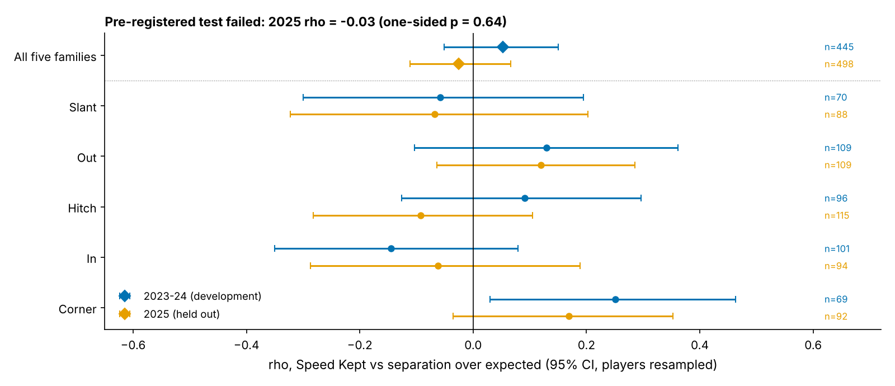
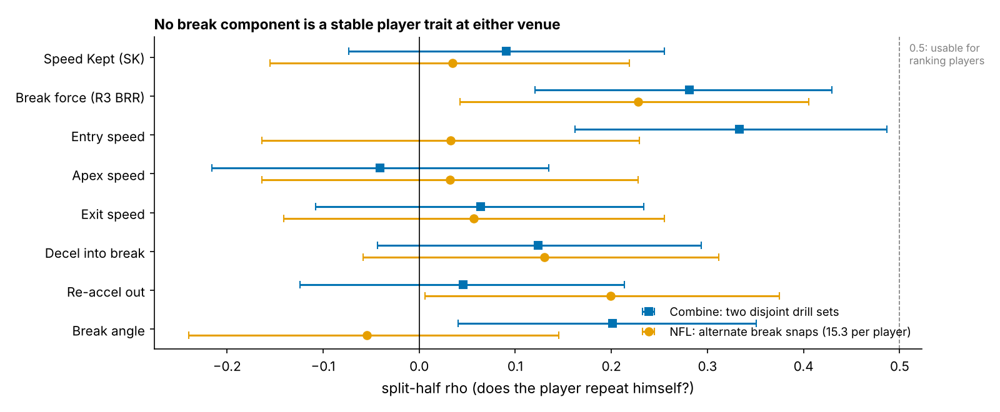
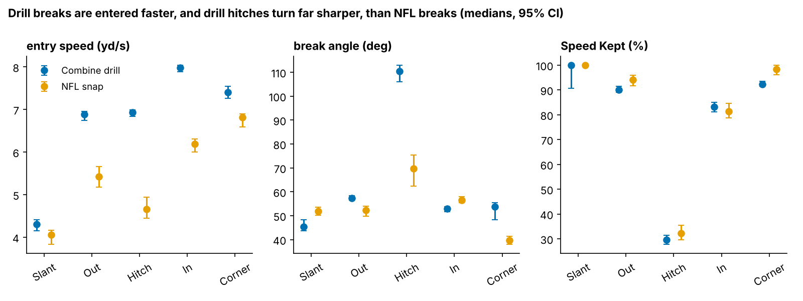

# Speed Kept: A Pre-Registered Test of Receiver Break Mechanics, and What Its Failure Tells a Scout

Combine route-drill tracking cannot tell you which receiver will keep his speed through an NFL break. Keeping speed through the break did not buy separation in a season we held out. We locked one metric, **Speed Kept**, before opening the 2025 games. It scored ρ = −0.03. Use route drills to pick tape, not to grade receivers.

**Why WR/TE, and why now.** Route drills are the only Combine drills that copy a position's game movement, and 10 Hz tracking now records them. "Suddenness" numbers built from them are coming; this entry tests one with a test fixed in advance.

## Summary

- **Metric.** *Speed Kept* (SK) is the share of his entry speed a receiver still has at the slowest point of his break. 100% means no slowdown. A typical NFL hitch keeps 32%.
- **Correction that comes first.** 47% of NFL "breaks" on slants, outs, hitches, ins and corners finish less than 0.2 s before the throw, or after it (63% of hitches). They cannot have created separation at the throw, so we do not grade them.
- **Pre-registered test: failed.** On 498 graded 2025 snaps (87 players), SK vs separation over expected is ρ = −0.03 [−0.11, 0.07], one-sided p = 0.64. The plan was committed to git (`d6d2360`) before 2025 outcomes were opened.
- **Not a player trait at either venue.** Only 1.2% of the snap-to-snap spread in NFL SK belongs to the player. Combine SK does not predict NFL SK: ρ = −0.03 [−0.22, 0.15], n = 115.
- **Decision.** Give route-drill break kinematics zero draft weight. Grade breaks from film only when they finish before the ball is out.

## The metric

**Coach's definition.** Find the slowest moment of the break. Divide his speed there by the fastest he was going in the second before. A speed cut that never throttles down scores 100%. A hitch where he plants and stops scores near zero.

**Code definition.** Speed comes from smoothed derivatives of x/y at 10 Hz. The break detector is the one used in round 3, unchanged: the first turn of 30° or more after 1.5 yd of travel, entered above 2.5 yd/s. The apex is the slowest frame within 0.5 s of the turn. SK is the apex speed divided by the peak speed in the 1.0 s before the apex. Values are standardized within drill × Combine year, and in games within route family × position, so a tight end is only compared with tight ends.

Breaks were found in 96% of 926 drill reps (149 WR/TE, median 7 drills each) and 89% of 1,988 NFL snaps on break routes. NFL snaps come from the repo's regular-season sample: up to 40 pass plays per player, half random and half chosen for high |EPA|. **Separation over expected (SOE)** is separation at the throw minus a context model. The model uses route, depth, cushion, man/zone, alignment, time to throw, target, down and distance. It was fitted on 2023–24 seasons only.

## A correction first: grade only breaks that finish before the throw

Separation is measured when the ball leaves the hand, so a later break cannot have caused it. Yet 39% of detected breaks reach their apex after the throw, and another slice in the last 0.2 s before it. Hitches are the worst case at 63%, because the quarterback throws the hitch as the receiver is still stopping.

This explains round 3's lead. Our previous entry found "hard breaks win against man, lose against zone." Most of the zone penalty comes from breaks scored after the throw (ρ = −0.17 [−0.24, −0.10]). On breaks before the throw it is −0.03 [−0.11, 0.06]. Any tracking grade of route breaks should apply this filter first.

## The pre-registered test

On 2023–24 snaps we compared break components only against each other and against SOE. Then we locked one metric, one snap rule and one test in `prereg.json`, and committed it before running any 2025 outcome. The test: ρ(SK, SOE) on 2025 graded snaps must be above 0, with one-sided p < 0.05 and a 90% interval above zero. If not, SK gets zero weight.

| | 2023–24 (development) | 2025 (held out) |
|---|---|---|
| Graded snaps / players | 445 / 78 | 498 / 87 |
| ρ(SK, SOE) [95% CI] | 0.05 [−0.05, 0.15] | −0.03 [−0.11, 0.07] |
| Families with ρ > 0 | 3 of 5 | 2 of 5 |

The test failed: the 90% interval is [−0.10, 0.05], and a within-player shuffle gives p = 0.64. The development estimate was itself only 0.05 (0.06 with the class-cross-fitted context model used while exploring), so the metric started weak. Within the same player, his higher-SK snaps show no more separation either: ρ = 0.00 [−0.07, 0.06].

**One pattern repeated, and it is still not worth coaching to.** On outs and corners, the two speed-cut routes, ρ was 0.16 in both periods (2025: [0.03, 0.29], n = 201). We noticed this only after opening 2025, so it is post hoc. In yards it is negligible: 0.6 inches of SOE per 10 points of SK [−2.5, 4.0]. Full-speed reps beat reps that lost 20% or more by only 3 inches [−20, 23]. It lives within players (0.10 [0.00, 0.19]), not between them (−0.07, 68 players). Read it as rep execution, not a trait to scout.

## Why it cannot be a draft trait

A gradeable trait must repeat. None of the eight break components does at either venue. The best Combine value is entry speed at 0.33. The best NFL value is round 3's break force at 0.23. SK's player share in NFL snaps is 0.012, at most 0.031. Even at that upper bound, it takes 73 break snaps to reach a reliability of 0.7, about five times the 15.3 per player in this sample.

The drills also test a different movement. Drill breaks are entered at 6.8 yd/s against 5.3 in games. The Combine curl, comeback and hook turn 110° where the NFL hitch turns 70°. The Combine corner turns 54° where the NFL corner turns 40°. Matching each drill to its own game family does not help: ρ = 0.06 [−0.05, 0.16] over 436 player-family pairs.

## Against a baseline without tracking

| Model, held out | No-tracking baseline R² | + SK | Change [95% CI] |
|---|---|---|---|
| Snap separation, 2025 season (498 snaps; fit on 2023–24) | 0.056 | 0.056 | 0.000 [−0.001, 0.000] |
| Season separation, out of class (67 players, ≥150 routes) | 0.05 | 0.03 | −0.02 [−0.09, 0.03] |
| Season yards per route run, out of class | 0.04 | −0.04 | −0.07 [−0.19, 0.00] |

The baseline is log draft slot, the 40 and weight (standardized within year × position), NGS athleticism and a TE flag, added to the context model at snap level. Out of class means a ridge trained on two Combine classes and scored on the third. SK (snap value, or Combine score at season level) adds nothing. Even the player baseline lowers held-out snap R², from 0.079 for context alone, which shows how little of single-snap separation the player explains.

## Named players: the Combine extremes

The five highest and five lowest Combine SK among 76 receivers with 4+ drill breaks and 10+ NFL breaks:

| Player | Pos, class | Pick | Combine SK (z, reps) | NFL SK z [90% CI] | NFL breaks |
|---|---|---|---|---|---|
| Kyle Williams | WR 2025 | 69 | 1.20 (6) | 0.13 [−0.15, 0.41] | 13 |
| Javon Baker | WR 2024 | 110 | 0.95 (9) | −0.35 [−0.82, 0.11] | 20 |
| Isaiah Williams | WR 2024 | UDFA | 0.85 (7) | 0.17 [−0.16, 0.50] | 21 |
| Michael Wilson | WR 2023 | 94 | 0.70 (7) | 0.02 [−0.22, 0.25] | 16 |
| Luke McCaffrey | WR 2024 | 100 | 0.59 (6) | 0.04 [−0.42, 0.49] | 21 |
| Devin Culp | TE 2024 | 246 | −0.66 (4) | −0.51 [−0.89, −0.13] | 20 |
| Devaughn Vele | WR 2024 | 235 | −0.74 (7) | −0.08 [−0.44, 0.27] | 24 |
| Elijah Higgins | TE 2023 | 197 | −0.89 (8) | 0.27 [−0.02, 0.56] | 17 |
| Rome Odunze | WR 2024 | 9 | −0.92 (6) | −0.03 [−0.47, 0.42] | 15 |
| Adonai Mitchell | WR 2024 | 52 | −0.93 (9) | 0.14 [−0.22, 0.50] | 23 |

The top five averaged +0.86 in Indianapolis and 0.00 in the NFL. The bottom five averaged −0.83 and −0.04. Rome Odunze, the ninth pick, sat near the bottom of the drill, yet his NFL breaks keep average speed. Only Devin Culp's NFL interval excludes zero, and that is one in ten, about what chance gives at 90% intervals. A scout who docked Odunze or Mitchell for drill "throttle-down" would have been docking noise.

## What a team should do

1. **Draft room.** Give route-drill SK, break force and entry speed zero weight. If a vendor sells a drill "suddenness" score, ask for its split-half reliability and its link to game breaks. Here they are 0.09 and −0.03.
2. **Film and tracking grades.** Count a break only if it finishes at least 0.2 s before the throw. Otherwise the grade measures quarterback timing, not the receiver.
3. **Coaching.** On outs and corners, "speed cut, don't throttle" is consistent with the data but is worth under an inch per rep here. Keep teaching it for timing reasons, not as a separation lever.
4. **Player evaluation.** Do not rank receivers on in-game break mechanics from a 15-snap sample. You need roughly 73 graded breaks, and even then reliability is only borderline.

## Pre-registered next test (2026 season)

One hypothesis, same code: on 2026 out and corner routes with the break finishing at least 0.2 s before the throw, ρ(SK, SOE) > 0 with one-sided p < 0.05. If it fails, the coaching note in point 3 goes too.

## Limitations

- **Sample.** The game data are a sample: up to 40 plays per player, half picked for high |EPA|, about nine graded breaks per player. Snap-level tests have power. Player-level ones mostly do not, and the reliability bounds say how far that goes.
- **No defenders or ball.** Coverage and separation are charted; leverage, press and the defender's break are unseen.
- **Metric design.** SK caps at 100%, and 72% of graded slants and 64% of corners sit at the cap. That limits what SK can show on those routes. We kept the metric as registered rather than redefine it after the result.
- **Detector.** The detector takes the first sharp turn. Double moves and option routes can be mis-assigned, and 11% of break-route snaps had no detectable break.
- **Not fully blind.** Round 3 had already looked at pooled break components across all seasons, ungraded. Apex speed vs SOE was near zero there, so the 2025 test checked a weak prior. Nothing in it was fished from 2025.
- **Drills.** The drills are uncovered and choreographed, most players run each drill once, and the TE groups are small.

## Appendix: statistics

| Quantity | Estimate |
|---|---|
| Combine / NFL split-half ρ for SK | 0.09 [−0.07, 0.26], n = 145 / 0.03 [−0.16, 0.22], n = 113 |
| SK player share (ICC) in NFL snaps; upper 95% | 0.012; 0.031 |
| Pooled graded snaps, all seasons | ρ = 0.01 [−0.05, 0.07], n = 943 |
| Combine SK vs player NFL SOE (graded) | 0.12 [−0.06, 0.30], n = 112 |
| Context model R² for separation, 2025 held out | 0.18 |
| Players missing an official 40 (imputed at mean) | 18 |

Reproduce: `uv run python writeup/candidates/round_04/cand_2/analysis.py` (about two minutes, `data/processed` only). Every quoted number is written to `numbers.json`. The pre-registration is `prereg.json`.
