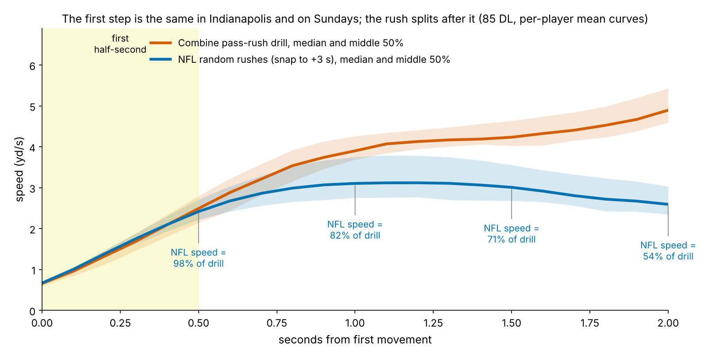
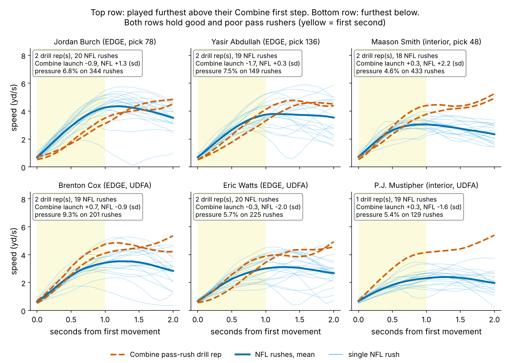
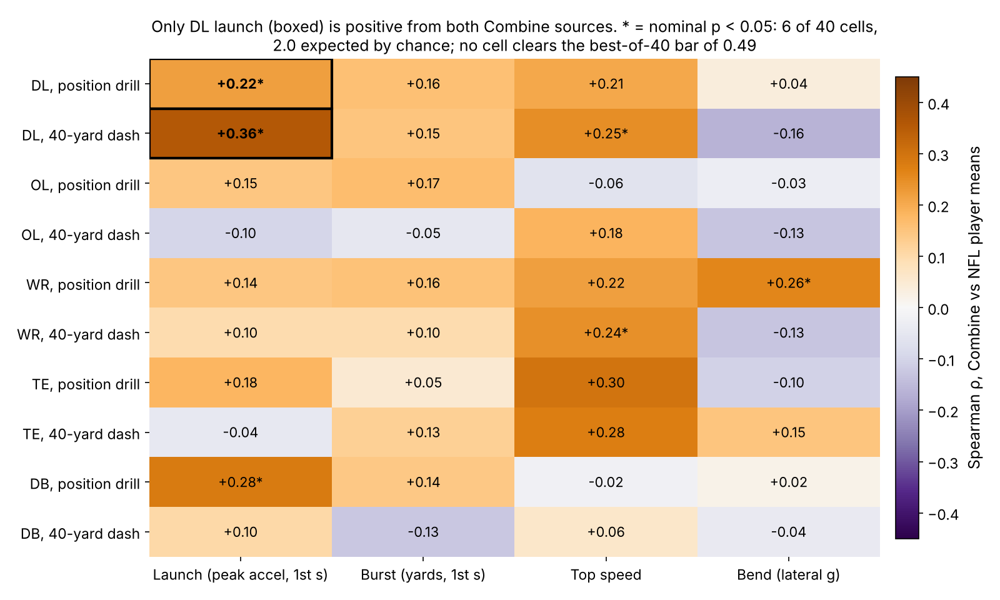
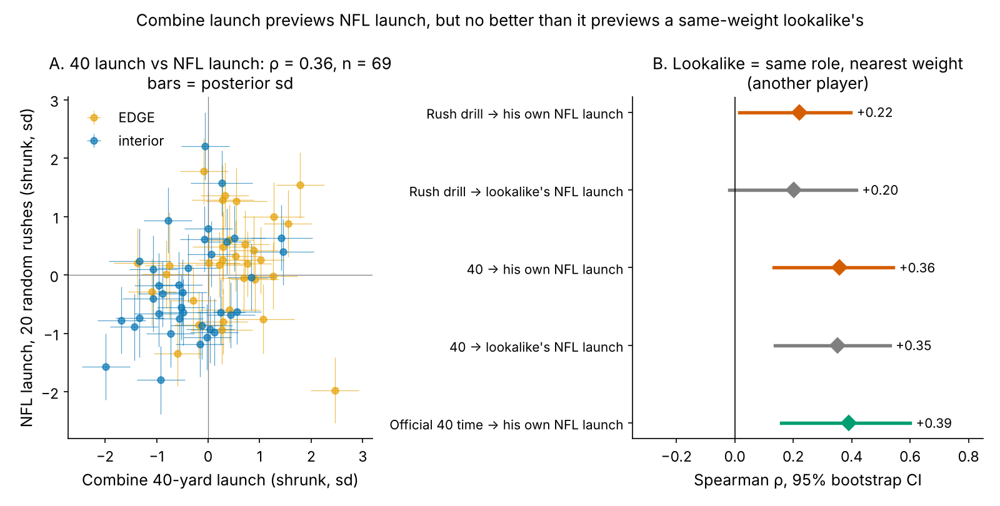

# The First Step Travels, the Match Doesn't Pay: Drill-to-Game Launch for NFL Pass Rushers

A defensive lineman's first half-second looks the same at the Combine and on Sundays, and his 40 previews how hard he launches in the NFL. But that preview is mostly body type. How closely a rusher "plays to his Combine" adds nothing to draft slot, weight and role in predicting pressure. Grade the first step with the stopwatch, and scout what happens at contact.

**Why DL, and why now.** Defensive line is the one group where Combine numbers already predict NFL pressure (3-cone, 40 and shuttle, ρ around 0.5–0.6). The first step is also the one movement that starts the same way in both places: from a stance, on a cue. Tracked position drills began with the 2023 Combine, and three classes now have NFL rushes. 

## Launch in coaching terms

**Launch is how hard a player pushes off over his first three steps.** Formally, it is the peak forward acceleration (yd/s²) in the first second after he starts moving. One function computes it on 10 Hz tracking from the Combine pass-rush drill, the Combine 40, and NFL snaps (window starts at the snap). **The gap** is a player's NFL launch minus his Combine-drill launch, both in standard-deviation units after shrinking noisy players toward the mean. A positive gap means he launches harder on Sundays than he did in Indianapolis. **Curve-shape match** correlates the shapes of his drill and NFL speed curves.

**Data.** {n_dl} DL from the 2023–2025 classes: {n_dl_drill_reps} pass-rush-drill reps, {n_dl_forty_reps} 40 reps and {n_dl_game_reps} *random* NFL rushes ({rand_per_player_DL} per player; the sack-heavy top-EPA half is only a replication check). NFL launch is adjusted for alignment; Combine launch is standardized within drill and year.

**Is the game metric real?** On single rushes, launch tracks NGS get-off time at ρ = {val_play_rho} (n = {val_play_n}; faster get-off, harder launch). One rush is noisy (reliability {r1_game}); twenty give {rel_game}, six only {rel_game_6}.

## Finding 1: the first step travels, mostly as body type

**The first half-second is the same.** At 0.5 s the median NFL rusher is moving at {spd_ret_5}% of his drill speed. By 1.0 s he is at {spd_ret_10}%, and by 2.0 s at {spd_ret_20}% (Fig 1). Peak launch is nearly matched: {med_acc_game} yd/s² in games against {med_acc_drill} in the drill, a median retention of {ret_med}%. The drill keeps accelerating; the NFL rush flattens at contact.

**Who launches hardest partly carries over.** We screened five position groups, four movement features and two Combine sources (Fig 3). DL launch is the only movement positive from both sources: the 40 gives ρ = {sp_fg} [{sp_fg_lo}, {sp_fg_hi}] (n = {sp_fg_n}) and the pass-rush drill {sp_dg} [{sp_dg_lo}, {sp_dg_hi}] (n = {sp_dg_n}). It is the top cell, but not proof: shuffling NFL players produces a cell this strong somewhere in the screen with probability {pbest_DL_forty_acc}.

**But it is not personal.** If translation were personal, a rusher's Combine launch would match his own NFL launch better than that of a lookalike: another player of the same role and nearest weight. It does not (Fig 4B). The 40 previews his own NFL launch at {look_forty_self} and the lookalike's at {look_forty_look}; the drill gives {look_drill_self} and {look_drill_look}. His Combine launch lands closer to his own NFL launch than to the lookalike's for {look_forty_closer}% of players [{look_forty_closer_lo}, {look_forty_closer_hi}] with the 40 and {look_drill_closer}% [{look_drill_closer_lo}, {look_drill_closer_hi}] with the drill. A coin flip gives 50%.

**And the stopwatch already has it.** The official 40 time ranks NFL launch at ρ = {sp_40time_g} [{sp_40time_g_lo}, {sp_40time_g_hi}], and the 10-yard split at {sp_10yd_g}. Beyond official 40 and weight, tracked drill launch adds {pc_dg_40wt} [{pc_dg_40wt_lo}, {pc_dg_40wt_hi}]. One drill rep keeps only {lam_drill_1rep} of its deviation after shrinkage; a player would need {reps07_drill} reps for a dependable reading.

## Finding 2: playing to your Combine does not predict pressure

The outcome is career pressure rate for the {n_cohort} DL with 100+ NFL rushes (median {cohort_snaps_med}), shrunk toward the role mean so short careers do not swing it. The no-tracking baseline is log draft pick, Combine weight and EDGE share. We tested five per-player measures (Fig 5): the gap, curve-shape match, NFL launch level, drill launch and 40 launch.

- **The gap**: partial ρ {pr_ltg} [{pr_ltg_lo}, {pr_ltg_hi}] beyond the baseline. Given his NFL launch level, it carries nothing ({pr_lt_givengame}).
- **NFL launch level** is the strongest: {raw_g_true} raw, but {pr_g_true} [{pr_g_true_lo}, {pr_g_true_hi}] beyond the baseline. Lighter rushers launch harder (ρ {rho_g_weight} with weight).
- **Out of class, nothing adds.** Each class is predicted from the other two. All five measures leave the baseline's held-out R² flat or lower (Appendix).
- **Re-running the whole pipeline** with each class held out (screen, choice of measure, fit) picks DL launch in only {nest_cell_dl_acc} of 3 folds and gains held-out accuracy in {nest_pos} of 3.
- **Placebo.** If the gap were a "good player" signal, it would also predict run-stop rate. It does not; it leans negative ({plac_ltg}).
- **EDGE vs interior.** The gap is {pr_lt_EDGE} for EDGE (n = {pr_lt_EDGE_n}) and {pr_lt_interior} for interior (n = {pr_lt_interior_n}). The difference is well inside noise.

**What it is worth.** At its point estimate, one standard deviation of gap is {ps_ltg} pressures a season (interval {ps_ltg_lo} to {ps_ltg_hi}) for a rusher with the cohort's median {rush_per_season_med} rushes. One standard deviation of NFL launch is {ps_g_true} ({ps_g_true_lo} to {ps_g_true_hi}), the same as moving from pick 100 to pick {pickeq_g_true}. Most of a player's gap is noise: gaps spread {lt_sd_spread} sd across players, but each player's own uncertainty is {lt_post_sd_med} sd. Only {ltg_excl0} of {n_lt} have a 90% interval that excludes zero.

{TABLE_named}

*Table 1. Five largest and five smallest gaps in the pressure cohort (launch in sd, ± posterior sd; pressure shrunk, cohort median {press_cohort_med}%). "Read" rule: high launch = NFL launch ≥ +0.5 sd; high pressure = at or above median.*

Byron Young was ordinary in Indianapolis, launches among the hardest on Sundays, and produces. Maason Smith launches harder still and pressures at 4.6%. Brenton Cox plays below his drill and still pressures above the median. The top five gaps average {top_lt_mean_press}% pressure, the bottom five {bot_lt_mean_press}%.

## What a team can use

1. **Draft room.** For first-step quickness, use the official 40 and 10-yard split with weight. Give tracked pass-rush-drill launch zero weight: it adds nothing beyond them, and one rep is mostly noise.
2. **Pro personnel and coaching.** Do not flag a young rusher for "not playing to his Combine." The gap is worth {ps_ltg} pressures a season at its point estimate and is mostly measurement noise. Grade launch from 20+ random rushes as a description of get-off, not a forecast.
3. **Scouting time.** The two settings agree for half a second and split at contact. Pressure is won after that point (hands, counters, power), and no Combine drill measures it. Spend film time there.

## Pre-registered 2026 test

For 2023–2025 DL with 100+ 2026 rushes, NFL launch from 20 random 2026 rushes will show a positive partial ρ with 2026 pressure beyond the same baseline. We drop the lead if the estimate is ≤ 0. Power is only {pow_g} at the observed effect, and the smallest effect detectable at this n is {mde_press}. A null would therefore be weak evidence, and we say so in advance.

## Limitations

- **Sample.** Twenty random rushes per player (reliability {rel_game}). On the top-EPA half the 40 link holds ({sp_fg_top}) but the drill link does not ({sp_dg_top}).
- **Selection.** {n_out_cohort} of {n_with_game} DL with NFL launch did not reach 100 rushes. Drill launch does not predict who reaches it ({sel_d_true}); 40 launch leans positive ({sel_f_true}, p = {sel_f_true_p}). Injuries are not modelled (cohort median {cohort_gps_med} games a season).
- **No ball, no opponents.** Launch starts at first movement, so snap reaction is excluded. Contact time, stunts and double teams are unobserved.
- **Construct.** The drills have no blocker and the 40 has no stance change. The lookalike test matches only role and weight; arm length and technique are not matched.
- **Outcomes.** Pressure is charted and carries scheme. The 2025 class has one season.

## Appendix: methods and statistics

Onset is the first frame at or above 1.0 yd/s, backed up while speed stays at or above 0.5 yd/s. Launch is the peak first difference of Savitzky–Golay-smoothed speed over the next 1.0 s. Player means are shrunk by λ = τ²/(τ² + σ²/k) (one-way variance components) and divided by τ. Pressure is beta-binomial shrunk within role (prior {prior_ab_EDGE} EDGE and {prior_ab_interior} interior rushes). Partial correlations are rank-based with 2,000 bootstraps. Best-of-k p values permute NFL means across players (screen) or pressure within class (production). The nested run repeats the screen and the choice of measure on two classes and scores the third (interval: 300 training redraws). Baseline R² varies by row because each uses its complete cases.

| Test | Estimate [95% CI] | n | best-of-k p | Held-out R² gain (baseline R²) |
|---|---|---|---|---|
| 40 → NFL launch | {sp_fg} [{sp_fg_lo}, {sp_fg_hi}] | {sp_fg_n} | {pbest_DL_forty_acc} (k = 40) | — |
| Drill → NFL launch | {sp_dg} [{sp_dg_lo}, {sp_dg_hi}] | {sp_dg_n} | {pbest_DL_pos_acc} (k = 40) | — |
| Own minus lookalike, 40 | {look_forty_diff} [{look_forty_diff_lo}, {look_forty_diff_hi}] | {look_forty_n} | — | — |
| Gap → pressure | {pr_ltg} [{pr_ltg_lo}, {pr_ltg_hi}] | {pr_ltg_n} | {pbest4_ltg} (k = 4) | {loco_ltg_d} ({loco_ltg_base}) |
| Curve match → pressure | {pr_sim} [{pr_sim_lo}, {pr_sim_hi}] | {pr_sim_n} | {pbest4_sim} (k = 4) | {loco_sim_d} ({loco_sim_base}) |
| NFL launch → pressure | {pr_g_true} [{pr_g_true_lo}, {pr_g_true_hi}] | {pr_g_true_n} | {pbest4_g_true} (k = 4) | {loco_g_true_d} ({loco_g_true_base}) |
| Drill launch → pressure | {pr_d_true} [{pr_d_true_lo}, {pr_d_true_hi}] | {pr_d_true_n} | {pbest4_d_true} (k = 4) | {loco_d_true_d} ({loco_d_true_base}) |
| 40 launch → pressure | {pr_f_true} [{pr_f_true_lo}, {pr_f_true_hi}] | {pr_f_true_n} | — | {loco_f_true_d} ({loco_f_true_base}) |
| Whole pipeline, nested | — | {nest_n} | — | {nest_d} [{nest_lo}, {nest_hi}] |
| Gap → run-stop (placebo) | {plac_ltg} [{plac_ltg_lo}, {plac_ltg_hi}] | {plac_ltg_n} | — | — |
| Gap × EDGE share (pp) | {int_lt_edge} [{int_lt_edge_lo}, {int_lt_edge_hi}] | {pr_ltg_n} | — | — |

*Table 2. All primary tests. Partial ρ is beyond log pick, weight and EDGE share.*

*Reproducible: `uv run python writeup/candidates/round_04/cand_3/analysis.py` writes every number to `numbers.json`, every figure, and renders this file from `writeup_template.md`.*
