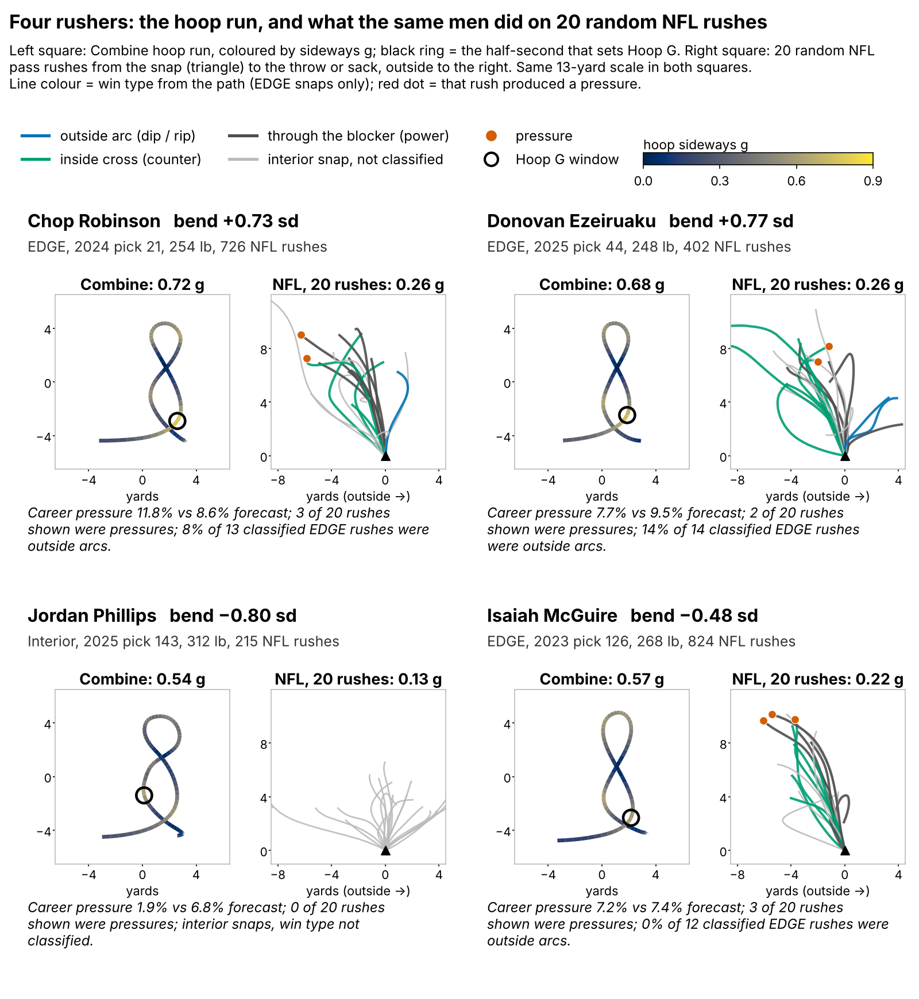
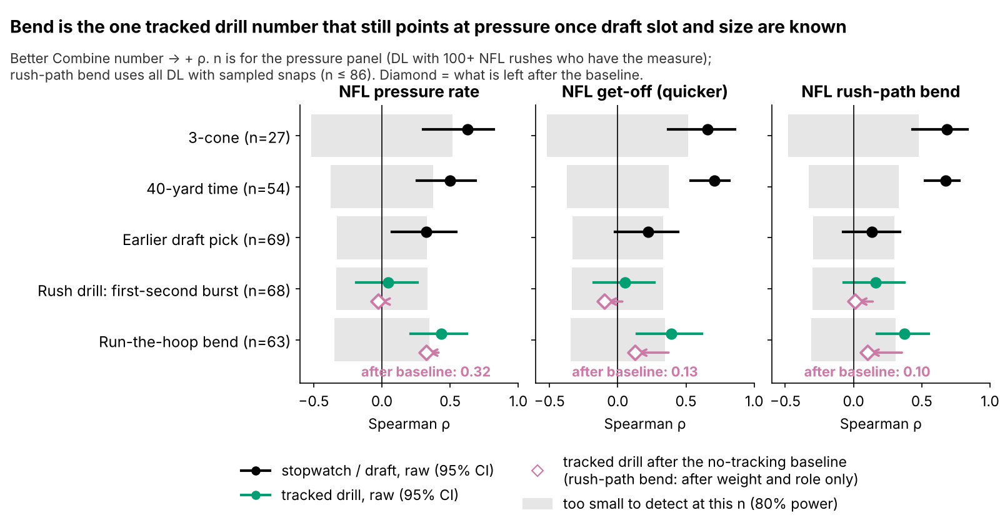
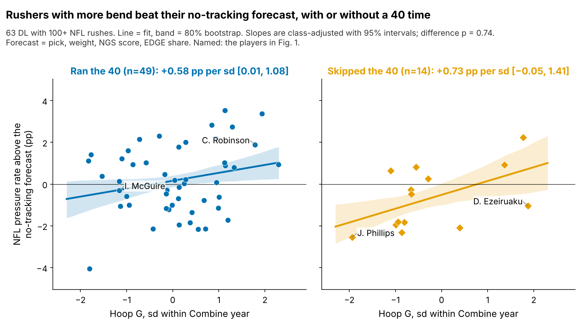
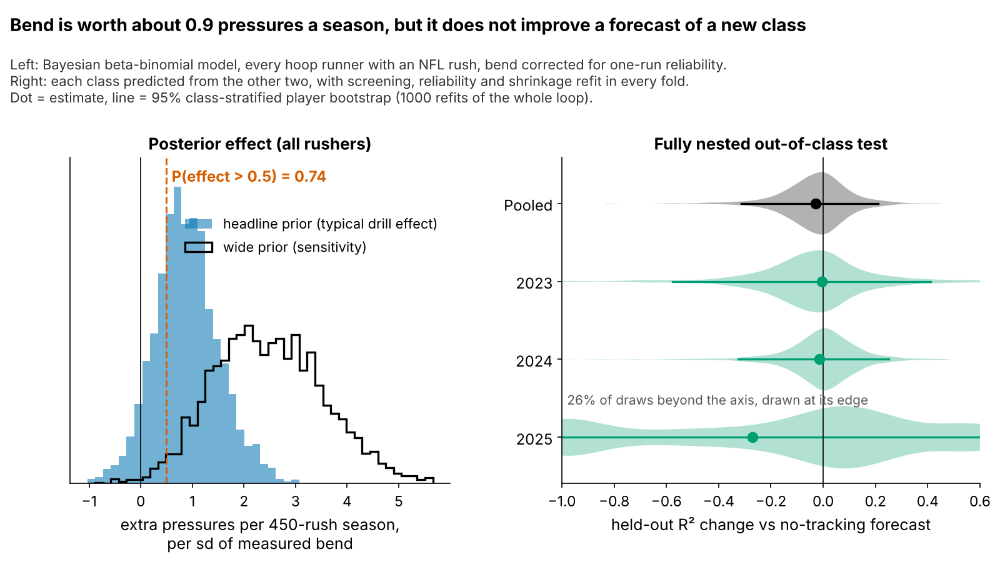
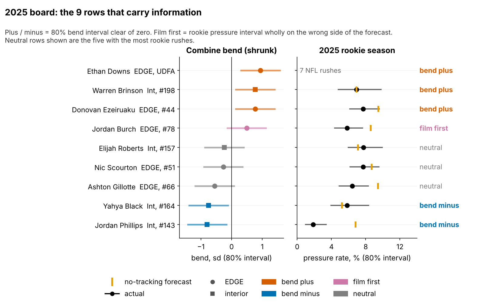

# Bend as a Tiebreaker: Run-the-Hoop "Hoop G" and NFL Pass-Rush Pressure

Defensive linemen who turned tighter at speed in the Combine's Run-the-Hoop drill produced a little more NFL pressure than their draft slot, size and athletic score predicted. Plan on under one extra pressure a season for a rusher one notch better at bend. That is a tiebreaker, not a reason to move up a round.

**Why DL.** Pressure is what a defensive lineman is paid for, and DL is the one position where Combine numbers already predict NFL production (3-cone ρ = {{rho_three_cone_z_press_eb}}). Three tracked Combine classes (2023–25) now have NFL snaps.

## Hoop G in coaching terms

**Hoop G is the hardest sideways push a rusher holds for half a second while rounding the hoops, measured in g.** It is the drill version of bending the corner: dip, keep speed through the turn, rip through without drifting wide. A typical run peaks at {{hoop_g_median}} g, about {{hoop_speed_at_bend}} yd/s on a {{hoop_radius_typ}}-yard radius. "One notch" below means one standard deviation within a Combine year. **NFL rush-path bend** applies the same formula to {{arc_snaps_per_player}} random sampled NFL rushes per player, snap to throw or sack.

**Does the drill show up as technique?** Not that we can see. On {{wt_n}} EDGE-aligned sampled rushes we read the win type from the path: outside arc (dip, rip), inside cross (counter) or through the blocker (power). Outside arcs are only {{wt_share_outside}}% of them, and high-bend rushers do not run more of them (ρ = {{wt_rho_out}} [{{wt_rho_out_lo}}, {{wt_rho_out_hi}}], n = {{wt_rho_out_n}}). Drill bend barely tracks NFL rush-path bend after weight and role ({{pr_hoop_arc}}). **Donovan Ezeiruaku** (#{{f1_ezeiruaku_rank}} of {{f1_ezeiruaku_classn}} in 2025 bend) bends on Sundays (rush-path bend at the {{f1_ezeiruaku_arc_pct}}th percentile), yet only {{f1_ezeiruaku_out}}% of his EDGE rushes are outside arcs; he produced {{f1_ezeiruaku_pr}}% against a {{f1_ezeiruaku_pb}}% forecast. **Jordan Phillips** (#{{f1_phillips_rank}} of {{f1_phillips_classn}}) plays square in the drill and in games: {{f1_phillips_pr}}% against {{f1_phillips_pb}}%. Hoop G is a drill score with a pressure link, not proof of a corner-bending skill.

## Data and baseline

**Outcome.** Pressures out of regular-season pass rushes. The headline model uses all {{bayes_n}} hoop runners with an NFL rush, weighted by rushes, so there is no 100-rush cut ({{bayes_n_norush}} never rushed). Rank checks use the {{v_n_main}} with 100+ rushes. Drill numbers are standardized within Combine year.

**Baseline without tracking:** log draft pick, weight, NGS athleticism score and NFL EDGE share, observed for everyone. The model adds games per season (median {{gps_out}} for runners under 100 rushes, {{gps_in}} above). Bend is unrelated to playing time (ρ = {{rho_hoop_snaps_ps}}).

## Finding 1: the stopwatch carries most of the signal

The 3-cone and 40 track pressure, as teams already know. Among tracked drill numbers, only bend keeps a pressure link after the baseline. The pass-rush drill's first-second burst cannot rank players: a player's {{k_rush_mean}} reps have reliability {{rel_drill_d1_player}}.

## Finding 2: under one pressure a season, not confirmed out of class

| Test | n | Estimate | Read |
|---|---|---|---|
| **Headline:** extra pressures per 450-rush season, per sd of bend (Bayesian, 90% interval) | {{bayes_n}} | **{{bayes_all}}** [{{bayes_all_lo}}, {{bayes_all_hi}}]; P(> 0.5) = {{bayes_all_p05}} | planning number |
| Same, EDGE / interior | {{bayes_n}} | {{bayes_edge}} / {{bayes_int}} | similar |
| Raw slope, no prior or reliability correction | {{v_n_main}} | {{pressures_per_450}} pressures | overstated |
| **Out of class:** fully nested, held-out R² change | {{nf_n}} | {{nf_dr2}} [{{nf_dr2_lo}}, {{nf_dr2_hi}}] | no forecast gain |
| Placebo: run-stop proxy (TFL per run snap) | {{plc_n_runstop}} | ρ {{plc_runstop}} [{{plc_lo_runstop}}, {{plc_hi_runstop}}] | none, as expected |
| Placebo: tackle rate | {{plc_n_tackle_rate}} | ρ {{plc_tackle_rate}} [{{plc_lo_tackle_rate}}, {{plc_hi_tackle_rate}}] | none positive |
| Negative-control drill: back-pedal speed → pressure | {{neg_n_bp}} | ρ {{neg_bp}} [{{neg_lo_bp}}, {{neg_hi_bp}}] | none, as expected |
| Technique: time to pressure / sacks per pressure | {{v_n_main}} | ρ {{plc_ttp}} / {{plc_finish}} | no link |

A rusher one notch better on a single hoop run is worth about **{{bayes_all}} extra pressures in a 450-rush season**, the same as moving from pick 100 to pick {{pick_equiv_bayes}}. The model corrects bend for one-run reliability ({{rel_hoop_sb}}) and starts from the typical effect among the 14 drill-and-outcome pairs we screened. The slope is the same with or without an official 40 (Figure 3). But the forecast gain is not testable in the {{n_40}} players who ran the 40. In the strictest test, with screening, reliability and shrinkage refit on two classes to predict the third, bend adds nothing ({{nf_dr2}}; Figure 4). Placebo outcomes and a back-pedal control show no link, so a general "good athlete" effect is unlikely.

## What a team can use

**Decision rule, applied to every row:**
1. **Bend plus** (80% interval of shrunk bend above zero): break ties his way.
2. **Bend minus** (80% interval below zero): he must win with power or get-off; check that on film.
3. **Film first**: if a rusher with 100+ NFL rushes has a pressure interval wholly on the wrong side of his forecast, trust the film over the drill.

**2025 class, top 8 and bottom 4 of {{board_n}} hoop runners** (pressure: rookie rate vs no-tracking forecast fit on 2023–24):

{{TABLE:board25}}

**2023–24 classes, every non-neutral call.** Across 2023–25 the rule gives {{board_all_plus}} plus, {{board_all_minus}} minus and {{board_all_flag}} film-first; the 2023–24 rows are below (career pressure):

{{TABLE:board_old}}

Jordan Burch is the 2025 film-first call: a plus-side hoop, but rookie pressure below forecast. Byron Murphy is the reverse: a low hoop and pressure above forecast. **Ask for 3–4 hoop runs.** One run has reliability {{rel_hoop_sb}} [{{rel_hoop_sb_lo}}, {{rel_hoop_sb_hi}}]; three reach {{rel_hoop_3runs}} and four {{rel_hoop_4runs}}. Undrafted Ethan Downs ran the best hoop in 2025 (z = +{{ex_top_z}}, shrunk +{{ex_top_shr}}) but has {{ex_top_snaps}} NFL rushes: worth a second run before moving him up.

## Pre-registered test

**Primary:** among 2026- and 2027-class DL with 100+ rushes by the end of 2027 (about {{n_prereg}}), the bend effect on pressure after the four-item baseline is above zero (one-sided α = 0.05). Power is {{power_prereg_eb}} at the headline effect, so this test can rule out a large effect, not prove a small one. An estimate at or below zero takes bend off the board. **Null check:** the bend slope does not differ between rushers with and without an official 40 (two-sided; today p = {{int_p}}).

## Limitations

- **Not confirmed out of class.** The fully nested test shows no forecast gain, and the hoop is chosen in only {{nf_hoop_folds}} of 3 folds. The headline is a small, plausible effect, not a proven one.
- **Blocker and alignment.** Pressure by blocker (tackle, guard, chip) or by alignment cannot be built from this data: game tracking has only the cohort player, with no ball, blockers or opponents. Win type is a path proxy, not film, and outside/inside is only trusted 4+ yards from the field centre.
- **Small n.** About 20 rushers per class; only {{n_hoop_two}} ran the hoop twice.
- **Game tracking is a sample** of {{arc_snaps_per_player}} random rushes per player; scheme, stunts and quarterback timing are not in the data.
- **Short careers.** The 2025 class has one season: its board is for order, not levels.

## Appendix: statistics

| Check | n | Estimate [95% CI] |
|---|---|---|
| Nested out-of-class R² change: 2023 / 2024 / 2025 held out | {{nf_n}} | {{nf_dr2_2023}} / {{nf_dr2_2024}} / {{nf_dr2_2025}} |
| Same, with 10-yd split and 3-cone imputed inside each fold | {{nf_n}} | {{nf_angle_dr2}} [{{nf_angle_lo}}, {{nf_angle_hi}}] |
| Posterior with a wide prior (pressures per season, 90%) | {{bayes_n}} | {{bayes_wide}} [{{bayes_wide_lo}}, {{bayes_wide_hi}}] |
| Posterior per sd of true (error-free) bend | {{bayes_n}} | {{bayes_true}} [{{bayes_true_lo}}, {{bayes_true_hi}}] |
| Rank link after baseline, in sample | {{v_n_main}} | ρ {{v_r_main}} [{{v_lo_main}}, {{v_hi_main}}] |
| Slope per sd: ran the 40 / skipped it (pp) | {{n_40}} / {{n_no40}} | {{int_slope_40}} [{{int_slope_40_lo}}, {{int_slope_40_hi}}] / {{int_slope_no40}} [{{int_slope_no40_lo}}, {{int_slope_no40_hi}}] |
| Best of 14 screened pairs, within-class permutation | {{v_n_main}} | p = {{perm_best14}} |
| Bend → NFL rush-path bend, after weight and role | {{pr_hoop_arc_n}} | {{pr_hoop_arc}} [{{pr_hoop_arc_lo}}, {{pr_hoop_arc_hi}}] |

**Methods.** Savitzky–Golay smoothing (window 7, order 2); sideways acceleration |v × a|/|v| over 0.5 s, identical for drill and NFL snaps. Headline: pressures ~ beta-binomial(rushes), logit link, class random intercept, EDGE and interior bend slopes, baseline plus games per season; latent true bend integrated by Gauss–Hermite quadrature. The bend-slope prior's standard deviation is the mean |ρ| of the 14 screened pairs ({{bayes_rho_typ}}), converted to the logit scale. Adaptive Metropolis, 4 chains, R-hat {{bayes_rhat}}. Nested test: inside each fold, screen 14 pairs, choose the best, estimate its reliability and shrink scores, then shrink its slope toward the other 13; {{nf_nboot}} class-stratified player bootstraps refit everything. Win type: lateral position when the rusher first reaches 3 yards upfield (outside ≥ 0.5 yd, inside ≤ −1 yd).

*Reproducible: `uv run python writeup/candidates/round_04/revised/analysis.py` writes `numbers.json` (one key per quoted number), draws every figure and fills this text from `writeup_template.md`.*
