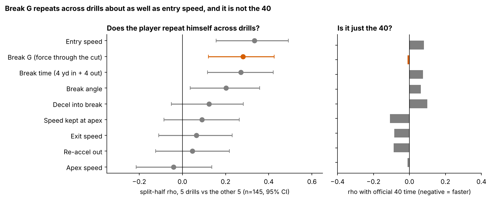

# Break G: Receivers Who Hit Their Combine Cuts Harder Drew More NFL Targets

Wide receivers who put more force into the cut in Combine route drills drew more NFL targets than their draft slot and 40 predicted. Plan on about 1.7 extra targets a season for a receiver one notch higher on Break G. Use it to break ties between similar receivers, not to move up a round. It does not show up as extra separation, and it does nothing for tight ends.

**Why WR/TE, and why now.** Route drills are the only Combine drills that copy game movement, and 10 Hz tracking now records every rep. Clubs will soon be sold "suddenness" scores built from them. We ask which part of a break, if any, is worth a draft-room minute.

## Summary

- **Metric.** *Break G* is the average force, in g, a receiver puts into the ground in the second around his cut. It combines braking into the break, the sideways pull of the turn and the push out of it. The typical Combine rep is 0.57 g.
- **It is a trait, it is not the 40.** Break G repeats from one set of drills to another (0.28), about as well as entry speed. Its correlation with the official 40 is −0.01. The separate pieces (braking, speed kept, re-acceleration) do not repeat.
- **It previews targets.** Across all 149 WR/TE from the 2023–25 classes, Break G was the strongest of 36 drill-and-outcome pairs we screened. After shrinking for that search, the planning number is 1.7 targets a season per notch (one standard deviation).
- **A lead, not a sure thing.** Wide receivers and the 2023 class drive it. Out of class it adds 1.1 points of R², above zero in 70% of resamples.
- **Not separation.** Combine Break G does not predict NFL cut force on the same route (−0.07), and harder NFL cuts do not buy separation (0.02).

## The metric

**Coach's definition.** Put a stopwatch on the second around the cut and measure how hard he is pushing in any direction: braking, turning and driving out. A receiver who rounds the cut and drifts scores low. One who sinks, snaps and drives out scores high. Kayshon Boutte and Adonai Mitchell put 0.62 g into their dagger reps. Jake Bobo and A.T. Perry put 0.46 and 0.50 g into theirs.

**Code definition.** Speed and acceleration come from smoothed 10 Hz x/y. The break is the first turn of 30° or more after 1.5 yd of travel, entered above 2.5 yd/s. Break G is the mean acceleration magnitude over the 1.0 s centred on the sharpest turn. Reps are standardized within drill × Combine year, averaged over a player's route drills (median 7), shrunk toward the mean by how many drills he ran, and reported in standard deviations of true Break G. Breaks were found in 96% of 926 reps.

## Is it a trait?

A number a scout can use must repeat. Break G does at 0.28 [0.12, 0.43] across disjoint drill sets. A single drill's reliability is 0.17, so a receiver who runs all seven route drills reaches 0.58. Usable for ranking, not for fine distinctions. The pieces coaches usually name do not repeat alone: speed kept at the apex (0.09), re-acceleration and exit speed sit near zero. Total force through the cut is the stable part.

It is also new information: unrelated to the 40 (−0.01) and draft slot (−0.12), modestly linked to the 3-cone (−0.25, n = 51; faster 3-cone, higher Break G).

## Does it matter? Targets

The outcome is NFL regular-season targets per season since the draft, for all 149 receivers. Players who never caught on count as zero (42 of them), so the result is not limited to survivors. The baseline without tracking is log draft slot, the official 40, weight and the NGS athleticism score (all standardized within year × position), plus a TE flag. Outcomes are compared within draft class.

| Test | Result |
|---|---|
| Break G vs targets per season, given the baseline | t = 2.81 (single-test p = 0.005) |
| Same, corrected for screening 9 drill numbers × 4 outcomes | p = 0.15 |
| Per class (partial rho, 2023 / 2024 / 2025) | 0.38 / 0.04 / 0.04 |
| Wide receivers (n = 106) / tight ends (n = 43) | t = 2.97 / 0.44 |
| Without the biggest over-performer (Puka Nacua) | t = 1.99 |
| Out-of-class R² gain (fit on two classes, score the third) | +0.011 [−0.036, 0.049] |

**Planning number.** The raw estimate is 7.8 targets a season per notch [1.6, 14.2]. Because Break G won a screen of 36 pairs, we shrink it with the spread of all 36 results. That leaves 1.7 targets a season. In the same model, halving the pick number (pick 100 to pick 50) is worth 19.0 targets, so a notch of Break G is worth about 9% of that move. That is a tiebreaker.

Two related outcomes agree, though neither is a separate test. Among the 79 receivers with a 100-route season, Break G predicts target rate (t = 2.43; 2.08 with slot share added). Receivers in the top third of Break G reached a 100-route season 62% of the time, against 38% for the bottom third. It does not make targets more productive: t = −0.02 for EPA per target and −1.79 for yards per catch, which fits shorter throws.

## What Break G is not: separation, or a copied NFL break

We set out to test whether drill break mechanics carry into the same NFL route and buy separation. They do not. The identical code ran on 1,763 NFL slant, out, hitch, in and corner snaps (115 players). A snap is graded only if the cut finished at least 0.2 s before the throw; 47% did not, leaving 943.

- Combine Break G per drill family vs NFL Break G on the same route family: −0.07 [−0.16, 0.03] over 436 player-family pairs.
- NFL Break G on a snap vs separation over expected: 0.02 [−0.05, 0.08]. The context model behind expected separation (route, depth, cushion, coverage, alignment, time to throw, down and distance) was fitted on 2023–24 seasons.
- Combine Break G vs season NGS separation, given the baseline: t = 0.92.

NFL cuts average 0.42 g against 0.57 g in drills, and in Figure 1 Boutte's and Mitchell's NFL in routes look like everyone else's. Break G measures capacity in an uncovered rep, not how a player uses it on Sunday. Why that capacity earns targets is not in this data; timing, coaches' trust and role are candidates. One check: high-Break-G receivers are not thrown to sooner after their cut (0.16 [−0.04, 0.36], n = 92). "He wins with his cuts" is not supported.

## The board

A receiver is **plus** if his 80% interval for Break G sits above zero, and **minus** if it sits below. Tight ends get no call. The forecast is the baseline model fitted without the player's own class.

| WR (class, pick) | Break G [80%] | Targets/season | Forecast | Call |
|---|---|---|---|---|
| Kayshon Boutte (2023, 187) | 1.8 [1.0, 2.6] | 40.3 | 16.3 | plus |
| Adonai Mitchell (2024, 52) | 1.7 [0.9, 2.5] | 64.5 | 57.6 | plus |
| Arian Smith (2025, 110) | 1.7 [0.9, 2.5] | 16.0 | 24.6 | plus |
| Tre Tucker (2023, 100) | 1.7 [0.8, 2.5] | 69.0 | 43.7 | plus |
| Puka Nacua (2023, 177) | 1.6 [0.8, 2.4] | 144.0 | 16.3 | plus |
| KeAndre Lambert-Smith (2025, 158) | 1.4 [0.5, 2.2] | 12.0 | 16.4 | plus |
| Trey Palmer (2023, 191) | 1.3 [0.5, 2.2] | 30.0 | 19.4 | plus |
| Isaiah Bond (2025, UDFA) | −1.3 [−2.1, −0.5] | 44.0 | 5.1 | minus |
| Jermaine Burton (2024, 80) | −1.4 [−2.2, −0.5] | 7.0 | 47.3 | minus |
| Jake Bobo (2023, UDFA) | −1.4 [−2.2, −0.5] | 14.7 | 1.5 | minus |
| Joseph Ngata (2023, UDFA) | −1.4 [−2.3, −0.6] | 0.0 | 5.3 | minus |
| Traeshon Holden (2025, UDFA) | −1.6 [−2.4, −0.7] | 0.0 | 4.7 | minus |

Across all calls, 59% of the 17 plus receivers beat their forecast, against 34% of neutral and 17% of the 12 minus receivers; median gaps were +3.9, −5.3 and −11.0 targets a season (medians, because Nacua carries the plus mean). Misses: Isaiah Bond out-earned his forecast as an undrafted minus, and Arian Smith, a plus, has not yet earned targets. The 2025 plus group to watch is Arian Smith, KeAndre Lambert-Smith, Nick Nash, Jaylin Noel and Pat Bryant.

## What a team should do

1. **Tiebreaker rule.** Between two wide receivers you grade within about a round of each other, prefer the one with the higher Break G when his 80% interval clears zero. Do not apply it to tight ends.
2. **Protocol.** Grade only receivers who ran five or more route drills. A single rep tells you almost nothing (0.17), but seven reps get to 0.58.
3. **Do not sell it as route running.** Film still grades the route. If a vendor pitches a break score as separation, ask for its link to separation; here it is 0.02.
4. **Tracking graders.** Count a break only if it finishes at least 0.2 s before the ball is out. Otherwise you are grading the quarterback's timing.

## Limitations

- **Small and screened.** There are 149 receivers in three classes. Break G was the best of 36 pairs, and the corrected p is 0.15. When the whole screen is re-run inside each training fold, it re-picks Break G and targets in 2 of 3 folds. The average held-out gain is −1.6%, because the 2025 class (one season) goes the wrong way. Earlier entries in this project tested the same quantity against separation, where it was null. Targets were added as an outcome this round.
- **Outcome.** Targets reflect role, depth chart, scheme, quarterback and health, none of which is modelled.
- **Sample.** The NFL tracking is a sample of up to 40 plays per player, half picked for high |EPA|, with no defenders or ball. NFL Break G repeats only at 0.23, so the drill-to-game null is partly a measurement limit.
- **Drills.** Uncovered and choreographed; most players run each drill once; some TEs ran only two.
- **Units.** One notch of true Break G is only 0.021 g, small against the 0.39–0.67 g spread of single reps (10th to 90th percentile). Most of the rep-to-rep spread is noise, which is why the shrinkage matters.

## Appendix: robustness (t for Break G on targets per season, given the baseline)

| Variant | t |
|---|---|
| + entry speed | 3.09 |
| + 3-cone, shuttle, 10-yd split (imputed) | 2.86 |
| Unshrunk Break G | 2.50 |
| Drafted players only (n = 108) | 2.99 |
| Five or more drills (n = 103) | 2.97 |
| Rank outcome (percentile within class) | 2.51 |
| Smallest leave-one-out t | 1.99 |
| Out-of-class R² gain by class, 2023 / 2024 / 2025 | 0.054 / 0.025 / −0.041 |

Reproduce: `uv run python writeup/candidates/round_05/cand_2/analysis.py` (about 90 seconds, `data/processed` only). Every quoted number is written to `numbers.json`, and the full 149-player board is in `board.csv`.
