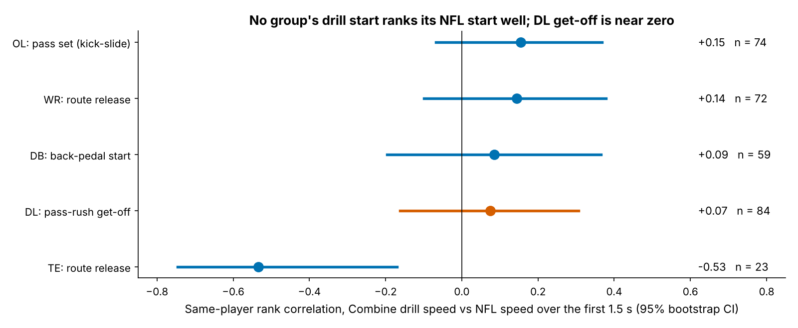
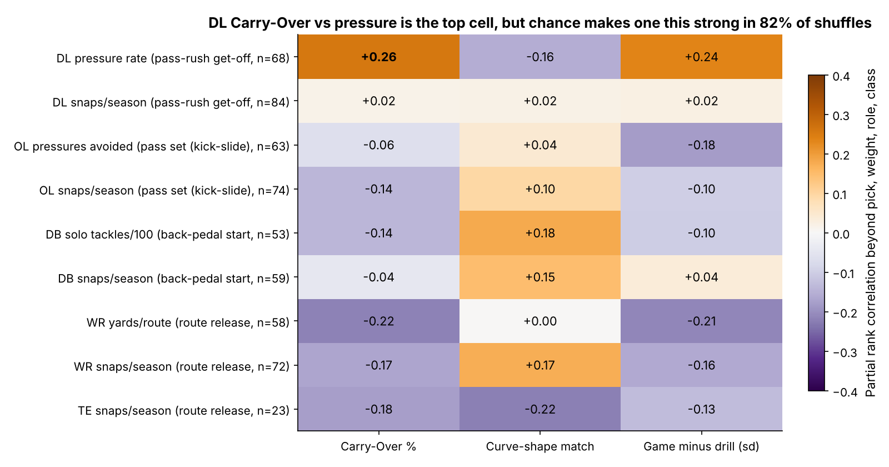
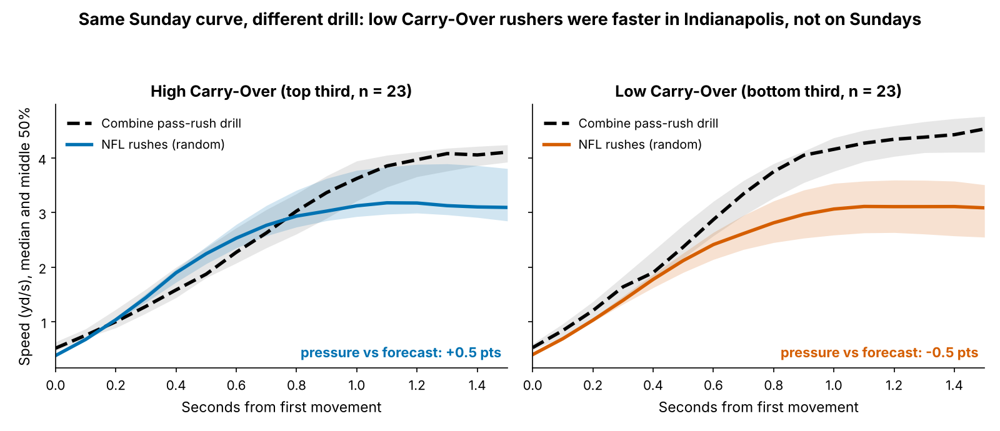
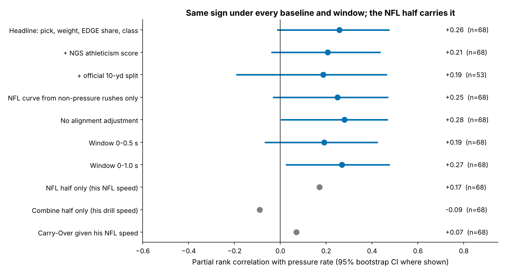
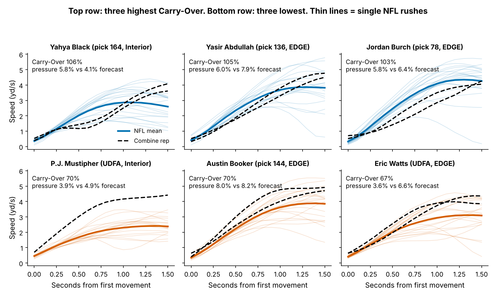
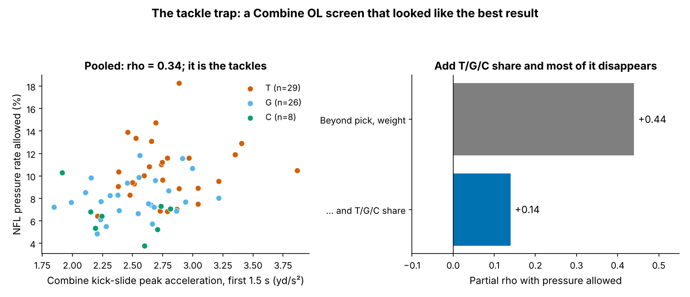

# Carry-Over: Do Pass Rushers Bring Their Combine Get-Off to Sundays?

We compared the first 1.5 seconds of each player's Combine position drill with the same movement on his NFL snaps. For four of five position groups, the drill tells you little about the player on Sundays. Defensive line gives the clearest signal: rushers who keep more of their drill speed produce a little more pressure than draft slot predicts. That signal comes from what they do on Sundays, not from the Combine. Treat Carry-Over as a pro-personnel film cue. It is not a draft grade.

## The question and the metric

Judges have seen public audits showing that Combine tracking adds roughly zero R² to draft models. Our question is narrower: **does a player move the same way in the game as he did in the matching drill, and does that match explain production beyond draft pick?** Matching drill and game on the same movement is the only fair way to ask it.

| Group | Combine drill | NFL movement (random pass plays) |
|---|---|---|
| DL | Pass-rush drill | Pass rush from the snap |
| OL | Pass-rush drop (kick-slide) | Pass set |
| DB | Four back-pedal drills | Coverage start |
| WR | Six route drills | Route release |
| TE | Five route drills | Route release |

*Table 1. Matched movements: first 1.5 s after the player starts from rest.*

**Carry-Over %** is his average speed over the first 1.5 s of NFL snaps divided by the same average from his Combine drill reps, times 100. At 100%, he moves as fast on Sundays as in Indianapolis. Drill speeds are adjusted for drill and Combine year (medians shift between years). NFL speeds are adjusted for alignment (EDGE vs interior, T/G/C, CB/slot/safety). The same function produces both curves. Two companion measures are curve-shape match (the correlation between his two speed curves) and the game-minus-drill gap in standard deviations.

**Data.** We used 1,956 drill reps and 5,514 NFL plays from the 2023–25 classes: 84 DL, 74 OL, 59 DB, 72 WR and 23 TE with eight or more random pass plays (median 20). We used only the `random` half of the game sample, because the top-EPA half oversamples big plays. Production is the outcome from `player_value`: DL pressure rate, OL pressures allowed, DB solo tackles per 100 snaps and WR yards per route. Snaps per season is the opportunity outcome.

**Baseline without tracking.** The baseline is log draft pick (UDFA = 262), Combine weight, role share from NFL alignment and draft class. Variants add the NGS athleticism score and the official 10-yard split. All associations are rank partial correlations beyond this baseline.

## Finding 1: the start barely travels from drill to game

We first asked whether a player who is fast in the drill is fast in the game. No group's drill reliably ranks his NFL start:

- **OL kick-slide:** 0.15 [−0.07, 0.37].
- **WR release:** 0.14 [−0.10, 0.38].
- **DB pedal:** 0.09 [−0.20, 0.37].
- **DL get-off:** 0.07 [−0.16, 0.31].
- **TE:** −0.53 (n = 23). This is most likely role mixing: inline and flexed TEs release differently, and n is small.

For DL the reason is plain. The pass-rush drill is not a stable trait measurement. A player's first and second reps agree at only 0.04 (n = 58). His NFL speed over 20 random rushes is reasonably stable: the split-half reliability is 0.55 after the Spearman–Brown correction.

## Finding 2: DL Carry-Over is the top lead, and it is a weak one

We screened all 27 cells before choosing a group. DL Carry-Over against pressure rate is the strongest: partial ρ = 0.26 [−0.03, 0.46], n = 68 DL with 100+ NFL rushes, nominal p = 0.035. It is the only cell under p < 0.05, where 1.4 are expected by chance. When we shuffle outcomes within class, the best of the 27 cells is this strong 82% of the time (family-wise p = 0.822). This is a lead, not a finding.

The typical DL carries 82% of his drill speed into a rush (10th–90th percentile, 72–93%). Rushers flatten at contact, while the drill keeps accelerating.

**What it is worth.** One standard deviation of Carry-Over (8.7 points) is worth 0.4 percentage points of pressure rate [−0.1, 1.0]. At the cohort's median 192 rushes a season, that is **0.7 extra pressures a season [−0.3, 1.9]**. In the same baseline model, moving from pick 100 to pick 30 is worth 2.4 pressures. Rushers in the top third (Carry-Over 85% or higher, n = 23) beat their draft-slot forecast 78% of the time, against 30% for the bottom third (79% or lower, n = 23).

**Where it comes from (Fig 4).** Carry-Over is NFL speed divided by drill speed, so we split it into those two parts:

- **His NFL speed alone:** 0.17 beyond the baseline.
- **His drill speed alone:** −0.09.
- **Carry-Over beyond his NFL speed:** 0.07, close to nothing.

The drill half is close to noise (rep-to-rep 0.04). The ratio therefore mostly re-expresses what the rusher does on Sundays. Its slightly better showing comes from dividing by a noisy drill number, and we would not rely on it.

**Out of class.** We fit on two draft classes and predicted the third. The baseline's held-out R² is 0.245, and adding Carry-Over gives 0.255, a gain of 0.010 [−0.231, 0.143]. The gain is positive in only 35% of class-stratified bootstraps. By class, the partial ρ is 0.19 (2023, n = 25), 0.17 (2024, n = 22) and 0.52 (2025, n = 21). All three are positive, but the single-season 2025 class carries the most weight.

The sign holds under every variant:

- **Adding the NGS athleticism score:** 0.21.
- **Adding the official 10-yard split:** 0.19 (n = 53).
- **Excluding NFL rushes that ended in pressure:** 0.25. This tests circularity, because winning rushes are faster.
- **Window 0–0.5 s:** 0.19.
- **Window 0–1.0 s:** 0.27.

Most of these intervals touch zero.

## Named rushers

| Player (class, pick, role, lb) | Drill speed, yd/s | NFL speed, yd/s | Carry-Over | Pressure % vs forecast |
|---|---|---|---|---|
| Yahya Black (2025, 164, interior, 336) | 2.15 | 2.29 | 106% | 5.8 vs 4.1 |
| Yasir Abdullah (2023, 136, EDGE, 237) | 2.38 | 2.49 | 105% | 6.0 vs 7.9 |
| Jordan Burch (2025, 78, EDGE, 279) | 2.46 | 2.54 | 103% | 5.8 vs 6.4 |
| Justin Eboigbe (2024, 105, interior, 297) | 2.52 | 2.55 | 101% | 7.1 vs 6.9 |
| Warren Brinson (2025, 198, interior, 315) | 2.45 | 2.47 | 101% | 6.9 vs 4.5 |
| Isaiah McGuire (2023, 126, EDGE, 268) | 3.19 | 2.28 | 71% | 7.2 vs 7.1 |
| Donovan Ezeiruaku (2025, 44, EDGE, 248) | 3.20 | 2.24 | 70% | 7.7 vs 7.9 |
| P.J. Mustipher (2023, UDFA, interior, 320) | 2.93 | 2.04 | 70% | 3.9 vs 4.9 |
| Austin Booker (2024, 144, EDGE, 240) | 3.28 | 2.28 | 70% | 8.0 vs 8.2 |
| Eric Watts (2024, UDFA, EDGE, 274) | 2.85 | 1.90 | 67% | 3.6 vs 6.6 |

*Table 2. Five highest and five lowest Carry-Over among the 68 (17–20 random rushes each). Forecast = baseline model without tracking.*

The top of the board has modest drill speeds and Sunday speeds a little above them. Late-round interior players Black and Brinson out-pressure their slots. The bottom is mostly EDGE rushers who ran fast drill reps: Ezeiruaku, Booker and McGuire are at about 3.2 yd/s. They are not slow on Sundays. They land where their pick predicts. Watts is the one clear "slow on Sundays" case. Of the 18 rushers with an above-median drill speed and bottom-third Carry-Over, only 6 beat their forecast. Burch and Abdullah show why this is a cue, not a grade: they carry their speed over and still pressure below forecast. Finishing (hands, counters) is not in a speed curve.

## The tackle trap: a confounder worth knowing

Our first OL pass gave the strongest-looking result in the project. Kick-slide peak acceleration "predicted" pressure allowed at ρ = 0.44 beyond pick and weight (n = 63). It turned out to be position. Tackles accelerate harder in the drill (median 2.75 yd/s² against 2.42 for centers) and face edge rushers (10.4% pressure allowed against 6.6%). Adding T/G/C share drops the link to 0.14. Any OL Combine-to-NFL claim has to condition on where the lineman plays.

## What a team can use

1. **Draft room:** give tracked first-step speed from position drills zero weight. One rep does not predict the next (DL 0.04), and no group's drill reliably ranks its NFL start. For get-off, use the official 10-yard split and 40 with weight.
2. **Pro personnel, after about 20 NFL rushes:** a rusher in the bottom third of Carry-Over who ran a fast drill is a film cue. Check whether he is stopped at contact or slow off the ball. Expect about 0.7 pressures a season per standard deviation at most, which is less than a third of the gap between pick 30 and pick 100.
3. **Analysts:** condition every OL and DL tracking claim on alignment (T/G/C, EDGE/interior) before believing it.

## Limitations

- **Statistical strength.** Carry-Over is the top of 27 screened cells (family-wise p = 0.822) and adds nothing reliable out of class (gain 0.010, positive in 35% of bootstraps). Read it as a lead.
- **Sample.** We had only up to 20 random rushes per player. A prospective test (rookie-season rushes predicting later pressure) is not possible yet: only 11 DL have 8 or more random rookie rushes and 100+ later rushes.
- **No ball, no opponents.** The tracking sample has no blockers, so contact, double teams and stunts are inferred, not observed. Win type (dip, rip, long arm) is not measured.
- **Construct.** The Combine drill has no blocker and is only 1–2 reps. Starting from rest excludes reps that began mid-movement. Alignment is a play-level label without side or technique.
- **Selection.** 16 of 84 DL with a Carry-Over did not reach 100 rushes. Carry-Over leans slightly against reaching it (−0.14), so the cohort is not obviously cherry-picked. Injuries and scheme are not modelled.
- **Outcome.** Pressure is charted and depends on scheme. The 2025 class has one season and drives the lead.

## Appendix: methods

Speed is smoothed with a Savitzky–Golay filter (5, 2). Onset is the first frame at or above 0.8 yd/s after the player has been at rest within 2 s of clip start or the snap, backed up 0.2 s. The curve covers the next 16 frames. Partial correlations are Spearman correlations of OLS residuals on the baseline. Intervals come from 2,000 class-stratified bootstraps (1,000 for variants). The family-wise p shuffles outcomes within class in every group-outcome cell and takes the maximum |ρ| over the 27 cells (1,000 shuffles). For leave-one-class-out, the baseline has no class dummies, and predictions and outcomes are centred within the held-out class. The effect is the OLS slope of pressure rate on standardized Carry-Over, times median rushes per season.

*Reproducible: `uv run python writeup/candidates/round_05/cand_3/analysis.py` (about 45 s) writes `numbers.json`, `board.csv`, `screen.csv` and every figure.*
