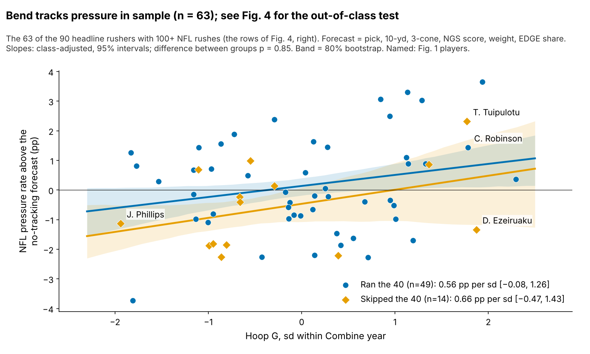
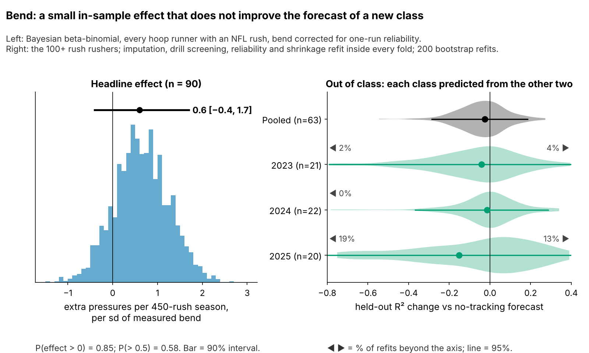

# Run-the-Hoop Bend Is a Weak DL Tiebreaker: {{bayes_all}} Pressures a Season per sd, Unproven Out of Class

We measured how hard {{bayes_n}} NFL defensive linemen turned in the Combine's Run-the-Hoop drill ("Hoop G") and compared it with their NFL pressure rate after a no-tracking baseline. One standard deviation more bend is worth {{bayes_all}} extra pressures per 450-rush season (90% interval {{bayes_all_lo}} to {{bayes_all_hi}}). When each class is predicted from the other two, using the {{nf_n}} with 100+ rushes, bend adds nothing (held-out R² change {{nf_dr2}}). Bend does not reliably separate rushers. Drill get-off burst carries over to games, but one or two reps are too noisy to grade. Use bend only to break ties.

## Why this question

Pressure is how teams grade and pay pass rushers, and the one DL outcome Combine numbers already predict: the 3-cone tracks it (ρ = {{rho_3cone_press}}), though only {{n_3cone_press}} of our 100+-rush players ran it. Between picks 80 and 130, boards stack rushers with similar film grades, so even a small, cheap tiebreaker has value. Combine tracking began in 2023; the 2025 class makes this the first test of a drill metric on a class it was not tuned on.

## Hoop G in coaching terms

**Hoop G is the hardest sideways push a rusher holds for half a second while rounding the hoops, in g.** A typical run peaks at {{hoop_g_median}} g. "One sd" is measured within a Combine year. **NFL rush-path bend** applies the same formula to {{arc_snaps_per_player}} random sampled NFL rushes per player.

**A tracking check, not a film check.** Without film, we read path direction from where the rusher is 3 yards upfield (outside: 0.5+ yd wide; inside: 1+ yd in) on {{wt_n}} EDGE-aligned rushes. Only {{wt_share_outside}}% are outside paths, and higher drill bend does not bring more of them (partial ρ = {{wt_rho_out}} [{{wt_rho_out_lo}}, {{wt_rho_out_hi}}], n = {{wt_rho_out_n}}). Robinson, Ezeiruaku and Tuipulotu mostly win inside or straight. Their game bend ({{f1_robinson_arc}}, {{f1_ezeiruaku_arc}}, {{f1_tuipulotu_arc}} g) beats Phillips's {{f1_phillips_arc}} g, but across all rushers drill bend barely tracks game bend after weight and role ({{pr_hoop_arc}}). Hoop G is not a proven dip-and-rip skill; confirm the path on film.

## Data and baseline

**Outcome:** regular-season pressures per pass rush. The headline uses all {{bayes_n}} hoop runners with an NFL rush, weighted by rushes; the out-of-class test and Figure 3 use the {{nf_n}} with 100+ rushes.

**Baseline without tracking:** log draft pick, official 10-yd split and 3-cone, NGS athleticism score, weight, NFL EDGE share and games per season. Only {{bayes_n_10yd_obs}} of {{bayes_n}} ran the 10-yd and {{bayes_n_3cone_obs}} the 3-cone. Missing times are filled from weight, role and NGS score with a flag; the appendix repeats the estimate on observed times and with multiple imputation.

## Finding 1: the stopwatch carries the signal; burst carries over but is noisy

The 3-cone and 40 track pressure and get-off, as teams know. Of the tracked numbers, only bend keeps a pressure link once pick, size, NGS score and role are accounted for. Get-off burst (yards covered in the rush drill's first second) tracks the same player's first second on random NFL snaps (ρ = {{rho_d1_game}} [{{rho_d1_game_lo}}, {{rho_d1_game_hi}}], n = {{n_d1_game}}). But a player's reps have reliability {{rel_drill_d1_player}} and say nothing about pressure ({{pr_d1_press}}).

## Finding 2: {{bayes_all}} pressures a season, not distinguishable from zero out of class

| Test | n | Estimate | Read |
|---|---|---|---|
| **Headline:** extra pressures per 450-rush season, per sd of bend (Bayesian, 90%) | {{bayes_n}} | **{{bayes_all}}** [{{bayes_all_lo}}, {{bayes_all_hi}}]; P(> 0) = {{bayes_all_p0}} | small, uncertain |
| **Out of class:** fully nested, held-out R² change (95%) | {{nf_n}} | {{nf_dr2}} [{{nf_dr2_lo}}, {{nf_dr2_hi}}] | no forecast gain |
| 2023 held out: effect fit on 2024–25 / inside 2023 only (90%); held-out R² | {{sg_n_2023}} | +{{sg_tr_2023}} / +{{sg_te_2023}} [{{sg_te_2023_lo}}, {{sg_te_2023_hi}}]; {{nf_dr2_2023}} | same sign, no gain |
| 2024 held out | {{sg_n_2024}} | +{{sg_tr_2024}} / +{{sg_te_2024}} [{{sg_te_2024_lo}}, {{sg_te_2024_hi}}]; {{nf_dr2_2024}} | same sign, no gain |
| 2025 held out | {{sg_n_2025}} | +{{sg_tr_2025}} / +{{sg_te_2025}} [{{sg_te_2025_lo}}, {{sg_te_2025_hi}}]; {{nf_dr2_2025}} | same sign, no gain |
| Placebo: run-stop proxy (TFL per run snap), partial ρ (95%) | {{plc_runstop_n}} | {{plc_runstop}} [{{plc_runstop_lo}}, {{plc_runstop_hi}}] | none, as expected |

A rusher one sd better on a single hoop run is worth {{bayes_all}} extra pressures in a 450-rush season. On our draft-slot model, that is the gap between pick 100 and pick {{pick_equiv}} (80% range: pick {{pick_equiv_lo}} to {{pick_equiv_hi}}). The model corrects for one-run reliability ({{rel_hoop_sb}}) and its prior is the typical effect of 14 screened drill-outcome pairs, so it is skeptical by design. The sign repeats: whether we fit without a class or inside that class alone, the effect is positive in {{sg_pos_te}} of 3 classes. But it shrinks in later classes, and refitting everything on two classes to predict the third adds nothing (Figure 4). No single rusher carries the result: dropping any one moves it between {{loo_min}} and {{loo_max}}.

## What a team can use

**Decision rule, split by role** (bend interval = 80%, shrunk for the number of runs):

1. **EDGE, bend plus** (interval above zero): break ties his way between similar film grades.
2. **EDGE, bend minus** (interval below zero): he must win with power or get-off; check film. No EDGE has hit it yet.
3. **Interior:** the hoop is not a corner test. A plus is an *agility note* for stunts and games. A minus is no call: all {{calls_i_minus}} interior minuses weigh {{int_minus_min_wt}}+ lb, and the baseline already prices weight.
4. **Film first:** 100+ NFL rushes and pressure wholly on the wrong side of his forecast: trust film over the drill.

**2025 class, top 8 and bottom 4 of {{board_n}}** (rookie rate vs out-of-class forecast; "—" under 30 rushes):

{{TABLE:board25}}

**2023–24 calls.** EDGE bend plus: {{TABLE:old_edge_plus}}. Interior agility note: {{TABLE:old_int_plus}}. Interior, no call (size): {{TABLE:old_int_minus}}. Film first: {{TABLE:old_film}}.

Of the {{fa_plus_n}} plus calls with 100+ rushes, {{fa_plus_above}} beat their forecast (mean +{{fa_plus_gap}} pp). Of the {{fa_minus_n}} interior minuses, {{fa_minus_above}} did. Calls never see pressure, but 2023–24 helped choose the hoop: a consistency check, not proof.

**Ask for 3–4 hoop runs.** One run has reliability {{rel_hoop_sb}} [{{rel_hoop_sb_lo}}, {{rel_hoop_sb_hi}}]; three runs reach {{rel_hoop_3runs}} and four reach {{rel_hoop_4runs}}. Undrafted Ethan Downs ran 2025's best hoop on one run: retest before moving him up.

## Pre-registered test

Among 2026–27 DL with 100+ rushes by the end of 2027 (about 40), bend's pressure effect after the full baseline must be above zero (one-sided α = {{alpha_prereg}}). Power is only {{power_prereg}}: the test can rule out a large effect, not prove a small one.

## Limitations

- **Not confirmed out of class.** The hoop is the screen's top pick in only {{nf_hoop_sel_pct}}% of nested folds. The headline also leans on the skeptical prior: a wide prior gives a larger effect (appendix).
- **No film, blockers or ball.** Path direction is a tracking proxy. Pressure by blocker or alignment cannot be built.
- **Small n.** About 30 hoop runners with NFL rushes per class.
- **Missing times.** Most rushers lack a 3-cone. The complete-case and imputation checks agree with the headline but are wider.
- **Sampled game tracking:** 20 random rushes per player, no scheme labels.
- **Short careers.** 2025 has one season: its board ranks, it does not set levels.

## Appendix: sensitivity checks

Same likelihood and priors, Laplace approximation (MCMC headline R-hat {{bayes_rhat}}).

| Check | n | Pressures per season per sd [90%] |
|---|---|---|
| Laplace approximation of the headline (MCMC: {{bayes_all}}) | {{bayes_n}} | {{lap_all}} [{{lap_all_lo}}, {{lap_all_hi}}] |
| Observed 10-yd only: with / without the 10-yd | {{cc10_n}} | {{cc10_t}} [{{cc10_t_lo}}, {{cc10_t_hi}}] / {{cc10_0}} [{{cc10_0_lo}}, {{cc10_0_hi}}] |
| Observed 3-cone only: with / without the 3-cone | {{cc3_n}} | {{cc3_t}} [{{cc3_t_lo}}, {{cc3_t_hi}}] / {{cc3_0}} [{{cc3_0_lo}}, {{cc3_0_hi}}] |
| Multiple imputation of both times ({{mi_m}} draws, pooled) | {{bayes_n}} | {{mi}} [{{mi_lo}}, {{mi_hi}}] |
| No stopwatch times in the baseline | {{bayes_n}} | {{lap_4item}} [{{lap_4item_lo}}, {{lap_4item_hi}}] |
| Wide prior on the bend slope | {{bayes_n}} | {{lap_wide}} [{{lap_wide_lo}}, {{lap_wide_hi}}] |
| EDGE / interior slopes (MCMC) | {{bayes_n}} | {{bayes_edge}} / {{bayes_int}} |
| Leave one rusher out (posterior mode; all rushers {{loo_full}}; most influential {{TABLE:loo_player}}) | 89 | {{loo_min}} to {{loo_max}} |
| Negative-control drill: back-pedal speed, partial ρ (95%) | {{neg_bp_n}} | {{neg_bp}} [{{neg_bp_lo}}, {{neg_bp_hi}}] |
| Fig. 3 slopes, ran / skipped the 40 (pp per sd) | {{n_40}} / {{n_no40}} | {{int_slope_40}} / {{int_slope_no40}}; difference p = {{int_p}} |
| Out of class without stopwatch times (R² change) | {{nf_n}} | {{nf4_dr2}} |

On observed times, adding the 10-yd or 3-cone does not move bend: the stopwatch does not absorb it.

*Reproducible: `uv run python writeup/candidates/round_05/revised/analysis.py` writes `numbers.json`, draws every figure and fills this text from `writeup_template.md`.*
