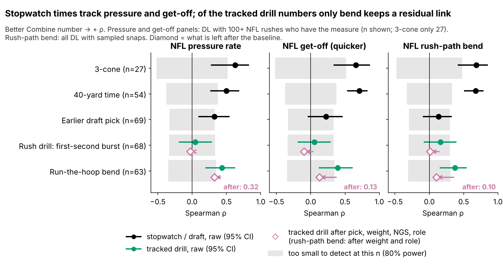
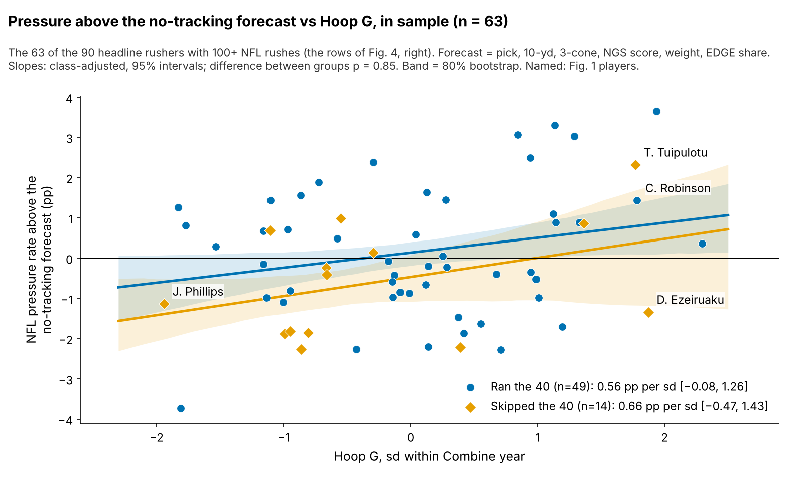
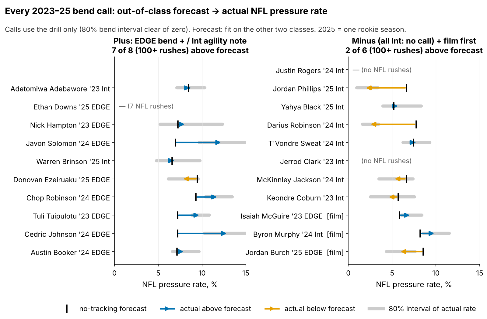

# Run-the-Hoop Bend Is a Weak DL Tiebreaker: 0.6 Pressures a Season per sd, Unproven Out of Class

We measured how hard 90 NFL defensive linemen turned in the Combine's Run-the-Hoop drill ("Hoop G") and compared it with their NFL pressure rate after a no-tracking baseline. One standard deviation more bend is worth 0.6 extra pressures per 450-rush season (90% interval −0.4 to 1.7). Predicting each class from the other two (63 rushers with 100+ rushes), bend adds nothing (held-out R² change −0.026). Verdict: use bend to break ties between EDGE rushers with similar film grades, never to move a player up a board.

## Why this question

Bend, turning the corner at the top of the rush without losing speed, is the first trait EDGE scouts write down, and the Combine never scores it. Run-the-Hoop is the one drill built to show it, yet it has no published time or score. Tracking can measure how hard a rusher turns. Between picks 80 and 130 boards stack rushers with similar film grades, so a cheap tiebreaker on pressure, the outcome teams pay for, has value if it is real. Three tracked classes (2023–25) allow the first test of a drill metric on a class it was not tuned on. The answer here is: real enough to break ties, not strong enough to move a player up a board.

## Hoop G in coaching terms

**Hoop G is the hardest sideways push a rusher holds for half a second while rounding the hoops, in g.** A typical run peaks at 0.62 g. "One sd" is measured within a Combine year. **NFL rush-path bend** applies the same formula to 20 random sampled NFL rushes per player.

**A tracking check, not a film check.** We read path direction from where the rusher is 3 yards upfield (outside: 0.5+ yd wide; inside: 1+ yd in) on 925 EDGE-aligned rushes. Only 9% are outside paths, and higher drill bend does not bring more of them (partial ρ = 0.04 [−0.24, 0.32], n = 41). Robinson, Ezeiruaku and Tuipulotu mostly win inside or straight. Their game bend (0.26, 0.26, 0.25 g) beats Phillips's 0.13 g, but across all rushers drill bend barely tracks game bend after weight and role (0.10). The tracking cannot confirm that hoop bend shows up as wider corner paths; film must.

## Data and baseline

**Outcome:** regular-season pressures per pass rush. The headline uses all 90 hoop runners with an NFL rush, weighted by rushes; the out-of-class test and Figure 3 use the 63 with 100+ rushes.

**Baseline without tracking:** log draft pick, official 10-yd split and 3-cone, NGS athleticism score, weight, NFL EDGE share and games per season. Only 71 of 90 ran the 10-yd and 34 the 3-cone. Missing times are filled from weight, role and NGS score with a flag; the appendix repeats the estimate on observed times and with multiple imputation.

## Finding 1: stopwatch times track pressure; burst carries over but is noisy

The 3-cone and 40 track pressure and get-off, as teams know. Of tracked numbers, only bend keeps a pressure link once pick, size, NGS score and role are accounted for. Get-off burst (yards covered in the rush drill's first second) tracks the same player's first second on random NFL snaps (ρ = 0.32 [0.12, 0.51], n = 85). But a player's reps have reliability 0.22 and say nothing about pressure (−0.03).

## Finding 2: 0.6 pressures a season, not distinguishable from zero out of class

| Test | n (all / 100+ rushes) | Estimate | Read |
|---|---|---|---|
| **Headline:** extra pressures per 450-rush season, per sd of bend (Bayesian, 90%) | 90 / — | **0.6** [−0.4, 1.7]; P(> 0) = 0.85 | small, uncertain |
| **Out of class:** fully nested, held-out R² change (95%) | — / 63 | −0.026 [−0.286, 0.185] | no forecast gain |
| 2023 held out: effect fit on 2024–25 / inside 2023 only (90%); held-out R² | 28 / 21 | +0.4 / +0.6 [−0.6, 2.0]; −0.042 | same sign, no gain |
| 2024 held out | 27 / 22 | +0.6 / +0.2 [−1.0, 1.5]; −0.014 | same sign, no gain |
| 2025 held out | 35 / 20 | +0.7 / +0.1 [−0.7, 1.1]; −0.151 | same sign, no gain |
| Placebo: run-stop proxy (TFL per run snap), partial ρ (95%) | — / 60 | 0.02 [−0.22, 0.25] | none, as expected |

A rusher one sd better on a single hoop run is worth 0.6 extra pressures in a 450-rush season. On our draft-slot model, that is the gap between pick 100 and pick 80 (80% range: pick 47 to 106). The model corrects for one-run reliability (0.41); its prior is the typical effect of 14 screened drill-outcome pairs, so it is skeptical by design. The sign repeats: whether we fit without a class or inside that class alone, the effect is positive in 3 of 3 classes. But it shrinks in later classes, and refitting everything on two classes to predict the third adds nothing (Figure 4). No single rusher carries the result: dropping any one moves it between 0.5 and 0.8.

## What a team can use

**Decision rule, split by role** (bend interval = 80%, shrunk for the number of runs):

1. **EDGE, bend plus** (interval above zero): break ties his way between similar film grades.
2. **EDGE, bend minus** (interval below zero): he must win with power or get-off; check film. No EDGE has hit it yet.
3. **Interior:** the hoop is not a corner test. A plus is an *agility note* for stunts and games. A minus is no call: all 8 interior minuses weigh 285+ lb, which the baseline already prices.
4. **Film first:** 100+ NFL rushes and pressure wholly on the wrong side of his forecast: trust film over the drill.

**2025 class, top 8 and bottom 4 of 42** (rookie rate vs out-of-class forecast; "—" under 30 rushes):

| # | Player | Pick | Role | Bend, sd [80%] | Rookie pressure vs forecast (rushes) | Call |
|---|---|---|---|---|---|---|
| 1 | Ethan Downs | UDFA | EDGE | 0.94 [0.31, 1.57] | — (7 rushes) | **bend +** |
| 2 | Warren Brinson | 198 | Int | 0.77 [0.14, 1.41] | 6.9% vs 6.6% (173) | agility note |
| 3 | Donovan Ezeiruaku | 44 | EDGE | 0.77 [0.14, 1.40] | 7.7% vs 9.5% (402) | **bend +** |
| 4 | Jah Joyner | UDFA | EDGE | 0.60 [−0.03, 1.23] | — (no rushes) | neutral |
| 5 | Tyrion Ingram-Dawkins | 139 | EDGE | 0.58 [−0.06, 1.21] | 5.3% vs 8.0% (113) | neutral |
| 6 | Jack Sawyer | 123 | EDGE | 0.56 [−0.07, 1.19] | 9.7% vs 8.5% (176) | neutral |
| 7 | Kyle Kennard | 125 | EDGE | 0.51 [−0.12, 1.14] | 2.0% vs 8.2% (50) | neutral |
| 8 | Jordan Burch | 78 | EDGE | 0.49 [−0.14, 1.12] | 5.8% vs 8.5% (344) | film first (under) |
| 39 | Ashton Gillotte | 66 | EDGE | −0.55 [−1.18, 0.08] | 6.4% vs 9.3% (342) | neutral |
| 40 | Tyler Baron | 176 | EDGE | −0.62 [−1.26, 0.01] | 4.4% vs 8.0% (68) | neutral |
| 41 | Yahya Black | 164 | Int | −0.75 [−1.38, −0.12] | 5.8% vs 5.2% (189) | no call (size) |
| 42 | Jordan Phillips | 143 | Int | −0.80 [−1.43, −0.17] | 1.9% vs 6.6% (215) | no call (size) |

Of the 8 plus calls with 100+ rushes, 7 beat their forecast (mean +2.0 pp). Of the 6 interior minuses, 2 did. Calls never see pressure, but 2023–24 helped choose the hoop: a consistency check, not proof.

**Ask for 3–4 hoop runs.** One run has reliability 0.41 [0.12, 0.59]; three runs reach 0.68 and four reach 0.74. Undrafted Ethan Downs ran 2025's best hoop on one run: retest before moving him up.

## Pre-registered test

Among 2026–27 DL with 100+ rushes by the end of 2027 (about 40), bend's pressure effect after the full baseline must be above zero (one-sided α = 0.05). Power is 0.12, so a miss will not disprove a small effect; a negative estimate would retire the tiebreaker.

## Limitations

- **Not confirmed out of class.** The hoop is the screen's top pick in only 47% of nested folds. The headline also leans on the skeptical prior: a wide prior gives a larger effect (appendix).
- **No film, blockers or ball.** Path direction is a tracking proxy. Pressure by blocker or alignment cannot be built.
- **Small n.** About 30 hoop runners with NFL rushes per class.
- **Missing times.** Most rushers lack a 3-cone. The complete-case and imputation checks agree with the headline but are wider.
- **Sampled game tracking:** 20 random rushes per player, no scheme labels, so game bend per player is itself noisy.
- **Short careers.** 2025 has one season: its board ranks, it does not set levels.

## Appendix: sensitivity checks

Same likelihood and priors, Laplace approximation (MCMC headline R-hat 1.02).

| Check | n | Pressures per season per sd [90%] |
|---|---|---|
| Laplace approximation of the headline (MCMC: 0.6) | 90 | 0.7 [−0.2, 1.8] |
| Observed 10-yd only: with / without the 10-yd | 71 | 0.5 [−0.4, 1.6] / 0.5 [−0.4, 1.6] |
| Observed 3-cone only: with / without the 3-cone | 34 | 0.1 [−1.0, 1.2] / 0.2 [−0.8, 1.3] |
| Multiple imputation of both times (20 draws, pooled) | 90 | 0.6 [−0.3, 1.7] |
| No stopwatch times in the baseline | 90 | 0.9 [−0.1, 2.0] |
| Wide prior on the bend slope | 90 | 2.0 [0.5, 3.8] |
| EDGE / interior slopes (MCMC) | 90 | 0.6 / 0.7 |
| Leave one rusher out (posterior mode; all rushers 0.7; most influential Tuli Tuipulotu) | 89 | 0.5 to 0.8 |
| Negative-control drill: back-pedal speed, partial ρ (95%) | 38 | 0.09 [−0.25, 0.43] |

On observed times, adding the 10-yd or 3-cone barely moves the bend estimate. The 3-cone subset (n = 34) is too small to tell its 0.1 from the headline.

*Reproducible: `uv run python writeup/candidates/round_06/cand_1/analysis.py` writes `numbers.json`, draws every figure and fills this text from `writeup_template.md`.*
