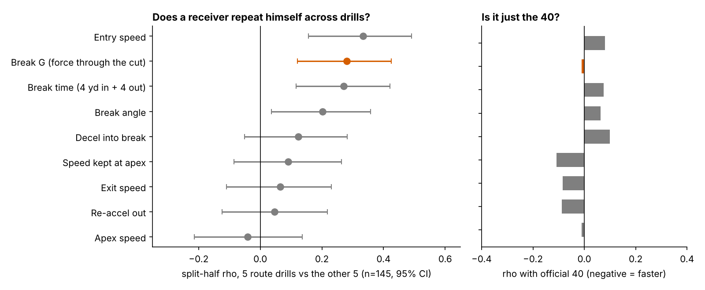
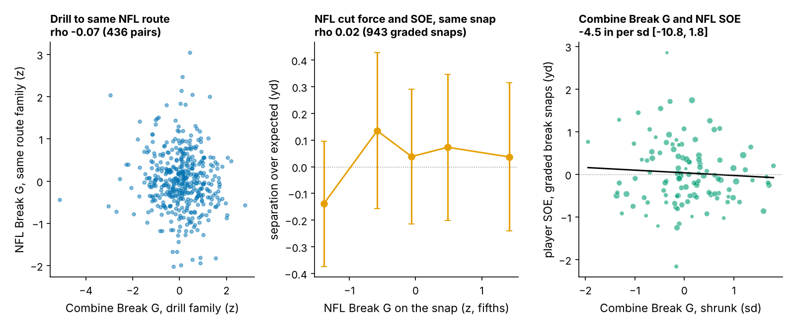

# Break G: Combine Cut Force Is a Target-Rate Lead for Receivers, Not a Separation Score

Across 116 WR/TE from the 2023–25 classes with an NFL route, receivers who put more force into their Combine cuts drew more targets per route than draft slot, 40, weight and NGS score forecast: 1.93 percentage points per sd [0.02, 3.78]. After a selection discount, plan on about 7 extra targets per 500-route season. The sign held in all three classes, but only 2023 clears zero. Held out, it adds 7.4% R² [−10.0, 17.7]. It buys no separation.

**Why this matters.** Route drills are the only Combine drills that copy game movement, and 10 Hz tracking now records every rep. Clubs will be sold "suddenness" scores built from them, pitched as separation. We test one against what a receiver coach cares about: does he get open (separation over expected, SOE), and does the quarterback throw to him (targets per route run, TPRR)?

## The metric: Break G

**Coach's definition.** Put a stopwatch on the second around the cut and ask how hard he is pushing into the ground in any direction: braking into the break, the sideways pull of the turn, and the drive out. A receiver who rounds the cut and drifts scores low. One who sinks, snaps and drives out scores high. The typical Combine rep is 0.57 g.

**Code definition.** Speed and acceleration come from smoothed 10 Hz x/y. The break is the first turn of 30° or more after 1.5 yd of travel, entered above 2.5 yd/s; breaks were found in 96% of 926 route-drill reps. Break G is the mean acceleration magnitude over the 1.0 s centred on the sharpest turn. Reps are standardized within drill × Combine year and averaged over a player's route drills (median 7). The average is shrunk toward zero by how many drills he ran and reported in sd of true Break G. Definition and shrinkage are unchanged from round 5.

Kayshon Boutte and Adonai Mitchell put 0.62 g into their dagger reps, against 0.46 and 0.50 g for Jake Bobo and A.T. Perry. Their NFL in routes run 0.47–0.54 g with no ordering. Mitchell (27% TPRR against an 18% forecast) fits the lead. Boutte (14% against 19%) does not.

**Is it a trait?** Break G repeats from one set of five route drills to the other at 0.28 [0.12, 0.43] (n = 145). That rises to 0.58 for a receiver who runs seven drills. The pieces coaches usually name do not repeat on their own; speed kept at the apex is 0.09 (Figure 3). It is unrelated to the official 40 (−0.01) and draft slot (−0.12).

## Result: targets per route, not separation

**Data and baseline.** The outcome is career regular-season TPRR (targets divided by routes) from `player_season_stats`. The fit is weighted by routes, with no route cut. Of 149 tracked receivers, 116 have an NFL route (median 231); the average TPRR is 18.2%. The 33 without a route are not explained by Break G (t = −0.59). The no-tracking baseline is log draft pick, official 40, weight and NGS athleticism score (standardized within year × position), plus a TE flag. Out of class means fitting on two draft classes and predicting the third.

| Held-out class | n | Slope inside the class, pct pts [95% CI] | Slope from the other two classes | Held-out R² change |
|---|---|---|---|---|
| 2023 | 42 | 2.67 [0.06, 5.91] | 0.97 | +10.7% |
| 2024 | 40 | 1.08 [−2.24, 3.24] | 2.27 | −0.8% |
| 2025 (one season) | 34 | 0.68 [−2.26, 5.17] | 2.08 | +2.7% |
| **All, pooled** | **116** | **1.93 [0.02, 3.78]**, t = 3.30 | — | **+7.4% [−10.0, 17.7]** |

**What to believe.** The pooled slope is positive in 98% of bootstrap resamples, and every class points the same way. But the interval nearly touches zero. Break G and TPRR were one of 36 drill-component × outcome pairs we examined, and a within-class permutation of that whole screen gives a family-wise p of 0.213. Shrinking for that search (factor 0.72) leaves **1.4 points of TPRR per sd, about 7 targets in a 500-route season** (10 before the discount). That is the planning number used everywhere below. Puka Nacua matters: without him the slope is 1.02 (t = 1.93). Counting each player once instead of weighting by routes, it is 1.41 (t = 1.75). Read it as a lead with a direction, not a confirmed effect.

**Same answer on tracked snaps.** On the 1,930 randomly sampled NFL pass snaps (not the high-EPA half), Break G predicts the share of routes that drew a target: 3.42 points per sd (t = 2.70, n = 103). These targets are a subset of the season totals, so this is a check, not a replication.

**Not separation.** We ran the same break code on 1,763 NFL slant, out, hitch, in and corner snaps. A snap is graded only if the cut finished at least 0.2 s before the throw, because a later cut cannot create separation at the throw. That removes 47% of snaps and leaves 943 (112 players). SOE is separation at the throw minus a context model (route, depth, cushion, coverage, alignment, time to throw, down and distance) fitted on 2023–24 snaps.

- Combine Break G does not carry into the same NFL route family: −0.07 [−0.17, 0.03] over 436 player-family pairs.
- Harder NFL cuts do not buy separation on the same snap: 0.02 [−0.05, 0.08].
- One sd of Combine Break G is worth −4.5 inches of SOE [−10.8, 1.8], given the baseline. The player-to-player sd of SOE is 26 inches, so anything above about 2 inches of extra separation per sd is ruled out.

The targets do not arrive through separation. Break G measures capacity in an uncovered rep (0.57 g in drills, 0.42 g in NFL cuts). Why it earns looks is not in this data; timing, trust and catch-point play are candidates. Yards per route agree (t = 3.23, built on the same targets); NGS season separation does not (t = −0.38).

## The board and what a team should do

A receiver is **plus** if his 80% interval for Break G sits above zero and **minus** if it sits below. Tight ends get no call (t = 0.91 within TEs, n = 34). The forecast is the baseline model fitted without the player's own class.

| WR (class, pick) | Break G [80%] | Career routes | NFL TPRR | Forecast | Call |
|---|---|---|---|---|---|
| Kayshon Boutte (2023, 187) | 1.8 [1.0, 2.6] | 873 | 13.9% | 18.7% | plus |
| Adonai Mitchell (2024, 52) | 1.7 [0.9, 2.5] | 486 | 26.5% | 17.9% | plus |
| Arian Smith (2025, 110) | 1.7 [0.9, 2.5] | 231 | 6.9% | 16.7% | plus |
| Tre Tucker (2023, 100) | 1.7 [0.8, 2.5] | 1,388 | 14.9% | 17.9% | plus |
| Puka Nacua (2023, 177) | 1.6 [0.8, 2.4] | 1,287 | 33.6% | 19.1% | plus |
| Trey Palmer (2023, 191) | 1.3 [0.5, 2.2] | 601 | 15.0% | 18.0% | plus |
| Johnny Wilson (2024, 185) | −1.2 [−2.1, −0.2] | 138 | 10.9% | 14.3% | minus |
| A.T. Perry (2023, 195) | −1.3 [−2.1, −0.4] | 192 | 9.4% | 16.2% | minus |
| Isaiah Bond (2025, undrafted) | −1.3 [−2.1, −0.5] | 333 | 13.2% | 15.9% | minus |
| Jake Bobo (2023, undrafted) | −1.4 [−2.2, −0.5] | 306 | 14.4% | 19.1% | minus |

(Top six and bottom four WRs with 100+ routes.) Across all calls, 50% of the 16 plus receivers beat their forecast, against 42% of the 57 neutral and 11% of the 9 minus. Route-weighted gaps are +1.4, −0.1 and −3.3 points of TPRR. The plus list is not a hit list: Boutte, Tucker, Palmer and Arian Smith all sit below forecast. Most of the signal is that **minus receivers rarely out-earn their slot**. The 2025 plus group to watch is Arian Smith, KeAndre Lambert-Smith, Jaylin Noel and Pat Bryant.

1. **Use it as a downgrade flag, not an upgrade.** When two wide receivers grade within a round of each other, let a minus call (80% interval below zero) break the tie against the player. Do not move a plus receiver up a round.
2. **Protocol.** Grade only receivers with five or more route drills. One drill has reliability 0.17; seven reach 0.58.
3. **Do not buy break scores as separation.** If a vendor sells cut force or "suddenness" as getting open, ask for the link to SOE. Here it is 0.02 per snap and at most about 2 inches per sd per player.
4. **Tracking staffs.** Count a break only if it finishes at least 0.2 s before the ball is out. Otherwise 47% of graded "breaks" measure the quarterback's timing.

## Limitations

- **A lead, not a confirmation.** The family-wise p is 0.213. The held-out gain interval spans zero, 2024 and 2025 slopes include zero, and one player (Nacua) halves the slope. This round changed the outcome from round 5's targets per season to TPRR, a rate that does not reward depth-chart volume. It was chosen after seeing round 5's result: a forking path.
- **Outcome.** TPRR still reflects role, quarterback, scheme and health. The 2025 class has one season.
- **Baseline details.** On the 38 who ran the 3-cone, the slope with the 3-cone added is −0.94 (t = −0.73), so we cannot show Break G adds to agility times in that subset.
- **Sample.** NFL tracking is up to 40 plays per player, with no defenders or ball, so the drill-to-game null is partly a measurement limit.
- **Units.** One sd of true Break G is only 0.021 g; most rep-to-rep spread is noise, which is why the shrinkage matters.

## Appendix: robustness (Break G slope on TPRR, pct pts per sd, given the baseline)

| Variant | Slope | t | n |
|---|---|---|---|
| Wide receivers only | 2.01 | 2.95 | 82 |
| Unweighted (each player counts once) | 1.41 | 1.75 | 116 |
| 100+ career routes | 1.91 | 2.77 | 84 |
| + slot share | 1.78 | 3.03 | 116 |
| + route-drill entry speed | 2.09 | 3.12 | 116 |
| + 3-cone, shuttle, 10-yd split (missing = 0) | 2.00 | 3.44 | 116 |
| Unshrunk Break G | 2.62 | 3.28 | 116 |

Reproduce: `uv run python writeup/candidates/round_06/cand_2/analysis.py` (about two minutes, `data/processed` only). Every quoted number is written to `numbers.json`; the full board is in `board.csv`.
