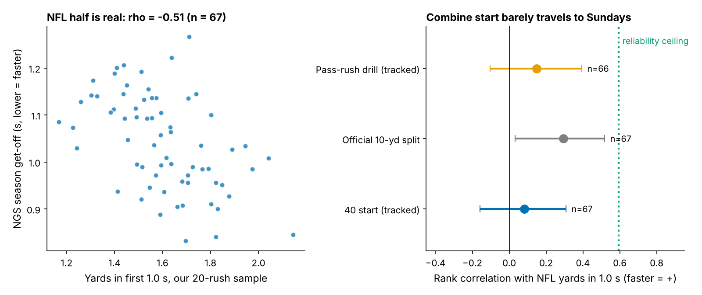
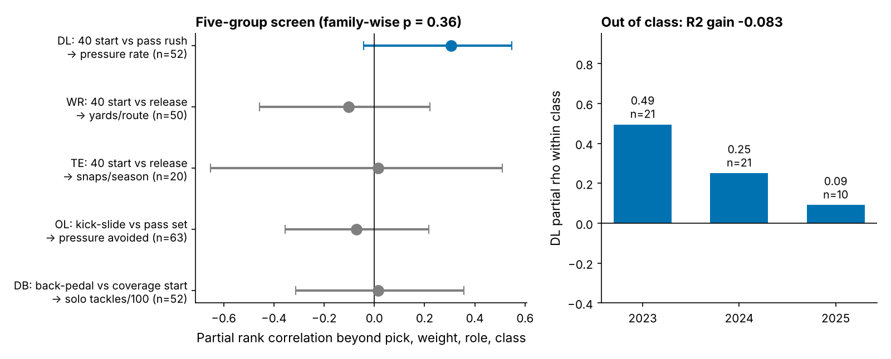
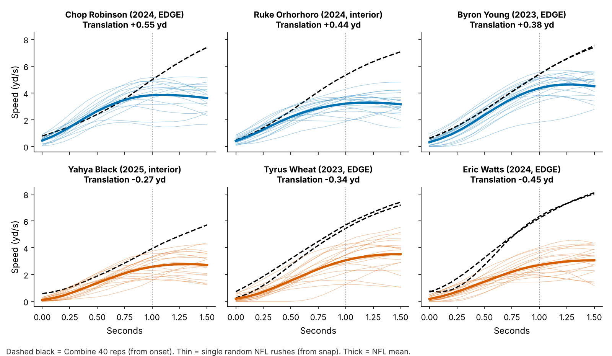
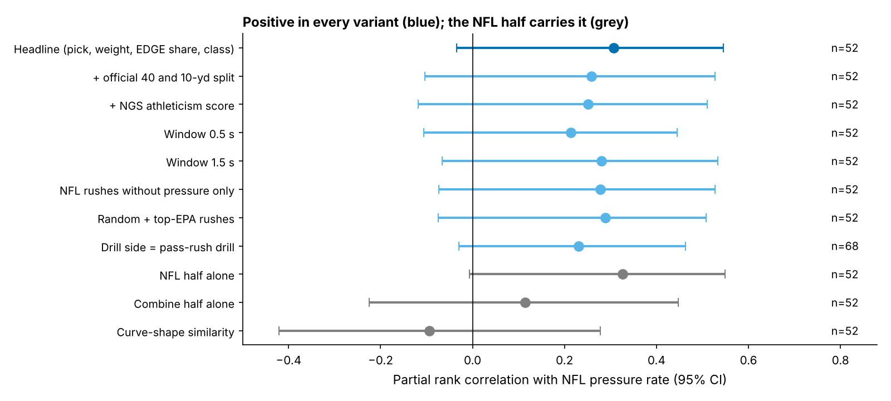

# Get-Off Translation: A Pass Rusher's 40 Start Stays in Indianapolis

**One result.** We built the same speed profile for a defensive lineman's first 1.5 seconds from his Combine 40 clip and from his random NFL pass rushes. The two barely agree (ρ = 0.08, where reliability allows 0.59). Among 52 DL, those whose Sunday get-off beat what their 40 start predicted out-pressured their draft slot by about **1.0 pressure a season per sd [−0.3, 2.1]**. That gain does not hold out of class (R² change −0.083), and all of it comes from the Sunday half.

## Why ask this

Teams pay for get-off. The 40 is the only Combine rep where a defensive lineman is timed exploding straight ahead from his own three-point stance, and scouts use its first ten yards as a get-off proxy. A tracked 40 gives a full speed curve, not just a time. If that curve shows up on Sundays, Combine tracking belongs in the draft room. If it does not, the gap is a coaching and pro-scouting question: why does an explosive athlete come off the ball slowly?

**For each player, does his NFL start look like his Combine start, and does the mismatch explain pressure beyond draft slot?**

## The metric

**Movement profile.** The smoothed speed curve over the first 1.5 s of a start, built by one function on:

- **Combine side:** every 40 rep, aligned to movement onset because the 40 has no snap. Values are adjusted for Combine year.
- **NFL side:** random pass plays only (`game_frames_sample`, `random` half), aligned to the ball snap, keeping only plays where he was at rest at the snap. Values are adjusted for alignment (EDGE vs interior).

Our summary is **yards covered in the first 1.0 s**. The typical DL covers 2.56 yards in the first second of his 40 and 1.59 yards in the first second after an NFL snap.

**Get-Off Translation (yards).** His NFL yards in 1.0 s, minus the yards predicted from his Combine 40 start by a cohort regression. A value of +0.2 means he gets 0.2 yards further off the ball on Sundays than his 40 start predicts. The sd is 0.20 yards, and the 10th–90th percentile range is −0.20 to 0.23.

**Data.** The cohort is 67 DL from the 2023–25 classes who have a tracked 40 and 8 or more random NFL rushes (1,271 rushes, median 20 each). Of these, 52 have an NFL pressure rate (`player_value`). Another 17 DL with enough rushes skipped the 40.

**Baseline without tracking.** The baseline is log draft pick (UDFA = 262), Combine weight, EDGE share and draft class. Every association is a rank partial correlation beyond this baseline.

**Group choice.** Before looking at DL we ran the same function on every group's matched movement (WR and TE 40 start vs release, OL kick-slide vs pass set, DB back-pedal vs coverage start). Only DL showed a signal: 0.31, against −0.10 (WR), 0.02 (TE), −0.07 (OL) and 0.01 (DB); family-wise p = 0.36. DL is the best of five, not a discovery.

## Finding 1: the Sunday start is measurable; the Combine start barely predicts it

The NFL half is real. On single plays, yards in 1.0 s tracks the official NGS get-off at ρ = −0.71 (1,271 rushes; lower get-off is faster). At the player level it tracks his snap-weighted season get-off at −0.51 (n = 67). Its split-half reliability over about 20 rushes is 0.67.

The Combine half is measurable too: the first two 40 reps agree at 0.40 (n = 56), or 0.52 for a player's mean, far better than the pass-rush drill (0.12 rep to rep).

Even so, the 40 start ranks NFL get-off at only **0.08 [−0.16, 0.31]**, where measurement noise alone would allow 0.59. The official 10-yard split does better (0.29); the tracked pass-rush drill reaches 0.15. Most of the Indianapolis-to-Sunday gap is real, not noise: snap reaction, stance, alignment and the blocker are all absent from the 40.

Literal profile similarity is uninformative: the two curve shapes correlate at a median of 0.961 (10th percentile 0.929). Every lineman accelerates the same way; what differs is how much speed arrives in time.

## Finding 2: translation tracks pressure in sample, not out of class

**In sample.** Translation's partial ρ with NFL pressure rate is 0.31 [−0.05, 0.54], n = 52. It is positive in 95% of class-stratified bootstraps. Rushers in the top third (+0.08 yards or more, n = 17) beat their no-tracking forecast 76% of the time, against 39% for the bottom third (−0.08 or less).

**Planning number.** One sd of translation is worth 0.6 percentage points of pressure rate. At the cohort's median 168 rushes a season, that is **1.0 pressure a season [−0.3, 2.1]** (80% interval 0.2 to 1.7). In the same baseline, moving from pick 100 to pick 30 is worth 1.5 pressures.

**Out of class.** We fit on two classes and predicted the third. Translation lowered held-out error for 2 of 3 classes, but the pooled R² change is **−0.083 [−0.530, 0.162]** on a baseline of 0.205. It is positive in only 25% of bootstraps. The within-class ρ falls from 0.49 (2023, n = 21) to 0.25 (2024, n = 21) and 0.09 (2025, n = 10).

**Where it comes from.** Splitting translation into its halves:

- **NFL half alone:** 0.33.
- **Combine half alone:** 0.11.
- **Translation beyond the NFL half:** −0.09.
- **Curve-shape similarity:** −0.09.

Translation is informative only because the Sunday get-off is; the 40 adds nothing on top. Translation describes a pro player. It is not a draft forecast.

## Named rushers

| Player (class, pick, role) | 40 start, yd in 1.0 s | NFL, yd in 1.0 s | Translation, yd | Pressure % vs forecast |
|---|---|---|---|---|
| Chop Robinson (2024, 21, EDGE) | 2.39 | 2.14 | +0.55 | 11.8 vs 10.1 |
| Ruke Orhorhoro (2024, 35, interior) | 2.55 | 2.04 | +0.44 | 8.2 vs 8.0 |
| Byron Young (2023, 77, EDGE) | 2.36 | 1.97 | +0.38 | 11.3 vs 8.3 |
| Maason Smith (2024, 48, interior) | 2.77 | 1.94 | +0.33 | 3.9 vs 7.3 |
| Will Anderson (2023, 3, EDGE) | 2.26 | 1.82 | +0.24 | 13.0 vs 11.3 |
| McKinnley Jackson (2024, 97, interior) | 2.67 | 1.40 | -0.21 | 5.1 vs 6.1 |
| Zacch Pickens (2023, 64, interior) | 2.70 | 1.38 | -0.22 | 6.1 vs 6.8 |
| Yahya Black (2025, 164, interior) | 2.00 | 1.31 | -0.27 | 5.8 vs 4.3 |
| Tyrus Wheat (2023, UDFA, EDGE) | 2.46 | 1.26 | -0.34 | 6.2 vs 6.7 |
| Eric Watts (2024, UDFA, EDGE) | 2.91 | 1.17 | -0.45 | 3.6 vs 7.1 |

*Table 1. Five highest and five lowest Get-Off Translation among the 52 (16–20 random rushes each). Forecast = no-tracking baseline.*

The top of the board pairs ordinary 40 starts with fast Sunday starts: Chop Robinson and Will Anderson are below the cohort median in Indianapolis and well above it on Sundays. Byron Young out-pressures pick 77 by three points. Maason Smith is the counterexample: he translates well and still pressures below forecast, because get-off without a finish does not create pressure.

The bottom is the case teams care about: **fast in Indianapolis, slow on Sundays.** Eric Watts ran one of the faster 40 starts (2.91 yards) and has the slowest NFL start of the 52 (1.17), with pressure at half his forecast. Of the 8 rushers with an above-median 40 start and bottom-third translation, only 1 beat his forecast. That one is Braden Fiske (3.16 yards in Indianapolis, −0.11, 10.9% vs 8.0%), who wins without the get-off. Laiatu Latu (2.85, −0.20) lands on his forecast (10.1 vs 10.2).

## What a team can use

1. **Draft room:** give the tracked 40 start no weight as a get-off projection (0.08 to NFL get-off). If you want a Combine get-off proxy, the official 10-yard split is better (0.29), and it is still weak.
2. **Pro personnel and coaching, after about 20 random rushes:** compute translation. A rusher with a fast 40 start and bottom-third translation is a specific question for the film and the position coach: is it snap reaction, stance or alignment? He is a development target, or a depth flag if it persists. A film-first cue, not a grade.
3. **What to expect:** at most about 1.0 pressure a season per sd, smaller than the pick 30 vs 100 gap, and not yet shown to forecast a new class.

## Robustness

The sign holds under every variant, and every interval touches zero: adding the official 40 and 10-yard split (0.26) or the NGS athleticism score (0.25); windows of 0.5 s (0.21) and 1.5 s (0.28); NFL rushes without pressure only, a circularity check (0.28); adding top-EPA rushes (0.29); and the pass-rush drill as the Combine side (0.23, n = 68).

## Limitations

- **Strength.** DL is the best of five groups (family-wise p = 0.36). The in-sample interval includes zero, and the out-of-class R² change is negative (−0.083). Treat translation as a lead.
- **It is the Sunday half.** Translation adds nothing beyond NFL get-off itself (−0.09). Where the NGS season get-off is available, it carries the same information.
- **Sample.** We had about 20 random rushes per player and 52 rushers with an outcome. The 2025 class has 10 rushers and one season. The 17 rushers without a 40 are excluded, so this is not a full-class tool.
- **Construct.** The 40 has no snap, so NFL time from the snap includes reaction and Combine time from onset does not. That difference is part of what translation measures. The game tracking contains no blockers or ball, so we cannot separate a slow get-off from an early double team. Alignment is a play-level label, without technique or side.
- **Outcome.** Pressure is charted and depends on scheme. Injuries and role changes are not modelled.

## Appendix: methods

Speed is smoothed with a Savitzky–Golay filter (5, 2). Combine onset is the first frame at or above 0.8 yd/s after rest, backed up 0.2 s. An NFL play is kept if speed at the snap is under 1 yd/s. Translation is the residual of an OLS of NFL yards on Combine yards across the 67 DL. Partial correlations are Spearman correlations of OLS residuals on the baseline. Intervals come from 2,000 class-stratified bootstraps (1,000 for variants). The family-wise p shuffles outcomes within class and takes the maximum |ρ| over the five groups (2,000 shuffles). Leave-one-class-out predictions and outcomes are centred within the held-out class.

*Reproducible: `uv run python writeup/candidates/round_06/cand_3/analysis.py` (about 40 s) writes `numbers.json`, `board.csv` and every figure.*
