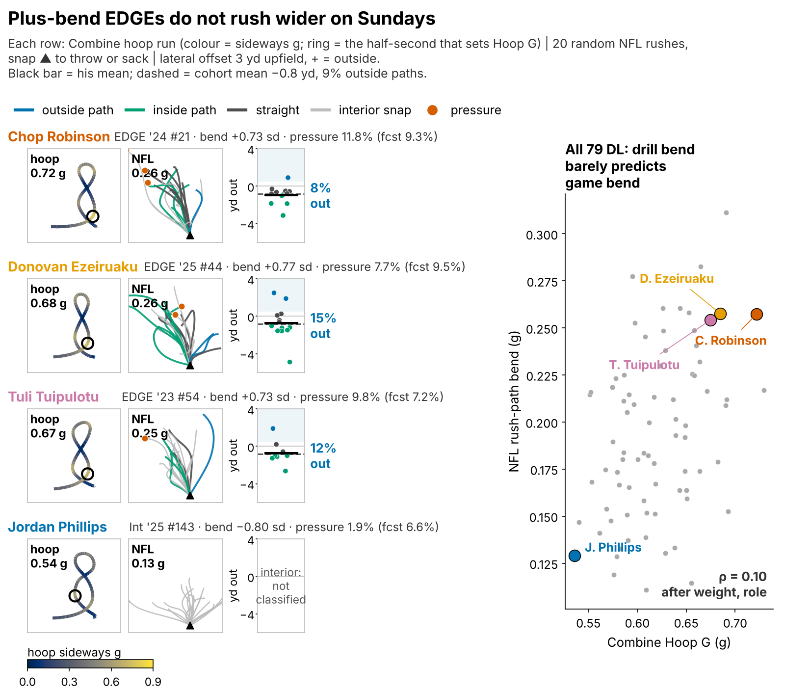
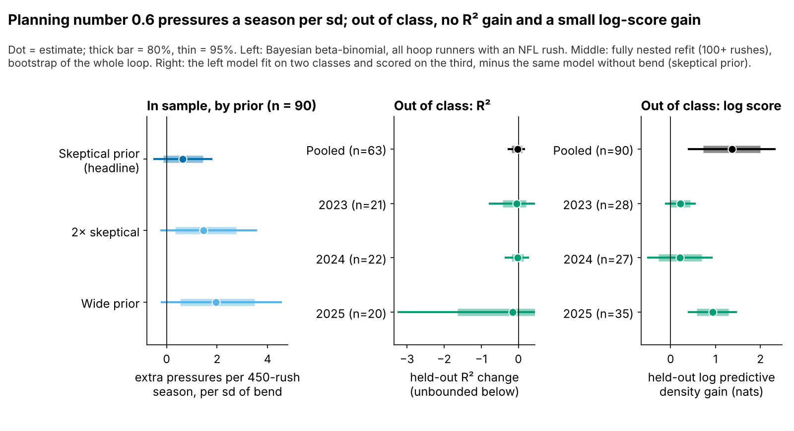
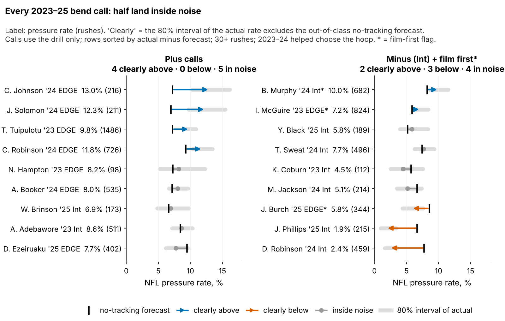

# Hoop G: A Lateral-Force Tiebreaker for Pass Rushers, Worth 0.6 Pressures a Season and Unproven Out of Class

**Hoop G is the hardest sideways push a defensive lineman holds while rounding the Combine's Run-the-Hoop drill. Beyond a no-tracking baseline, one sd more is worth 0.6 pressures per 450-rush season (90% interval −0.4 to 1.7). Predicting each class from the other two, it adds no R². Use it to break ties, never to move a player up a board.**

| Test | Players | Estimate | Read |
|---|---|---|---|
| **Headline**, in sample: pressures per 450-rush season per sd (Bayesian, 90%) | 90 hoop runners with an NFL rush | **0.6** [−0.4, 1.7] | small, uncertain |
| Out of class, fully nested: held-out R² change (95%) | 63 with 100+ rushes | −0.026 [−0.286, 0.185] | no gain |
| Same, each held-out class 2023 / 2024 / 2025 | 21 / 22 / 20 | −0.042 / −0.014 / −0.151 | no gain in any |
| Out of class, log score: held-out log predictive density gain (± SE) | 90 | +1.36 ± 0.50 nats; positive in 3 of 3 classes | small gain, not fully nested |
| Nested R² change, observed official 10-yd in the baseline (95%) | 49 | −0.002 [−0.645, 0.278] | no gain |

The two sample sizes are deliberate: the Bayesian model weights every rusher by his rushes, so it can use all 90; the R² test needs a stable observed rate, so it keeps the 63 with 100+ rushes.

## Why this question

Bend, turning the corner without losing speed, is a trait EDGE scouting reports routinely grade, and the Combine never scores it. Run-the-Hoop is the drill built to show it, yet it has no published time. Between picks 80 and 130, boards stack rushers with similar film grades, so a cheap tiebreaker on pressure has value if it is real. Three tracked classes (2023–25) allow a test on classes the metric was not fit on.

## What Hoop G measures, and what it does not

Hoop G is the peak sideways acceleration held for half a second while rounding the hoops, in g, standardized within Combine year. A typical run peaks at 0.62 g.

We ran two in-game tests of the corner mechanism. Both fail. First, plus-bend EDGEs do not rush wider (Figure 1). Second, if hoop bend were a corner skill, its link to pressure should be strongest on EDGE-aligned snaps. On 1541 random sampled rushes by 79 hoop runners, the odds of a pressure per sd of Hoop G are 1.05 [0.85, 1.32] on EDGE-aligned snaps and 1.20 [0.96, 1.45] on interior snaps (90%). The season-level slopes agree: 0.6 pressures for EDGEs and 0.7 for interior linemen.

**So we read Hoop G as a general lateral-force (change-of-direction) marker, not as bend.** The board relies only on its association with pressure, not on any corner mechanism.

## Data and baseline

**Outcome:** regular-season pressures per pass rush, 2023–25.

**Main model:** a beta-binomial regression of pressures on rushes with a class random intercept. The no-tracking covariates are log draft pick, weight, NFL EDGE share, NGS athleticism score, games per season and the official 10-yd split and 3-cone. Only 71 of 90 ran the 10-yd and 34 the 3-cone, so missing times are imputed from weight, role and NGS score, with a missing flag. Hoop G enters corrected for its one-run reliability (0.41). The "official times" baseline is tested directly on observed times only (Table 1, last row; 3-cone in the appendix).

## Finding 1: burst carries over to games, but not to pressure

Get-off burst (yards covered in the rush drill's first second) tracks the same player's first second on random NFL snaps (ρ = 0.32 [0.12, 0.50], n = 85). But reps are unreliable (0.22) and burst says nothing about pressure (−0.03).

## Finding 2: 0.6 pressures a season, prior-dependent, no out-of-class R²

On our draft-slot model, 0.6 pressures is the gap between pick 100 and pick 80 (80% range 47 to 106). The estimate depends on the prior. Our prior on the bend slope is skeptical by design. Doubling it gives 1.5 [0.0, 3.1]; a wide prior gives 2.0 [0.1, 4.0]. We plan on the smallest.

Out of class, the R² test on 63 rushers (about 20 per class) finds nothing. The log score uses every rusher's full pressure count and is less noisy. It favours the bend model by 1.36 ± 0.50 nats (wide prior: 1.63 ± 1.28). But the hoop was chosen on all three classes before that test, so it is not a confirmation.

## What a team can use

**2025 class: every call** (bend interval = 80%, shrunk for number of runs; tie-break range = EDGEs picked within 30% of his slot):

| # of 42 | Player | Pick | Role | Bend, sd [80%] | Tie-break range | Use |
|---|---|---|---|---|---|---|
| 1 | Ethan Downs | UDFA | EDGE | 0.94 [0.31, 1.57] | day 3 / UDFA EDGEs | break ties his way |
| 2 | Warren Brinson | 198 | Int | 0.77 [0.14, 1.41] | — | agility note (stunts) |
| 3 | Donovan Ezeiruaku | 44 | EDGE | 0.77 [0.14, 1.40] | EDGEs picked 34–57 | break ties his way |
| 8 | Jordan Burch | 78 | EDGE | 0.49 [−0.14, 1.12] | EDGEs picked 60–101 | film first: rookie year below forecast |
| 41 | Yahya Black | 164 | Int | −0.75 [−1.38, −0.12] | — | no call: size, priced by baseline |
| 42 | Jordan Phillips | 143 | Int | −0.80 [−1.43, −0.17] | — | no call: size, priced by baseline |

**Head-to-head, same class, picks within 30%:** the three closest-pick EDGE pairs with a 0.4+ sd bend gap, scored on pressure minus out-of-class forecast:

| Class | Higher bend (pick, sd) | Lower bend (pick, sd) | Pressure − forecast, pp (rushes) | Tie-break |
|---|---|---|---|---|
| 2025 | Jack Sawyer (123, +0.56) | Barryn Sorrell (124, +0.06) | +1.1 (176) vs −0.6 (119) | right |
| 2023 | Tavius Robinson (124, +0.06) | Isaiah McGuire (126, −0.48) | −2.7 (795) vs +1.3 (824) | wrong |
| 2024 | Cedric Johnson (214, +0.66) | Javontae Jean-Baptiste (222, +0.00) | +5.8 (216) vs −1.9 (180) | right |

Across all 14 such pairs in 2023–25, the higher-bend rusher came out ahead 8 times (57%, 90% [25, 83]). Shuffling bend within class gives 50% (p = 0.33). Head-to-head, the tiebreaker is unproven. It costs little, which is why it remains a tiebreaker and nothing more.

**Ask for 3–4 hoop runs.** One run has reliability 0.41 [0.12, 0.59]; three reach 0.68 and four 0.74. A run lasts about 7.5 s inside a workout that is already tracked, so the cost is a few minutes of drill time and fatigue, not equipment. Undrafted Ethan Downs ran 2025's best hoop on one run: retest before moving him.

## Pre-registered test

Among 2026–27 DL with 100+ rushes by the end of 2027 (about 40), bend's pressure effect after the full baseline must be above zero (one-sided α = 0.05). Power is 0.12, so a miss will not disprove a small effect. A negative estimate would retire the tiebreaker.

## Limitations

- **Not confirmed out of class.** The nested R² test is null, and the positive log score did not re-select the hoop inside each fold.
- **Prior-dependent.** The planning number is the smallest of three prior scales.
- **Mechanism unknown.** Path direction and alignment come from tracking, not film. With no blockers or ball, we cannot tell what the hoop captures; we call it lateral force, not bend.
- **Injuries and snap role.** Pressure rate ignores injuries and how a rusher is used (passing downs, rotation). We adjust only for games per season and EDGE share.
- **Small n and missing times.** About 30 hoop runners with NFL rushes per class; most lack a 3-cone.
- **Sampled game tracking:** 20 random rushes per player, no scheme labels.
- **Short careers.** 2025 has one season; its board ranks, it does not set levels.

## Appendix: method notes and checks

The bend-slope prior is scaled to the typical effect of 14 screened drill-outcome pairs. In the nested loop, the hoop is the screen's top pick in 47% of folds. Path direction uses the position 3 yd upfield on 925 EDGE-aligned rushes. Drill bend does not raise the outside share (partial ρ = 0.04 [−0.25, 0.32], n = 41). Of the 2023–25 plus calls with 100+ rushes, 7 of 8 beat their forecast (88%, 90% bootstrap [62, 100]; shuffled-bend null 44%, p = 0.03). Calls never see pressure, but 2023–24 helped choose the hoop. In 2025, the class that did not, the count is 1 of 2. **This is not evidence.**

| Check (Laplace unless noted) | n | Pressures per season per sd [90%] or as stated |
|---|---|---|
| Laplace version of the headline (MCMC: 0.6; R-hat 1.02) | 90 | 0.7 [−0.2, 1.8] |
| Observed 10-yd / 3-cone only, time in the baseline | 71 / 34 | 0.5 [−0.4, 1.6] / 0.1 [−1.0, 1.2] |
| Multiple imputation of both times (20 draws) | 90 | 0.6 [−0.3, 1.7] |
| Per class, fit without it / inside it only | 28 / 27 / 35 | 2023: 0.4 / 0.6; 2024: 0.6 / 0.2; 2025: 0.7 / 0.1 |
| Leave one rusher out (posterior mode) | 90 | 0.5 to 0.8 |
| Nested R² change, observed 3-cone in the baseline (95%) | 27 | −0.225 [−5.157, 1.411]: uninformative |
| Placebo, run-stop proxy / back-pedal drill, partial ρ (95%) | 60 / 38 | 0.02 [−0.22, 0.26] / 0.09 [−0.28, 0.44] |

*Reproducible: `uv run python writeup/candidates/round_06/revised/analysis.py` writes `numbers.json`, draws every figure and fills this text from `writeup_template.md`.*
