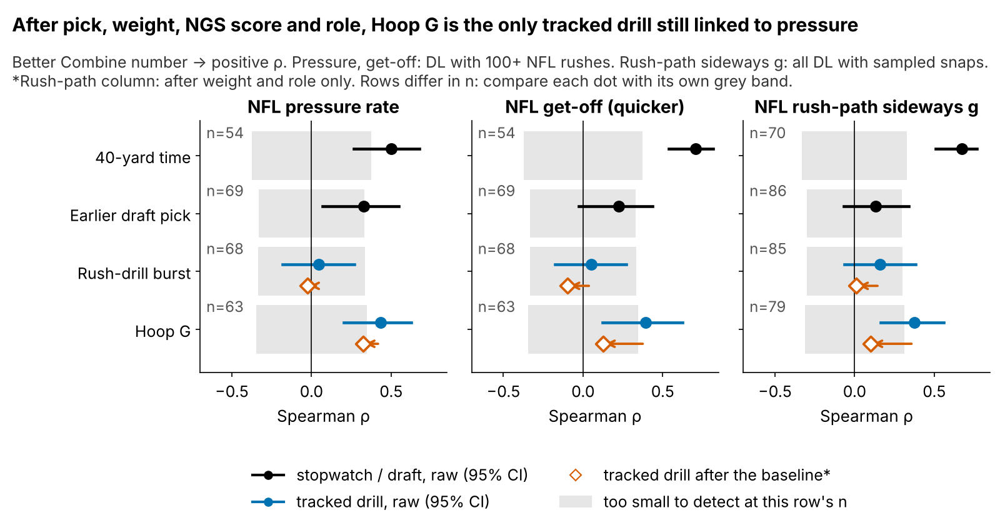

# A Combine Hoop Drill Hints at Extra Pass Rush: {{bayes_all}} Pressures a Season, Not Yet Confirmed Out of Class

**Can the Combine's Run-the-Hoop drill, which has no published time, help sort pass rushers who look alike on draft slot and stopwatch times? One standard deviation of its tracked Hoop G is worth {{bayes_all}} extra pressures per 450-rush season (90% interval {{bayes_all_lo}} to {{bayes_all_hi}}), but its gain on unseen classes is too small to separate from zero: use it only to break ties.**

| Test | Players | Planning estimate | Sensitivity |
|---|---|---|---|
| **In sample:** extra pressures per 450-rush season per sd [90%] | {{bayes_n}} hoop runners with an NFL rush | **{{bayes_all}}** [{{bayes_all_lo}}, {{bayes_all_hi}}], skeptical prior | 2× prior {{pr_double}} [{{pr_double_lo}}, {{pr_double_hi}}]; wide prior {{pr_wide}} [{{pr_wide_lo}}, {{pr_wide_hi}}] |
| **Out of class, log score** (± SE): gain over the same model without the drill; screen, prior and reliability re-chosen in each fold | {{nlpd_n}} ({{nlpd_n_2023}} / {{nlpd_n_2024}} / {{nlpd_n_2025}}) | +{{nlpd_skeptical}} ± {{nlpd_skeptical_se}}; 2023 / 2024 / 2025: +{{nlpd_skeptical_2023}} / +{{nlpd_skeptical_2024}} / +{{nlpd_skeptical_2025}} | 2× prior +{{nlpd_double}} ± {{nlpd_double_se}}; wide prior {{nlpd_wide}} ± {{nlpd_wide_se}} |
| **Out of class, R² change** [95%], fully nested | {{nf_n}} with 100+ rushes ({{nf_n_2023}} / {{nf_n_2024}} / {{nf_n_2025}}) | {{nf_dr2}} [{{nf_dr2_lo}}, {{nf_dr2_hi}}]; by class {{nf_dr2_2023}} / {{nf_dr2_2024}} / {{nf_dr2_2025}} | ridge {{ridge_dr2}} [{{ridge_dr2_lo}}, {{ridge_dr2_hi}}]; Hoop G fixed in advance {{olsfix_dr2}} |

The count model weights every rusher by his rushes, so it uses all {{bayes_n}}. R² needs a stable observed rate, so it keeps the {{nf_n}} with 100+ rushes.

## Why this question

1. **Pressure is what teams pay pass rushers for**, and it is where Combine movement already shows signal for DL: the 40 and 3-cone track it.
2. **The drills that carry that signal are often skipped.** Of our {{bayes_n}} hoop runners with an NFL rush, only {{bayes_n_3cone_obs}} ran the 3-cone and {{bayes_n_10yd_obs}} the 10-yd split. Nearly every DL runs the hoop, and it is fully tracked, yet nobody publishes a number for it.
3. **Three tracked classes (2023–25) now allow an honest test:** fit on two classes, score the third. No tracking baseline exists for this drill yet.

## What Hoop G is

**Coach's version: the hardest sideways push he holds for half a second while rounding the hoop.** Formally, it is the peak half-second average of acceleration perpendicular to his path, in g, standardized within Combine year. A typical run peaks at {{hoop_g_median}} g. One run has reliability {{rel_hoop_sb}}, so every model corrects for measurement error.

The drill was built to show bend, so we tested whether Hoop G *is* bend on Sundays. Both tests fail. First, plus-Hoop G EDGEs do not take wider paths: Robinson, Ezeiruaku and Tuipulotu run outside on {{f1_robinson_out}}%, {{f1_ezeiruaku_out}}% and {{f1_tuipulotu_out}}% of classified rushes, against {{wt_share_outside}}% for the cohort. Second, a corner skill should pay off most on EDGE-aligned snaps. Across {{al_snaps}} random sampled rushes by {{al_players}} hoop runners, the odds of a pressure per sd are {{al_or_wide}} [{{al_or_wide_lo}}, {{al_or_wide_hi}}] when aligned on the edge and {{al_or_int}} [{{al_or_int_lo}}, {{al_or_int_hi}}] inside (90%). **So we read Hoop G as a general change-of-direction force marker, not a bend grade,** and nothing below relies on a corner mechanism.

## Data and baseline

**Outcome:** regular-season pressures per pass rush, 2023–25.

**No-tracking baseline:** log draft pick, weight, NFL EDGE share, NGS athleticism score, games per season, and the official 10-yd split and 3-cone. Missing times are filled from weight, role and NGS score, with a missing flag.

**Model:** a pressure-count regression that allows extra player-to-player spread (beta-binomial), with a class intercept and separate EDGE and interior slopes. The prior on the Hoop G slope is skeptical by design: it is scaled to the typical effect of 14 drill-outcome pairs we screened.

## Finding 1: Hoop G is the tracked drill that survives the baseline

Get-off burst (yards covered in the rush drill's first second) tracks the player's first second on random NFL snaps (ρ = {{rho_d1_game}} [{{rho_d1_game_lo}}, {{rho_d1_game_hi}}], n = {{n_d1_game}}). It is unreliable across reps ({{rel_drill_d1_player}}), though, and unrelated to pressure ({{pr_d1_press}}).

**Against what a team already has**, after the same baseline (pick, weight, role, NGS score), the partial ρ with pressure is {{cmp3_r}} [{{cmp3_lo}}, {{cmp3_hi}}] for the 3-cone (n = {{cmp3_n}}), {{cmp10_r}} [{{cmp10_lo}}, {{cmp10_hi}}] for the 10-yd split (n = {{cmp10_n}}) and {{cmph_r}} [{{cmph_lo}}, {{cmph_hi}}] for Hoop G (n = {{cmph_n}}). Trust a 3-cone first when there is one. Hoop G covers the rushers who skipped it. Adding the observed 10-yd split to the baseline changes nested R² by {{ob10_dr2}} (n = {{ob10_n}}), so the stopwatch does not beat the drill out of class either.

## Finding 2: {{bayes_all}} pressures a season, not confirmed out of class

On our draft-slot model, {{bayes_all}} pressures is the gap between pick 100 and pick {{pick_equiv}} (80% range {{pick_equiv_lo}} to {{pick_equiv_hi}}).

**Out of class, everything is re-chosen inside each fold:** the drill screen, the chosen drill's reliability and the prior scale, all on the two training classes. The log score asks how likely the held-out pressure counts are under each model. With the skeptical prior, the drill model makes them {{nlpd_skeptical_lr}}× as likely as the baseline (+{{nlpd_skeptical}} ± {{nlpd_skeptical_se}} on the log scale). The screen picked Hoop G in {{nlpd_hoop_folds}} of 3 folds. With a wide prior the gain vanishes ({{nlpd_wide}} ± {{nlpd_wide_se}}). The R² tests agree that any gain is small: least squares {{nf_dr2}}, ridge {{ridge_dr2}}, both intervals across zero. Fixing Hoop G in advance gives {{olsfix_dr2}}, positive in {{olsfix_pos}} of 3 classes. That number is optimistic, because we chose the hoop after seeing all three classes. It is exactly the test the 2026–27 classes will run.

**Checks.** The model's 80% predictive intervals cover {{ppc_cov80}}% of rushers, and the simulated spread of pressure rates matches the observed spread (p = {{ppc_sd_p}}). With observed 10-yd times only, the estimate is {{cc10_t}} [{{cc10_t_lo}}, {{cc10_t_hi}}] (n = {{cc10_n}}). Over {{mi_m}} imputations it is {{mi}} [{{mi_lo}}, {{mi_hi}}], and dropping any one rusher moves it between {{loo_min}} and {{loo_max}}. Placebos stay near zero: run-stop rate {{plc_runstop}} (n = {{plc_runstop_n}}) and the back-pedal drill {{neg_bp}} (n = {{neg_bp_n}}).

## What a team can use

**Rules, by role** (a call needs the 80% interval of his shrunk Hoop G to clear zero):

| Situation | EDGE | Interior |
|---|---|---|
| Plus call | Break ties his way against EDGEs picked within 30% of his slot | Same rule against interior DL; the interior slope ({{bayes_int}}) matches the EDGE slope ({{bayes_edge}}) |
| Minus call | None in 2023–25; check film for a power plan, do not drop him | Ignore. Hoop G falls with weight (ρ = {{rho_hoop_wt}}), every interior minus weighs {{int_minus_min_wt}}+ lb, and the baseline already prices weight. {{imin_below}} of {{imin_n}} still landed clearly below forecast |
| Already in the league (trade, extension) and his pressure rate clearly contradicts the call | Film first: the drill never overrules NFL tape | Same |
| Call rests on one run (most prospects) | Still a tiebreak only. Ask for 2–3 more runs at his pro day: three runs lift reliability from {{rel_hoop_sb}} to {{rel_hoop_3runs}} | Same |
| No call | Ignore Hoop G | Ignore Hoop G |

**Draft-room example:** {{TABLE:ex_names}}. {{TABLE:ex_h}}'s Hoop G is {{ex_gap}} sd higher (shrunk). On the planning number that is worth {{ex_dpress}} pressures a season, about the value of moving from pick {{ex_pick_from}} up to {{ex_pick_to}}. The rule says take {{TABLE:ex_h}} and do not trade up for him. As rookies, {{TABLE:ex_h}} pressured at {{ex_pr_h}}% against a forecast of {{ex_pb_h}}%, and {{TABLE:ex_l}} at {{ex_pr_l}}% against {{ex_pb_l}}%. That is one pair called {{TABLE:ex_right}}, not proof.

**2025 class, every call** (rank of {{board_n}}; Hoop G shrunk for the number of runs):

{{TABLE:board25}}

Head to head, across all {{pair_n}} same-class EDGE pairs picked within 30% of each other with a 0.4+ sd gap, the higher-Hoop G rusher finished further above his forecast in {{pair_wins}} ({{pair_win_pct}}%), no better than shuffling ({{pair_null_pct}}%).

**Ask for 3–4 hoop runs.** A run lasts about {{hoop_dur_s}} s inside a workout that is already tracked, so it costs only a few minutes.

**Pre-registered test:** among 2026–27 DL with 100+ rushes by the end of 2027 (about 40), the Hoop G effect after the full baseline must be above zero (one-sided α = {{alpha_prereg}}). Its power is only {{power_prereg}}, so a miss will not disprove a small effect. That is another reason to keep the board low-stakes: a tiebreaker costs little when it is wrong. A negative estimate would retire it.

## Limitations

- **Not confirmed out of class.** The fully nested log score is positive under the skeptical and 2× priors but not the wide one, and every R² interval spans zero.
- **Prior-dependent.** The planning number is the smallest of three prior scales.
- **Mechanism unknown.** Path direction and alignment come from tracking, not film. With no blockers or ball in the data, we cannot say what the hoop captures. We call it change-of-direction force, not bend.
- **Usage and health.** Pressure rate ignores injuries, scheme and how a rusher is used (passing downs, rotation). We adjust only for games per season and EDGE share.
- **Small n and missing times.** There are about 30 hoop runners with NFL rushes per class, and most lack a 3-cone.
- **Sampled game tracking:** 20 random rushes per player, without scheme labels.
- **Short careers.** 2025 has one season, so the board ranks players but does not set levels.

*Reproducible: `uv run python writeup/candidates/round_07/cand_1/analysis.py` writes `numbers.json` (only the numbers this text uses), `claims.json` (key → sentence) and every figure, then fills this text from `writeup_template.md`.*
