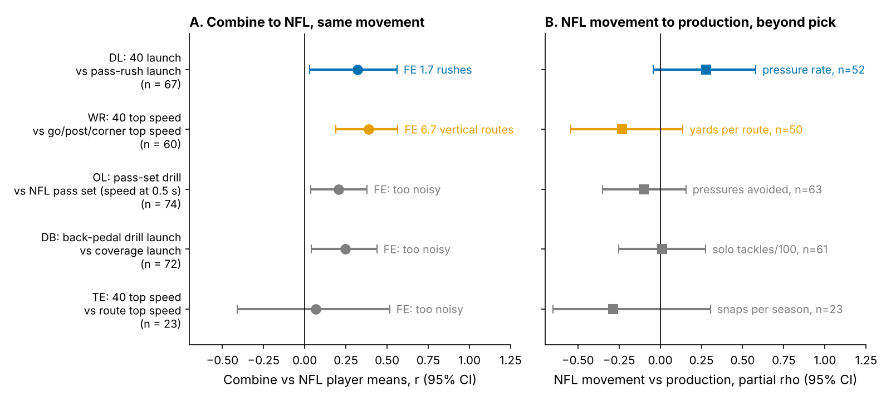
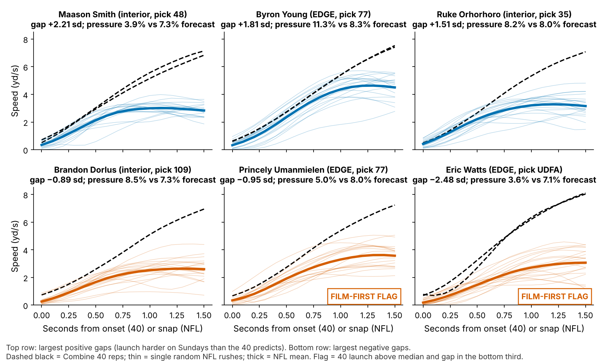

# A Pass Rusher's 40 Is Worth About Two NFL Rushes of Film

**We measured how hard each 2023–25 defensive lineman launches off the line, both in his Combine 40 and on about 20 random NFL pass rushes. His 40 previews his Sunday launch, but only as much as {{dl_fe}} NFL rushes would, so at draft time it explains nothing about pressure beyond draft slot.**

| Question | Answer | Players |
|---|---|---|
| What is the 40 worth for knowing a rusher's NFL launch? | **{{dl_fe}} rushes of film** (80% interval {{dl_fe_lo}} to {{dl_fe_hi}}) | {{dl_n}} |
| Does the 40 launch explain pressure beyond pick, weight and role? | No: partial ρ {{p_c}} [{{p_c_lo}}, {{p_c_hi}}]; held-out R² change {{oc_c}} | {{pr_n}} |
| Does the Sunday launch? | In sample, weakly: {{p_g}} [{{p_g_lo}}, {{p_g_hi}}]. Out of class, no: {{oc_nfl}} | {{pr_n}} |

## Why this question

1. **One movement, two settings.** A lineman's first steps from a stance are the closest match between a Combine rep and an NFL snap; scouts read the 40's first ten yards as a get-off proxy.
2. **Tracking now measures both** with the same 10 Hz speed trace, for three classes.
3. **The decision needs a unit.** Weighing a Combine number against a few games of film needs a common currency, so we price the Combine rep in NFL snaps.

## The metric

**Launch** is how hard his first steps push him out of his stance: the largest gain in speed over any tenth of a second in his first second of movement (yd/s²). One function computes it on the Combine 40 (from first movement, as the 40 has no snap) and on NFL pass rushes where he was set at the snap (from the snap). The median DL launches at {{dl_c_med}} yd/s² in the 40 and {{dl_g_med}} on Sundays. On single rushes, launch tracks the official NGS get-off time at ρ = {{val_play_rho}} (n = {{val_play_n}}; a harder launch means a faster get-off).

**Film Equivalent (FE)** is how many NFL snaps of the same movement a Combine measurement is worth. One random rush is mostly noise (reliability {{dl_rel1}}). The 40 explains {{dl_r2}} of the true spread in Sunday launch. FE = k·R²/(1 − R²) converts that share into rushes, where k = {{dl_k}} is the number of rushes that carry as much noise as there is signal.

**Translation gap** is his Sunday launch minus what his 40 predicted, shrunk for his number of rushes, in sd of true launch.

**Data and baseline.** {{dl_n}} DL have a tracked 40 and 8+ random NFL rushes ({{dl_n_rushes}} rushes, median {{dl_rush_med}}; the top-EPA half of the sample is excluded because it oversamples sacks). Of these, {{pr_n}} have a career pressure rate (median {{pr_med}}%). The no-tracking baseline is log draft pick (UDFA = 262), weight, NFL EDGE share and class. The official 40 time and 10-yd split compete on the same players.

## Finding 1: the start carries over, cheaply

One pre-specified matched movement per group went through the same pipeline (Table 1, Figure 2). Only DL launch both carries over and pays. WR straight-line speed carries over more (r = {{sc_WR_r}}; the 40 is worth {{sc_WR_fe}} vertical routes), but NFL vertical speed does not track yards per route ({{sc_WR_py}}). For OL, DB and TE, one NFL snap is too noisy (reliability {{rel_noisy_max}} or less) to price.

{{TABLE:screen}}

*Table 1. One matched movement per group, random NFL snaps only. r = correlation of player means. Production = partial Spearman ρ of the NFL movement beyond pick, weight and class.*

For DL, the 40 launch ranks NFL launch at r = {{dl_r}} [{{dl_r_lo}}, {{dl_r_hi}}] ({{dl_rt}} corrected for game-side noise); two 40 reps agree at {{dl_c_rep}} (n = {{dl_c_rep_n}}).

**The stopwatch does as well.** The official 40 time gives r = {{alt_40_r}} (FE {{alt_40_fe}} rushes), and the 10-yd split gives {{alt_10_r}} (FE {{alt_10_fe}}). The tracked pass-rush drill gives {{alt_prd_r}} (FE {{alt_prd_fe}}, n = {{alt_prd_n}}). Beyond the official 40 and weight, tracked launch adds {{dl_beyond_forty}}.

## Finding 2: translation does not explain pressure beyond pick at draft time

- **No draft-time signal.** The 40 launch has partial ρ {{p_c}} [{{p_c_lo}}, {{p_c_hi}}] with pressure. Out of class, it changes held-out R² by {{oc_c}} [{{oc_c_lo}}, {{oc_c_hi}}] on a baseline of {{oc_base}}.
- **The arithmetic says it must be small.** Translation ({{pr_rt_true}}) times the Sunday payoff gives an expected draft-time effect near {{implied}}. Detecting that with 80% power needs about {{implied_n80}} rushers; we have {{pr_n}}.
- **The 40 time works, but not through launch:** official 40 {{p_40}}, 10-yd split {{p_10}}.
- **The Sunday launch carries the in-sample signal.** NFL launch gives {{p_g}} [{{p_g_lo}}, {{p_g_hi}}], positive in {{p_g_ppos}}% of bootstraps, and the gap gives {{p_gap}}. Given the Sunday launch, the gap adds {{p_gap_given_nfl}} and the 40 adds {{p_c_given_nfl}}.
- **Out of class, nothing survives.** Held-out R² changes by {{oc_nfl}} [{{oc_nfl_lo}}, {{oc_nfl_hi}}] for Sunday launch and {{oc_gap}} for the gap. Each lowers held-out error in {{oc_nfl_better}} of 3 classes (2025, n = {{oc_n_2025}}).

**Film carries the signal (Figure 1B):** film alone ranks pressure at {{lc_film_2}} after 2 rushes and {{lc_film_12}} after 12; adding the 40 gives {{lc_blend_2}} and {{lc_blend_12}}.

**Planning number.** One sd of Sunday launch is worth {{eff_pp}} points of pressure rate (90%: {{eff_pp_lo}} to {{eff_pp_hi}}). At the median {{rush_season}} rushes a season, that is {{eff_press}} pressures ({{eff_press_lo}} to {{eff_press_hi}}). In the same model, moving from pick 100 to pick 80 is worth {{pick_80_100}} points ({{pick_80_100_press}} pressures). The launch effect is about {{eff_ratio}} times larger, in sample only.

## EDGE vs interior: translation and payoff sit in different players

{{TABLE:roles}}

*Table 2. Split by NFL role (EDGE share ≥ 50%), thirds within role. Exploratory: the split was not pre-specified.*

For **EDGE**, the 40 does not preview launch ({{role_e_rc}}), but launch pays: the top third pressure at {{role_e_hi}}% against {{role_e_lo}}% (n = {{role_e_n}}). For **interior** linemen it is closer to the reverse: the 40 previews launch ({{role_i_rc}}), but the pressure gap is small ({{role_i_hi}}% vs {{role_i_lo}}%, partial ρ {{role_i_pr}}), although top-third interior rushers still beat their forecast more often. Both intervals are wide.

## Named rushers

{{TABLE:board}}

*Table 3. The four largest and four smallest translation gaps among the {{pr_n}} (launch in yd/s²; ± is the 90% half-width).*

Gaps are noisy: they spread {{gap_sd_spread}} sd across players against a posterior sd of {{gap_psd_med}} each, and only {{n_sure}} of {{pr_n}} have a 90% interval excluding zero. The top third by gap beat their forecast {{gap_hi_beat}}% of the time ({{gap_hi_press}}% pressure), against {{gap_lo_beat}}% ({{gap_lo_press}}%) for the bottom third (n = {{gap_ter_n}} each).

- **Byron Young**: ordinary 40 launch ({{pl_young_c}}), one of the hardest Sunday launches ({{pl_young_g}}), pressure {{pl_young_y}}% against an {{pl_young_fc}}% forecast. **Chop Robinson** is similar ({{pl_robinson_y}}% vs {{pl_robinson_fc}}%).
- **Maason Smith** has the largest gap but pressures at {{pl_smith_y}}% against {{pl_smith_fc}}%: launch without a finish.
- **Eric Watts** (UDFA) has the hardest 40 launch in the table ({{pl_watts_c}}) and the softest Sunday launch ({{pl_watts_g}}). His gap is {{pl_watts_gap}} sd, and he pressures at {{pl_watts_y}}% against {{pl_watts_fc}}%. Fast in Indianapolis, slow off the snap.
- **Film-first flags** have a 40 launch above the median and a bottom-third gap. Of the {{flag_n}} flagged, {{flag_beat}} beat their forecast (mean {{flag_press}}% vs {{flag_fc}}%).

## What a team can use

1. **Draft room.** Give the tracked 40 launch no weight beyond the stopwatch. It is worth {{dl_fe}} rushes, and the official 40 time carries as much.
2. **Pro personnel.** Switch to film early: after about {{k_prime}} random rushes, film outweighs the 40 in a young rusher's launch estimate. For EDGE rushers, use Sunday launch as a tiebreaker (in sample only). For interior linemen the payoff is smaller and less certain.
3. **Coaching.** A flag like Watts is a question for the position coach (stance, snap reaction, alignment?): a cue for film review, not a grade.

## Limitations

- **Strength.** No result holds out of class, the in-sample payoff interval includes zero, and DL was chosen as the best of five groups after looking.
- **Sample.** We have about 20 random rushes per player (reliability {{dl_rel20}}). The 2025 class has 10 rushers and one season. DL who skipped the 40 are excluded.
- **Construct.** The 40 has no snap and no blocker, while NFL launch includes some snap reaction. The game tracking has no ball and no opponents, so a soft launch cannot be separated from a slide protection or a stunt.
- **FE assumptions.** Rushes are treated as exchangeable, with equal noise for every player. The interval is wide ({{dl_fe_lo}} to {{dl_fe_hi}}); groups with one-snap reliability below {{rel_min}} are not priced.
- **Outcome.** Pressure is charted and scheme-dependent; injuries are not modelled.

*Reproducible: `uv run python writeup/candidates/round_07/cand_3/analysis.py` (about one minute) writes every figure, table and number (`numbers.json`, with each number's claim) and renders this file.*
