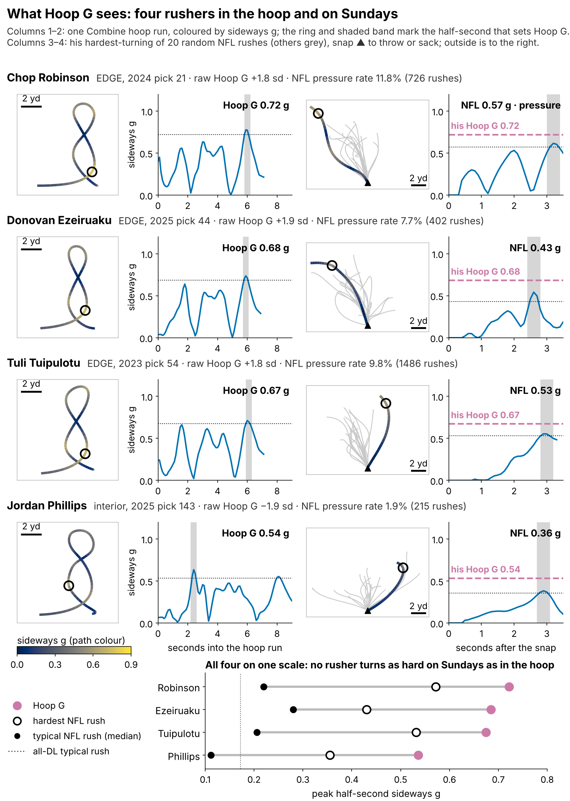
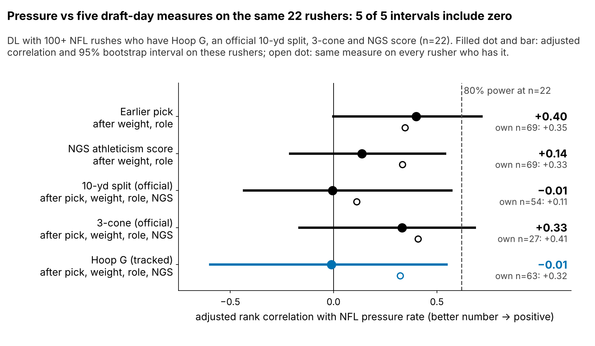
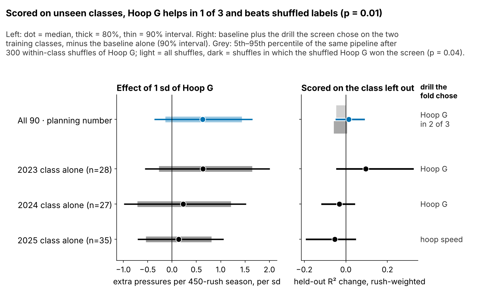
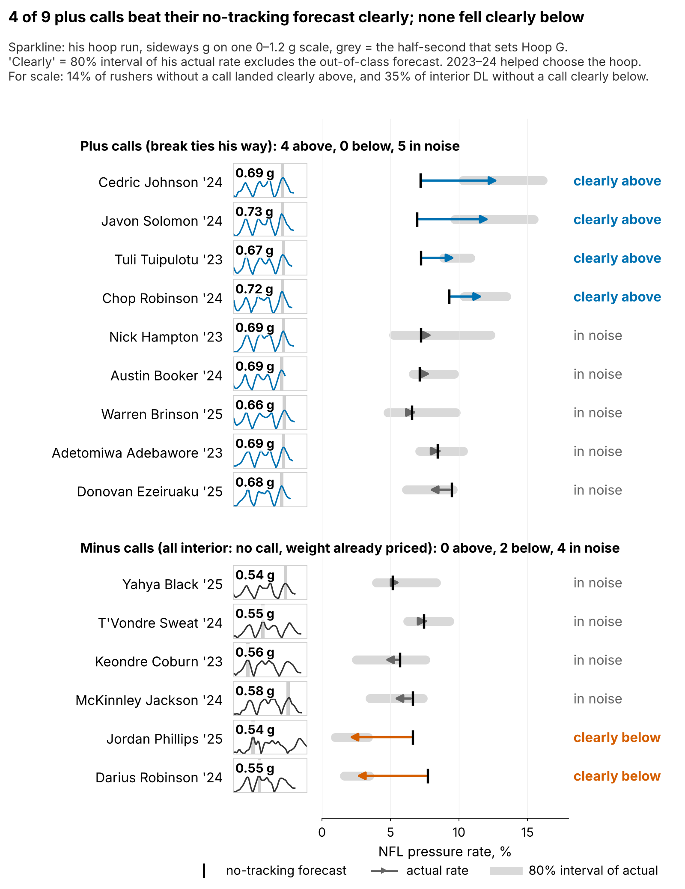

# Run-the-Hoop as a Pass-Rush Tiebreaker: {{bayes_all}} Pressures a Season, Unproven on New Classes

**Pass rushers with a stronger sideways push in the Combine's Run-the-Hoop drill pressured more in the NFL: about {{bayes_all}} extra pressures a season per standard deviation, the gap between pick 100 and pick {{pick_equiv}}. On classes it was not fit on, the gain is small and shows in only one of three, so treat it as unproven: a tie-break after the 3-cone, never a reason to move a player.**

| Test ({{bayes_n}} DL hoop runners with an NFL rush) | Result |
|---|---|
| **In sample:** extra pressures per 450-rush season per sd of Hoop G [90%] | **{{bayes_all}}** [{{bayes_all_lo}}, {{bayes_all_hi}}] |
| **Out of class:** fit on two classes, score the third; R² change over the no-tracking baseline, weighted by rushes [90%] | +{{wr2}} [{{wr2_lo}}, {{wr2_hi}}]; by class +{{wr2_2023}} / {{wr2_2024}} / {{wr2_2025}} |

## Why this question

1. **Pressure is what teams pay pass rushers for**, and Combine movement already tracks it for DL: the 40 and the 3-cone.
2. **The draft-room problem.** A scout comparing two day-2 or day-3 rushers with similar grades often has no 3-cone to separate them: only {{bayes_n_3cone_obs}} of our {{bayes_n}} hoop runners ran it. Nearly every DL runs the hoop, it is fully tracked, and nobody publishes a number for it.
3. **Why EDGE and interior are pooled.** About 30 hoop runners per class reach the NFL, too few to split. The model fits separate EDGE and interior slopes, and they agree ({{bayes_edge}} and {{bayes_int}}).

## What Hoop G is

**Coach's version: the hardest sideways push he holds for half a second while rounding the hoop.** Formally: the peak half-second average of acceleration perpendicular to his path, in g, standardized within Combine year. A typical run peaks at {{hoop_g_median}} g. One run has reliability {{rel_hoop_sb}} (split-half). The {{rel_icc_n}} players with two runs agree at {{rel_icc}} (90% {{rel_icc_lo}} to {{rel_icc_hi}}), so every model adjusts for measurement error.

What the traces say, player by player:

- **Chop Robinson** (pressure {{f1_robinson_pr}}% vs a {{f1_robinson_pb}}% forecast): {{f1_robinson_hoop}} g in the hoop, {{f1_robinson_nfl}} g on his hardest rush, yet outside on only {{f1_robinson_out}}% of rushes. The turn shows up as a late redirect, not a wide arc.
- **Tuli Tuipulotu** ({{f1_tuipulotu_pr}}% vs {{f1_tuipulotu_pb}}%): {{f1_tuipulotu_hoop}} g drill, {{f1_tuipulotu_nfl}} g Sunday peak after a straight start. He is a closer, not a bender.
- **Donovan Ezeiruaku** ({{f1_ezeiruaku_pr}}% vs {{f1_ezeiruaku_pb}}%): a top-three hoop ({{f1_ezeiruaku_hoop}} g), but his typical rush peaks at {{f1_ezeiruaku_med}} g. The drill's turn has not reached his rookie tape.
- **Jordan Phillips** ({{f1_phillips_pr}}% vs {{f1_phillips_pb}}%): {{f1_phillips_hoop}} g drill, {{f1_phillips_med}} g typical rush. He barely redirects at all.

The drill was built to show bend, but the plus-Hoop G EDGEs run outside no more often than the cohort ({{wt_share_outside}}%), and the pressure link is no stronger on edge-aligned snaps (odds ratio per sd {{al_or_wide}} vs {{al_or_int}} inside). **We read Hoop G as change-of-direction force, not bend.**

## Data and baseline

**Outcome:** regular-season pressures per pass rush, 2023–25.

**No-tracking baseline:** log draft pick, weight, NFL EDGE share, NGS athleticism score, games per season, and the official 10-yd split and 3-cone. Missing times are filled in from weight, role and NGS score, with a missing flag.

**Model:** a pressure-count model that allows extra player-to-player spread, with a class intercept. The prior on the Hoop G slope is skeptical by design: it is scaled to the typical effect across the 14 drill-and-outcome pairs we screened.

## Finding 1: on a common set of rushers, the 3-cone beats Hoop G

On the {{cmn_n}} rushers who have every measure, the adjusted correlation with pressure (after pick, weight, role and NGS score) is {{cmn_t3_r}} [{{cmn_t3_lo}}, {{cmn_t3_hi}}] for the 3-cone, {{cmn_t10_r}} [{{cmn_t10_lo}}, {{cmn_t10_hi}}] for the 10-yd split and {{cmn_hoop_r}} [{{cmn_hoop_lo}}, {{cmn_hoop_hi}}] for Hoop G. At this n only correlations above {{cmn_mde}} are reliably detectable. On every rusher who has it, Hoop G reaches {{cmph_r}} (n = {{cmph_n}}) and the 3-cone {{cmp3_r}} (n = {{cmp3_n}}). **So the order is 3-cone first; Hoop G only covers rushers who skipped it.**

What does carry to Sundays is movement, not production: the rush drill's first-second burst tracks the same player's first second on random NFL snaps (ρ = {{rho_d1_game}}, n = {{n_d1_game}}), but not his pressure rate ({{pr_d1_press}}).

## Finding 2: {{bayes_all}} pressures a season, not confirmed on new classes

**Fit on two classes, scored on the third,** with the drill screen, the chosen drill's reliability and the prior scale all re-chosen inside each fold, Hoop G raises rush-weighted R² by {{wr2}} on the same {{wr2_n}} rushers as the headline. Only 2023 gains. In 2025 the screen chose hoop speed instead.

**Negative control.** We shuffled Hoop G across players within each class and reran the whole pipeline {{perm_n}} times. The real drill beats the shuffles (p = {{perm_p_r2}}; p = {{perm_p_r2_h}} among the {{perm_h_n}} shuffles in which shuffled Hoop G still won the screen). The count model's held-out accuracy (how likely the held-out counts were, +{{nlpd_skeptical}} ± {{nlpd_skeptical_se}}) fails this control: shuffled Hoop G scores higher (median {{perm_lpd_med}}, p = {{perm_p_lpd}}), so we no longer use it as evidence.

| Check | In sample, pressures per season [90%] | Out of class |
|---|---|---|
| Skeptical prior (planning) | {{bayes_all}} [{{bayes_all_lo}}, {{bayes_all_hi}}] | R² +{{wr2}}, shuffle p = {{perm_p_r2}} |
| 2× prior / wide prior | {{pr_double}} [{{pr_double_lo}}, {{pr_double_hi}}] / {{pr_wide}} [{{pr_wide_lo}}, {{pr_wide_hi}}] | — |
| Least squares / ridge, {{nf_n}} with 100+ rushes | — | R² {{nf_dr2}} / +{{ridge_dr2}} |
| Hoop G fixed in advance (optimistic) | — | R² +{{olsfix_dr2}} |
| Observed 10-yd only; pick, weight, role, NGS (n = {{oo10_n}}) | {{oo10_t}} [{{oo10_t_lo}}, {{oo10_t_hi}}] | R² {{oo10_wr2}} |
| Observed 3-cone only; same baseline (n = {{oo3_n}}) | {{oo3_t}} [{{oo3_t_lo}}, {{oo3_t_hi}}] | R² +{{oo3_wr2}} |
| Reliability from repeat runs ({{rel_icc}}) | {{relicc_t}} [{{relicc_t_lo}}, {{relicc_t_hi}}] | — |

The effect is not an artifact of filled-in times: with observed 10-yd splits only it barely moves. With an observed 3-cone in the model it nearly vanishes, which matches Finding 1.

## What a team can use

**The pick-value translation.** On our draft-slot model, {{bayes_all}} pressures a season is the gap between pick 100 and pick {{pick_equiv}} (80% range {{pick_equiv_lo}} to {{pick_equiv_hi}}). That is a tiebreak between neighbours on the board, not a round.

**Rules** (a call needs the 80% interval of his adjusted Hoop G to clear zero):

| Call | EDGE | Interior |
|---|---|---|
| Plus | Break ties his way against EDGEs picked within 30% of his slot | Same, against interior DL |
| Minus | None in 2023–25 | No call: Hoop G falls with weight (ρ = {{rho_hoop_wt}}), and the baseline already prices weight |

A call that rests on one run is still only a tiebreak: ask for 2–3 more runs at his pro day (three runs lift reliability from {{rel_hoop_sb}} to {{rel_hoop_3runs}}; a run takes about {{hoop_dur_s}} s). Without a call, ignore Hoop G.

**Draft-room example:** {{TABLE:ex_names}}. {{TABLE:ex_h}}'s adjusted Hoop G is {{ex_gap}} sd higher, worth {{ex_dpress}} pressures a season, about the value of moving from pick {{ex_pick_from}} up to {{ex_pick_to}}. The rule says take {{TABLE:ex_h}}, and do not trade up for him. As rookies, {{TABLE:ex_h}} pressured at {{ex_pr_h}}% against a forecast of {{ex_pb_h}}%, and {{TABLE:ex_l}} at {{ex_pr_l}}% against {{ex_pb_l}}%: one pair called {{TABLE:ex_right}}.

**2025 calls with 30+ NFL rushes** (rank of {{board_n}}; Hoop G adjusted for the number of runs):

{{TABLE:board25}}

**Why Phillips is not a minus call.** A −0.8 sd interior Hoop G mostly says "heavy". {{base_int_below_pct}}% of interior DL without any call also landed clearly below forecast, and {{imin_below}} of {{imin_n}} interior minus calls did, which is no better. His rate is a film question, not a drill one.

The plus calls beat their forecast clearly in {{plus_above}} of {{plus_n}} cases and never fell clearly below; {{base_above_pct}}% of rushers without a call beat theirs. All {{plus_above}} hits come from 2023–24, the classes that helped choose the drill. In head-to-head EDGE pairs picked within 30% of each other, the higher-Hoop G rusher beat his forecast by more in {{pair_win_pct}}% of {{pair_n}} pairs, against {{pair_null_pct}}% by chance.

**Pre-registered test:** among 2026–27 DL with 100+ rushes (about 40), the Hoop G effect after the full baseline must be above zero (one-sided α = {{alpha_prereg}}). At the selection-adjusted effect its power is only {{power_prereg}}; 80% power needs about {{n_power80}} rushers, roughly {{classes_power80}} classes. So a miss will not disprove it, and a tiebreaker costs little when wrong. A negative estimate would retire it.

## Limitations

- **Not confirmed out of class.** The R² gain comes from one class, and its interval spans zero. The count model's accuracy gain fails the shuffle control.
- **Weaker than the 3-cone** where both exist ({{cmn_n}} rushers), and the planning number depends on the prior.
- **Mechanism unknown.** No blockers or ball are in the tracking. Path direction comes from 20 sampled random rushes per player, without film or scheme labels.
- **Usage, health and short careers.** Pressure rate ignores rotation and injuries, and 2025 has one season.

*Reproducible: `uv run python writeup/candidates/round_07/revised/analysis.py` writes `numbers.json`, `claims.json` and every figure, then fills this text from `writeup_template.md`.*
