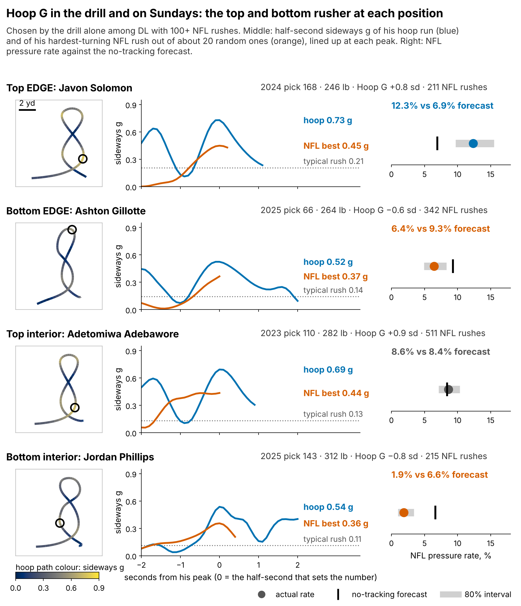
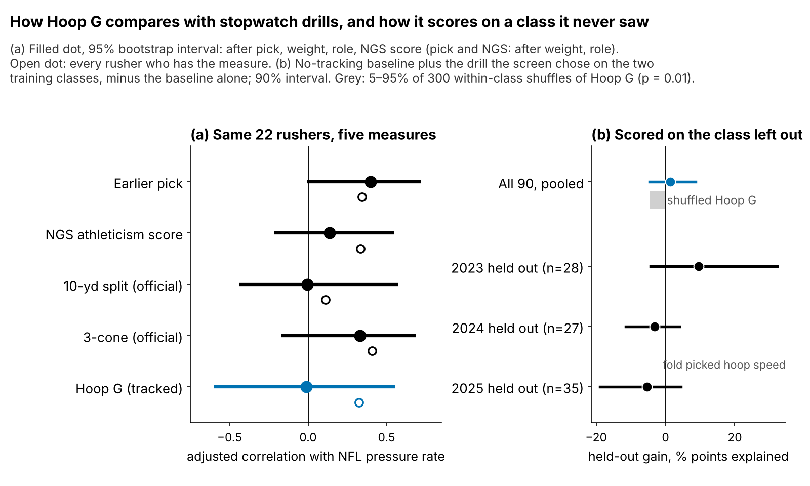
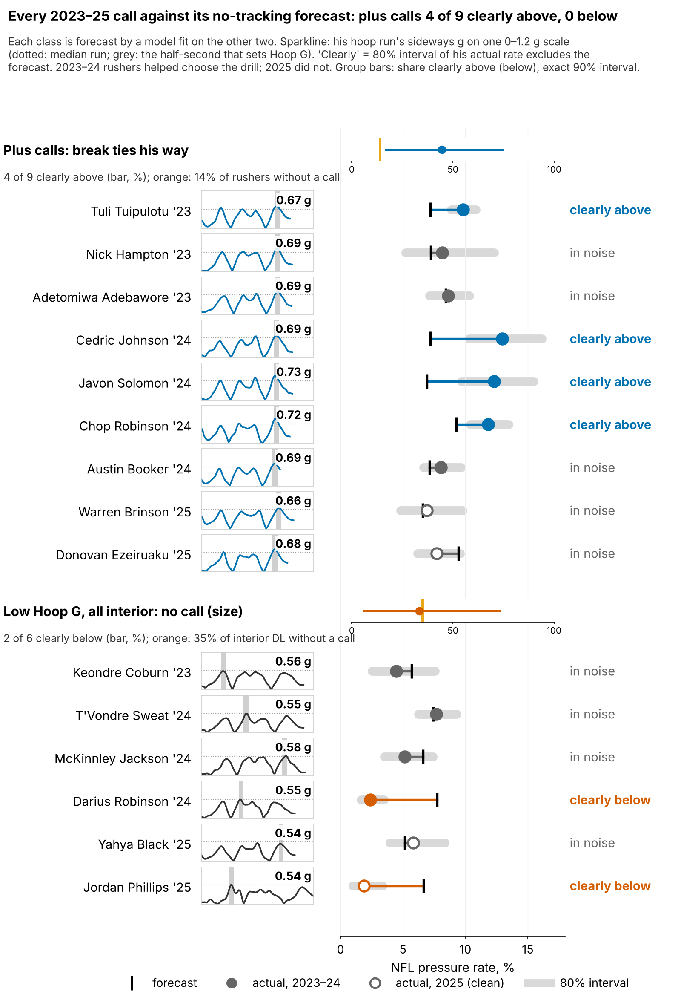

# Hoop G: Run-the-Hoop Lateral Force as a Pass-Rush Tiebreaker

**Hoop G, the hardest sideways force a defensive lineman holds for half a second in the Combine's Run-the-Hoop drill, is worth about {{bayes_all}} pressures a season per standard deviation, the gap between pick 100 and pick {{pick_equiv}}. It has not yet held up on new classes, so use it only to break ties between rushers who never ran the 3-cone.**

| {{bayes_n}} DL hoop runners with an NFL pass rush, 2023–25 | Result |
|---|---|
| Extra pressures per 450-rush season, per sd of Hoop G [90%] | **{{bayes_all}}** [{{bayes_all_lo}}, {{bayes_all_hi}}] |
| On a class the model never saw: pressure-rate variance explained beyond the no-tracking baseline [90%] | +{{wr2_pts}} points [{{wr2_pts_lo}}, +{{wr2_pts_hi}}]; it helped in 2023 only |

## Why now, and why this drill

- **Why now.** This Big Data Bowl is the first public release of 10 Hz tracking from Combine position drills. The Run-the-Hoop, where a rusher circles a hoop on the ground leaning in, has always been graded by eye; the official results carry no number for it.
- **The draft-room problem.** Pressure is what teams pay pass rushers for, and the 3-cone is the best Combine predictor of it we found. But only {{bayes_n_3cone_obs}} of our {{bayes_n}} hoop runners ran a 3-cone ({{pct_3cone_25}}% of the 2025 class). Nearly every DL runs the hoop.

## What Hoop G is

**One metric, one name.** Hoop G is the peak half-second average of acceleration perpendicular to his path in the hoop, in g, standardized within Combine year. In plain terms it is how hard he can lean into a turn without slowing down.

**What {{hoop_g_median}} g means.** A typical run peaks at {{hoop_g_median}} g while moving {{hoop_v_peak}} yd/s ({{hoop_v_mph}} mph). Holding that force at that speed means running a circle about {{hoop_radius}} yards in radius without slowing: a tight corner, not a wide loop. On sampled NFL rushes the typical half-second peak is only {{nfl_arc_med}} g: blockers, not the hoop, set the path on Sundays.

**Noise.** One run has reliability {{rel_hoop_sb}} (split-half); the {{rel_icc_n}} players with two runs agree at {{rel_icc}}. Every model below corrects for this. Heavier players turn less sharply: within interior DL Hoop G falls with weight (ρ = {{rho_wt_int}}, n = {{rho_wt_int_n}}), much less so on the edge ({{rho_wt_edge}}).

What the four rows say:

- **Javon Solomon** (EDGE, pick 168): {{f1_solomon_hoop}} g in the hoop, {{f1_solomon_nfl}} g on his hardest NFL turn and the highest typical rush of the four ({{f1_solomon_med}} g). Pressure {{f1_solomon_pr}}% against a {{f1_solomon_pb}}% forecast: a day-3 EDGE with no 3-cone, the case the rule is built for.
- **Ashton Gillotte** (EDGE): {{f1_gillotte_hoop}} g drill, {{f1_gillotte_med}} g typical rush; {{f1_gillotte_pr}}% vs {{f1_gillotte_pb}}%. Clearly below forecast, but his Hoop G interval crosses zero, so no call.
- **Adetomiwa Adebawore** (interior, {{f1_adebawore_wt}} lb): the best interior hoop ({{f1_adebawore_hoop}} g), yet his typical rush peaks at {{f1_adebawore_med}} g and he lands on forecast ({{f1_adebawore_pr}}% vs {{f1_adebawore_pb}}%). Inside, the turn rarely gets used.
- **Jordan Phillips** (interior, {{f1_phillips_wt}} lb): {{f1_phillips_hoop}} g drill, {{f1_phillips_pr}}% vs {{f1_phillips_pb}}%. A film flag, not a call: at his weight a low Hoop G is expected.

**Does it show up in his own NFL movement?** Barely. Across {{n_hoop_arc}} rushers, Hoop G tracks the average peak sideways g of his own random NFL rushes at ρ = {{pr_hoop_arc}} (95% {{pr_hoop_arc_lo}} to {{pr_hoop_arc_hi}}, after weight and role, players resampled). The pass-rush drill's first-second burst does better on get-off: it tracks his first second on random NFL snaps (ρ = {{rho_d1_game}}, n = {{n_d1_game}}) but not his pressure rate. And plus-Hoop G EDGEs run outside the tackle no more often than the cohort, {{wt_share_outside}}% of classified rushes, so **we read Hoop G as change-of-direction force, not bend.**

## Data and baseline

**Outcome:** regular-season pressures per pass rush, 2023–25 (player season totals).

**No-tracking baseline:** log draft pick, weight, NFL EDGE share, NGS athleticism score, games per season, and the official 10-yd split and 3-cone. Missing times are filled in from weight, role and NGS score, with a missing flag.

**Model:** pressures out of rushes, allowing rushers to differ beyond chance, with a class effect and separate EDGE and interior slopes ({{bayes_edge}} and {{bayes_int}} pressures a season). It starts from a cautious assumption: Hoop G is expected to be no stronger than the typical one of the 14 drill-and-outcome pairs we screened (7 rush and hoop measures against pressure and get-off).

## Does it hold up?

**Against the stopwatch.** On the {{cmn_n}} rushers who have every measure, the 3-cone's adjusted correlation with pressure is {{cmn_t3_r}} [{{cmn_t3_lo}}, {{cmn_t3_hi}}] and Hoop G's is {{cmn_hoop_r}}. **The 3-cone comes first; Hoop G only covers rushers who skipped it.**

**On unseen classes.** Fitting on two classes and scoring the third, with every choice (which drill, its noise, how cautious to be) remade inside each split, Hoop G adds {{wr2_pts}} points of variance explained: +{{wr2_pts_2023}} in 2023, {{wr2_pts_2024}} in 2024, {{wr2_pts_2025}} in 2025. Rerunning the whole pipeline on {{perm_n}} copies with Hoop G shuffled within class gives a gain this large with p = {{perm_p_r2}}.

**Chance of a lucky pick.** Hoop G was the strongest of 14 screened pairs (ρ = {{mult_obs}}). Shuffling the NFL outcomes {{mult_nperm}} times, the best of 14 reaches that strength with p = {{mult_p}}. Taken alone, the in-sample link is not beyond luck.

| Check | Pressures a season per sd [90%] |
|---|---|
| Planning number (cautious) | {{bayes_all}} [{{bayes_all_lo}}, {{bayes_all_hi}}] |
| Only rushers with an official 3-cone (n = {{oo3_n}}) | {{oo3_t}} [{{oo3_t_lo}}, {{oo3_t_hi}}] |
| Less cautious starting assumption | {{pr_wide}} [{{pr_wide_lo}}, {{pr_wide_hi}}] |

## What a team can use

**The price.** {{bayes_all}} pressures a season is the gap between pick 100 and pick {{pick_equiv}} on our draft-slot model (80% range {{pick_equiv_lo}} to {{pick_equiv_hi}}). That is a tiebreak between neighbours on the board, not a round.

**Rules.** A call needs the 80% interval of his noise-corrected Hoop G to clear zero.

| | EDGE | Interior |
|---|---|---|
| Plus call | Break ties his way against EDGEs picked within 30% of his slot, if neither has a 3-cone | Same, against interior DL |
| Film check | Does he flatten at the top of the rush or only redirect late? | Does he win laterally on games and stunts? |
| Low Hoop G | No EDGE fell that low in 2023–25 | No call: mostly says "heavy", which the baseline already prices; film flag only |

**For the position coach:** a plus says the turn is in his body. The plus EDGEs did not run wider arcs, so the job is building the late redirect into his rush plan.

**How the calls did.** There are {{plus_all_n}} plus calls in 2023–25; {{plus_scored_n}} have the 30+ NFL rushes needed to score them. Each class is forecast by a no-tracking model fit on the other two.

{{TABLE:calib}}

The plus calls pressured at {{raw_p_rate}}% against {{raw_n_rate}}% for rushers without a call, {{raw_p_gap}} points above their forecast. In 2023–24, the classes that helped choose the drill, {{calp_tune_k}} of {{calp_tune_n}} plus calls clearly beat their forecast [90% {{calp_tune_lo}}–{{calp_tune_hi}}%]; in 2025, the clean class, {{calp_clean_k}} of {{calp_clean_n}}. The no-call base rate is {{caln_pct}}% [{{caln_lo}}–{{caln_hi}}%]. By class the plus calls went {{calc_2023_k}} of {{calc_2023_n}} (2023), {{calc_2024_k}} of {{calc_2024_n}} (2024) and {{calc_2025_k}} of {{calc_2025_n}} (2025); none fell clearly below. Low-Hoop G interior DL fell clearly below in {{imin_below}} of {{imin_n}} cases, close to the {{base_int_below_pct}}% of no-call interior DL who did.

**2025 decision card** (Hoop G corrected for the number of runs; rookie results shown for reference, not used):

{{TABLE:card}}

## Limitations

- **Not confirmed on new classes.** The out-of-class gain comes from 2023 alone and its interval spans zero; allowing for the 14 screened pairs, the in-sample link could be luck. A confirmatory test needs about {{n_power80}} rushers, roughly {{classes_power80}} classes.
- **Weaker than the 3-cone** where both exist, and the planning number depends on the cautious starting assumption.
- **Thin NFL tracking.** In-game checks use about {{arc_snaps_per_player}} sampled random rushes per player, with no ball, blockers, stunts or scheme labels. Pressure counts ignore rotation, injuries and opponents; 2025 has one season.
- **Size.** For interior DL, low Hoop G is largely weight.

*Reproducible: `uv run python writeup/candidates/round_08/cand_1/analysis.py` writes `numbers.json`, `claims.json` (each number's sentence), the board CSV and every figure, then fills this text from `writeup_template.md`.*
