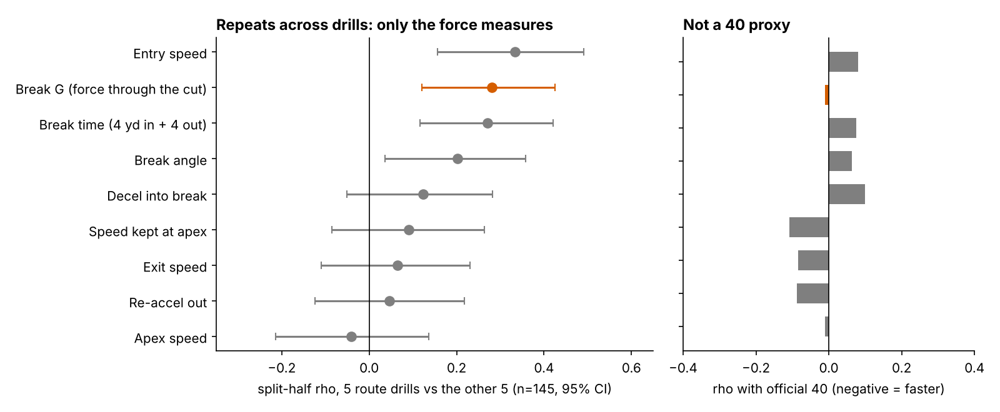
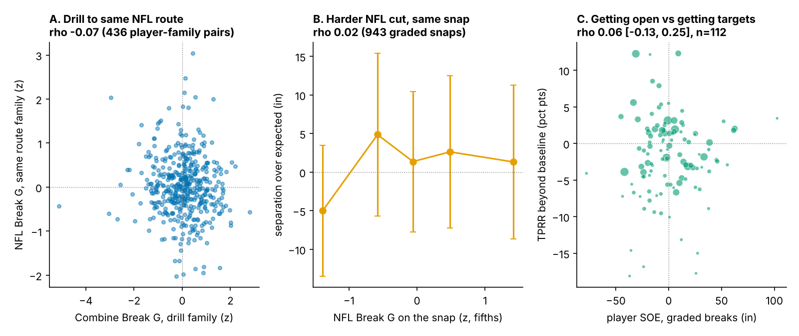

# Break G: Hard Combine Cuts Earn Receivers a Few More Targets, Not More Separation

Break G measures how hard a receiver brakes, turns and drives out of the cut in his Combine route drills. Among {{n_main}} receivers and tight ends with NFL routes, each sd came with {{coef_pp}} more targets per 100 routes than draft slot and testing predicted (95% CI {{coef_pp_lo}} to {{coef_pp_hi}}), but no extra separation. It breaks ties; it does not move boards.

**Why now.** Every Combine route-drill rep is now tracked at 10 Hz, so clubs will be offered "suddenness" scores built from those reps and told they mean getting open. We test that claim on the three classes that have played, against what a club already has: pick, 40, weight and NGS athleticism score.

## The metric

**For a coach.** Break G is how hard a receiver pushes into the ground in the one second around his cut, averaged over his route drills. A receiver who rounds the cut and drifts scores low; one who sinks, snaps and drives out scores high.

**On the field.** A typical Combine cut averages {{bg_drill_median}} g: over that second his velocity changes by about {{bg_drill_yds}} yd/s in total, for example braking from 7 to 4 yd/s and driving back to 7 on a new line. One sd of true Break G is {{g_true_sd}} g, or {{sd_yds}} yd/s more velocity change per cut. A plus receiver (about +1.5 sd) gains roughly {{plus_sd_yds}} yd/s on an average cutter: too little to see live, easy for tracking to see.

**In code.** Speed and acceleration come from smoothed 10 Hz x/y. The break is the first turn of 30° or more after 1.5 yd, entered above 2.5 yd/s; it was found in {{pct_drill_detected}}% of {{n_drill_reps}} route-drill reps. Break G is the mean acceleration over the 1.0 s centred on the sharpest turn, standardized within drill × Combine year, averaged over a player's route drills (median {{median_drills_per_player}}) and pulled toward average when he ran few, so one hot rep cannot make a grade. The definition has been frozen since round 5 of this project.

Figure 1 shows the metric on four players. Kayshon Boutte and Adonai Mitchell cut at {{hero0_drill_g}} and {{hero1_drill_g}} g in drills; Jake Bobo and Jermaine Burton at {{hero2_drill_g}} and {{hero3_drill_g}} g. On NFL breaks, the {{hero_drill_gap}} g drill gap shrinks to {{hero_game_gap}} g. NFL cuts are softer for everyone ({{bg_game_median}} g), likely because they are run to leverage and timing, not to a cone.

**Is it a trait?** Break G from five route drills predicts Break G from the other five at ρ = {{rel_bg}} [{{rel_bg_lo}}, {{rel_bg_hi}}] (n = {{rel_n}}), which projects to {{rel_7drills}} for a receiver who runs seven. The three pieces coaches usually name (decel into the break, speed kept through it, re-acceleration out) do not repeat on their own; speed kept through the turn is {{rel_sk}} (Figure 3). Break G is unrelated to the official 40 ({{rho_bg_forty}}) and draft slot ({{rho_bg_pick}}): it is not a speed score.

## Result: a few more targets per route

**Data and baseline.** The outcome is career regular-season targets per route run, weighted by routes. Of {{n_combine_players}} tracked receivers, {{n_main}} have an NFL route (median {{routes_median}}); average TPRR is {{tprr_mean}}%. Break G does not predict who reaches the field (t = {{reach_t}}). The baseline is log pick, official 40, weight and NGS athleticism score, plus a tight end flag. "Held out" means fitting on two draft classes and forecasting the third.

The slope is positive in every class but clears zero only in 2023 (Figure 2A). Held out, Break G removes {{dr2_pct}}% of forecast error [{{dr2_lo_pct}}, {{dr2_hi_pct}}]: {{cls2023_gain_pct}}% in 2023, {{cls2024_gain_pct}}% in 2024, {{cls2025_gain_pct}}% in 2025. A class of about 40 has only {{power_one_class}} power to detect this slope, so disagreement between classes is expected either way. Wide receivers carry it ({{rob_wr_pp}} points, t = {{rob_wr_t}}); tight ends do not (t = {{rob_te_t}}). Three checks keep the claim small:

{{TABLE:checks}}

Discounting for the search, the planning number is **{{plan_pp}} points of TPRR per sd, about {{plan_tg}} targets in a 500-route season**.

## The calls, and how often they were right

A wide receiver is **plus** if his 80% Break G range sits above zero and **minus** if it sits below. Receivers with fewer than five route drills and all tight ends get no call. Each forecast comes from a model that never saw his class.

- **Plus ({{n_plus}} WRs):** TPRR {{plus_tprr}}% against an average forecast of {{plus_fc}}%; {{plus_n_beat}} beat it ({{plus_beat_pct}}%, 95% CI {{plus_beat_lo}} to {{plus_beat_hi}}). A coin flip.
- **No call ({{n_neutral}}):** {{neutral_tprr}}% against {{neutral_fc}}%; {{neutral_beat_pct}}% beat it.
- **Minus ({{n_minus}}):** {{minus_tprr}}% against {{minus_fc}}%; only {{minus_n_beat}} beat it ({{minus_beat_pct}}%, 95% CI {{minus_beat_lo}} to {{minus_beat_hi}}).

The downgrade side looks more useful, but eight players cannot prove it: the interval runs to {{minus_beat_hi}}%, and the 2023–24 hits come from classes we could see while building the metric. The 2025 class, with one season, has {{plus25_beat}} of {{plus25_n}} plus and {{minus25_beat}} of {{minus25_n}} minus receivers beating forecast.

**Draft-room example.** In 2023 A.T. Perry (pick {{ex_minus_pick}}, Break G {{ex_minus_bg}}) and Trey Palmer (pick {{ex_other_pick}}, {{ex_other_bg}}) went {{ex_dpick}} picks apart. The rule takes Palmer: {{ex_other_tprr}}% TPRR over {{ex_other_routes}} routes against Perry's {{ex_minus_tprr}}%, though Palmer also fell short of his {{ex_other_fc}}% forecast. Across all {{n_pairs}} minus WRs the same pairing (nearest-pick non-minus WR of his class, median {{pairs_median_dpick}} picks apart) goes the rule's way {{n_pairs_minus_lower}} times: better than a coin, not by much.

**Decision card, 2025 class** (rule: every plus and minus WR, the closest neutral to a minus call, the WR with fewest drills, the most-used TE):

{{TABLE:card}}

What a receivers coach does with it: a minus call is a reason to ask what else on tape makes him win early in the route; a plus call is a note, not a promotion.

## Not separation

We ran the same code on {{n_break_snaps_fmt}} sampled NFL slant, out, hitch, in and corner snaps. A snap counts only if the cut finished at least 0.2 s before the throw ({{n_graded}} snaps, {{n_graded_players}} players). Separation over expected (SOE) is separation at the throw minus a model of route, depth, cushion, coverage, alignment, time to throw, down and distance fitted on 2023–24.

- **Same route family:** drill Break G does not carry to NFL Break G on that route: ρ = {{fam_rho}} [{{fam_lo}}, {{fam_hi}}], {{fam_n}} player-route pairs.
- **Same snap:** harder NFL cuts do not buy separation: ρ = {{snap_rho}} [{{snap_lo}}, {{snap_hi}}].
- **Player level:** one sd of Combine Break G goes with {{soe_coef_in}} inches of SOE [{{soe_lo_in}}, {{soe_hi_in}}], against a player-to-player spread of {{soe_sd_in}} inches.

This does not contradict the target result. In this sample SOE barely tracks TPRR beyond the baseline (ρ = {{rho_soe_tprr}} [{{rho_soe_tprr_lo}}, {{rho_soe_tprr_hi}}]), and adding SOE moves the Break G slope only from {{recon_without}} to {{recon_with}}. Whatever Break G picks up, it is not getting open at the throw; timing, quarterback trust and catch-point play are candidates this data cannot separate.

## Limitations

- **A lead, not a confirmation.** The search-adjusted chance is {{p_fwer}}, the held-out gain interval spans zero, and one player carries half the slope. Targets per route replaced an earlier volume outcome after that result was seen; the definition was frozen, the outcome choice was not.
- **No clean holdout.** All three classes were visible when Break G was defined. The 2025 class has one season.
- **Mechanism unknown.** Break G does not carry to NFL cut force or separation, so "break" describes the drill, not a proven game skill.
- **Outcome noise.** TPRR reflects role, quarterback, scheme and health; it carries no coverage or play-call context.
- **Sample.** NFL tracking is up to 40 sampled plays per player with no defenders or ball, so the drill-to-game nulls are partly a measurement limit.

Reproduce: `uv run python writeup/candidates/round_08/cand_2/analysis.py` (about two minutes, `data/processed` only). It writes every quoted number to `numbers.json`, the sentence quoting each to `claims.json`, and renders this text from `writeup_template.md`; the full board is in `board.csv`.
