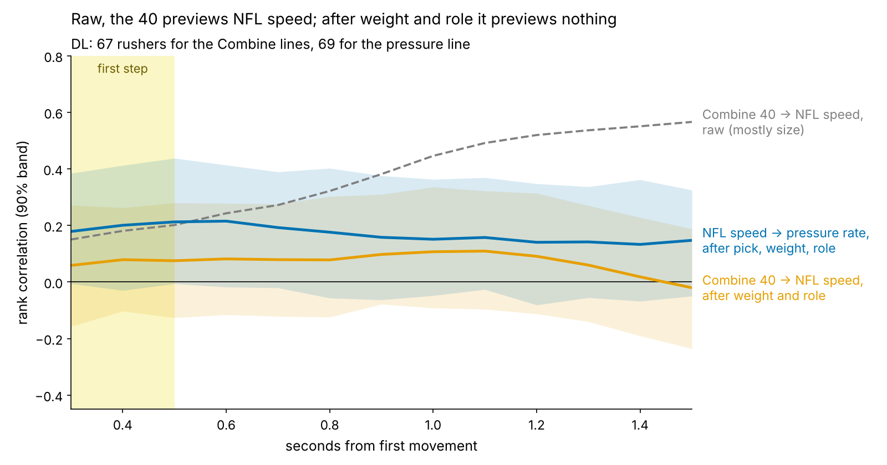
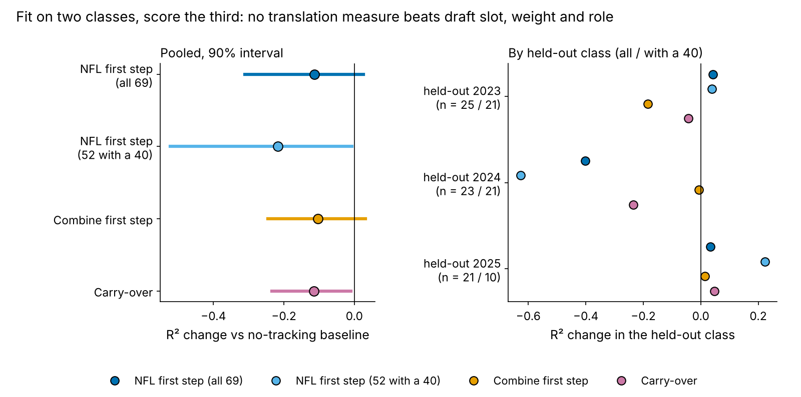

# The 40 Doesn't Travel: A Pass Rusher's Combine Start Reaches Sunday Only Through His Weight

**We laid each 2023–25 defensive lineman's Combine 40 start over his own NFL pass-rush starts, tenth of a second by tenth. Raw, the 40 previews his NFL speed at 1.5 s (ρ = 0.57). After weight and role it previews nothing (−0.02), and translation explains no pressure beyond draft slot. Grade the start from tape.**

| Question (67 DL with a tracked 40 and 8+ random NFL starts) | Answer |
|---|---|
| Does his 40 start show up in his NFL start, beyond weight and role? | No: ρ 0.07 [90%: −0.14, 0.28] for the first step |
| Does the carry-over explain pressure beyond pick, weight and role? | No: 0.18 [−0.10, 0.44] in sample; it lowers R² on held-out classes |
| What does carry signal? | His NFL first step, weakly: top third beat their draft-slot forecast 61% of the time, bottom third 13% |

## Why this question

1. **The scouting habit.** "Explosive 40, he'll win off the ball" is a common read on day-2 and day-3 rushers: the 40's first steps are the Combine's closest thing to a get-off.
2. **Why now.** Since 2023 the Combine is tracked at 10 Hz, like NFL games. For the first time a scout can put a player's Combine rep and his NFL snaps on one time axis and ask whether the same movement carried over.
3. **The decision.** If the 40 start travels, it should move a rusher up the board; if not, the board should wait for tape.

## The metric: Carry-over

**First step** is a player's mean speed 0.3–0.5 s after he first moves. In that window the 40 and a pass rush are the same movement: a lineman leaving a stance. After 0.5 s they part ways. By 1.5 s the median DL is at 6.8 yd/s in the 40 but 3.1 yd/s on a rush, because he has met a blocker (Figure 1).

**Carry-over = NFL first step minus Combine first step**, each in standard deviations after weight and NFL role (EDGE share), so heavy interior players are not penalized for being heavy. Positive means he starts faster on Sundays than his 40 promised.

**Data.** Combine side: every tracked 40 rep, year-standardized. NFL side: only the random half of the game sample (the top-EPA half oversamples sacks), pass plays where he was set at the snap. Each start is adjusted for alignment: 1563 starts, median 19 per player. Outcome: career regular-season pressures per pass rush, 2023–25, for rushers with 100+ rushes, shrunk toward the mean for small samples.

**Is it measuring something real?**

- The NFL first step averaged over 19 starts has reliability 0.64. On single snaps it tracks the official NGS get-off time at ρ = 0.51 (n = 1563; faster first step, quicker get-off).
- The tracked 40 first step repeats at 0.54 between a player's two reps (n = 56).

**Baseline without tracking:** log draft pick (UDFA = 262), weight and EDGE share.

## Finding 1: the 40 translates only through size

- **Raw, it looks like translation.** The 40 at 1.5 s ranks NFL speed at 1.5 s at 0.57 [0.41, 0.71].
- **It is weight.** Heavier linemen are slower at 1.5 s on Sundays (ρ = 0.82) and in the 40 (0.65). After weight and role the link is −0.02 [−0.24, 0.19], and no tenth from 0.3 to 1.5 s exceeds 0.11.
- **Not measurement noise.** The upper 90% bound on the first-step link, 0.28, becomes 0.47 after correcting for unreliability on both sides. Even that optimistic case leaves most of the NFL start unexplained.
- **The closest drill does no better.** The pass-rush drill's first step gives 0.04 (n = 84).
- **The stopwatch does better than the trace.** After weight and role, the official 40 *time* ranks the NFL first step at 0.26 [0.06, 0.45], and the tracked first step at 0.06. Whatever travels is overall speed, not the shape of the start.

**Other groups.** With the same pipeline, no group's 40 start survives size, and DL is the only group where the NFL first step leans toward production (Table 1). OL, DB and TE starts are too noisy on 20 random snaps (reliability ≤ 0.20) to read.

| Group | Players (40 + 8 NFL starts) | Sunday first step, reliability | Combine → Sunday, raw | Combine → Sunday, after size | Sunday first step → production beyond pick [90%] (n) |
|---|---|---|---|---|---|
| **DL** | 67 | 0.64 | 0.16 | 0.02 | **0.22** [0.01, 0.43] (69, pressure rate) |
| WR | 61 | 0.72 | −0.13 | −0.14 | −0.05 [−0.25, 0.16] (58, yards per route) |
| OL | 58 | 0.14 | −0.16 | −0.31 | −0.02 [−0.24, 0.19] (64, fewer pressures allowed) |
| DB | 58 | 0.20 | −0.06 | −0.10 | 0.14 [−0.08, 0.34] (65, solo tackles per 100 snaps) |
| TE | 20 | 0.19 | 0.12 | 0.05 | −0.18 [−0.58, 0.14] (24, snaps per season) |

*Table 1. Same metric for every group, random NFL snaps only. Correlations are Spearman; "after size" removes weight (and EDGE share for DL); production is beyond log pick and weight.*

## Finding 2: carry-over does not explain pressure beyond pick

We tried five per-player similarity measures, none chosen on pressure: carry-over, two speed ratios, curve-shape agreement, curve distance. Against pressure beyond pick, weight and role, none exceeds 0.18 in absolute value. Carry-over itself is 0.18 [−0.10, 0.44] (n = 52).

**The vertical axis carries what signal there is.** Rushers above the line beat their forecast 61% of the time (n = 28), below it 17% (n = 24). Split left/right by the 40 instead: 48% vs 33%. The NFL first step alone gives partial ρ 0.22 [0.01, 0.43] on all 69 rushers. One sd is worth 0.6 points of pressure rate [90%: 0.0 to 1.0], about 1.6 pressures in a 292-rush season.

**Why that is still not a finding:**

- **Teams already have it.** The season-long NGS get-off, measured on every snap, gives 0.40 [0.25, 0.55]. Beyond it our 20-start first step adds 0.12.
- **We picked the window.** Scanning all 13 tenths and re-running with pressure shuffled within class, the best tenth beats chance with p = 0.12.
- **It fails on new classes** (Figure 4). Fit on two classes and scored on the third, the NFL first step changes rush-weighted R² by −0.113 [−0.311, 0.026] on a baseline of 0.462. Carry-over gives −0.114, the Combine first step −0.103. 2024 drives the loss (−0.401), led by Maason Smith (Table 2).
- **Calibration is better but thin.** Against the out-of-class forecast, the top third by NFL first step beat it 14 of 23 times (61%, exact 90% interval 42–78%), the bottom third 3 of 23 (4–30%); base rate 35%. In 2025 alone the top third went 2 of 7 (5–66%).

**EDGE vs interior.** The 40 start leans toward translating for interior linemen (0.30, n = 37) and away for EDGEs (−0.18, n = 30). The NFL first step leans positive in both: interior 0.29 [0.03, 0.55], top third 7.9% vs bottom third 6.0% pressure (n = 33); EDGE 0.23 [−0.05, 0.51], 10.5% vs 8.3% (n = 36). Exploratory: the split was not pre-specified.

## Named rushers

Figure 1 shows one rusher per quadrant:

- **YaYa Diaby** (fast in both): his 40 start shows up on tape, and he pressures at 10.5% against a forecast of 8.0%.
- **Byron Young** (NFL-only fast): 40 start at percentile 21, NFL first step at percentile 96, and 11.3% vs 8.3%. The 40 undersold him.
- **Eric Watts** (Combine-only fast): 40 start at percentile 81, the slowest NFL first step in the cohort, 3.6% vs 7.0%.
- **Brenton Cox** (slow in both) is the counter-example: 9.5% vs 6.9% on 201 rushes with no start edge at all. A first step is one way to win, not the only one.

**Decision card.** One plain call per rusher, from the NFL first step and, where present, the 40. 2023–24 rows are the classes we looked at while building this; 2025 rows are the cleanest check.

| Rusher (class, pick, role) | Combine first step, pct | Sunday first step, pct (starts) | Pressure rate vs forecast | Call |
|---|---|---|---|---|
| Warren Brinson (2025, 198, interior) | 56 | 93 (19) | 6.9% vs 6.2% | Credit the start as a tie-break |
| Ashton Gillotte (2025, 66, EDGE) | no 40 | 90 (20) | 6.4% vs 8.9% | Credit the start as a tie-break |
| Princely Umanmielen (2025, 77, EDGE) | 65 | 3 (16) | 5.0% vs 9.2% | Film check: his 40 start is not on tape |
| Maason Smith (2024, 48, interior) | 67 | 100 (18) | 3.9% vs 7.7% | Credit the start as a tie-break |
| Ruke Orhorhoro (2024, 35, interior) | 35 | 99 (18) | 8.2% vs 8.2% | Trust the tape over the 40 |
| YaYa Diaby (2023, 82, EDGE) | 98 | 94 (18) | 10.5% vs 8.0% | Credit the start as a tie-break |
| Zacch Pickens (2023, 64, interior) | 87 | 9 (20) | 6.1% vs 7.3% | Film check: his 40 start is not on tape |
| Eric Watts (2024, UDFA, EDGE) | 81 | 1 (20) | 3.6% vs 7.0% | Film check: his 40 start is not on tape |

*Table 2. Percentiles among the 69 rushers with 100+ rushes, after weight and role. Forecast = no-tracking model fit on the other two classes. Calls: top third NFL first step = credit it (or "trust the tape" if his 40 start was below median); bottom third with an above-median 40 start = film check.*

Maason Smith is the cautionary row: the best NFL first step in the cohort and 3.9% against 7.7%. A fast start without a finish is not a pass rush.

## What a team can use

1. **Draft room.** Do not read a fast 40 start as get-off. Once weight and role are priced, the tracked start adds nothing; if you use the 40, use the time.
2. **Pro personnel.** For a young rusher, the NFL first step from about 20 random starts is a tie-break at most, and NGS get-off already covers it.
3. **Position coach.** A "Combine-only fast" rusher (Watts, Umanmielen, Pickens) is a film question: stance, alignment, snap anticipation, or role. The drill says the burst exists; the tape says it is not being used.

## Limitations

- **Mostly nulls.** Translation is near zero after size, and nothing holds out of class. DL was chosen as the best of five groups.
- **Small, sampled tape.** About 20 random NFL starts per player and 52 rushers with a 40, pressure rate and NFL starts together; the 2025 class has one season.
- **No context.** The game tracking has no ball, blockers or opponents, so a slow first step can be a stunt, a two-gap call or a slide toward him; scheme is unmodelled.
- **Construct.** The 40 has no snap. We anchor both sides at first movement, so snap reaction is excluded by design.
- **Outcome.** Pressure is charted and usage-dependent; injuries and rotation are not modelled.

*Reproducible: `uv run python writeup/candidates/round_08/cand_3/analysis.py` (about 30 s) writes every figure, table and number (`numbers.json`; `claims.json` maps each key to its sentence) and renders this file.*
