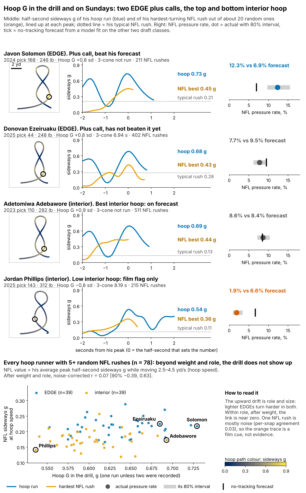
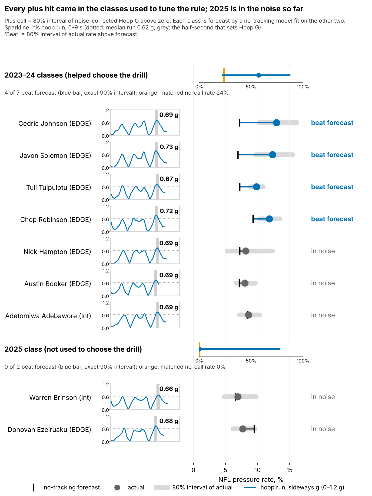
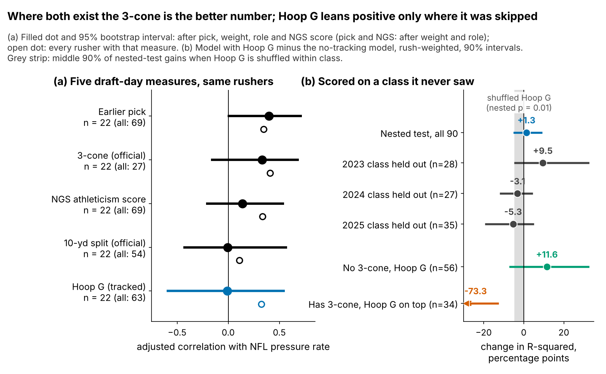

# Hoop G: A Pass-Rush Tiebreaker for Linemen Who Skip the 3-Cone

**For defensive linemen who skip the 3-cone, Hoop G, a number we pull from the Combine's Run-the-Hoop tracking, is a usable tiebreak. Across {{bayes_n}} hoop runners it is worth about {{bayes_all}} pressures a season per standard deviation, the gap between pick 100 and pick {{pick_equiv}}. Use it to break ties, not to move rounds: its hits so far come from the draft classes we used to build it.**

## The 2025 decision card

Draft rule, the same for every class: **a plus call needs the 80% interval of a player's noise-corrected Hoop G to clear zero.** A plus call breaks a tie in his favour against same-role rushers drafted near him. Where a 3-cone exists, the 3-cone comes first. Only {{pct_3cone_25}}% of the 2025 DL class ran it, so Hoop G covers the rest.

{{TABLE:card}}

Every rookie line is a rotation-sized sample, and pressure rate does not see who drew the double team. Read the last column as "nothing contradicts the call yet", never as proof. Brinson is the clean use case: a day-3 interior lineman with no 3-cone and a top-class hoop. Downs and Ezeiruaku ran 3-cones, so Hoop G only settles ties those times leave. Phillips gets a film flag, not a downgrade. At {{f1_phillips_wt}} lb a low Hoop G is expected, and the baseline already prices weight.

## What Hoop G is

**Hoop G is how hard a lineman can lean into a turn at speed: the sideways force he holds for half a second while circling the hoop.**

Units: the peak half-second average of acceleration across his path, in g, standardized within Combine year (drill medians shift between years). A typical run peaks at {{hoop_g_median}} g at {{hoop_v_peak}} yd/s ({{hoop_v_mph}} mph). That is a circle about {{hoop_radius}} yards in radius run without slowing: a tight corner, not a wide loop. One run is a noisy read (reliability {{rel_hoop_sb}}), so every number below shrinks single-run players toward average. Heavier interior linemen turn less sharply (ρ = {{rho_wt_int}} with weight, n = {{rho_wt_int_n}}).

- **Javon Solomon** (EDGE, pick {{f1_solomon_pick}}, no 3-cone): {{f1_solomon_hoop}} g in the hoop. Pressure {{f1_solomon_pr}}% against a {{f1_solomon_pb}}% forecast over {{f1_solomon_n}} rushes, a part-time role. He is the case the rule is built for. *Film cue:* does he flatten at the top of the rush and turn the corner, or does he win late with an inside redirect?
- **Donovan Ezeiruaku** (EDGE, pick {{f1_ezeiruaku_pick}}): a similar hoop ({{f1_ezeiruaku_hoop}} g) and a plus call. His rookie rate is {{f1_ezeiruaku_pr}}% vs {{f1_ezeiruaku_pb}}% over {{f1_ezeiruaku_n}} rushes, inside the noise. He also ran a strong 3-cone, which outranks Hoop G under the rule. *Film cue:* same check. If he redirects but does not finish, that is a plan-and-hands question, not a body question.

## How the calls did on classes the model never saw

Each class gets a pressure forecast from a no-tracking model fit on the other two classes. That model uses draft pick, weight, NFL EDGE share, NGS athleticism score and the official 10-yd split and 3-cone (missing times filled in from weight, role and NGS score). A call "beats" its forecast when the 80% interval of his actual rate sits above it.

{{TABLE:calib}}

**All {{fr_edge_tune_hits}} hits are EDGEs from the 2023–24 classes, the classes that helped choose the drill. In 2025, the only clean test, the plus calls went {{fr_clean_k}} of {{fr_clean_n}}.** Pooled, the plus calls beat their forecast {{fr_all_k}} of {{fr_all_n}} times [exact 90%: {{fr_all_lo}}–{{fr_all_hi}}%], against {{fr_all_base}}% for no-call rushers matched on role and class. When we shuffle Hoop G within class and remake the calls {{fr_perm_n}} times, a gap that large appears with p = {{fr_perm_p}}. That is a lead, not a validation: {{fr_all_n}} rushers cannot validate a rule.

**Where the tiebreak applies.** We used no imputed times here. On the {{ccnohoop_n}} hoop runners with an NFL rush and no 3-cone, adding Hoop G to the no-tracking model changes held-out explained pressure rate by +{{ccnohoop_r2}} points [90%: {{ccnohoop_r2_lo}}, +{{ccnohoop_r2_hi}}]. The held-out log score changes by +{{ccnohoop_ls}} per rusher [{{ccnohoop_ls_lo}}, +{{ccnohoop_ls_hi}}]. Both lean positive, and neither interval clears zero.

**Where it does not.** On the {{cc3hoop_n}} who ran a 3-cone, adding Hoop G on top makes held-out forecasts worse, because a seventh term overfits so few rushers ({{cc3hoop_r2}} points; log score {{cc3hoop_ls}} [{{cc3hoop_ls_lo}}, +{{cc3hoop_ls_hi}}]). On {{cmn_n}} rushers with every measure, the 3-cone's adjusted correlation with pressure is {{cmn_t3_r}} and Hoop G's is {{cmn_hoop_r}}. With so few rushers even the 3-cone loses ground held out ({{cc3cone_r2}} points), so "3-cone first" rests on the in-sample comparison.

**How the headline is built.** We count pressures out of pass rushes and let rushers differ beyond chance. We shrink Hoop G's effect toward the typical drill-to-outcome link among the 14 pairs we screened, so one lucky pair cannot drive the result. That model gives the {{bayes_all}} pressures a season [90%: {{bayes_all_lo}}, {{bayes_all_hi}}] on {{bayes_n}} hoop runners. In plain draft terms, pick 100 vs pick {{pick_equiv}} (80% range {{pick_equiv_lo}} to {{pick_equiv_hi}}).

## Does the hoop turn show up on Sundays?

Not in our data. The game sample gives each lineman about {{arc_snaps_per_player}} random NFL rushes, with no blockers or ball. On those rushes we measured sideways g only while he moved at hoop speed (2.5–4.5 yd/s), across {{mx_snaps}} rushes. A mixed model with a separate baseline for each player, adjusting for weight, role and speed, gives {{mx_b}} g per sd of Hoop G [95%: {{mx_b_lo}}, {{mx_b_hi}}]. After correcting for noise in both measures, the drill-to-NFL correlation is {{mx_rc}} [90%: {{mx_rc_lo}}, {{mx_rc_hi}}], n = {{mx_n}}. The NFL side is the weak link: a single rush agrees with the same player's next rush at only {{mx_icc}}.

So the traces in Figure 1 are film cues, not evidence of mechanism. We cannot say *how* a strong hoop turns into pressure. In the bottom strip, the upward drift is role and size, not the drill.

**Drill-protocol recommendation.** The cheapest fix is at the Combine, not in the model:

1. **Record each hoop run's peak sideways g** (the tracking already supports it) and publish it beside the 40.
2. **Two timed hoop runs per player.** Reliability rises from {{rel_hoop_sb}} to {{rel_hoop_2runs}}, and fewer rushers fall in the "no call" middle.
3. **Ask every DL to run the 3-cone.** Where it exists it is the better number, and Hoop G is only a stand-in for it.

## Limitations

- **Not confirmed.** The out-of-class gain across all rushers is +{{wr2_pts}} points [90%: {{wr2_pts_lo}}, +{{wr2_pts_hi}}] and comes from 2023 alone. Hoop G was the best of 14 screened drill-outcome pairs, and the best of 14 looks this strong by luck with p = {{mult_p}}. The nested shuffle test (p = {{perm_p_r2}}) uses the same three classes. A confirmatory test needs about {{n_power80}} rushers.
- **Small call sample.** {{fr_all_n}} scored plus calls, {{fr_clean_n}} of them clean. The rule and the outcome window were set with 2023–24 visible.
- **Where both exist, the 3-cone wins.** With an observed 3-cone, Hoop G's effect drops to {{oo3_t}} pressures a season.
- **Thin NFL data.** Pressure counts ignore rotation, injuries, opponents and scheme, and 2025 has one season. The in-game tracking has about {{arc_snaps_per_player}} sampled rushes per player and no blockers.
- **Size.** For interior DL, a low Hoop G is mostly weight.

*Reproducible: `uv run python writeup/candidates/round_08/revised/analysis.py` writes `numbers.json`, `claims.json`, the board CSV and every figure, then fills this text from `writeup_template.md`.*
