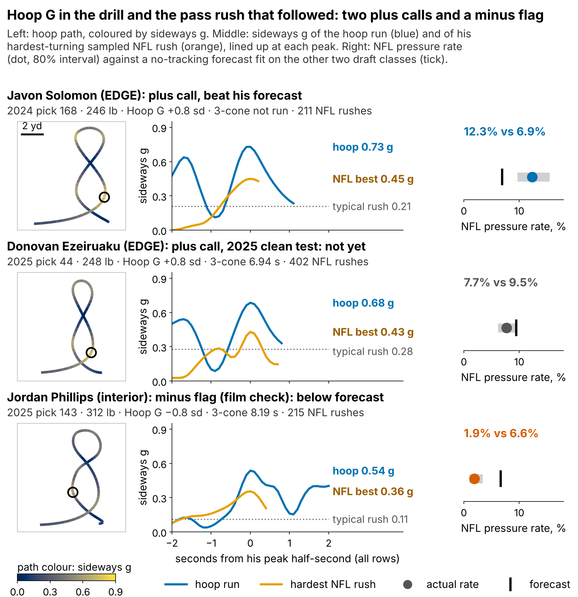
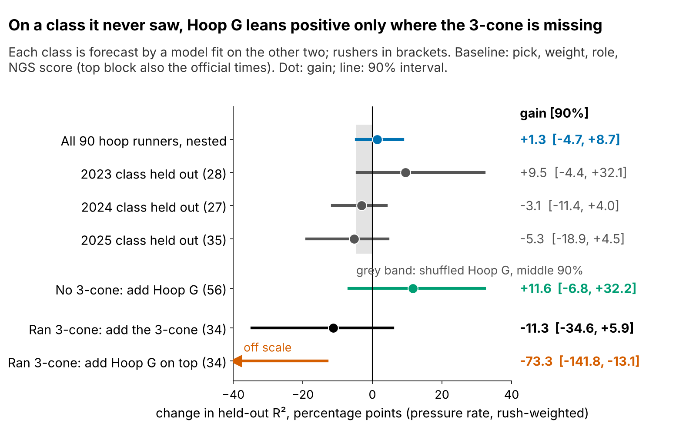
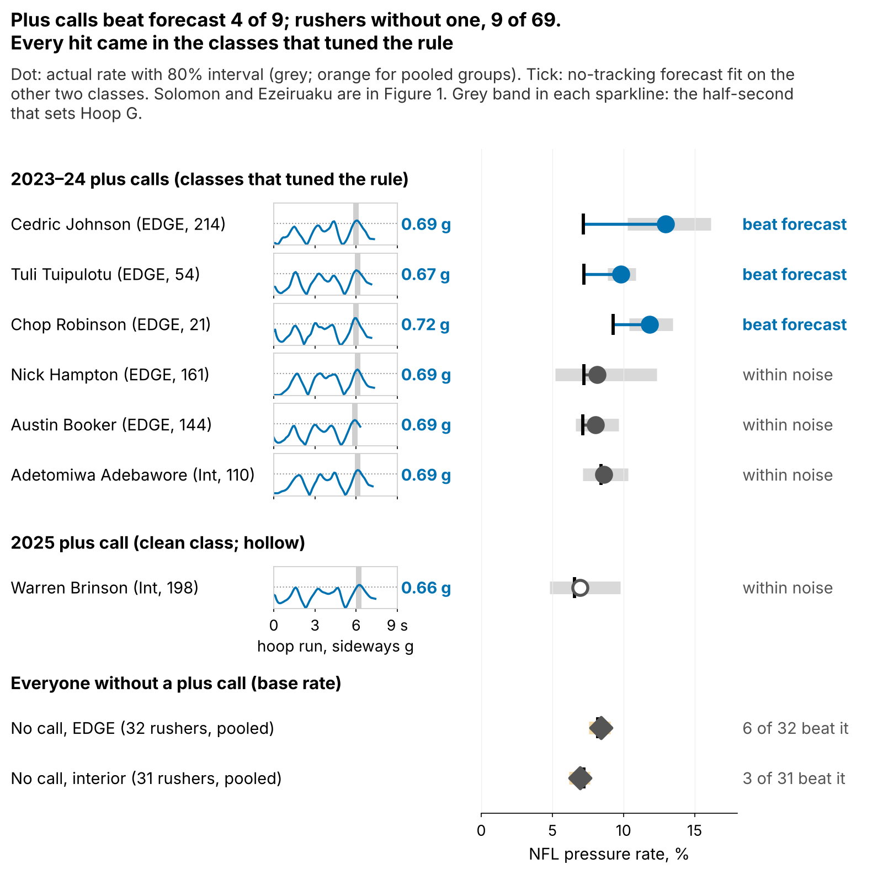

# The 3-Cone Finds Pass Rushers. Hoop G Is a Lead When It Is Missing

**Where a defensive lineman ran the 3-cone, that time is the best Combine number we have for his NFL pressure rate. Only {{r9_3cone_25_k}} of {{r9_3cone_25_n}} linemen in the 2025 class ran it. For the rest, Hoop G, a number we pull from Run-the-Hoop tracking, is a lead worth a film check, not a rule: about {{bayes_all}} pressures a season per standard deviation [90%: {{bayes_all_lo}}, {{bayes_all_hi}}], and its clean 2025 test went 0 of 2. The cheapest fix is at the Combine.**

## Why linemen who skip the 3-cone

Pressure is what teams pay pass rushers for, and one stopwatch drill tracks it for linemen. Among rushers with 100+ NFL pass rushes, a faster year-standardized 3-cone goes with a higher pressure rate (ρ = {{r9_t3_raw}} [95%: {{r9_t3_raw_lo}}, {{r9_t3_raw_hi}}], n = {{r9_t3_raw_n}}; {{cmp3_r}} after pick, weight, role and NGS athleticism score). That is in-sample on few rushers; held out, no single time survives samples this small (see "How sure we are"). Still, it is the most consistent number we have, and only {{r9_3cone_all_pct}}% of the {{r9_dl_all}} linemen in the 2023–25 classes ran it. Run-the-Hoop is the one lineman drill built around holding a curve at speed. {{r9_hoop_all}} of them ran it, and the Combine's 10 Hz tracking turns that circle into a force reading.

## The ask: three changes at the Combine

1. **Every DL runs the 3-cone.** Where it exists it is the better number; Hoop G is a stand-in.
2. **Record each hoop run's peak sideways g** (the tracking already supports it) and publish it beside the 40.
3. **Time two hoop runs per player.** Single-run reliability is {{rel_hoop_sb}}; two runs raise it to {{rel_hoop_2runs}}, so fewer rushers sit in the "film first" middle.

## What Hoop G is

**Hoop G is how hard a lineman can lean into a turn at speed: the sideways force he holds for half a second while circling the hoop.** It is the peak half-second average of acceleration across his path, in g, standardized within Combine year (drill medians shift between years). A typical run peaks at {{hoop_g_median}} g at {{hoop_v_peak}} yd/s ({{hoop_v_mph}} mph): a circle about {{hoop_radius}} yards in radius run without slowing, a tight corner rather than a wide loop. One run is a noisy read, so every number below shrinks single-run players toward average.

- **Javon Solomon** (EDGE, pick {{f9_solomon_pick}}, no 3-cone) is the case the rule is built for: {{f9_solomon_hoop}} g in the hoop, then {{f9_solomon_pr}}% pressure against a {{f9_solomon_pb}}% forecast over {{f9_solomon_n}} rushes.
- **Donovan Ezeiruaku** (EDGE, pick {{f9_ezeiruaku_pick}}) has a similar hoop ({{f9_ezeiruaku_hoop}} g) but a rookie rate of {{f9_ezeiruaku_pr}}% against {{f9_ezeiruaku_pb}}% over {{f9_ezeiruaku_n}} rushes, inside the noise. His strong 3-cone outranks Hoop G anyway.
- **Jordan Phillips** (interior, pick {{f9_phillips_pick}}, {{f9_phillips_wt}} lb) has a low hoop and the slowest 3-cone among 2025 interior linemen who ran one. He is a minus flag, labelled a film check because weight explains part of a low interior hoop. Rookie year: {{f9_phillips_pr}}% against {{f9_phillips_pb}}%.

## If you are a DL coach or scout

The rule is fixed: **a plus call needs the 80% interval of a player's noise-corrected Hoop G to clear zero; a minus flag needs it below zero.** Each rusher is compared with a no-tracking forecast (pick, weight, NFL EDGE share, NGS score, official 10-yd split and 3-cone) fit on the other two draft classes. He "beats" it when the 80% interval of his actual rate sits above it.

{{TABLE:coach}}

EDGE plus calls rushed at {{co_pe_rate}}% against a {{co_pe_fc}}% forecast and beat it {{co_pe_k}} of {{co_pe_n}} times, while EDGEs without a call ran at forecast. The two interior plus calls tell us nothing yet. Every minus flag is interior. Those six ran below forecast ({{co_mi_rate}}% vs {{co_mi_fc}}%, none above it), but weight explains part of a low interior hoop, so the flag sends you to film, not down the board.

## The 2025 decision card

{{TABLE:card9}}

Brinson is the clean use case: a day-3 interior lineman with no 3-cone and a top-class hoop. Downs and Ezeiruaku ran 3-cones, so Hoop G only settles ties those times leave. Rookie lines are rotation-sized and blind to double teams: "nothing contradicts the call yet", never proof.

**For 2026, stated in advance:** the same rule and forecast, scored after the 2027 season on rushers with 30+ rushes. The rule earns its place only if plus calls beat forecast more often than matched rushers without one.

## How sure we are

{{TABLE:where}}

Every test we ran, with the null it tests:

{{TABLE:ptable}}

**Why the p-values differ.** The {{fr_perm_p}} tests the calls; the {{perm_p_r2}} tests the held-out R² gain, but the log score, which also charges for overconfident spread, does not survive the same shuffles ({{perm_p_lpd}}). Only the {{mult_p}} prices our search over 14 drill-outcome pairs, so it is the one to quote.

**The matched {{fr_all_base}}% base rate.** Without a plus call the raw hit rate is {{r9_nc_pct}}% ({{r9_nc_k}} of {{r9_nc_n}}). Plus calls are mostly 2023–24 EDGEs, where hits are commoner, so we weight each role-by-class no-call hit rate by the plus calls in that cell: {{TABLE:matched}}.

**Calibration checks.** Scoring Ethan Downs on his {{dw_rush}} rushes, the plus record is {{dw_all_k}} of {{dw_all_n}} [exact 90%: {{dw_all_lo}}–{{dw_all_hi}}%] and the clean class {{dw_clean_k}} of {{dw_clean_n}}. Forecasting each rusher only from the official times he actually ran, plus calls still beat forecast {{ob_all_k}} of {{ob_all_n}}, against {{ob_rest_k}} of {{ob_rest_n}} for everyone else. Rush-weighted, plus calls produced {{oe_pf}} times their forecast pressures [90%: {{oe_pf_lo}}, {{oe_pf_hi}}], everyone else {{oe_nf}}; most of that comes from the tuning classes. A model fit on 2023–24 alone gives the 2025 result, 0 of 2, a probability of {{pp25_p0}}, and {{pp25_p0_null}} if Hoop G did nothing. Two rookie seasons cannot tell those apart.

The hoop turn itself does not show up in sampled NFL movement for either role (last row of the test table), so the Figure 1 traces are film cues. We cannot say *how* a strong hoop becomes pressure.

## Limitations

- **Not confirmed.** The held-out gain across all rushers spans zero, the best-of-14 screen gives p = {{mult_p}}, and a confirmatory test needs about {{n_power80}} rushers.
- **Small call sample.** {{fr_all_n}} scored plus calls, {{fr_clean_n}} of them clean. The rule and outcome window were set with 2023–24 visible.
- **The 3-cone wins where both exist.** With an observed 3-cone, Hoop G adds about {{cc3_t}} pressures a season.
- **Thin NFL data.** Pressure counts ignore rotation, injuries, opponents and scheme; 2025 has one season. The sampled game tracking has about {{arc_snaps_per_player}} rushes per player and no blockers.

*Reproducible: `uv run python writeup/candidates/round_09/cand_1/analysis.py` writes `numbers.json`, `claims.json`, the board CSV and every figure, then fills this text from `writeup_template.md`. Log scores, ridge, prior-scale and imputation checks are in `tables.json`.*
