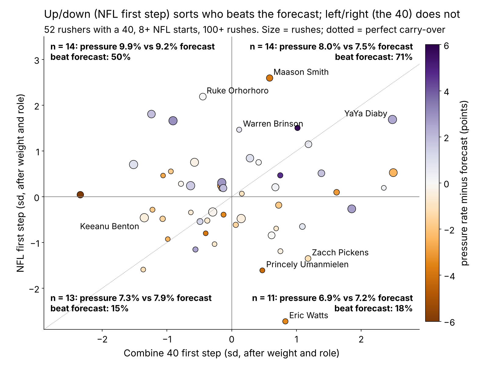
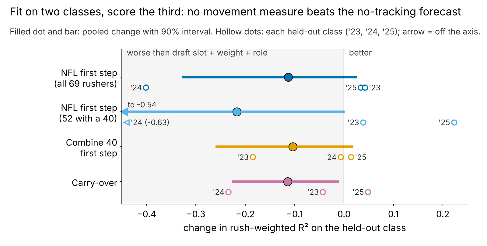

# The 40 Start Doesn't Travel: Matching Each Pass Rusher's Combine Burst to His Own NFL Starts

**We laid every 2023–25 defensive lineman's tracked 40 start over his own random NFL pass-rush starts, tenth of a second by tenth. Once weight and role are priced, the Combine start previews nothing on Sundays (ρ = {{tr_fs}}, n = {{n_tr}}), and how well it translates explains no pressure beyond draft slot. What does sort rushers is the NFL first step itself: a lead worth a film check, not a rule.**

## What a team can do with this

1. **Draft room: pay for the stopwatch, not the trace.** After weight and role, the official 40 *time* ranks a rusher's NFL first step at {{tr_offfs}}; the tracked 40 start at {{tr_fs}}. Do not add credit for a "fast first two steps" in the clip.
2. **Combine protocol.** Neither the 40 nor the pass-rush drill (ρ = {{tr_prd}}, n = {{tr_prd_n}}) is a snap-cued start from a rusher's own stance, and neither travels. That is the rep to add if the league wants a translatable get-off.
3. **Pro personnel, after year one.** From about 20 random rookie rushes, a bottom-third first step with an above-median 40 start is a minus flag: put on the tape before the depth chart (Eric Watts, Zacch Pickens, Princely Umanmielen in Table 3).

## Why this question

Pass rush is the defensive skill teams pay most for, and "explosive off the ball" is how day-2 and day-3 rushers get sold; the 40's first steps are the Combine's closest thing to a get-off. Since 2023 the Combine is tracked at 10 Hz like NFL games, so a player's Combine rep and his NFL snaps can finally sit on one clock. If the burst carries over, it should move a rusher up the board.

## The metric: Carry-over

**First step** = mean speed 0.3–0.5 s after a player first moves. In that window the 40 and a pass rush are the same movement, a lineman leaving a stance. By 1.5 s they part: the median DL is at {{dr_med_40}} yd/s in the 40 and {{dr_med_sunday}} yd/s on a rush, because he has met a blocker.

**Carry-over = NFL first step minus Combine first step**, each in standard deviations after weight and role (share of snaps at EDGE). Positive means he starts faster on Sundays than his 40 promised.

**Data.** Combine: every tracked 40 rep, year-standardized. NFL: only the random half of the game sample (the top-EPA half oversamples sacks), pass plays where he was set at the snap, adjusted for alignment: {{n_snaps_dl}} starts, median {{snaps_med}} per player. Outcome: career regular-season pressures per pass rush (rushers with 100+ rushes), shrunk toward the mean. **Baseline without tracking:** log draft pick (UDFA = 262), weight and role; the forecast for each rusher is fit on the other two classes.

**Is it real?** The NFL first step over 19 starts has reliability {{rel_fs_game}} and tracks official NGS get-off at ρ = {{rho_fs_ngs_snap}} snap by snap; the 40 first step repeats at {{rel40_fs}} across two reps (n = {{rel40_n}}).

## Finding 1: the 40 translates only through size

Raw, the 40 at 1.5 s ranks NFL speed at 1.5 s at {{tr_raw_15}}. That is weight: heavier linemen are slower at 1.5 s on Sundays (ρ = {{rho_w_dr_sunday}}) and in the 40 ({{rho_w_dr_40}}). After weight and role no tenth from 0.3 to 1.5 s exceeds {{tr_adj_absmax}}. It is not just noise: even correcting both sides for unreliability, the upper bound on the first-step link is {{tr_fs_ceiling}}.

## Finding 2: translation does not pay; the NFL first step leans

| Claim (DL) | Estimate [90%] | n | Null tested | p |
|---|---|---|---|---|
| 40 first step → NFL first step, after weight and role | {{tr_fs}} [{{tr_fs_lo}}, {{tr_fs_hi}}] | {{n_tr}} | no link (40 shuffled within class) | {{p_tr_fs}} |
| Official 40 time → NFL first step, same | {{tr_offfs}} [{{tr_offfs_lo}}, {{tr_offfs_hi}}] | {{n_tr}} | same | {{p_tr_offfs}} |
| Carry-over → pressure beyond pick, weight, role | {{sim_carry}} [{{sim_carry_lo}}, {{sim_carry_hi}}] | {{n_carry}} | same | {{p_carry}} |
| NFL first step → pressure, same | {{pay_all}} [{{pay_all_lo}}, {{pay_all_hi}}] | {{n_pay}} | same, one window | {{p_pay_all}} |
| … best of {{n_windows}} tenths | — | {{n_pay}} | no tenth matters (max over windows) | {{p_maxt}} |
| … beyond season NGS get-off | {{pay_beyond_ngs}} | {{n_ngs_pay}} | same | {{p_beyond_ngs}} |
| Held-out R² change, NFL first step | {{ooc_sunday_all}} [{{ooc_sunday_all_lo}}, {{ooc_sunday_all_hi}}] | {{n_pay}} | no gain | interval |
| Beat out-of-class forecast: top vs bottom third | {{cal_top_pct}}% vs {{cal_bot_pct}}% | {{cal_top_n}} + {{cal_bot_n}} | equal rates (Fisher) | {{p_fisher}} |
| … window picked on the other two classes | {{lw_t_pct}}% vs {{lw_b_pct}}% | {{lw_t_n}} + {{lw_b_n}} | same | {{p_lw_fisher}} |
| … 2025 only, top third | {{cal25_k}} of {{cal25_n}} | {{cal25_n}} | 2023–24 rate holds | {{pp25}} |

*Table 1. Spearman partial correlations, bootstrap intervals by player, 2,000 within-class shuffles. "Beat" = career pressure rate above the forecast fit on the other two classes; base rate {{beat_k}} of {{n_pay}} ({{beat_base}}%).*

- **Translation fails.** Carry-over and four other similarity measures (speed ratios, curve shape, curve distance; none chosen on pressure) never exceed {{sim_absmax}} in absolute value, and carry-over lowers held-out R² ({{ooc_carry}}).
- **The NFL first step sorts direction, not size.** Top-third first steps beat their forecast {{cal_top_k}} of {{cal_top_n}} times (exact 90% interval {{cal_top_lo}}–{{cal_top_hi}}%), bottom third {{cal_bot_k}} of {{cal_bot_n}}. That holds when the window is chosen on the other two classes ({{lw_t_k}} of {{lw_t_n}} vs {{lw_b_k}} of {{lw_b_n}}), although the chosen window moves between folds. As a linear term it hurts held-out R², because one outlier (Maason Smith) dominates 2024 ({{ooc_sunday_all_2024}}). Use it as a sign, not a number.
- **The clean class disagrees.** 2025 was not seen when the window was set. Its top third went {{cal25_k}} of {{cal25_n}}; if the 2023–24 rate ({{pp_k0}} of {{pp_n0}}) were true, a result that poor has probability {{pp25}}. At the base rate it is unremarkable ({{pp25_base}}). One season of rushes is thin, but this is why the call is a film check.

Split by the 40 instead of the NFL start, the beat rates are {{half_cr_beat}}% vs {{half_cl_beat}}%.

**Plus call vs no call, EDGE and interior:**

{{TABLE:roles}}

*Table 2. Thirds of NFL first step among all {{n_pay}} rushers; "a of b" = rushers beating their out-of-class forecast.*

**Why DL.** On the same pipeline no group's 40 start survives size (after weight: WR {{g_WR_tradj}}, OL {{g_OL_tradj}}, DB {{g_DB_tradj}}, TE {{g_TE_tradj}}), and only DL's NFL first step leans toward production ({{g_DL_pay}}, WR {{g_WR_pay}}). OL, DB and TE starts are too noisy on 20 random snaps to read (reliability {{g_OL_rel}}, {{g_DB_rel}}, {{g_TE_rel}}).

## Decision card

One plain call per rusher. Plus = top-third NFL first step; minus flag = bottom third with an above-median 40 start; film first = bottom third without one. Rows marked * are the clean 2025 class.

{{TABLE:card}}

*Table 3. Percentiles among the {{n_board}} rushers with 100+ rushes, after weight and role.*

- **Same slot, opposite calls.** Gillotte (pick 66) and Umanmielen (pick 77) are 2025 EDGEs. Gillotte's NFL start is at the {{b_gillotte_s}}th percentile, Umanmielen's at the {{b_umanmielen_s}}rd despite a {{b_umanmielen_c}}th-percentile 40 start. For year-two snaps the call prefers Gillotte; both trail their forecast, so it is a film question, not a verdict.
- **Maason Smith is the cautionary plus:** the best NFL first step in the cohort and {{b_smith_rate}}% against {{b_smith_fc}}%. A fast start without a finish is not a pass rush.
- **Keeanu Benton is film first:** neither start is fast; grade his hands and power, which this metric cannot see.
- **Pre-registered for the 2026 class:** after ≥8 random rookie starts, apply the same thirds and calls; we will score them against the same out-of-class forecast after their first season.

## Limitations

- **Mostly nulls.** Translation is near zero after size and fails out of class; DL was chosen as the clearest of five groups, and the first-step window was read off Figure 2 (best-of-{{n_windows}} p = {{p_maxt}}).
- **Small, sampled tape.** About 20 random NFL starts per player, {{n_both}} rushers with a 40, a pressure rate and NFL starts; 2025 has one season.
- **No context.** The game sample has no ball, blockers or opponents, so a slow first step can be a stunt, a two-gap call or a slide toward him.
- **Construct.** The 40 has no snap. Both sides are anchored at first movement, so snap reaction is excluded by design.
- **Outcome.** Pressure is charted and usage-dependent; injuries and rotation are not modelled.

*Reproducible: `uv run python writeup/candidates/round_09/cand_3/analysis.py` (about 30 s) writes every figure, table and number and renders this file.*
