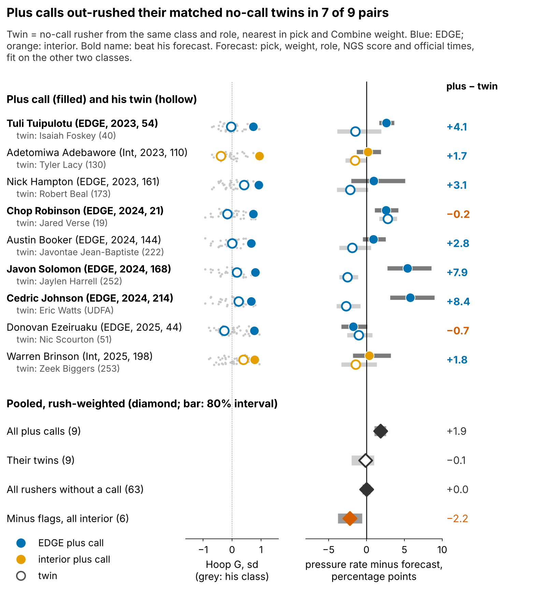

# Two Leads for Pass Rushers: The 3-Cone, and Hoop G When the 3-Cone Is Missing

**For defensive linemen who ran the 3-cone, that time is our best Combine lead on NFL pressure rate. For the two in three who skipped it, Hoop G, the sideways force he holds while circling the Run-the-Hoop drill, is a second lead. Neither is confirmed on a draft class it was not fit on: use Hoop G to break ties and send scouts to film, not to move a board.**

## Why a tiebreak, and why now

A pressure is the play a pass rusher is paid for: on 1681 sampled NFL pass plays of our rookies, the offense lost 0.53 expected points more on snaps he pressured than on snaps he did not [90%: 0.37, 0.68]. Boards are flattest on day 3, and that is where the stopwatch is thinnest: only 43 of 118 linemen in the 2023–25 classes ran an official 3-cone (36%; 2025: 15 of 44). But 109 of the 118 ran Run-the-Hoop, and the Combine's 10 Hz tracking turns that circle from a lap time into a force reading.

## The ask

1. **Every DL runs the 3-cone.** Where it exists it is the better number.
2. **Publish each hoop run's peak sideways g** beside the 40. The tracking already supports it.
3. **Time two hoop runs per player.** One run has reliability 0.41; two raise it to 0.58.
4. **For 2026, stated in advance:** we score the same rule and forecast after the 2027 season, against matched twins (below).

## What Hoop G is, and what it is not

**Hoop G is how hard a lineman can lean into a curve at speed when nobody is blocking him.** It is the peak half-second of acceleration across his path, standardized within Combine year. A typical run peaks at 0.62 g at 3.5 yd/s (7 mph): a circle about 1.8 yards in radius. Single runs are noisy, so every number shrinks toward average.

It is not a measure of how he wins. In sampled NFL rushes, a high Hoop G does not show up as harder turning at matched speed (EDGE: 0.002 g per sd [−0.006, 0.011]) or as more outside rushes (38 EDGEs, ρ = 0.07). So it speaks to two situations a scout must still confirm on film: the speed rush from a wide-9 or ghost alignment, where the rusher has to flatten at the top, and the looper on a T-E or E-T stunt, who has to turn tight behind the crash. It says nothing about a bull rush.

Solomon (pick 168, no 3-cone) is the use case: 0.73 g in the hoop, then 12.3% pressure against a 6.9% forecast over 211 rushes. Phillips (312 lb) pairs a low hoop with the slowest 2025 interior 3-cone: 1.9% against 6.6%.

High and low hoops among EDGEs, with the 3-cone and how their sampled wide rushes left the line:

| EDGE (class, pick) | Hoop G, sd | 3-cone | Sampled wide rushes: outside / inside / straight | Pressure vs forecast |
|---|---|---|---|---|
| Javon Solomon (2024, 168) | 0.80 | not run | 15% / 15% / 70% (20) | 12.3% vs 6.9% |
| Donovan Ezeiruaku (2025, 44) | 0.77 | 6.94 s | 8% / 50% / 42% (24) | 7.7% vs 9.5% |
| Isaiah McGuire (2023, 126) | −0.48 | 7.39 s | 8% / 48% / 44% (25) | 7.2% vs 5.8% |
| Tyler Baron (2025, 176) | −0.62 | not run | 4% / 30% / 67% (27) | 4.4% vs 8.0% |

The two high hoops win differently: Solomon goes straight upfield, Ezeiruaku takes the inside move half the time. Hoop G ranks the bend a man has, not the move he uses; the tape tells you whether he uses it.

## The track record, player by player

The rule is frozen: **a plus call needs the 80% interval of a player's noise-corrected Hoop G to clear zero; a minus flag needs it below zero.** Each rusher with 30+ NFL rushes is compared with a no-tracking forecast (pick, weight, EDGE share, NGS score, official 10-yd split and 3-cone) fit on the other two classes; he "beats" it when the 80% interval of his rate sits above it.

| Group, 2023–25 (30+ NFL rushes) | Rushers (2025) | Pressure rate (forecast) | Beat forecast [exact 90%] | Clearly below |
|---|---|---|---|---|
| Plus call, EDGE | 7 (1) | 10.0% (7.8%) | 4 of 7 [23–87%] | 0 |
| Plus call, interior | 2 (1) | 8.2% (8.0%) | 0 of 2 [0–78%] | 0 |
| No call, EDGE | 32 (10) | 8.4% (8.2%) | 6 of 32 [8–34%] | 12 |
| No call, interior | 31 (13) | 6.9% (7.2%) | 3 of 31 [3–23%] | 11 |
| Minus flag, interior (film check) | 6 (2) | 4.7% (6.9%) | 0 of 6 [0–39%] | 2 |

Plus calls went 4 of 9, every hit a 2023–24 EDGE; rushers without a call went 9 of 69. By name: Cedric Johnson (pick 214) rushed at 13.0% against a 7.2% forecast; Adetomiwa Adebawore (pick 110), a plus call from the same rule, at 8.6% against 8.4%, inside the noise.

A fairer test puts each plus call beside the no-call rusher a scout would have weighed him against: same class and role, nearest in pick and Combine weight.

Plus calls out-rushed their twins' rate over forecast in 7 of 9 pairs, by 3.2 points on average, and 1 of 2 in 2025. The 6 interior minus flags sit 2.2 points under forecast, but weight explains part of a low interior hoop, so that flag sends you to film, not down the board.

## The 2025 decision card

| 2025 player (pick, role) | Call (Hoop G, sd) | 3-cone | Rookie pressure vs forecast (rushes) |
|---|---|---|---|
| **Ethan Downs** (UDFA, EDGE) | Plus (0.94) | 7.58 s | too few to score (7) |
| **Warren Brinson** (198, Int) | Plus (0.77) | not run | 6.9% vs 6.6% (173; within noise) |
| **Donovan Ezeiruaku** (44, EDGE) | Plus (0.77) | 6.94 s | 7.7% vs 9.5% (402; within noise) |
| **Jack Sawyer** (123, EDGE) | Film first (0.56) | not run | 9.7% vs 8.5% (176; within noise) |
| **Tyler Baron** (176, EDGE) | Film first (−0.62) | not run | 4.4% vs 8.0% (68; within noise) |
| **Jordan Phillips** (143, Int) | Minus flag (−0.80) | 8.19 s | 1.9% vs 6.6% (215; clearly below) |
| **Yahya Black** (164, Int) | Minus flag (−0.75) | 7.63 s | 5.8% vs 5.2% (189; within noise) |

Film checklist and tie-breaks:

- **Plus, EDGE (Downs and Ezeiruaku):** does he flatten at the top of the rush from a wide-9 or ghost alignment, or only redirect late? If his 3-cone still leaves a tie, take him over Jah Joyner (UDFA) / Nic Scourton (51).
- **Plus, interior (Brinson):** does he win as the looper on T-E and E-T stunts, turning tight behind the crash? In a tie, take him over Tim Smith (190).
- **Film first (Sawyer, Baron):** does he turn the corner, or win only with power? A second hoop run would settle the call.
- **Minus flag, interior (Phillips, 312 lb and Black, 336 lb):** partly size. Does he still redirect on games at that weight? If film agrees, prefer Cam Jackson (140) / Elijah Roberts (157).

Where a 3-cone exists, it decides first; Brinson, a day-3 interior lineman with no 3-cone, is the clean use case.

## How sure we are

| Claim (rushers) | Estimate | Tested against |
|---|---|---|
| 3-cone → pressure, after pick, weight, role, NGS (27 rushers with 100+ rushes) | in-sample ρ 0.41 [−0.01, 0.72]; fit on two classes, scored on the third: 0.36 [−0.22, 0.67], positive in 1 of 3 held-out classes | 95% bootstrap |
| Hoop G → pressures per 450-rush season, per sd (all 90) | 0.6 [−0.4, 1.7]; no 3-cone (56) 1.0 [−0.1, 2.5], ran it (34) 0.3 | one count model, shared prior, 90% |
| Hoop G, held-out gain where the 3-cone is missing (56) | explains 11.6 more points of rusher-to-rusher spread [−6.8, 32.2] | fit on two classes, 90% |
| Plus calls beat forecast (frozen rule) | 4 of 9 vs 9 of 69 without a call | Hoop G shuffled: p = 0.05 |
| Same rule, re-chosen on two classes and scored on the third | 4 of 12 vs 9 of 66 (4 of 13 with Downs) | nothing fit on the scored class |
| Plus call vs matched no-call twin | better in 7 of 9 pairs; +3.2 pts of pressure rate over forecast [1.6, 4.9] | Hoop G shuffled, twins re-matched: p = 0.004 |
| Best of 14 drill–outcome pairs we screened | Hoop G partial ρ 0.32 | outcomes shuffled: p = 0.12 |
| 2025 clean test | 0 of 2 plus calls beat forecast; 0 of 23 without a call did | P(0 of 2) = 0.22 at the 2023–24 plus rate, 0.96 at the 2025 no-call rate |

Quote the 0.12: it is the only p-value that prices our search over 14 drill–outcome pairs, so the calls are leads, not rules.

## Limitations

- **Not confirmed.** Out of class, both leads' intervals span zero; a confirmatory test needs about 840 rushers.
- **Small and early.** 9 scored plus calls; one rookie season is too short for anyone to clear the bar. The twin test was added after the rule, on the same rushers.
- **Thin NFL data.** Season pressure counts ignore rotation, injuries, opponents and scheme. Sampled tracking has about 20 rushes per player and no blockers.
- **Where both exist, the 3-cone wins.** Hoop G is a stand-in, not an addition.

*Reproducible: `uv run python writeup/candidates/round_09/revised/analysis.py` writes `numbers.json`, `claims.json`, the board CSV and both figures, then fills this text from `writeup_template.md`.*
