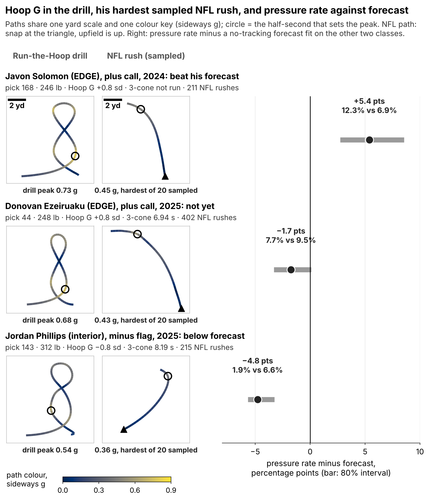
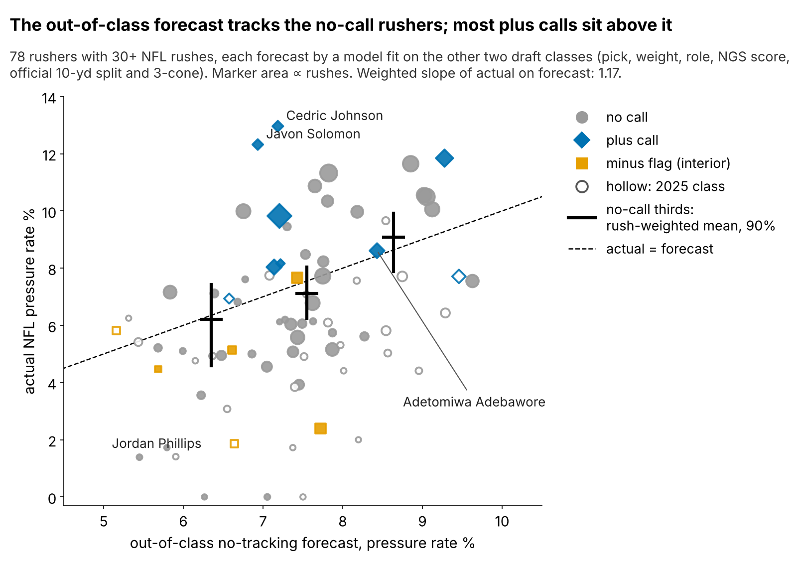
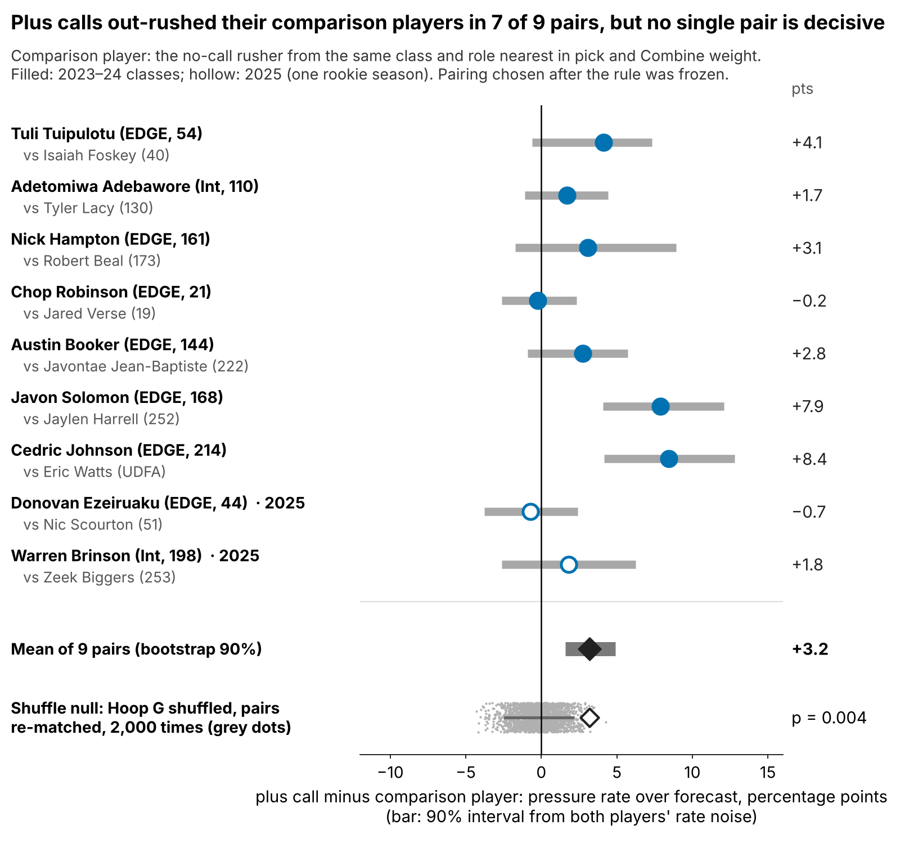
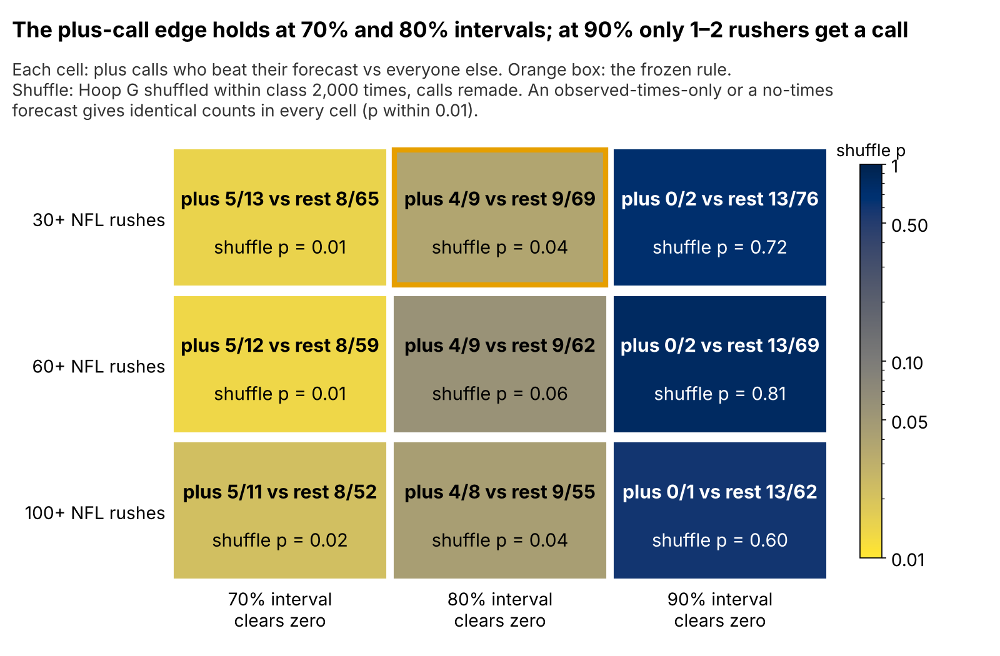

# Hoop G: A Tiebreak Lead for Pass Rushers Who Skip the 3-Cone

**Among 2023–25 defensive linemen, the 3-cone is the Combine time most tied to NFL pressure rate, yet on a draft class it was not fit on, it reaches only ρ = {{r10_t3_loco}} [{{r10_t3_loco_lo}}, {{r10_t3_loco_hi}}]. Hoop G, from Run-the-Hoop tracking, stands in for the two in three who skip the 3-cone: its plus calls beat a no-tracking forecast {{fr_all_k}} of {{fr_all_n}} times, against {{r9_nc_k}} of {{r9_nc_n}} for everyone else, and 0 of {{fr_clean_n}} in 2025. A lead, not a rule.**

## Why it matters

A pressure is what a rusher is paid for: on {{r10_epa_n}} sampled NFL pass plays of our rookies, the offense lost {{r10_epa_diff}} more expected points on pressured snaps [90%: {{r10_epa_lo}}, {{r10_epa_hi}}].

The 3-cone should relate to pressure because it makes a big man stop, plant and bend around a cone low to the ground, the same hip bend and redirect he needs to dip under a tackle's hands and turn toward the quarterback. But only {{r10_t3_all_k}} of {{r10_t3_all_n}} linemen ran an official 3-cone ({{r10_t3_25_k}} of {{r10_t3_25_n}} in 2025)¹, while {{r9_hoop_all}} ran Run-the-Hoop, a figure-eight around two hoops. The Combine's 10 Hz tracking turns that lap into a force reading: **Hoop G**, the peak half-second of sideways acceleration on the curve, standardized within Combine year and shrunk toward average for one-run noise (reliability {{rel_hoop_sb}}).

## The ask

1. **Every DL runs the 3-cone.** Where it exists it decides first.
2. **Publish each hoop run's peak sideways g** beside the 40, and **time two runs** (reliability rises to {{rel_hoop_2runs}}).
3. **2026, stated in advance:** we score the same frozen rule and forecast after the 2027 season. Alone, that class has {{r11_pw_1}}% power at the 2023–24 hit rates ({{r11_pw_p1}}% vs {{r11_pw_p0}}%); four classes (2026–29) reach {{r11_pw_full_4}}%, and only {{r11_pw_halfgap_4}}% if the true gap is half as large.

## What Hoop G is not

Hoop G is an **empirical correlate with no mechanism we can see in games**. At matched speed, a high Hoop G does not show up as harder turning on sampled NFL rushes ({{mx9_e_n}} EDGEs: {{mx9_e}} g per sd [{{mx9_e_lo}}, {{mx9_e_hi}}]) or as more outside rushes ({{r10_dir_n}} EDGEs, ρ = {{r10_dir_rho}}). Compare the pass-rush drill: its first-second burst does carry into games (ρ = {{rho_d1_game}} [{{rho_d1_game_lo}}, {{rho_d1_game_hi}}] with first-second distance after the NFL snap, {{n_d1_game}} linemen), yet says nothing about pressure (partial ρ {{pr_d1_press}}). Carry-over is not value.

## The track record

**Frozen rule:** a plus call needs the 80% interval of a player's shrunk Hoop G above zero; a minus flag, below. Each rusher with 30+ NFL rushes gets a no-tracking forecast (pick, weight, EDGE share, NGS score, official 10-yd split and 3-cone) fit on the other two classes, and "beats" it when the 80% interval of his pressure rate clears it. The forecast is honest out of class (Figure 2; weighted slope {{r11_cal_slope}} [{{r11_cal_slope_lo}}, {{r11_cal_slope_hi}}]).

{{TABLE:coach}}

By class, plus calls went {{r11_c2023_pk}} of {{r11_c2023_pn}} (others {{r11_c2023_nk}} of {{r11_c2023_nn}}), {{r11_c2024_pk}} of {{r11_c2024_pn}} ({{r11_c2024_nk}} of {{r11_c2024_nn}}) and {{r11_c2025_pk}} of {{r11_c2025_pn}} ({{r11_c2025_nk}} of {{r11_c2025_nn}}). An exact test that compares within class gives mid-p {{r11_strat_midp}}; shuffling Hoop G gives p = {{fr_perm_p}}. One rookie season is too short for anyone to clear the bar: no 2025 rusher did.

Each plus call beside the no-call rusher a scout would have weighed him against (same class and role, nearest pick and weight):

Plus calls led in {{r10_tw_better}} of {{r10_tw_n}} pairs, by {{r10_tw_diff}} points on average, but only {{r11_pair_excl0}} pairs clear zero alone, and the pairing was designed after the rule.

Is 80% a lucky setting? Across {{r11_grid_n}} variants of the call interval, the 30-rush minimum and the forecast, plus calls lead in {{r11_grid_pos}}; the edge vanishes at 90%, where only 1–2 rushers get a call. In the count model with rushes as exposure, rushes per game for rotation and a pick × rotation term, Hoop G is worth {{r11_xall}} pressures per 450 rushes per sd [{{r11_xall_lo}}, {{r11_xall_hi}}], carried by the {{r11_x100_n}} rushers with 100+ rushes (Appendix).

## When the call is wrong

{{TABLE:cases}}

**Adebawore** is the plus-call miss: an interior rusher who met his forecast but never beat it, though he still out-rushed his comparison player, {{TABLE:ade_twin}}, by {{r11_ade_twin_d}} points. **Phillips and Black** are the same flag with opposite outcomes: both line up inside on at least {{r11_mf_inside_min}}% of snaps and get off the ball slower than {{r11_mf_slower_min}}% of cohort linemen, yet Phillips sits {{r11_phillips_p450}} pressures per 450 rushes under forecast and Black {{r11_black_p450}} over. At {{f9_phillips_wt}} and {{r11_black_wt}} lb a low Hoop G is partly size, so the flag is a film question: does he still change direction when the play moves away?

The price of a wrong tie-break is small: in the {{r11_bad_n}} pairs the comparison player won, he won by at most {{r11_bad_cost_max}} pressures per 450 rushes, about {{r11_bad_epa_max}} expected points.

## The 2025 decision card

{{TABLE:card11}}

Film checklist and tie-breaks:

{{TABLE:film11}}

## How sure we are

{{TABLE:sure}}

## Limitations

- **Not confirmed.** Out of class, the 3-cone and Hoop G intervals both span zero; the 3-cone count model gives {{r11_t3cm}} pressures per 450 rushes per sd [{{r11_t3cm_lo}}, {{r11_t3cm_hi}}]. Hoop G is a stand-in where the 3-cone is missing, not an addition.
- **Small and early.** {{fr_all_n}} scored plus calls; the 2025 class cannot discriminate yet.
- **Thin NFL data.** Season counts ignore opponents and scheme; rotation is proxied by rushes per game. Sampled tracking has 20 rushes per player and no blockers or ball.
- **Searched.** Hoop G was the best of 14 drill–outcome pairs; shuffling outcomes, a pair that strong appears with p = {{mult_p}}.

¹ Tracking shows {{r11_t3_tracked}} linemen with a 3-cone attempt: {{r11_t3_both}} with an official time, {{r11_t3_trk_only}} with tracking only; {{r11_t3_off_only}} official time has no tracked run. We use official times.

## Appendix: model checks

{{TABLE:appx}}

*Reproducible: `uv run python writeup/candidates/round_10/cand_1/analysis.py` writes `numbers.json`, `claims.json`, the board CSV and all four figures, then fills this text from `writeup_template.md`.*
