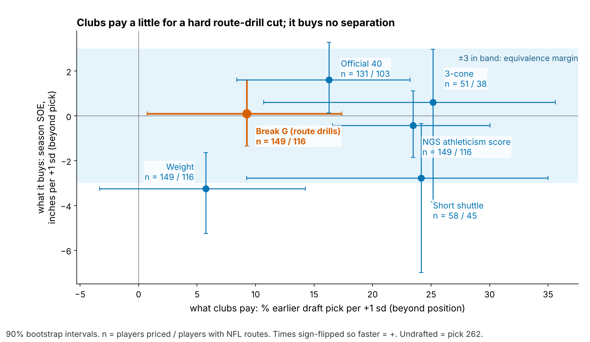

# Break G: Clubs Pay for the Combine Cut. It Does Not Get Receivers Open.

**Break G grades how hard a receiver brakes, turns and drives out of his Combine route-drill cuts. Clubs already pay a little for it: 14% earlier picks per sd beyond the 40, weight and NGS score (p = 0.06). Across 116 NFL receivers and tight ends it buys −0.6 inches of season separation over expected per sd (90% interval −2.6 to +1.2). Even at the top of that interval, that is 0.2 catches a season. Grade the break on tape.**

## What a club should do

- **Take route-drill break grades off the separation side of the board.** No version moves separation by 3 inches. That holds for Break G, its three coach pieces, each draft class and 18 alternative definitions. The wrong call has a price. A board that paid for Break G would have taken Kayshon Boutte, the hardest drill cutter here, at pick 143 instead of 187. He finished 4.8 inches below forecast.
- **On tape, grade timing, not force.** On NFL snaps a harder cut does not open a receiver. When the ball arrives after the cut does (exploratory, Figure 2).
- **Combine protocol ask.** A break measure that transfers needs route drills run against a scripted defender, or at least to throw timing, with two reps of each route. Today 75–83% of position drills have one rep.

## Why test this

Every Combine route-drill rep is now tracked at 10 Hz, so clubs will be sold "suddenness" scores on the promise that sudden cutters get open. Separation is worth predicting because it repeats. A receiver's season separation over expected (SOE) correlates 0.44 [0.23, 0.62] with his next season's (n = 53 pairs, 100+ routes in both). The question is whether the cut he shows on a cone predicts the separation he creates on the matching NFL route, beyond pick, 40, weight and NGS athleticism score.

## The metric

**For a coach.** Break G is how hard a receiver pushes into the ground in the second around his cut. Rounding the cut and drifting scores low. Sinking, snapping and driving out scores high.

**On the field.** A typical Combine cut averages 0.57 g. NFL cuts are softer for everyone (median 0.42 g), because they are run to leverage and timing, not to a cone. One sd of true Break G is 0.021 g.

**In code.** Speed and acceleration come from smoothed 10 Hz x/y. The break is the first turn of 30° or more after 1.5 yd, entered above 2.5 yd/s. It was found in 96% of 926 route-drill reps. Break G is the mean acceleration over the 1.0 s centred on the sharpest point of the turn. It is standardized within drill × Combine year, averaged over a player's route drills (median 7) and shrunk by drill count. Identical code runs on sampled NFL snaps of the same route families: slant, out, hitch (with curl and comeback), in and corner. The definition, outcome and ±3-inch equivalence margin were fixed in the previous round.

Adonai Mitchell (2024, pick 52) cut at 0.60 g in drills and Jake Bobo (2023, undrafted) at 0.53 g. On NFL breaks the 0.07 g gap shrinks to 0.02 g, and their season SOE is nearly identical (−0.6 and −0.8 inches).

## The chain: does the drill reach the snap?

1. **The drill trait holds.** Break G from five route drills predicts Break G from the other five at ρ = 0.28 [0.16, 0.40] (n = 145, shuffle p = 0.001), a reliability of 0.58 for a receiver who runs seven. It is not a speed score (ρ with the 40: −0.01). The pieces coaches name do not repeat (decel 0.12, speed through the break −0.04, re-acceleration 0.05), so they are combined.
2. **It does not carry to the same NFL routes.** If drill and game cuts were one skill, the correlation could reach about 0.46, given NFL Break G's own odd-vs-even reliability of 0.23 over a median 16 breaks. It is −0.11 [−0.26, 0.05] across 115 players, and −0.07 [−0.15, 0.02] over 436 player × route-family pairs. No family exceeds 0.05 (corner).
3. **A harder NFL cut does not buy separation; timing might.** Within a player, snap Break G against SOE at the throw is ρ = 0.01 [−0.05, 0.07] (943 snaps, 112 players). SOE is separation minus a model of route, depth, cushion, coverage, alignment, time to throw, down and distance. Throws in the second fifth of cut-to-throw time (median 0.7 s) beat the player's own average by 8.6 inches. Throws in the last fifth (3.1 s) trail it by 9.8, a gap of 18.4 inches [6.0, 31.3]. This was not pre-specified. It matches what coaches teach: the window opens just after the break and closes as the defender recovers.

## What clubs pay vs what it buys

Scouts watch the route drills, so Break G is partly priced. Beyond position, +1 sd goes 9% earlier [1, 17]. Beyond the 40, weight and NGS score it goes 14% earlier (p = 0.06), so a pick-100 receiver goes at 86. The payoff is 0.1 inches [−1.4, 1.6]. The 40 is priced at 16% and pays +1.6 inches [0.1, 3.3]. Weight costs separation (−3.2 inches) but is barely priced, which is sensible: heavier receivers are drafted to win contested catches and block.

## Season separation: the bound

**Data and baseline.** The outcome is full-season NGS separation at the throw, adjusted for cushion, alignment, tight end and season, and route-weighted over each career: 213 player-seasons, 116 players, median 231 routes. Each yard of cushion is worth 0.42 yd of separation. The no-tracking baseline is log pick, official 40, weight, NGS athleticism and a TE flag. "Held out" means fitting on two draft classes and forecasting the third.

| Test | n | Estimate [90% interval] | p |
|---|---|---|---|
| **Season SOE, inches per sd** | 116 players | **−0.6 [−2.6, +1.2]** | 0.57 vs zero; 0.019 vs ±3 in (equivalence) |
| Best of Break G and its 3 pieces | 116 players | decel −0.9 | 0.94 (max-t shuffle within class) |
| Held-out forecast error removed | 3 classes | 1.3% [−0.9, 3.6] | interval spans 0 |
| 18 alternative definitions | 116 players | −0.7 to +0.7; all inside ±3 in | — |

**Out of class.** In every held-out class, Break G correlates negatively with how far players beat the baseline forecast: −0.15 (2023, n = 42), −0.13 (2024, n = 40), −0.06 (2025, n = 34). Wide receivers alone give −0.2 inches, 100+ routes −0.6 (n = 84), equal weighting −2.8. No version of Break G is positive by more than 0.7 inches.

**In football units.** Season catch rate rises 8.8 points per yard of separation when targeted (120 player-seasons, 20+ targets), and the median receiver with 200+ routes draws 60 targets. The +1.2-inch upper bound is worth 0.2 catches a season, and weight's effect 0.5.

## Named players

The rule takes the three highest and three lowest Break G wide receivers with 5+ route drills and 200+ NFL routes (46 qualify). "vs forecast" is season SOE minus the held-out no-tracking forecast.

| Player (class, pick) | Break G [80% range] | NFL Break G (z) | SOE vs forecast (routes) | Read |
|---|---|---|---|---|
| Kayshon Boutte (2023, 187) | 1.8 [1.0, 2.6] | 0.1 | −4.8 in (873) | False positive (below) |
| Adonai Mitchell (2024, 52) | 1.7 [0.9, 2.5] | 0.3 | +0.9 in (486) | On forecast; drill added nothing |
| Arian Smith (2025, 110) | 1.7 [0.9, 2.5] | 0.2 | +11.8 in (231) | Credit the 4.36 speed |
| Jake Bobo (2023, UDFA) | −1.4 [−2.2, −0.5] | 0.1 | −6.4 in (306) | The one correct downgrade |
| Isaiah Bond (2025, UDFA) | −1.3 [−2.1, −0.5] | −0.5 | +1.0 in (333) | Softest in drills and games, on forecast |
| Jalin Hyatt (2023, 73) | −0.9 [−1.7, 0.0] | 0.1 | +0.9 in (679) | Do not mark down a 4.40 for a soft cone |

Two of three hard and two of three soft cutters beat forecast, against 46% of all 46: a coin flip both ways.

**False-positive case: Kayshon Boutte.** His drill cuts (median 0.62 g) were the hardest in the cohort. On his 7 graded NFL breaks he did what a cut grade promises. He entered faster than the median (5.4 vs 4.9 yd/s) and kept 100% of his speed (median 98%), and the ball came out 0.7 s after the cut (median 1.1 s). He still finished 4.8 inches below forecast over 873 routes, so the shortfall happened outside the cut. On tape, check the release, the stem leverage and the route mix: go routes were 35% of his sampled snaps against 21% for peers. Priced at the market rate, his +1.8 sd would have moved him from pick 187 to 143.

**One channel we cannot rule out.** Break G relates to targets per route run: +1.9 points per sd (t = 3.3). That falls to 1.0 (t = 1.9) without Puka Nacua, and holding SOE fixed leaves 2.0. If the cut earns anything, it is quarterback trust or route detail, not open space. Treat it as an untested lead, not a reason to pay.

## Limitations

- **Not a blind test.** The definition, outcome and margin were fixed before this test, but an earlier look had seen no snap-level link, and all three classes were visible when the definition was frozen.
- **Power.** The test rules out 3 inches per sd (minimum detectable effect 3.2 inches), not 1 inch. Adding the 2026 class (about 40 players) as a prospective test brings that to 2.8 inches, with power 0.85 against a 3-inch effect.
- **Game tracking is a sample.** Each player has up to 40 plays with no defenders and no ball. NFL break force reflects the route call as much as the player, and its reliability (0.23) caps every drill-to-game correlation. The timing result is exploratory.
- **Outcome and price.** Season SOE is not adjusted for quarterback, and the 2025 class has one season. The draft price is an association: scouts may pay for route detail seen in the same drill, not for Break G itself.
- **Drill protocol.** Route drills are run to cones, mostly once. Standardizing within drill × year removes the year shift, not single-rep noise.

Reproduce: `uv run python writeup/candidates/round_10/cand_2/analysis.py` (about two minutes, `data/processed` only). It writes every quoted number to `numbers.json` and every WR/TE to `board_full.csv`.
