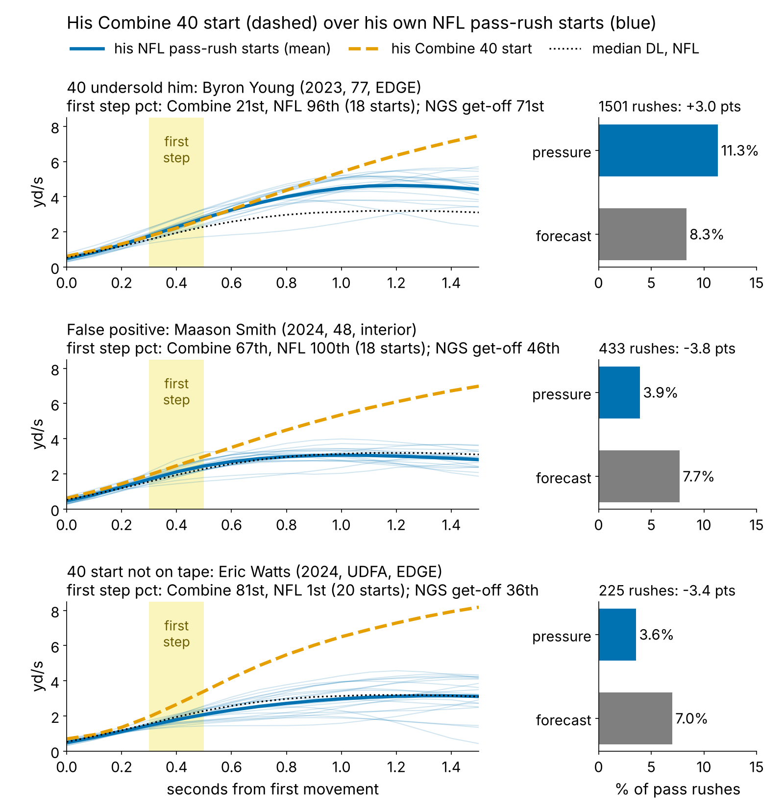
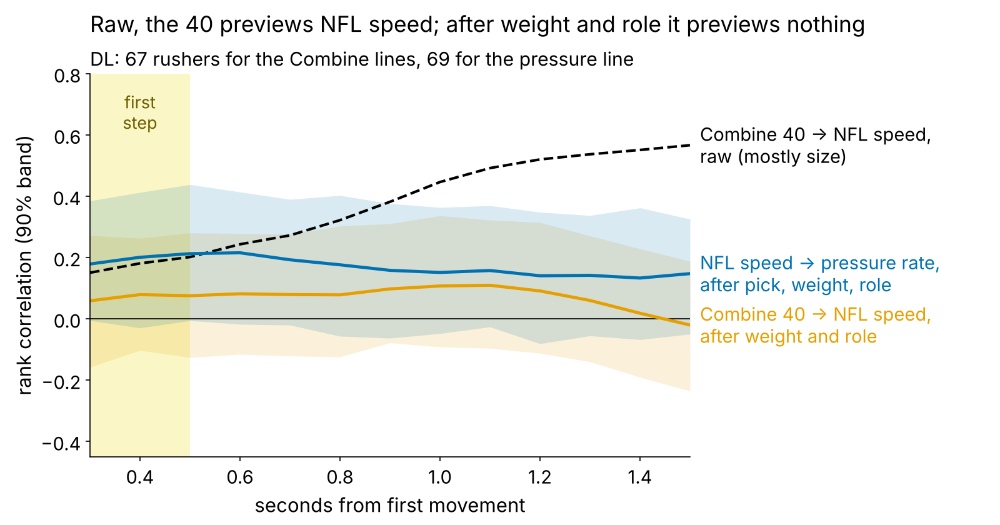
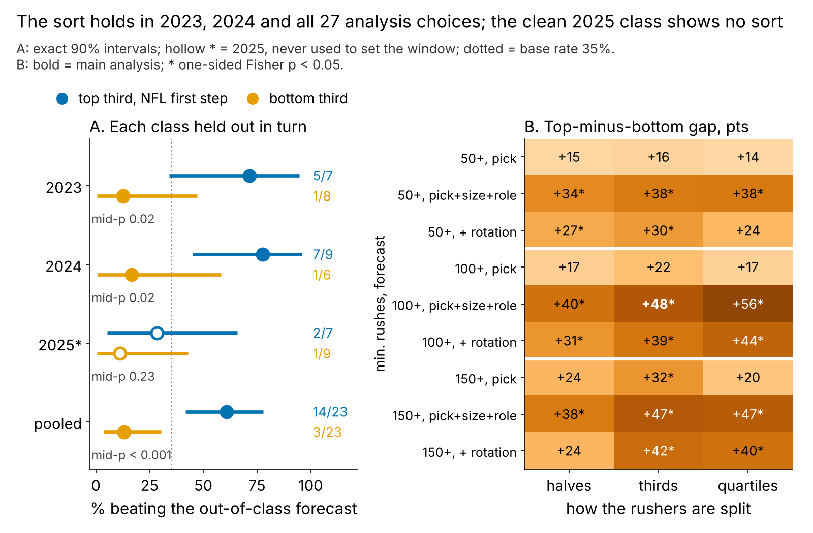

# The 40 Start Doesn't Travel; the NFL First Step Is a Film Lead

**We laid each 2023–25 defensive lineman's tracked 40 start over his own random NFL pass-rush starts. After weight and role, the 40 previews the NFL first step at ρ = {{tr_fs}} (n = {{n_tr}}) and adds no pressure beyond draft slot. The NFL first step does sort rushers: the top third beat a no-tracking forecast {{cal_top_k}} of {{cal_top_n}} times, the bottom third {{cal_bot_k}} of {{cal_bot_n}}. But the clean 2025 top third went {{cal25_k}} of {{cal25_n}}. A film lead, not a rule.**

## What a team can do with this

1. **Draft room: pay for the stopwatch, not the clip.** After weight and role, the official 40 *time* ranks a rusher's NFL first step at {{tr_offfs}}; the tracked 40 start at {{tr_fs}}. Give no extra credit for "fast first two steps" on the Combine trace.
2. **Pro personnel, after about 20 rookie rushes.** A top-third NFL first step earns a second film look. A bottom-third start after a fast 40 (Eric Watts, Zacch Pickens, Princely Umanmielen) means tape before the depth chart. Neither moves a player alone.
3. **On every plus, ask whether the burst finishes.** Maason Smith, below, is the miss: the cohort's fastest start, half his forecast pressure.
4. **Combine protocol.** Neither the 40 nor the pass-rush drill (ρ = {{tr_prd}}, n = {{tr_prd_n}}) is a snap-cued start from a rusher's stance. That is the rep to add.

## Why this question

"Explosive off the ball" is how day-2 and day-3 rushers get sold, and the 40's first steps are the Combine's closest thing to get-off. The logic: a rusher who reaches the blocker's set point first makes the tackle open his hips early and the guard catch instead of punch. Since 2023 the Combine is tracked at 10 Hz like NFL games, so both can sit on one clock.

## The metric: Carry-over

**First step** = mean speed 0.3–0.5 s after a player first moves. In that window the 40 and a pass rush are the same movement, a lineman leaving a stance. By 1.5 s they part: the median DL is at {{dr_med_40}} yd/s in the 40 and {{dr_med_sunday}} yd/s on a rush, because he has met a blocker.

**Carry-over = NFL first step minus Combine first step**, each in standard deviations after weight and role (share of snaps at EDGE). Positive means he starts faster on Sundays than his 40 promised.

**Data.** Combine: every tracked 40 rep, year-standardized. NFL: random sampled pass plays only (the top-EPA half oversamples sacks), set at the snap, alignment-adjusted: {{n_snaps_dl}} starts, median {{snaps_med}} per player. Outcome: career pressures per pass rush. **Baseline without tracking:** log draft pick (UDFA = 262), weight and role, fit on the other two classes.

**Is it real?** Over 19 starts the NFL first step has reliability {{rel_fs_game}}, and snap by snap it tracks official NGS get-off at ρ = {{rho_fs_ngs_snap}}.

## Finding 1: the 40 translates only through size

Raw, the 40 at 1.5 s ranks NFL speed at 1.5 s at {{tr_raw_15}}. That is weight: heavier linemen are slower on Sundays (ρ = {{rho_w_dr_sunday}}) and in the 40 ({{rho_w_dr_40}}). After weight and role, no tenth from 0.3 to 1.5 s exceeds {{tr_adj_absmax}}. Correcting both sides for noise, the upper bound on the first-step link is {{tr_fs_ceiling}}.

## Finding 2: translation does not pay; the NFL first step leans

| Question (DL) | Estimate [90%] | n | p |
|---|---|---|---|
| Does the 40 start preview the NFL first step (after weight, role)? | ρ {{tr_fs}} [{{tr_fs_lo}}, {{tr_fs_hi}}] | {{n_tr}} | {{p_tr_fs}} |
| Does carry-over add pressure beyond pick, weight, role? | ρ {{sim_carry}} [{{sim_carry_lo}}, {{sim_carry_hi}}] | {{n_carry}} | {{p_carry}} |
| NFL first step → pressure rate, rushes as exposure | +{{ex_pp}} pts per sd [{{ex_pp_lo}}, {{ex_pp_hi}}] | {{ex_n}} | {{ex_p}} |
| Top vs bottom third beating the out-of-class forecast | {{cal_top_k}}/{{cal_top_n}} vs {{cal_bot_k}}/{{cal_bot_n}} | {{cal_top_n}} + {{cal_bot_n}} | {{p_fisher1}} |

*Table 1. Rows 1–2: partial Spearman, player bootstrap, p from 2,000 within-class shuffles. Row 3: quasi-binomial (pressures out of rushes; dispersion {{ex_disp}}) with pick, weight, role, rotation share and pick × rotation. Row 4: one-sided Fisher. Base rate {{beat_k}} of {{n_pay}} ({{beat_base}}%). Technical checks are in the appendix.*

Four other similarity measures (speed ratios, curve shape, curve distance) never exceed {{sim_absmax}} in absolute value. One sd of NFL first step is worth about {{ex_pr_season}} pressures over a {{rush_season}}-rush season; rotation does not change the pick slope (pick × rotation {{ex_pxr}}, p = {{ex_pxr_p}}).

## Does it hold out of class?

- **Class by class.** 2023: {{pc2023_kt}}/{{pc2023_nt}} vs {{pc2023_kb}}/{{pc2023_nb}} (mid-p {{pc2023_midp}}). 2024: {{pc2024_kt}}/{{pc2024_nt}} vs {{pc2024_kb}}/{{pc2024_nb}} (mid-p {{pc2024_midp}}). 2025, never used to set the window: {{pc2025_kt}}/{{pc2025_nt}} vs {{pc2025_kb}}/{{pc2025_nb}} (mid-p {{pc2025_midp}}). The clean class does not confirm the sort.
- **Analysis choices.** Over halves, thirds or quartiles; 50, 100 or 150 minimum rushes; and three forecast specs, the gap is positive in {{grid_pos}} of {{grid_n}} cells ({{grid_min}} to {{grid_max}} points), with {{grid_sig}} at p < 0.05. It is smallest against a pick-only forecast, so part of the sort comes from scoring heavy interior players fairly.
- **Likelihood vs squared error.** With rushes as exposure, adding the first step improves held-out fit in {{exo_pos}} of 3 classes ({{exo2023_dll}}, {{exo2024_dll}}, {{exo2025_dll}} log-likelihood units per 1,000 rushes; small). By rush-weighted R² it hurts ({{ooc_sunday_all}}), because one rusher, Smith, dominates 2024 ({{ooc_sunday_all_2024}}).
- **Exposure.** For the {{ex_low_n}} rushers with 30–99 rushes the slope is {{ex_s30}} pts [{{ex_s30_lo}}, {{ex_s30_hi}}] vs {{ex_s100}} for 100+ (difference p = {{ex_int_p}}): too few to tell.
- **Power for 2026.** One class gives about {{pow_narm}} rushers per third. Even if the true gap equals ours, a one-class test has {{pow_obs}}% power; if it is half ({{pow_half_pt}}% vs {{pow_half_pb}}%), {{pow_half}}%. Confirming the half-size gap needs about {{pow_need}} rushers per third, roughly {{pow_need_classes}} classes. The 2026 check is monitoring, not proof.

**Mechanism: an empirical correlate.** If the first step worked by winning at the snap, it should predict quick pressures best. It does not: ρ = {{mech_quick}} [{{mech_quick_lo}}, {{mech_quick_hi}}] for quick pressures against {{mech_late}} [{{mech_late_lo}}, {{mech_late_hi}}] for later ones (same baseline, n = {{n_pay}}). Fast feet seem to keep a rush alive rather than win the rep outright. We have no blockers in the data to show why.

## False positive: Maason Smith

Smith (2024, pick 48) rushed {{fp_interior}}% of his snaps inside. After weight and role his NFL first step is the cohort's best; his 40 start was {{b_smith_c}}th percentile and his NGS get-off is median ({{fp_go}} s against {{go_med}}). He produced {{fp_pr}} pressures on {{fp_rs}} rushes, {{b_smith_rate}}% against a {{b_smith_fc}}% forecast. Only {{fp_qp}} of the {{fp_pr}} ({{fp_quick}}%) came quickly, against {{quick_share}}% for the cohort.

- **Not a stunt artifact.** His starts are among the straightest ({{fp_lat_pct}}th percentile sideways); sideways movement is unrelated to the first step (ρ = {{rho_lat_fs}}).
- **What the curve shows.** Fast for a 306-lb tackle through half a second, then flat at median DL speed by 0.7 s (Figure 1). He arrives; he does not win.
- **Film cues.** Do his hands land inside on first contact, or does he lead with a shoulder? After contact, is there a counter, or does the rep stall? Is he reading run first on early downs?
- **Cost of the wrong call.** Moving him up the rotation on the plus call would have cost about {{fp_lost_season}} pressures a season against forecast ({{fp_lost}} over his career). One team and one scheme (Jacksonville) in both seasons, so player and call cannot be separated.

## Decision card

Plus = top-third NFL first step; minus flag = bottom third with an above-median 40 start; film first = bottom third without one. The finish check is a film step, not part of the rule. * = clean 2025 class.

{{TABLE:card}}

*Table 2. Percentiles among the {{n_board}} rushers with 100+ rushes, after weight and role; NGS get-off percentile, higher = quicker.*

- **Same slot, opposite calls.** Gillotte (pick 66) and Umanmielen (pick 77) are 2025 EDGEs. Their NFL starts sit at percentiles {{b_gillotte_s}} and {{b_umanmielen_s}}, the latter despite a {{b_umanmielen_c}}th-percentile 40 start. Both trail their forecast: a film question for year-two snaps, not a verdict.
- **Smith keeps his plus** under the rule; the finish check is what would have caught him.

## Limitations

- **Mostly nulls.** Translation is near zero after size. DL was the clearest of five groups (the 40 start after weight: WR {{g_WR_tradj}}, OL {{g_OL_tradj}}, DB {{g_DB_tradj}}, TE {{g_TE_tradj}}), and the first-step window was read off Figure 2.
- **Small, sampled tape.** About 20 random NFL starts per player; one start alone has reliability {{rel_fs_1snap}}. 2025 has one season.
- **No context.** No ball, blockers or opponents: a slow first step can be a two-gap call or a slide toward him.
- **NGS already sees most of it.** Season NGS get-off ranks pressure at {{pay_ngs}}; the first step adds {{pay_beyond_ngs}} beyond it (p = {{p_beyond_ngs}}). For a club with NGS this is a tiebreak.
- **Outcome.** Pressure is charted and usage-dependent; injuries are not modelled.

## Appendix: technical checks

| Check | Result | n |
|---|---|---|
| Official 40 time → NFL first step, after weight and role | {{tr_offfs}} [{{tr_offfs_lo}}, {{tr_offfs_hi}}], p = {{p_tr_offfs}} | {{n_tr}} |
| 40 first step, two-rep repeatability | {{rel40_fs}} | {{rel40_n}} |
| Best of {{n_windows}} first-step windows (max-statistic shuffle) | p = {{p_maxt}} | {{n_pay}} |
| Window re-chosen on two classes, scored on the third | {{lw_t_k}}/{{lw_t_n}} vs {{lw_b_k}}/{{lw_b_n}}, p = {{p_lw_fisher}} | {{lw_t_n}} + {{lw_b_n}} |
| 2025 top third if the 2023–24 rate were true | p = {{pp25}} (at base rate {{pp25_base}}) | {{cal25_n}} |

*Table 3. Two-sided shuffle p unless stated.*

*Reproduce: `uv run python writeup/candidates/round_10/cand_3/analysis.py` (about 20 s).*
