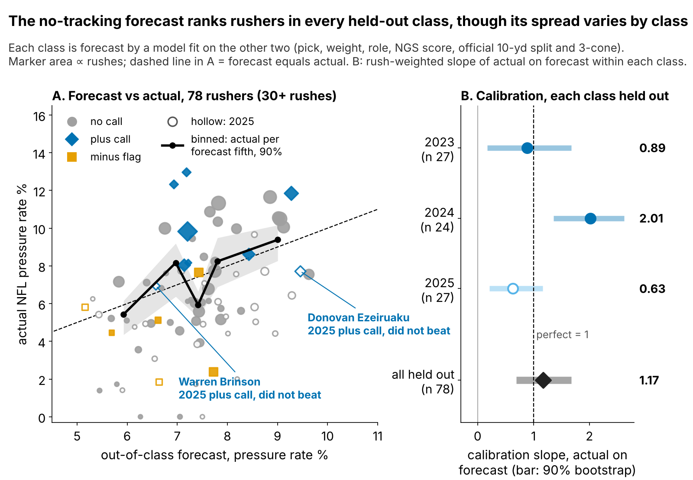
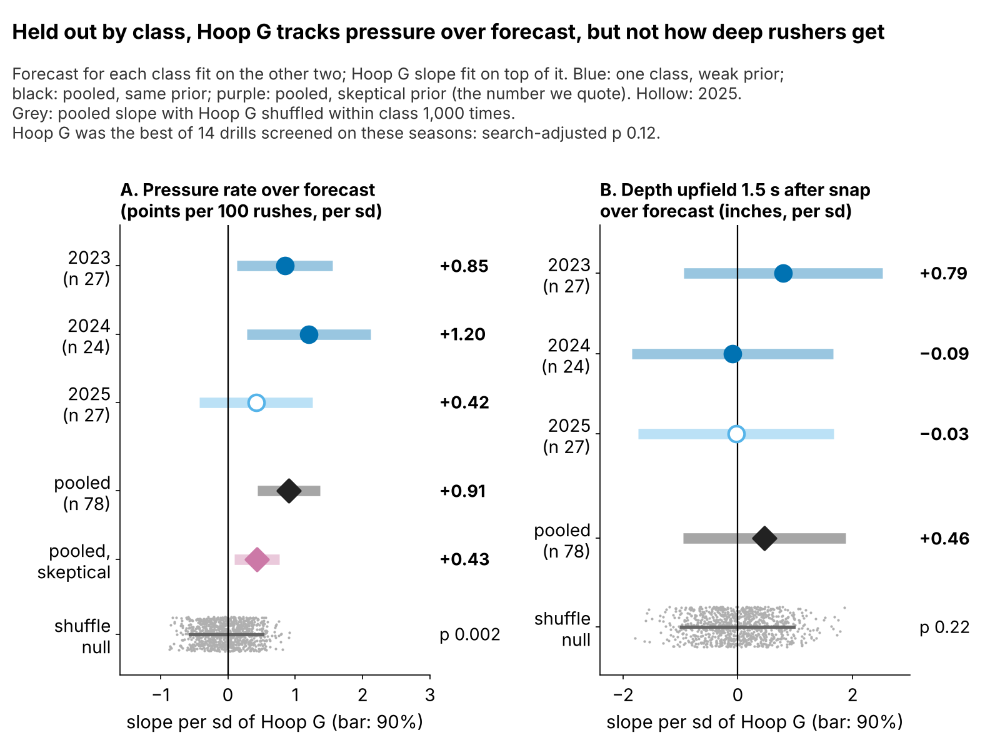

# Hoop G: A Tiebreak Lead for Pass Rushers Who Skip the 3-Cone

**Two in three defensive linemen at the 2023–25 Combines skipped the 3-cone; almost all of them ran Run-the-Hoop. From that lap's tracking we read Hoop G, how hard a lineman pushes sideways through the curve, and score it against a forecast built from pick, weight, role, NGS score and official times. On draft classes the forecast never saw, one standard deviation of Hoop G came with {{r12_sk_all}} more pressures per 100 rushes, about {{r12_sk_all_450}} a season, and the sign held in all {{r12_sk_pos}} classes. The edge is small, Hoop G was the best of 14 drills we screened, and it leaves no trace in NFL rush tracking. Use it to break ties, not to move boards.**

## Why it matters

A pressure is what a rusher is paid for: on {{r10_epa_n}} sampled NFL pass plays of our rookies, the offense lost {{r10_epa_diff}} more expected points on pressured snaps (90% interval {{r10_epa_lo}} to {{r10_epa_hi}}).

The 3-cone makes a big man stop, plant and bend low around a cone, the hip bend he needs to dip under a tackle's hands. But only {{r10_t3_all_k}} of {{r10_t3_all_n}} linemen in the 2023–25 classes ran an official 3-cone, and even it is unsettled: on a class it was not fit on, its link to pressure is ρ = {{r10_t3_loco}} (95% interval {{r10_t3_loco_lo}} to {{r10_t3_loco_hi}}), slightly negative in 2023 ({{r13_t3_2023}}) and 2024 ({{r13_t3_2024}}) and carried by {{r12_t3_2025_n}} rushers in 2025. Another {{r12_rec_8_all}} linemen ran Run-the-Hoop, a figure-eight around two hoops, and no 3-cone.

**Hoop G is how hard a lineman can push sideways while turning the hoop curve, compared with his Combine class.** Technically: the peak half-second of sideways acceleration in the 10 Hz Combine tracking, standardized within year.

## One test, held out by class

**The bar.** Every rusher with 30+ NFL rushes gets a no-tracking forecast of his pressure rate (pick, weight, EDGE share, NGS score, official 10-yard split and 3-cone) fit on the other two draft classes. It ranks rushers in every held-out class (Figure 2B: calibration slopes {{r13_cal_2023}}, {{r13_cal_2024}} and {{r13_cal_2025}}), though 2025 rookies as a group fell to {{r13_citl_2025}} of their forecast.

**The test.** Within each class, does Hoop G predict pressure *beyond* that forecast? A count model starts from the forecast, adds a class level and one Hoop G slope. The rule is frozen in `frozen_rule.json` (SHA-256 `{{r12_hash}}`) and will score the 2026 class after the 2027 season unchanged.

Letting the data speak (weak prior), the slope is {{r12_wd_2023}} in 2023, {{r12_wd_2024}} in 2024 and {{r12_wd_2025}} in 2025 pressures per 100 rushes per sd, consistent across classes (heterogeneity p = {{r13_q_p}}); only 2025 spans zero alone. Pooled it is {{r12_wd_all}}. Because Hoop G was picked from 14 drills, we quote the slope under a skeptical prior sized to the typical screened effect: **{{r12_sk_all}} (90% interval {{r12_sk_all_lo}} to {{r12_sk_all_hi}}), {{r12_sk_all_450}} pressures in a 450-rush season, worth about {{r13_epa_per_sd}} expected point.** Freeing the forecast's scale in each class leaves it at {{r13_free_sk}}. Shuffling Hoop G within class gives p = {{r12_wd_pshuf}} (Figure 3A), **but adjusted for the 14-drill search, p = {{r12_mult_p}}**.

As calls: a plus call needs the 80% interval of a player's Hoop G above zero; a hit means his pressure rate clearly beat his forecast.

{{TABLE:coach12}}

## Does it show up in NFL tracking?

Pressure on a player's 20 sampled rushes is noisy (split-half reliability {{r12_rel_prs}}), so we built a steadier outcome from the same 10 Hz game frames: **depth upfield 1.5 seconds after the snap**, on random NFL pass rushes. It is repeatable (reliability {{r12_rel_dep}}, {{r12_rel_dep_n}} linemen) and tracks season pressure after weight and role (ρ = {{r12_val_rho}}, 90% interval {{r12_val_lo}} to {{r12_val_hi}}, {{r12_val_n}} linemen).

Hoop G does not move it. With the same held-out design, one sd of Hoop G is worth {{r12_dep_all_in}} inches of depth (90% interval {{r12_dep_all_inlo}} to {{r12_dep_all_inhi}}; shuffle p = {{r12_dep_pshuf}}; Figure 3B). The direction-change rate after the snap is unreliable ({{r12_rel_turn}}) and unrelated (ρ = {{r12_turn_rho}}, {{r12_turn_n}} rushers); matched-speed turning and outside-rush share were null too (Appendix).

**So Hoop G is a correlate without a visible mechanism.** It may mark a rusher who keeps speed through contact, which we cannot test without blockers in the data; we treat it as a tiebreak only.

## When the call is wrong

{{TABLE:cases12}}

**Johnson** is the case the tiebreak is for: a day-3 EDGE who beat his forecast. **Adebawore** is the miss: an interior rusher who met his forecast, no more. **Phillips and Black** carry the same minus flag with opposite results, and scheme is the likely reason. Miami moved Phillips 2+ yards sideways in the first 1.5 seconds, a stunt or slant, on {{r12_phillips_loop}}% of his sampled rushes (interior median {{r12_loop_int_med}}%), where weak sideways force should hurt; he sits {{r11_phillips_p450}} pressures per 450 rushes under forecast. Pittsburgh's odd front sent Black straight ahead ({{r12_black_loop}}% such rushes), and he sits {{r11_black_p450}} over.

**Cost of a wrong call:** a tiebreak swaps players a median {{r12_pair_pickgap}} picks apart. Where the alternative out-rushed the plus call, the loss was at most {{r11_bad_cost_max}} pressures per 450 rushes, about {{r11_bad_epa_max}} expected points a season.

## So what for a team

{{TABLE:card12}}

1. **Break ties, do not move boards.** Use Hoop G only between players that film, and the 3-cone where it exists, cannot separate.
2. **Run the hoop twice.** {{r12_card_onerun}} of these {{r12_card_n}} rushers have one run; a second, at a pro day or in a camp tracker, lifts reliability from {{rel_hoop_sb}} to {{rel_hoop_2runs}}.
3. **Match flags to scheme.** Phillips's flag matters for a stunt-heavy front; Black's barely matters for a two-gap nose.

## Limitations

- **Selected, then tested on the same seasons.** The adjusted p = {{r12_mult_p}} is the honest number; holding out classes checks the forecast, not the drill choice.
- **Small and early.** {{fr_all_n}} scored plus calls; the 2025 class has one season. The 2026 class alone has {{r11_pw_1}}% power under the frozen rule; four classes reach {{r11_pw_full_4}}%, or {{r11_pw_halfgap_4}}% if the true gap is half as large.
- **No mechanism.** Hoop G does not show in depth, turning or rush direction on NFL frames.
- **Thin NFL data.** Season counts ignore opponents; sampled tracking has about 20 random rushes per player and no blockers or ball. Scheme reads come from loop rates, not play calls.

## Appendix

{{TABLE:appx12}}

{{TABLE:recon}}

*Reproducible: `uv run python writeup/candidates/round_11/cand_1/analysis.py` writes `numbers.json`, `claims.json`, `frozen_rule.json`, the board CSV and the three figures, then fills this text from `writeup_template.md`.*
