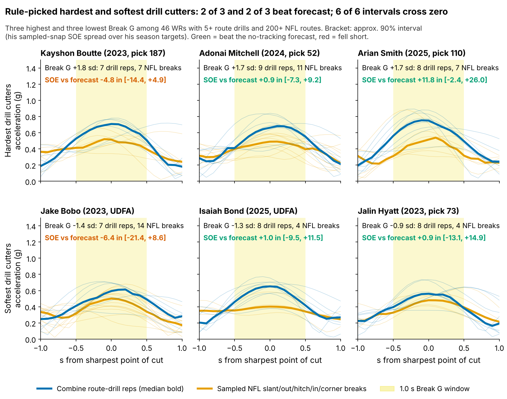
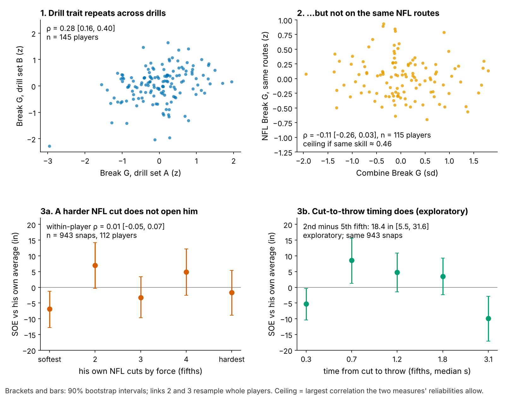

# Break G: A Hard Combine Cut Does Not Get Receivers Open

**Break G measures how hard a receiver brakes, turns and drives out of his Combine route-drill cuts. We froze the definition, then tested it on draft classes the model had not seen. Among 116 NFL wide receivers and tight ends, one sd of Break G moved season separation over expected by −1.2 inches (90% interval −3.0 to +0.9). Even the top of that range is worth 0.13 catches a season. Clubs appear to pay 14% earlier picks per sd for it. They should stop, and grade the break on tape.**

## So what for a team

- **Take the drill cut off the separation side of the board.** In every held-out class, Break G pointed the wrong way, and no version adds 3 inches. Paying for it has a price. Kayshon Boutte, the hardest drill cutter here, would have gone at pick 143 instead of 187. He then fell 4.8 inches short of forecast.
- **On tape, grade timing, not force.** On NFL snaps a harder cut does not open a receiver. What did matter in this sample was when the ball arrived after the cut (exploratory, Figure 2).
- **Ask the Combine for a drill that could transfer.** Run route drills against a scripted defender, or at least to throw timing, with two reps of each route. Today 75–83% of position drills have one rep.

## Why test this

Clubs will be sold 10 Hz "suddenness" scores on the promise that sudden cutters get open. Separation is worth predicting because it repeats: a receiver's season separation over expected (SOE) correlates 0.44 [0.23, 0.62] with his next season's (53 pairs, 100+ routes in both).

## The metric

**For a coach.** Break G is how hard a receiver pushes into the ground in the second around his cut. Rounding and drifting scores low; sinking, snapping and driving out scores high.

**On the field.** A typical Combine cut averages 0.57 g. NFL cuts are softer for everyone (median 0.42 g), because they are run to leverage and timing, not to a cone. One sd of true Break G is 0.021 g.

**In code.** Speed and acceleration come from smoothed 10 Hz x/y. The break is the first turn of 30° or more after 1.5 yd, entered above 2.5 yd/s. It finds a break in 96% of 926 route-drill reps. Break G is the mean acceleration over the 1.0 s centred on the sharpest point of the turn. It is standardized within drill × Combine year, averaged over a player's route drills (median 7), and shrunk toward zero for players with few drills. The same code runs on sampled NFL snaps of the same route families: slant, out, hitch (with curl and comeback), in and corner. The rule, outcome, test and ±3-inch margin are stored in `frozen_rule.json` (SHA-256 prefix `00666c1d61bc`), so the 2026 re-score can show nothing moved.

Across the six, drill cuts differ clearly, but NFL cuts converge. Four of six beat the forecast, and all six intervals cross zero.

## The chain: does the drill reach the snap?

1. **The drill trait holds.** Break G from five route drills predicts Break G from the other five at ρ = 0.28 [0.16, 0.40] (145 players, shuffle p = 0.001). That gives a reliability of 0.58 for a receiver who runs seven. It is not a speed score (ρ with the 40: −0.01). The pieces coaches name do not repeat (decel 0.12, speed through the break −0.04, re-acceleration 0.05), so they are combined.
2. **It does not carry to the same NFL routes.** If drill and game cuts were one skill, the correlation could reach about 0.46, given NFL Break G's own reliability of 0.23 over a median 16 breaks. It is −0.11 [−0.26, 0.03] across 115 players. Over 436 player × route-family pairs it is −0.07, and no family exceeds 0.05 (corner).
3. **A harder NFL cut does not buy separation, but timing might.** Within a player, cut force against SOE at the throw is ρ = 0.01 [−0.05, 0.07] (943 snaps, 112 players). Snap SOE adjusts for route, depth, cushion, coverage, alignment, time to throw, down and distance. Throws in the second fifth of cut-to-throw time (median 0.7 s) beat the player's own average by 8.6 inches. Throws in the last fifth (3.1 s) trail it by 9.8. The gap is 18.4 inches [5.5, 31.6]. Not pre-specified, but it matches coaching: the window opens just after the break and closes as the defender recovers.

## The test: season separation on unseen classes

**Data and baseline.** The outcome is full-season NGS separation at the throw. It is adjusted for cushion, alignment, tight end and season, then route-weighted over each career (213 player-seasons, 116 players, median 231 routes). Each yard of cushion is worth 0.42 yd of separation. The forecast without tracking uses log pick, official 40, weight, NGS athleticism score and a TE flag.

**One clean test.** For each draft class, the forecast is fit on the other two classes. On the held-out class we ask whether Break G explains what the forecast missed: a slope in inches per sd, pooled over classes, against 2,000 within-class shuffles.

| Test | n | Inches per sd [90% interval] | p |
|---|---|---|---|
| **Held-out slope (primary)** | 116 players, 3 classes | **−1.2 [−3.0, +0.9]** | shuffle 0.39; gain of 3 in ruled out, 0.0002 |
| In sample, full baseline | 116 players | −0.6 [−2.6, +1.2] | 0.019 for equivalence within ±3 in |
| Best of Break G and its 3 pieces (post hoc) | 116 players | decel −0.9 | 0.93 after the best-of-4 adjustment |

The held-out slope is negative in all three classes: −1.1 (2023, n = 42), −1.9 (2024, n = 40) and −0.3 (2025, n = 34). The downside is not ruled out: the interval touches −3.0, so the two-sided equivalence p is 0.066. But the decision only needs the upside. Even at +0.9 inches, Break G buys less than the 40 (+1.6 inches per sd beyond pick, n = 103). All 18 alternative definitions land between −0.7 and +0.7.

**In football units.** Season catch rate rises 8.8 points per yard of separation when targeted (120 player-seasons, 20+ targets). The median receiver with 200+ routes draws 60 targets. A 3-inch effect would be worth 0.4 catches a season, and the in-sample upper bound 0.2.

**What clubs pay.** Beyond the 40, weight and NGS score, +1 sd goes 14% earlier (p = 0.06), so a pick-100 receiver goes at 86. It pays 0.1 inches [−1.3, 1.6] beyond pick.

## Decision card

The rule takes the three highest and three lowest Break G wide receivers with 5+ route drills and 200+ NFL routes (46 qualify). "vs forecast" is season SOE minus the held-out forecast. "If paid" is where a board pricing Break G at the market rate would have taken him. Slot and go-route shares come from his sampled snaps (pool: 36% slot, 21% go).

| Player (class, pick → if paid) | Break G | vs forecast [90%] | Snap profile | Action |
|---|---|---|---|---|
| Kayshon Boutte (2023, 187 → 143) | +1.8 | −4.8 [−14.4, +4.9] | 12% slot, 35% go | Cut is fine. Pull press-release and vertical-stem cuts. |
| Adonai Mitchell (2024, 52 → 40) | +1.7 | +0.9 [−7.3, +9.2] | 22% slot, 20% go | On forecast. Paying would have cost 12 slots for nothing. |
| Arian Smith (2025, 110 → 86) | +1.7 | +11.8 [−2.4, +26.0] | 42% slot, 32% go | Only 16 targets. Credit the 4.36, re-score after 2026. |
| Jake Bobo (2023, UDFA → UDFA) | −1.4 | −6.4 [−21.4, +8.6] | 22% slot, 20% go | Ball arrived 1.4 s after his cut. Grade QB timing before the receiver. |
| Isaiah Bond (2025, UDFA → UDFA) | −1.3 | +1.0 [−9.5, +11.5] | 40% slot, 32% go | Soft in drills and games, still on forecast. Keep the slot role. |
| Jalin Hyatt (2023, 73 → 83) | −0.9 | +0.9 [−13.1, +14.9] | 12% slot, 25% go | Kept 85% of his speed on 4 breaks. Use him vertically; do not mark down a 4.40. |

All six intervals cross zero. Two of three hard cutters and two of three soft ones beat forecast, against 46% of the pool: a coin flip both ways.

**False positive: Kayshon Boutte.** His drill cuts (median 0.62 g) were the hardest in the cohort, and on 7 sampled NFL breaks he did what a cut grade promises: faster entry than the median (5.4 vs 4.9 yd/s), 100% of speed kept (median 98%), ball out 0.7 s after the cut (median 1.1 s). The shortfall happened outside the cut, so pull his release and stem film, mostly on go routes.

**One channel we cannot rule out.** Break G relates to targets per route run: +1.9 points per sd (t = 3.3), 1.0 (t = 1.9) without Puka Nacua, and 2.0 holding SOE fixed. If the cut earns anything, it is quarterback trust, not open space: a lead to test, not a reason to pay.

## Limitations

- **Not a blind test.** The rule was frozen before this test, but earlier rounds had seen all three classes and the snap-level null. The 2026 class is the first true out-of-sample score.
- **Power.** The held-out interval rules out gains above +0.9 inches but not losses down to −3.0. The in-sample minimum detectable effect is 3.2 inches. Adding about 40 players from 2026 brings it to 2.8, with power 0.85 against 3 inches.
- **Game tracking is a sample.** Each player has up to 40 plays, with no defenders and no ball. NFL break reliability (0.23) caps every drill-to-game correlation. The timing result is exploratory.
- **Outcome and price.** Season SOE is not adjusted for quarterback, and the 2025 class has one season. Player intervals ignore forecast error, so they are too narrow. The draft price is an association: scouts may pay for route detail seen in the same drill, not Break G itself.
- **Drill protocol.** Route drills are run to cones, mostly once; year-standardizing removes the year shift, not single-rep noise.

Reproduce: `uv run python writeup/candidates/round_11/cand_2/analysis.py` (about three minutes, `data/processed` only). It writes every quoted number to `numbers.json`.
