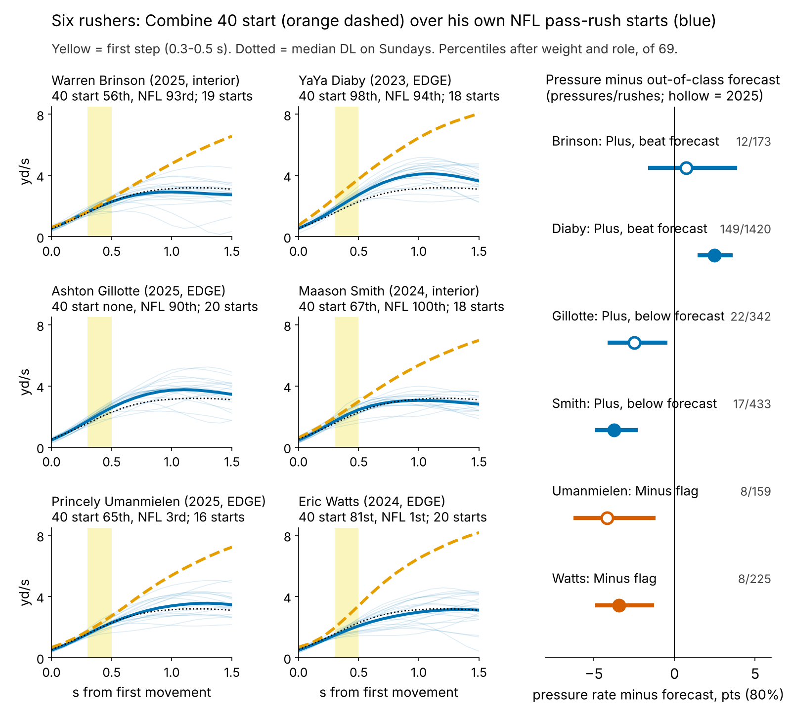
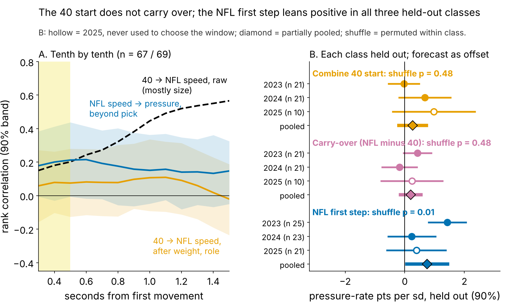
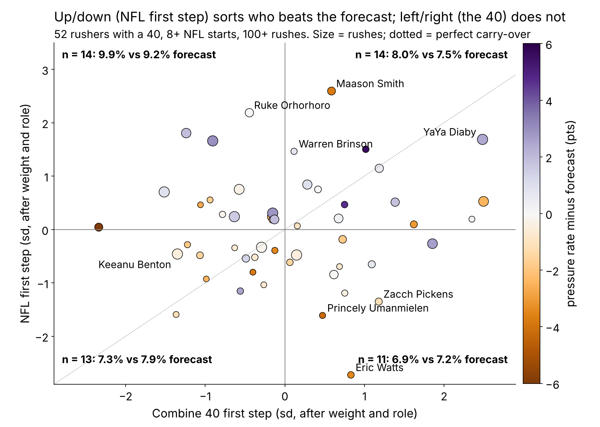

# The 40 Start Doesn't Travel. The NFL First Step Does.

**We put each 2023–25 defensive lineman's tracked Combine 40 start on the same clock as his own random NFL pass-rush starts. Once size is removed, the 40 start barely previews how fast he leaves his stance on Sundays, and the gap between the two adds no pressure beyond draft slot. The NFL start itself carries information. Scored on draft classes the model never saw, a faster first step leaned toward more pressure than a no-tracking forecast in all three, though the clean 2025 class alone is not convincing. On the snaps where a rusher started faster than his own norm, his odds of pressure rose by half. Use it as a film lead after about 20 rookie rushes, not as a draft number.**

## Why this question

Day-2 and day-3 rushers are sold as "explosive off the ball", and the 40's first steps are the Combine's closest thing to get-off. Since 2023 the Combine is tracked at 10 Hz like NFL games, so we can ask directly: does the Indianapolis burst show up in his rushes, and if not, what should replace it?

## The metric

**First step: how fast a lineman is moving 0.3 to 0.5 seconds after he first moves.** There the 40 and a pass rush are the same movement, a lineman leaving a stance. By 1.5 s they part: the median lineman is at {{dr_med_40}} yd/s in the 40 and {{dr_med_sunday}} yd/s on a rush, because he has met a blocker.

**Carry-over = NFL first step minus Combine first step**, each in standard deviations after weight and role (share of snaps at EDGE). Positive means he starts faster on Sundays than his 40 promised.

**Data.** Combine: every tracked 40 rep, year-standardized. NFL: random sampled pass plays only (the top-EPA half oversamples sacks), alignment-adjusted: {{n_snaps_dl}} starts by {{n_gplayer}} linemen, median {{snaps_med}} each. Over that many starts the NFL first step has reliability {{rel_fs_game}}, and snap by snap it tracks official NGS get-off (ρ = {{rho_fs_ngs_snap}}). Outcome: career pressures per pass rush. **Baseline without tracking:** log draft pick (undrafted = 262), weight and role, always fit on the other two classes.

## Finding 1: the 40 start translates only through size

Raw, the 40 at 1.5 s ranks NFL speed at 1.5 s at {{tr_raw_15}}. That is weight: heavier linemen are slower on Sundays (ρ = {{rho_w_dr_sunday}}) and in the 40 ({{rho_w_dr_40}}). After weight and role the 40 first step previews the NFL first step at ρ = {{tr_fs}} [{{tr_fs_lo}}, {{tr_fs_hi}}] (n = {{n_tr}}), and no tenth of a second from 0.3 to 1.5 s exceeds {{tr_adj_absmax}} (Figure 2A). Corrected for noise on both sides, the link is at most {{tr_fs_ceiling}}. The official 40 *time* does slightly better ({{tr_offfs}}).

## Finding 2: one held-out test, three measures

Same test for every measure: hold out a class, fit the no-tracking forecast on the other two, then ask how far each standard deviation of the measure moves the held-out class's pressures away from that forecast. Class slopes are pooled with shrinkage; the null shuffles the measure within class 2,000 times.

| Measure (DL) | 2023 | 2024 | 2025 (clean) | Pooled, pressure-rate pts per sd [90%] | Shuffle p | n |
|---|---|---|---|---|---|---|
| Combine 40 start | {{ht_c40_2023}} | {{ht_c40_2024}} | {{ht_c40_2025}} | {{ht_c40_pp}} [{{ht_c40_pp_lo}}, {{ht_c40_pp_hi}}] | {{ht_c40_p}} | {{ht_c40_n}} |
| Carry-over (translation) | {{ht_carry_2023}} | {{ht_carry_2024}} | {{ht_carry_2025}} | {{ht_carry_pp}} [{{ht_carry_pp_lo}}, {{ht_carry_pp_hi}}] | {{ht_carry_p}} | {{ht_carry_n}} |
| **NFL first step** | {{ht_nfl_2023}} | {{ht_nfl_2024}} | {{ht_nfl_2025}} | **{{ht_nfl_pp}} [{{ht_nfl_pp_lo}}, {{ht_nfl_pp_hi}}]** | **{{ht_nfl_p}}** | {{ht_nfl_n}} |

*Table 1. Quasi-binomial slope, out-of-class forecast as offset, random-effects pooling. 40 rows need a tracked 40 and 100+ rushes.*

- **Translation does not pay.** Carry-over is flat; four other similarity measures (speed ratios, curve shape, curve distance) never exceed {{sim_absmax}} in rank correlation with pressure beyond pick.
- **The NFL first step leans positive in {{ht_nfl_pos}} of 3 classes.** The first-step window was read off Figure 2A. Taking the best of {{ht_nwin}} windows under the same shuffle, the adjusted p is {{ht_nfl_p_adj}}.
- **2025 alone is weak:** +{{ht_nfl_2025}} [{{ht_nfl_2025_lo}}, {{ht_nfl_2025_hi}}], one-sided p = {{ht_nfl_2025_p1}}. 2024 is weakest; its top first step is Maason Smith (below).
- **Size of the effect.** One sd of NFL first step is worth about {{ht_nfl_season}} pressures [{{ht_nfl_season_lo}}, {{ht_nfl_season_hi}}] over a {{rush_season}}-rush season.

## Mechanism: same rusher, faster snap, more pressure

Season pressure is a noisy outcome. A sharper test compares each rusher with himself, snap by snap. On {{sn_n}} random pass rushes by {{sn_players}} linemen ({{sn_k}} pressures), a first step one sd faster than his own average multiplies the odds of pressure on that snap by {{sn_or}} [{{sn_or_lo}}, {{sn_or_hi}}]. Shuffling first steps within each rusher never matched it in 500 tries (p = {{sn_p}}). His fastest fifth of starts ended in pressure {{sn_top5}}% of the time, his slowest fifth {{sn_bot5}}% (Figure 4).

- **Not the stopwatch.** With that snap's NGS get-off, sideways movement, passing down and alignment in the model, the odds ratio is {{sn_or_ctl}}. Get-off itself adds nothing ({{sn_or_go}}, p = {{sn_p_go}}): what matters is the speed after the first movement, not how soon it starts.
- **Same direction in every slice:** {{sn_or_2023}}, {{sn_or_2024}} and {{sn_or_2025}} by class; {{sn_or_e}} for EDGE and {{sn_or_i}} inside.
- **Football reading:** reach the blocker's set point first and the tackle opens early, the guard catches instead of punching. Without blockers in the data, a free rush could also produce a fast start (Limitations).

## When the call is wrong: Maason Smith

Smith (2024, pick 48, Jacksonville) rushed {{fp_interior}}% of his snaps inside. After weight and role his NFL first step is the cohort's best, his 40 start {{b_smith_c}}th percentile, his NGS get-off {{fp_go_pct}}th. He produced {{fp_pr}} pressures on {{fp_rs}} rushes, {{b_smith_rate}}% against a {{b_smith_fc}}% forecast; only {{fp_quick}}% came quickly ({{quick_share}}% for the cohort). His curve is fast for a {{fp_wt}}-lb tackle through half a second, then flat at median speed (Figure 1): he arrives, he does not win. His starts are among the straightest ({{fp_lat_pct}}th percentile sideways), so it is not a stunt artifact. Film cues: do the hands land inside at contact, is there a counter when the rep stalls, is he reading run first? Trusting the plus call cost about {{fp_lost_season}} pressures a season against forecast. One team and scheme in both years, so player and call cannot be separated.

## So what for a team

The rule is frozen before any 2026 data: config hash `{{rule_hash}}` in `frozen_rule.json`. **Plus** = top third of NFL first step. **Minus flag** = bottom third after an above-median 40 start. **Film first** = bottom third without one. **Sideways** = percentile of sideways movement in the first 1.5 s, a stunt and slant proxy for scheme. **At stake** = pressures per season his first step is worth at the held-out slope, i.e. the cost of a wrong call. * = 2025 class.

{{TABLE:card}}

*Table 2. Percentiles among the {{n_board}} rushers with 100+ rushes, after weight and role.*

- **Draft room: pay for the stopwatch, not the clip.** Give no credit for a fast Combine start trace; the pass-rush drill does not preview the NFL start either (ρ = {{tr_prd}}, n = {{tr_prd_n}}).
- **Same slot, opposite calls.** Gillotte (Kansas City, pick 66) and Umanmielen (Carolina, pick 77) are 2025 EDGEs at NFL first-step percentiles {{b_gillotte_s}} and {{b_umanmielen_s}}. Both trail their forecast. Umanmielen's starts are {{b_umanmielen_lat}}th percentile sideways: the slow start may be Carolina's slant-heavy front, not him.

## Limitations

- **The angle's answer is a null.** Translation is near zero after size. DL was the clearest of five groups screened (40 start after weight, NFL first step: WR {{g_WR_tradj}}, OL {{g_OL_tradj}}, DB {{g_DB_tradj}}, TE {{g_TE_tradj}}).
- **Small, sampled tape.** About 20 random starts per player; a single start has reliability {{rel_fs_1snap}}. 2025 has one season, and one new class gives the held-out test only {{pow_cls}}% power at the pooled slope; about {{pow_cls_need}} classes are needed for 80%. The 2026 check is monitoring, not proof.
- **No blockers, ball or opponents.** A slow first step can be a two-gap call, a fast one a free rush; the snap-level link may partly run from play to start.
- **NGS already sees much of it.** Season NGS get-off ranks pressure at {{pay_ngs}} beyond pick; the first step adds {{pay_beyond_ngs}} beyond it (p = {{p_beyond_ngs}}). For a club with NGS this is a tiebreak.
- **Outcome.** Pressure is charted and usage-dependent; injuries are not modelled.

## Appendix: sample flow and technical checks

| Item | Value |
|---|---|
| Linemen with 8+ random NFL starts / their starts | {{n_gplayer}} / {{n_snaps_dl}} |
| ... with a tracked 40 (translation, Finding 1) | {{n_tr}} |
| ... with 100+ career rushes (Table 1 NFL row, Figure 4) | {{n_pay}}, {{sn_n}} starts |
| ... with both (Table 1 Combine and carry-over rows, Figure 3) | {{n_both}} |
| 40 first step, two-rep repeatability | {{rel40_fs}} (n = {{rel40_n}}) |
| Round-10 hit count, top vs bottom third beating forecast | {{cal_top_k}}/{{cal_top_n}} vs {{cal_bot_k}}/{{cal_bot_n}} |
| Sampled-snap pressure vs career pressure rate | ρ = {{rho_sample_season}} |

*Table 3.*

*Reproduce: `uv run python writeup/candidates/round_11/cand_3/analysis.py` (about 3 minutes, one core).*
