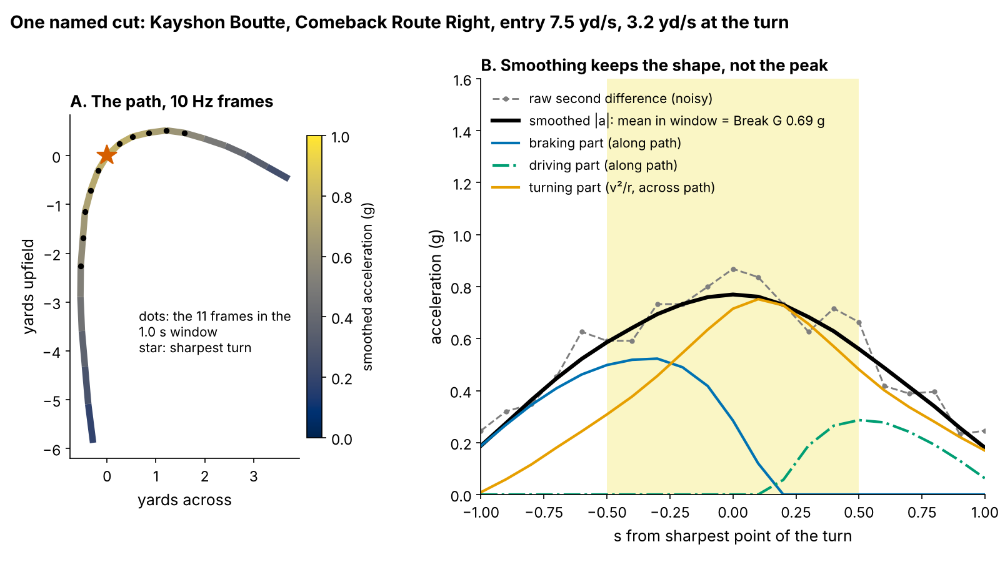
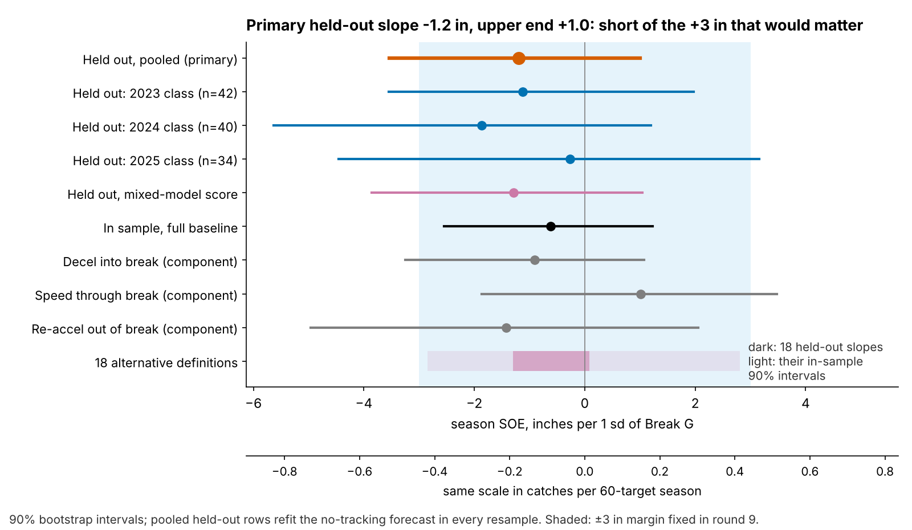
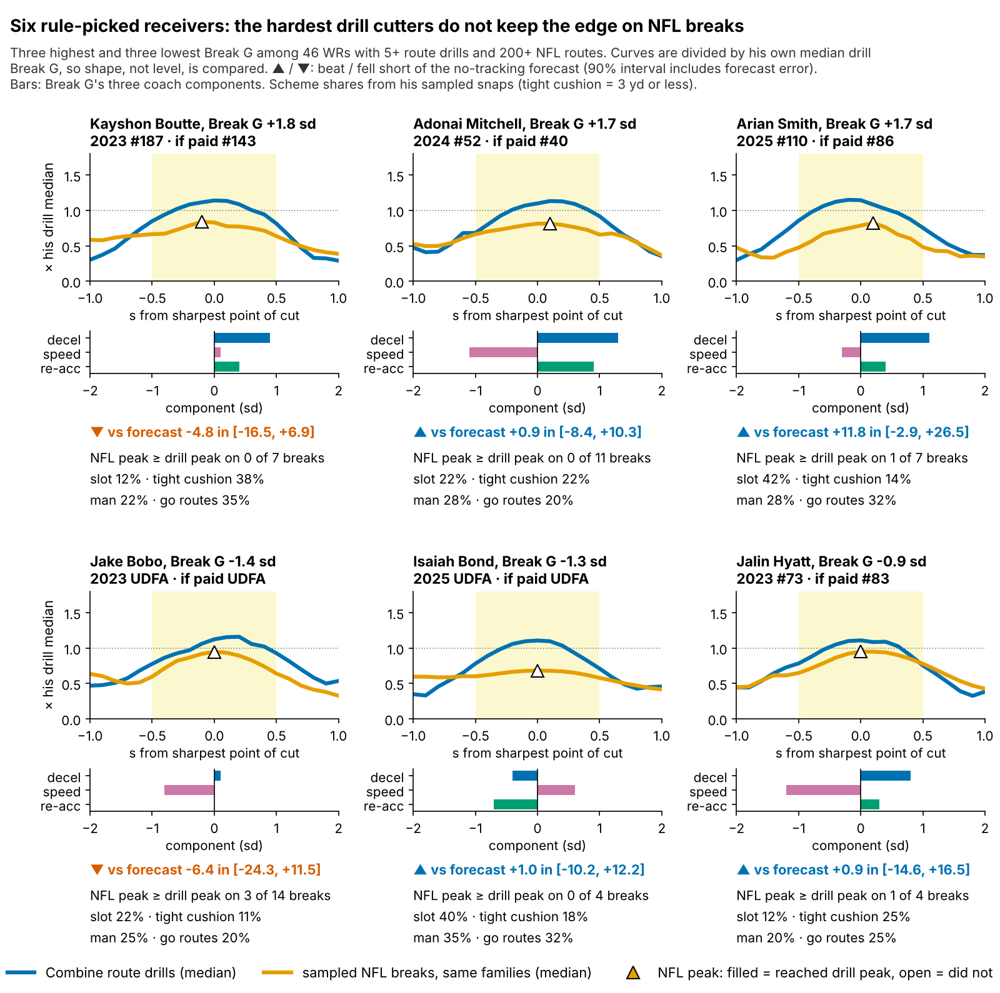

# Break G: A Hard Combine Cut Does Not Get Receivers Open

**Receivers who cut hardest in Combine route drills did not get more open in the NFL. On draft classes the model had not seen, one sd of Break G was worth −1.2 inches of separation over expected (90% interval −3.5 to +1.0). Grade the break on tape.**

## So what for a team

- **Keep the drill cut off the separation grade.** No evidence of gain; a small loss is not ruled out. Even the top of the interval is worth 0.15 catches a season.
- **The data give no reason to pay for it.** Clubs already take high-Break G receivers about 14% earlier per sd (p = 0.06).
- **Fix the Combine protocol before trusting any cut score.** Run slant, dagger and comeback twice: reliability rises from 0.53 to 0.62.

## Why test this

The 10 Hz Combine tracking is new to the public with this Big Data Bowl. Tracking vendors, draft-analytics services and draft media will turn it into "suddenness" scores, sold on the idea that sudden cutters get open. It should be tested where it is most likely to work.

WR/TE route drills are that place: the only Combine drills that copy a football action, a break on a named route, that the same code can find on NFL snaps. The NFL outcome is measured too: separation over expected (SOE), the yards of space at the throw beyond what route, cushion and alignment predict. It repeats: season SOE correlates 0.44 [0.23, 0.62] with the next season's (53 pairs).

## The metric

**For a coach.** Break G is how hard a receiver pushes into the ground in the second around his cut. Rounding and drifting scores low; sinking, snapping and driving out scores high.

**The physics.** At 10 Hz a cut lasts about ten frames. Acceleration has two parts: braking or driving along the path, and turning across it (v²/r). Averaging their combined size over the 1.0 s around the sharpest turn covers the sink, the turn and the first drive step in one number. In drill cuts the turning part is the larger one (median 0.46 g against 0.24 g along the path). Figure 1 shows one named cut. Smoothing flattens the peak (the smoothed peak is 89% of the raw one), and 10 Hz cannot see single foot strikes. So Break G measures sustained force through the break, not peak ground force.

**In code.** The break is the first turn of 30° or more after 1.5 yd, entered above 2.5 yd/s (found in 96% of 926 route-drill reps). Scores are standardized within drill × Combine year, averaged over a player's route drills (median 7) and shrunk for players with few drills. The same code runs on sampled NFL snaps of the same route families: slant, out, hitch, in and corner. The rule, outcome, test and ±3-inch margin were frozen and hashed before this test.

## The chain: does the drill reach the snap?

1. **The drill trait holds.** Break G from five route drills predicts Break G from the other five at ρ = 0.28 [0.16, 0.40] (145 players). It is not a speed score (ρ with the 40: −0.01).
2. **It does not carry to the same NFL routes.** Across 115 players the correlation is −0.11 [−0.25, 0.04], well under the ceiling of about 0.46 that one shared skill would allow.
3. **A harder NFL cut does not buy separation.** Within a player, cut force against SOE at the throw is ρ = 0.01 [−0.05, 0.07] (943 snaps, 112 players). An earlier post hoc lead, that throws soon after the cut beat late ones, does not survive. With snap SOE rebuilt without time to throw and each player's breaks ranked against his own, cut-to-throw time predicts no better than entry speed or speed kept (family-wise p = 0.26 over four splits). We drop it.

## The test: season separation on unseen classes

**Data and baseline.** The outcome is full-season NGS separation at the throw, adjusted for cushion, alignment, tight end and season, then route-weighted over each career (213 player-seasons, 116 players, median 231 routes). The forecast without tracking uses log pick, official 40, weight, NGS athleticism score and a TE flag.

**One test.** For each draft class, the forecast is fit on the other two; on the held-out class we ask whether Break G explains what the forecast missed. The interval refits the forecast in each of 2,000 resamples, so forecast error is included.

| Test | n | Inches of season SOE per sd [90% interval] |
|---|---|---|
| **Held out, pooled (primary)** | 116 players, 3 classes | **−1.2 [−3.5, +1.0]** |
| Held out, mixed-model score | 116 players | −1.3 [−3.9, +1.0] |
| In sample, full baseline | 116 players | −0.6 [−2.6, +1.2] |

In plain terms: no version reaches the +3 inches fixed in advance as the smallest gain worth paying for, and random shuffles of Break G within class give a slope this far from zero 38% of the time. The slope is negative in all three classes (−1.1, −1.9 and −0.3). The no-tracking forecast is itself weak out of class (calibration slopes 0.40, 0.64 and 1.33), which is why the interval refits it. All 18 alternative definitions give held-out slopes between −1.3 and +0.1 (Appendix).

**In football units.** Season catch rate rises 8.8 points per yard of separation when targeted (120 player-seasons). The median receiver with 200+ routes draws 60 targets. The upper end, +1.0 inch, is worth 0.15 catches a season; 3 inches would be 0.4.

**What clubs pay.** Beyond the 40, weight and NGS score, +1 sd of Break G goes 14% earlier (p = 0.06), so a pick-100 receiver goes at 86. It returns 0.1 inches [−1.3, 1.6] of SOE beyond pick.

## Decision card

The rule takes the three highest and three lowest Break G wide receivers with 5+ route drills and 200+ NFL routes (46 qualify). Figure 4 shows their cut shapes, components and coverage faced (pool: 36% slot, 20% tight cushion, 30% man, 21% go).

| Player | Read from his tape sample | Action | Cost of the wrong call |
|---|---|---|---|
| Kayshon Boutte (2023, #187) | Outside, 38% tight cushion, 35% go; −4.8 in | Grade release and stem against press, not the cut | 44 picks earlier for at most 0.26 catches a season |
| Adonai Mitchell (2024, #52) | 22% slot, 28% man; on forecast | Price the 4.34 and the pick; Break G adds nothing | 12 picks for at most 0.25 catches |
| Arian Smith (2025, #110) | 42% slot, 32% go; 16 targets | Keep the slot-vertical role; re-score after 2026 | 24 picks for at most 0.25 catches |
| Jake Bobo (2023, UDFA) | 11% tight cushion; ball 1.4 s after his cut (median 1.1) | Check quarterback timing before marking him down | A roster spot, not a pick |
| Isaiah Bond (2025, UDFA) | 40% slot, 35% man; on forecast | Keep him in the slot against man | None at the draft |
| Jalin Hyatt (2023, #73) | Outside, 25% go; kept 85% of speed on 4 breaks | Use him vertically; do not mark down a 4.40 | 10 picks later for at most 0.13 catches |

**False positive: Kayshon Boutte.** His drill cuts were the hardest in the cohort, and on 7 sampled NFL breaks he still entered faster than the median (5.4 vs 4.9 yd/s) and kept all his speed. He faced a tight cushion on 38% of sampled snaps (pool 20%) and ran go routes on 35%, so the shortfall most likely sits in release and stem, not the cut.

**One channel we cannot rule out.** Break G relates to targets per route run: +1.9 points per sd, family-wise p = 0.038 across three usage outcomes, but 1.0 without Puka Nacua (p = 0.25). Treat it as a lead on quarterback trust, not a reason to pay.

## Combine-week protocol

A mixed model on single reps (player and player × drill effects, drill × year fixed effects) puts only 14% of one rep's variance on the player, so seven single-rep drills give a reliability of 0.53. Slant, dagger and comeback track a player's other drills best (ρ 0.47, 0.47, 0.44; slot strike 0.14). Run each twice: reliability rises to 0.62, about 0.023 per extra rep; doubling all seven gives 0.69.

## Limitations

- **Not a blind test.** The rule was frozen before this test, but earlier rounds had seen all three classes. The 2026 class is the first true out-of-sample score; adding it gives power 0.85 against 3 inches.
- **The downside is open.** The interval rules out gains above +1.0 inch, not losses down to −3.5.
- **Game tracking is a sample.** Up to 40 plays per player, no defenders, no ball. NFL break reliability (0.23 over a median 16 breaks) caps every drill-to-game correlation; cards rest on 4 to 14 breaks.
- **Outcome and price.** Season SOE is not adjusted for quarterback, and the 2025 class has one season. The draft price is an association: scouts may pay for route detail seen in the same drill.
- **Physics.** Smoothing and 10 Hz sampling cap the peak force we can see; Break G is a 1-second average, not a force-plate number.

## Appendix: robustness detail

**Held-out slope under each of the 18 definitions** (turn threshold × window; columns are entry speed). Worst case −1.3; the largest in-sample upper bound is +2.8.

| Turn, window | 2.0 yd/s | 2.5 yd/s | 3.0 yd/s |
|---|---|---|---|
| 30°, 0.6 s | −0.6 | −1.3 | +0.1 |
| 30°, 1.0 s (frozen) | −0.5 | **−1.2** | 0.0 |
| 30°, 1.4 s | −0.7 | −1.1 | −0.1 |
| 45°, 0.6 s | −0.6 | −0.7 | −0.8 |
| 45°, 1.0 s | −0.7 | −0.7 | −0.9 |
| 45°, 1.4 s | −0.8 | −0.8 | −1.0 |

**Bounds.** Gain under +3 inches: one-sided p = 0.0015; two-sided equivalence p = 0.101. With the forecast held fixed the interval is −3.0 to +0.9. The best of Break G and its three pieces, adjusted for picking it: p = 0.95.

**Reliability.** Mean-then-shrink implies 0.58 for seven drills, the mixed model 0.53; the two scores correlate 0.99. The ceiling is the square root of the drill and NFL reliabilities' product.

**Timing.** The earlier gap (second minus last fifth of cut-to-throw time) was 18.4 inches; 19.7 with SOE built without time to throw; 13.4 with time to throw as a covariate (the two correlate 0.77 within player). On within-player ranks, unadjusted p: force 0.63, time 0.07, entry speed 0.09, speed kept 0.09.

Reproduce: `uv run python writeup/candidates/round_11/revised/analysis.py` (about four minutes). It writes every quoted number to `numbers.json` and the rule hash to `frozen_rule.json`.
