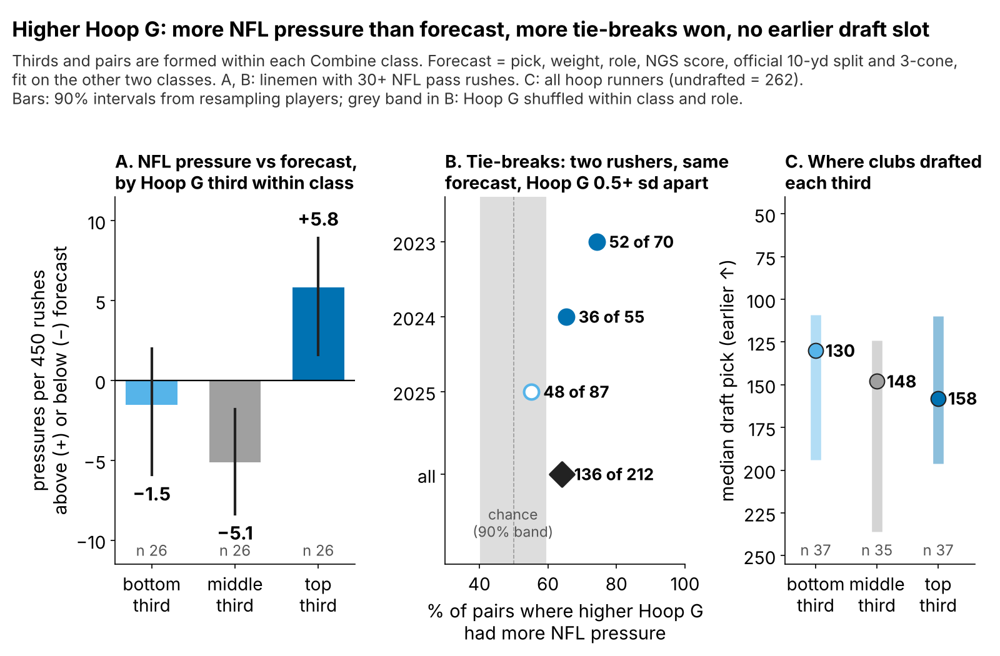
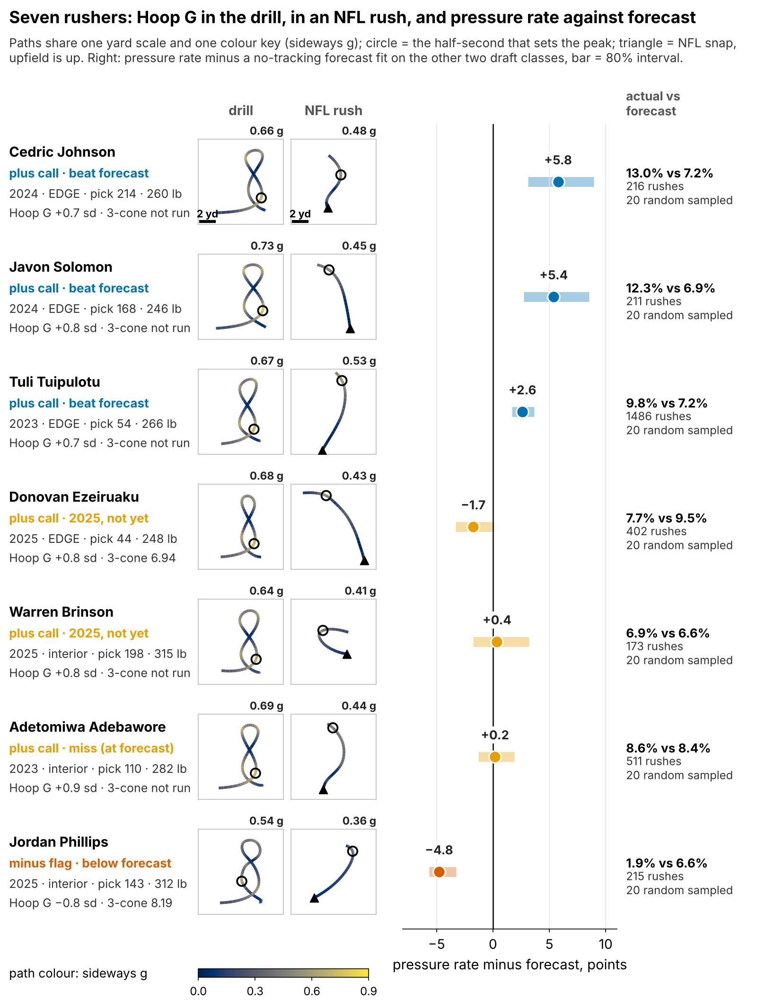
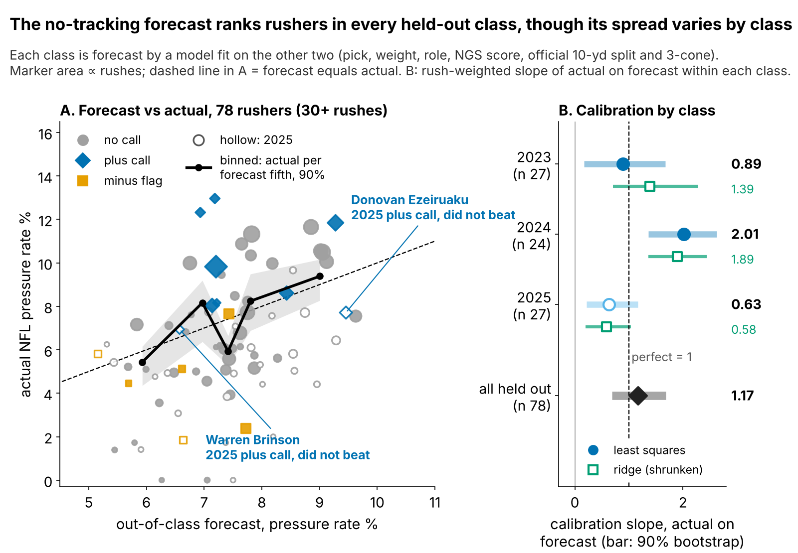
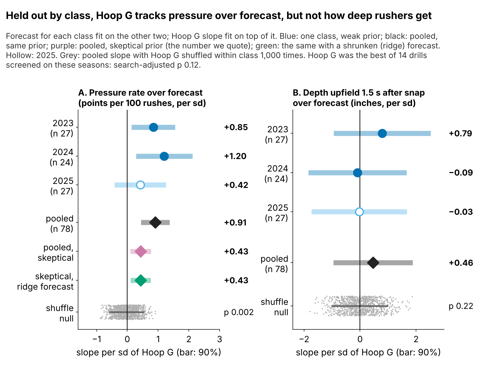

# Hoop G: A Free Tiebreak for Pass Rushers Who Skip the 3-Cone

**Hoop G is how hard a defensive lineman pushes sideways while turning the Run-the-Hoop curve, compared with his Combine class. Take two rushers from the same class and role whose no-tracking forecasts (pick, weight, NGS score, official times) sit within a point of each other: the one with the clearly higher Hoop G got more NFL pressure in 136 of 212 such pairs (64%; a coin flip gives 50%). Clubs do not pay for it: high-Hoop G linemen were drafted no earlier. The edge is small, about 1.9 pressures a season per standard deviation, Hoop G was the best of 14 drills we screened, and we cannot see why it works. Use it to break day-3 ties, not to move boards.**

## Why it matters

A pressure is what a rusher is paid for: on 1681 sampled NFL pass plays of our rookies, the offense lost 0.53 more expected points on pressured snaps (90% interval 0.37 to 0.68).

The 3-cone makes a big man stop, plant and bend around a cone, the hip bend he needs to dip under a tackle's hands. But only 43 of 118 linemen in the 2023–25 classes ran an official 3-cone, and even it is unsettled on classes it was not fit on (ρ = 0.36, 95% interval −0.22 to 0.67). Another 69 ran Run-the-Hoop, a figure-eight around two hoops, and no 3-cone. From the 10 Hz Combine tracking we take the hardest half-second of sideways acceleration on that curve and standardize it within year.

## One test, held out by class, and every other test we ran

**The bar.** Every lineman with 30+ NFL rushes gets a forecast of his pressure rate from pick, weight, EDGE share, NGS score and the official 10-yard split and 3-cone, fit only on the other two draft classes. It ranks rushers in every held-out class, but its spread is uneven (Figure 3B). A shrunken (ridge) version cuts its error from 2.42 to 2.29 points without evening the spread.

**The test.** Within each class, does Hoop G predict pressure *beyond* that forecast? A count model starts from the forecast and adds one Hoop G slope. Because Hoop G was picked from 14 drills, we shrink the slope toward zero by the size of a typical screened effect. The rule is frozen in `frozen_rule.json` (SHA-256 `4c2930111941`) and will score the 2026 class after the 2027 season unchanged.

| Test | n | Result [90%] | Status |
|---|---|---|---|
| **Hoop G slope over forecast, held out by class** | 78 | **+0.43 pressures per 100 rushes per sd [0.09, 0.77]**; positive in 3 of 3 classes | Primary |
| … resampling players; dropping any one | 78 | [0.19, 0.64]; 0.35 to 0.46 | Check |
| … with a shrunken (ridge) forecast | 78 | +0.43 [0.10, 0.76] | Check |
| … random relabelling; then priced for the 14-drill search | 78 | p 0.002; **p 0.12** | Check |
| Tie-break pairs: forecast within 1 pt, Hoop G 0.5+ sd apart | 212 pairs | higher Hoop G out-rushed 64% (chance 50%), p 0.008 | Secondary, new |
| Frozen plus-call rule beat forecast | 78 | 4 of 9 vs 9 of 69; p 0.07 | Secondary |
| Clubs' price: draft slot per sd of Hoop G | 109 | 3% later [18% later, 11% earlier]; helps predict picks in 0 of 3 held-out classes | Secondary |
| Hoop G → NFL depth 1.5 s after snap | 78 | 0.5 in [−0.9, 1.9] | Mechanism: null |
| Hoop G → NFL direction-change rate | 78 | ρ −0.04 | Mechanism: null |
| Rush-drill get-off → NFL get-off; → pressure | 85; 68 | ρ 0.32; −0.03 | Carries over; not pressure |
| 3-cone → pressure, held out | 27 | ρ 0.36 [−0.22, 0.67] | Context |

One sd of Hoop G is worth 0.43 more pressures per 100 rushes, 1.9 in a 450-rush season, about 1.0 expected point. The sign holds in each class (Figure 4A) and with the ridge forecast. Resampling players keeps the whole interval above zero; dropping any single rusher moves the slope only between 0.35 and 0.46. The honest weakness is the search: priced for picking the best of 14 drills, p = 0.12.

In plain thirds (Figure 1A), the top Hoop G third out-rushed its forecast by 5.8 pressures per 450 rushes; the bottom third sat at −1.5 and the middle at −5.1, so the edge lives in the top third, not in a smooth line.

## Does it show up in NFL tracking?

Pressure on 20 sampled rushes is noisy (split-half reliability 0.07), so we built a steadier outcome from the game frames: **depth upfield 1.5 seconds after the snap**. It repeats (reliability 0.85, 86 linemen) and tracks season pressure after weight and role (ρ = 0.33). Hoop G does not move it (Figure 4B), nor the direction-change rate after the snap.

The pass-rush drill's own get-off does carry over: its first-second burst tracks NFL get-off (ρ = 0.32, 85 linemen). But get-off is not pressure (ρ = −0.03 after pick, weight, role and NGS score, 68 linemen). **So Hoop G is a correlate without a visible mechanism**; it may mark a rusher who keeps speed through contact, which we cannot see without blockers in the data.

## When the call is wrong

| Player (class, pick, lb, team) | Call | Pressure vs forecast (rushes) | 2+ yd sideways by 1.5 s (random sampled) | Film cut and cue |
|---|---|---|---|---|
| **Cedric Johnson** (2024, 214, 260, CIN) | Plus | 13.0% vs 7.2% (216) | 20% (of 20) | Pull: wide rushes from a 7/9 technique. Cue: does he dip under the tackle's hands and flatten to the quarterback within two steps? |
| **Adetomiwa Adebawore** (2023, 110, 282, IND) | Plus | 8.6% vs 8.4% (511) | 15% (of 20) | Pull: 3-technique rushes and his loops on stunts. Cue: the bend shows when he loops, but does he finish, or stall once the guard re-anchors? |
| **Jordan Phillips** (2025, 143, 312, MIA) | Minus flag | 1.9% vs 6.6% (215) | 40% (of 20) | Pull: rushes where the play moves away and his stunt loops. Cue: does he redirect at all, or only push the pocket? |
| **Yahya Black** (2025, 164, 336, PIT) | Minus flag | 5.8% vs 5.2% (189) | 0% (of 19) | Pull: odd-front nose snaps in Pittsburgh's 3-4. Cue: is he asked to two-gap first? A flag on a two-gap nose is a role question, not a skill read. |

**Johnson** is the case the tiebreak is for: a day-3 EDGE who beat his forecast. **Adebawore** is the miss. **Phillips and Black** carry the same minus flag with opposite results, and scheme is the likely reason: Miami moved Phillips 2+ yards sideways in the first 1.5 seconds on 40% of his sampled rushes (interior median 15%), where weak sideways force should hurt; Pittsburgh's odd front sent Black straight ahead.

**Cost of a wrong call:** a tiebreak swaps players a median 20 picks apart. Where the alternative out-rushed the plus call, the loss was at most 3.2 pressures per 450 rushes, about 1.7 expected points a season.

## So what for a team

| 2025 player (pick, role) | Call (Hoop G, sd) | Rookie pressure vs forecast (rushes) | Snap plan | Film cut |
|---|---|---|---|---|
| **Ethan Downs** (UDFA, EDGE) | Plus (0.94) | — (7) | Third-down sub rusher, 10–15 snaps a game, to get a read | Third-down wide rushes in a KC sub package: bend at the top, or drift? |
| **Warren Brinson** (198, Int) | Plus (0.77) | 6.9% vs 6.6% (173) | Keep rotation; make him the looper on stunts | Looper on interior stunts: tight turn behind the crash, or wide? |
| **Donovan Ezeiruaku** (44, EDGE) | Plus (0.77) | 7.7% vs 9.5% (402) | Keep starter snaps; no raise until the arc cut is graded | Wide-arc rushes from a 9 technique: flattens to the quarterback, or runs past? |
| **Jack Sawyer** (123, EDGE) | Film first (0.56) | 9.7% vs 8.5% (176) | Keep role; second hoop run in camp tracker | Speed-to-power vs corner turns: which one wins? |
| **Tyler Baron** (176, EDGE) | Film first (−0.62) | 4.4% vs 8.0% (68) | More rush snaps: 68 is too few to judge | Any corner turn at all, or power only? |
| **Jordan Phillips** (143, Int) | Minus flag (−0.80) | 1.9% vs 6.6% (215) | Early downs; take him off stunts | Rushes where the play moves away from him |
| **Yahya Black** (164, Int) | Minus flag (−0.75) | 5.8% vs 5.2% (189) | Keep two-gap nose role; no pass-rush upgrade | Two-gap nose snaps vs true pass-rush downs (Pittsburgh odd front) |

1. **Spend it on day 3.** 7 of 10 plus calls went on day 3 or undrafted (median pick 152). Clubs priced Hoop G at 3% later per sd (90%: 18% later to 11% earlier), and it adds nothing to predicting picks in any held-out class: the tiebreak costs no draft capital.
2. **Break ties, do not move boards.** Use it only between rushers that film, and the 3-cone where it exists, cannot separate.
3. **Run the hoop twice.** 6 of these 7 rushers have one run; a second, at a pro day or in a camp tracker, lifts reliability from 0.41 to 0.58.

## Limitations

- **Selected, then tested on the same seasons.** Holding out classes checks the forecast, not the drill choice; the search-adjusted p = 0.12 is the honest number. The tie-break pairs were defined this round, after the slope test.
- **Small and early.** 78 rushers with 30+ rushes; the 2025 class has one season and is the weakest class in the slope and tie-break tests. The 2026 class alone has 30% power under the frozen rule; four classes reach 81%.
- **No mechanism.** Hoop G does not show in depth, turning or rush direction on NFL frames.
- **Thin NFL data.** Season counts ignore opponents and the quarterback; sampled tracking has about 20 random rushes per player and no blockers or ball. Scheme reads come from loop rates, not play calls.

*Reproducible: `uv run python writeup/candidates/round_12/cand_1/analysis.py` writes `numbers.json`, `claims.json`, `frozen_rule.json`, the board CSV and the four figures, then fills this text from `writeup_template.md`.*
