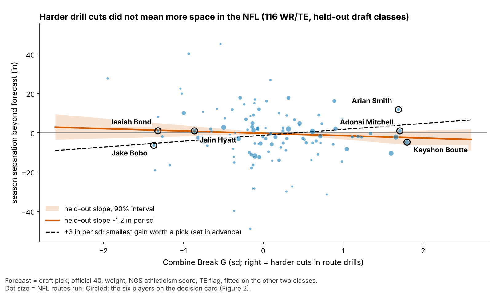
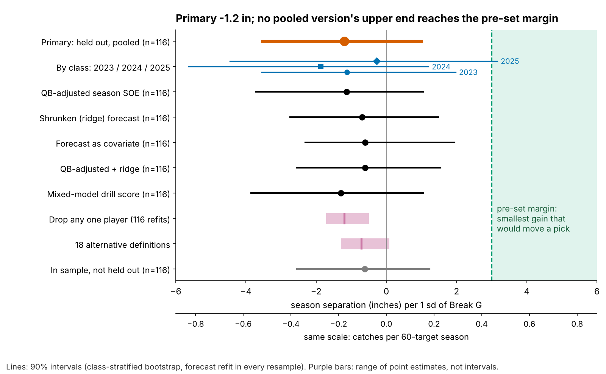

# Break G: A Hard Combine Cut Does Not Get Receivers Open, and Clubs Pay for It Anyway

**Separation over expected (SOE) is the yards of space a receiver has at the throw beyond what his route, alignment and cushion predict. On draft classes the model had not seen, receivers who cut one sd harder in Combine route drills had 1.2 inches *less* season SOE than their draft forecast (90% interval −3.5 to +1.0; 116 WR/TE). Clubs still drafted them 14% earlier. Grade the break on tape.**

## So what for a team

1. **Leave Break G out of the separation grade.** No version of the test shows a gain. The best case, +1.0 inch per sd, is worth 0.15 catches a season.
2. **Don't pay for it.** Clubs do, and the price holds on held-out classes: +1 sd of Break G moves a receiver 14% earlier (pick 100 goes at 86) and buys 0.1 inches of SOE. The flip side is a discount: receivers with soft drill cuts and good tape, like Isaiah Bond, come cheaper.
3. **Run the cut drills twice.** Second reps of slant, dagger and comeback raise reliability from 0.53 to 0.62.

| Question (tests run) | Result | Verdict |
|---|---|---|
| **Held-out season SOE per sd (1, primary)** | **−1.2 in [−3.5, +1.0]; shuffle p = 0.38** | **No gain; +3 in ruled out** |
| Same test, 6 variants: QB-adjusted, ridge, forecast as covariate, both, mixed-model score, in sample | −1.3 to −0.6; highest upper end +1.9 | Same |
| 18 alternative definitions | −1.3 to +0.1 | Same |
| Break G and its 3 coach pieces (4) | family-wise p = 0.95 | None |
| Drill → NFL chain (3) | repeats 0.28; carries −0.11; in-game 0.01 | Real trait, does not transfer |
| Within-player in-game splits (4) | family-wise p ≥ 0.26 | None |
| Usage outcomes (3) | targets/route +2.0 pts held out, 0.8 without Puka Nacua | Fragile |
| **Draft price (2)** | **14% earlier [4, 24], held out; all 3 classes** | **Robust association** |

That is 41 tests. Only the price finding survives without leaning on one player.

## Why test this

The 10 Hz Combine tracking is new to the public with this Big Data Bowl. Vendors and draft media will turn it into "suddenness" scores sold on one idea: sudden cutters get open. WR/TE route drills are where that idea is most likely to work. They are the only Combine drills that copy a football action (a break on a named route), the same code can find that break on NFL snaps, and the NFL outcome is measured. Season SOE repeats at 0.44 [0.23, 0.62] year to year (53 pairs), so it is a skill and not noise.

## The metric

**For a coach.** Break G is how hard a receiver pushes into the ground in the second around his cut. Rounding and drifting score low. Sinking, snapping and driving out score high.

**In code.** Acceleration (smoothed 10 Hz, in g) is averaged over the 1.0 s centred on the sharpest point of the first turn of 30° or more after 1.5 yd, entered above 2.5 yd/s. The break is found in 96% of 926 route-drill reps. Scores are standardized within drill × Combine year, averaged over a player's route drills (median 7) and shrunk for players with few drills. The same code runs on sampled NFL snaps of the same route families: slant, out, hitch, in and corner. The rule, outcome, test and ±3-inch margin were frozen and hashed before the test. It is a one-second average of force through the break, not a force-plate peak.

Figure 2 is the whole story at player level. The three hardest drill cutters and the three softest separate cleanly on Break G. On NFL snaps all six cut softer than in drills (0.38 to 0.48 g against 0.51 to 0.65 g), and none of their separation intervals clears zero.

## The chain: does the drill reach the snap?

1. **The drill trait holds.** Break G from five route drills predicts Break G from the other five at ρ = 0.28 [0.16, 0.40] (145 players). It is not a speed score (ρ with the 40: −0.01).
2. **It does not carry to the same NFL routes.** Across 115 players the correlation is −0.11 [−0.25, 0.04], inside the band random pairings fill (−0.15 to 0.16) and well under the ceiling of 0.46 that one shared skill would allow.
3. **A harder NFL cut does not buy space.** Within a player, one sd more cut force goes with +1.5 inches of snap SOE [−2.0, +5.0] (943 snaps, 112 players). 78% of individual players' intervals cross zero.

## The test: season separation on unseen classes

**Data and baseline.** The outcome is full-season NGS separation at the throw, adjusted for cushion, alignment, tight end and season, then route-weighted over each career (213 player-seasons, 116 players, median 231 routes). The forecast without tracking uses log pick, official 40, weight, NGS athleticism score and a TE flag.

**One test.** For each draft class, the forecast is fit on the other two. On the held-out class we ask whether Break G explains what the forecast missed. The interval refits the forecast in each of 2,000 resamples, so forecast error is included. The slope is negative in all three classes (−1.1, −1.9 and −0.3).

**Quarterback.** Every sampled play names its passer (97 quarterbacks, 4,071 snaps). We credit each receiver with his quarterbacks' effect on other receivers' snaps, shrunk and leaving him out, and subtract it. Held out, the slope becomes −1.1 [−3.7, +1.0]. Quarterback environment varies by only 0.8 inches between receivers, so it cannot hide a cut effect.

**A weak forecast.** The no-tracking forecast travels poorly between classes (Appendix). Letting the held-out fit estimate how much to trust it gives −0.6 [−2.3, +1.9]. Ridge shrinkage gives −0.7 [−2.7, +1.5]. Dropping any one player gives −1.7 to −0.5, and Puka Nacua moves it most. The jackknife interval (−3.5 to +1.1) matches the bootstrap.

**In football units.** Catch rate rises 8.8 points per yard of separation when targeted (120 player-seasons), and the median receiver with 200+ routes draws 60 targets. The +3-inch margin is 0.4 catches a season. No version's upper end reaches it.

## What clubs pay

Beyond the 40, weight and NGS score, clubs take high-Break G receivers earlier. Fit on two classes and tested on the third, +1 sd goes 14% earlier [4, 24] (149 WR/TE; 15%, 24% and 4% by class). No single player moves it outside 12 to 15%. Beyond pick it returns 0.1 inches [−1.3, +1.6]. This is an association: scouts may pay for route detail they see in the same drill. Either way, the extra force they see buys no space.

## Decision card

The rule takes the three highest and three lowest Break G wide receivers with 5+ route drills and 200+ NFL routes (46 qualify). The verdict for all six is the same: **draft on tape, ignore the drill cut.** The actions are re-watch prompts from 40 sampled snaps each, not grades.

| Player | Action | Cost of the wrong call |
|---|---|---|
| Kayshon Boutte (2023, #187) | Grade release against press: tight cushion on 38% of snaps (pool 20%), −7 in on 9 man snaps | 44 picks earlier for at most 0.26 catches |
| Adonai Mitchell (2024, #52) | Keep him outside: −23 in on 9 slot snaps, −1 on 31 wide; re-watch his 5 posts | 12 picks for at most 0.25 catches |
| Arian Smith (2025, #110) | Outside against zone (+14 in, 29 snaps); test him against man (−9 in, 11 snaps) before adding slot work | 24 picks for at most 0.25 catches |
| Jake Bobo (2023, UDFA) | Check quarterback timing on in-breakers: ball 1.4 s after his cut (pool 1.1) | A roster spot |
| Isaiah Bond (2025, UDFA) | Use him against zone on verticals: +36 in on 26 zone snaps, go routes his best | None; the discount case |
| Jalin Hyatt (2023, #73) | Give him hitches against man: +20 in on 8 man snaps, hitch his best route | 10 picks later for at most 0.13 catches |

## Combine-week protocol

Only 14% of one rep's variance belongs to the player, so seven single-rep drills reach a reliability of 0.53. Slant, dagger and comeback track a player's other drills best. Repeat them and reliability reaches 0.62. That is cheap insurance for any cut score a club builds later.

## Limitations

- **Not a blind test.** The rule was frozen before this test, but earlier work had seen all three classes. The 2026 class is the first true out-of-sample score; adding it gives power 0.85 against 3 inches.
- **The downside is open.** The interval rules out gains above +1.0 inch, not losses down to −3.5.
- **Game tracking is a sample.** Up to 40 plays per player, no defenders, no ball. NFL break reliability (0.23 over a median 16 breaks) caps every drill-to-game correlation. Card splits rest on 5 to 31 snaps.
- **Outcome and price.** The 2025 class has one season. The quarterback adjustment uses sampled snaps, half chosen for high EPA. The price is an association, not a cause.
- **Targets per route.** Break G goes with +2.0 points of targets per route held out [0.0, 4.2], but 0.8 without Puka Nacua (p = 0.25). It is a lead on quarterback trust, not a reason to pay.

## Appendix

**Forecast calibration** (held-out slope of SOE on forecast, 2023 / 2024 / 2025): plain 0.40, 0.64, 1.33; ridge 0.52, 3.95, 1.86. Ridge over-shrinks in 2024, so the covariate version is the honest fix. **Bounds:** gain under +3 inches, one-sided p = 0.0015; two-sided equivalence p = 0.101. **Reliability:** a mixed model (player and player × drill effects, drill × year fixed effects) gives 0.53 for seven drills, against 0.58 by mean-then-shrink; the two scores correlate 0.99. The ceiling is the square root of the drill and NFL reliabilities' product. **Quarterback check:** fit freely, the quarterback term has the wrong sign (−2.02), so we subtract it at face value.

Reproduce: `uv run python writeup/candidates/round_12/cand_2/analysis.py` (about three minutes). It writes every quoted number to `numbers.json` and the rule hash to `frozen_rule.json`.
