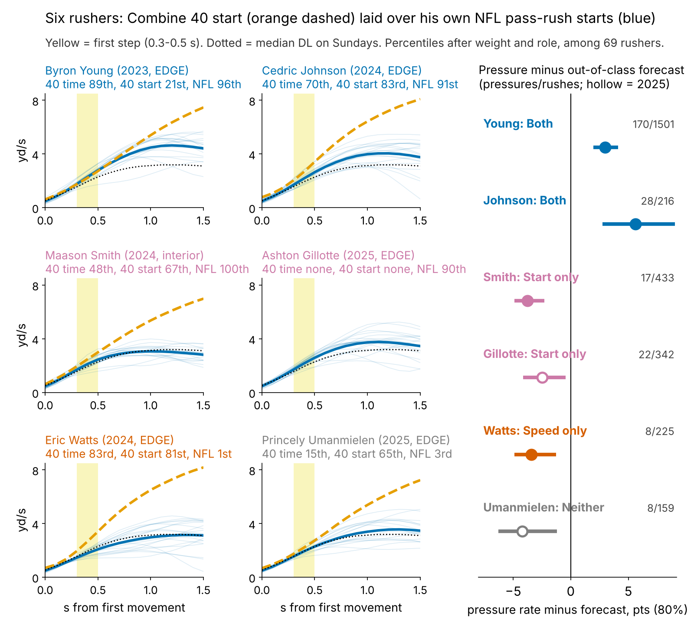
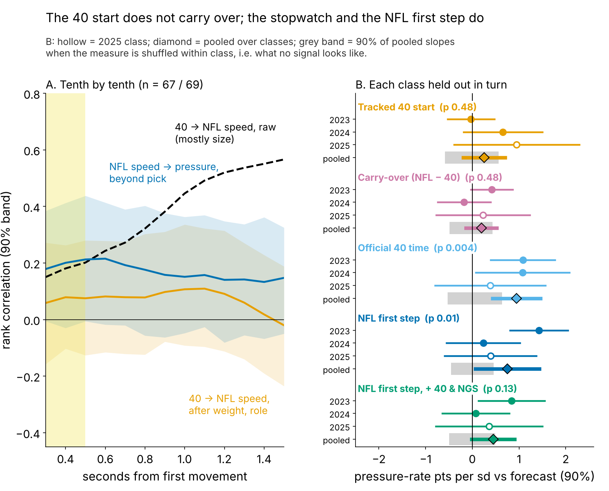
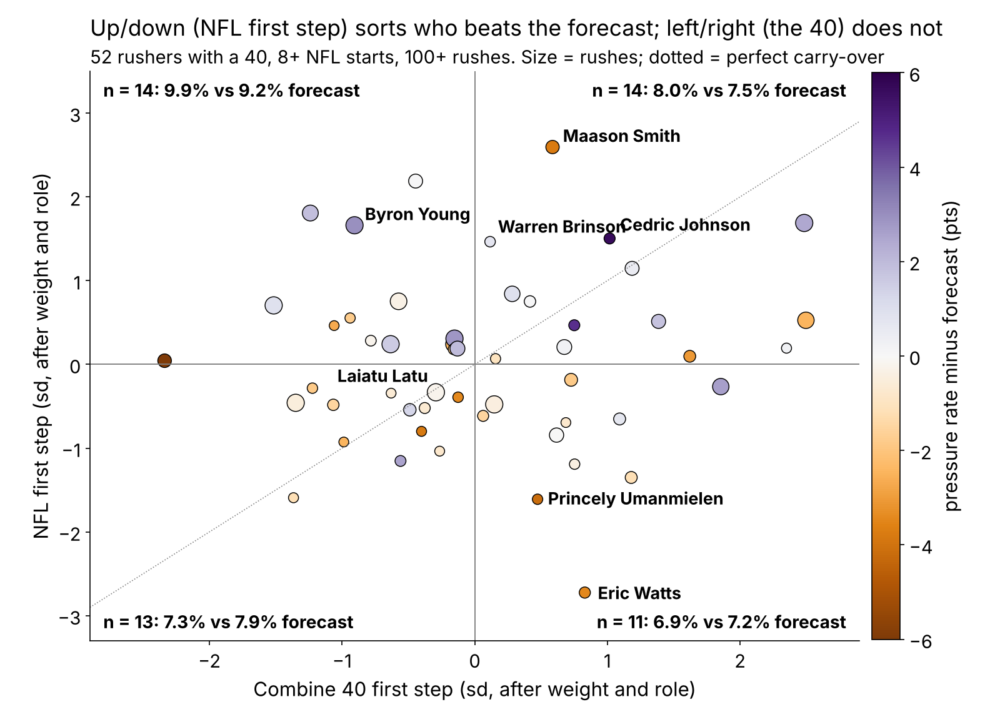
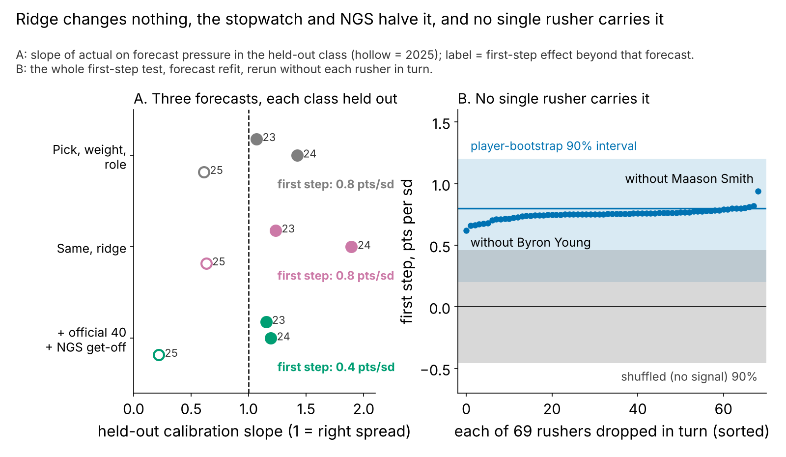

# The 40 Clip Doesn't Travel. The Stopwatch Does.

**We laid every 2023–25 defensive lineman's tracked Combine 40 start over his own random NFL pass-rush starts, on one clock. Once size is removed, the Combine start barely previews how fast he leaves his stance on Sundays, and the gap between the two adds no pressure. Scored only on draft classes the model never saw, the plain stopwatch 40 time does carry: one standard deviation faster is worth +{{x_f40_pick_pp}} pressure-rate points beyond draft slot, in all three classes. That is about the gain from moving from pick {{pick_equiv_from}} to pick {{pick_equiv_to}}. The NFL first step adds a smaller, less certain +{{x_nfl_full_pp}} on top of the stopwatch and NGS get-off.**

**Three actions.** (1) *Draft room:* weight a rusher's official 40 time more than the board does; give no credit for the tracked start trace. (2) *Pro personnel:* after about 20 random rushes, use the NFL first step as a tiebreak and film lead, trusted most when the 40 time agrees. (3) *Contracts:* a fast start without pressure is a tape question, not a buy signal (Maason Smith, below).

{{TABLE:ledger}}

*Table 1. Every test of the angle. Each draft class is held out in turn: the forecast is fit on the other two, and the measure must move the held-out class's pressures away from it. Pressure-rate points per sd (the DL average is about 8%), 90% interval; p from shuffling the measure within class.*

## The question and the metric

Rushers are sold as "explosive off the ball", and the 40's first steps are the Combine's closest thing to get-off. Since 2023 the Combine is tracked at 10 Hz like NFL games, so the movement itself can be compared.

**First step = how fast a lineman is moving 0.3 to 0.5 s after he first moves.** In that window the 40 and a pass rush are the same movement, a big man leaving a stance. By 1.5 s they part: the median lineman is at {{dr_med_40}} yd/s in the 40 and {{dr_med_sunday}} on a rush, because he has met a blocker. **Carry-over = NFL first step minus Combine first step**, each in standard deviations after weight and role (share of snaps at EDGE).

**Data.** Combine: every tracked 40 rep, standardized within year. NFL: random sampled pass plays only (the top-EPA half oversamples sacks), adjusted for alignment: {{n_snaps_dl}} starts by {{n_gplayer}} linemen, median {{snaps_med}} each. Over that many starts the NFL first step has reliability {{rel_fs_game}}; snap by snap it tracks official NGS get-off (ρ = {{rho_fs_ngs_snap}}). Outcome: career pressures per pass rush. **Baseline without tracking:** draft pick, weight and role; the stronger baseline adds the official 40 time and season NGS get-off.

## Finding 1: the start translates only through size

Raw, the 40 at 1.5 s ranks NFL speed at 1.5 s at {{tr_raw_15}}. That is weight: heavier linemen are slower on Sundays (ρ = {{rho_w_dr_sunday}}) and in the 40 ({{rho_w_dr_40}}). After weight and role the 40 first step previews the NFL first step at ρ = {{tr_fs}} [{{tr_fs_lo}}, {{tr_fs_hi}}] (n = {{n_tr}}); no tenth of a second exceeds {{tr_adj_absmax}} (Figure 2A), and even corrected for measurement noise the link is at most {{tr_fs_ceiling}}. The pass-rush drill start does no better ({{tr_prd}}, n = {{tr_prd_n}}).

So the angle's question has a short answer. Five ways of scoring how alike a player's two curves are (gap, speed ratios, shape, distance) never exceed {{sim_absmax}} in rank correlation with pressure beyond pick, and carry-over fails on held-out classes (Table 1).

## Finding 2: the stopwatch carries, and it is underpriced

The test that rejects the clip accepts the official 40 time: +{{x_f40_pick_pp}} points per sd [{{x_f40_pick_lo}}, {{x_f40_pick_hi}}], n = {{x_f40_pick_n}}, positive in {{x_f40_pick_pos}} of 3 classes, and still +{{x_f40_ngs_pp}} with season NGS get-off in the forecast. Over a {{rush_season}}-rush season that is about {{f40_season}} pressures.

Clubs do pay for it. Among {{price_n}} linemen, a one-sd faster 40 goes {{price_40}}% earlier in pick number after weight and role (p < {{price_40_p_lt}}); a fast tracked start goes {{price_cfs}}% *later* if anything (p = {{price_cfs_p}}). Because our test is beyond the pick, the 40 remains under-weighted at the price clubs pay. This is an association, not a market experiment.

## Finding 3: the NFL first step, a smaller lead

Beyond pick, weight and role, a faster NFL first step leans positive in every held-out class: +{{ht_nfl_pp}} points per sd [{{ht_nfl_lo}}, {{ht_nfl_hi}}], n = {{ht_nfl_n}}. About half is the athlete the stopwatch already measured: with the 40 time and NGS get-off in the forecast it falls to +{{x_nfl_full_pp}} [{{x_nfl_full_lo}}, {{x_nfl_full_hi}}], p = {{x_nfl_full_p}}. The clean 2025 class alone is +{{ht_nfl_2025}} [{{ht_nfl_2025_lo}}, {{ht_nfl_2025_hi}}].

The sharper evidence compares each rusher with himself. On {{sn_n}} random rushes by {{sn_players}} linemen ({{sn_k}} pressures), a first step one sd faster than his own average multiplies the odds of pressure on that snap by {{sn_or}} [{{sn_or_lo}}, {{sn_or_hi}}]: his fastest fifth of starts ended in pressure {{sn_top5}}% of the time, his slowest fifth {{sn_bot5}}% (Figure 4). It holds with that snap's NGS get-off, sideways movement, down and alignment controlled ({{sn_or_ctl}}), in each class, and for EDGE ({{sn_or_e}}) and interior ({{sn_or_i}}). Football reading: reach the blocker's set point first and the tackle opens early (though a free rush could also produce a fast start).

## Is it the forecast, or one player?

A shrunken (ridge) forecast does not improve calibration (held-out slopes {{cal_ridge_2023}}, {{cal_ridge_2024}}, {{cal_ridge_2025}} against {{cal_ols_2023}}, {{cal_ols_2024}}, {{cal_ols_2025}}; 1 is ideal) and leaves the first-step result at +{{x_ridge_pp}}. Resampling rushers and refitting everything gives [{{cb_lo}}, {{cb_hi}}]; dropping any single rusher keeps it between {{loo_min}} and {{loo_max}}, and dropping Smith raises it (Figure 5).

## Decision card

Two signals, read together, both after weight and role. **Both** = NFL first step in the top third and 40 time in the top half; **Start only** = top-third first step, slower or no 40; **Speed only** = bottom-third first step after a fast 40; **Neither**. Pressure against the pick forecast, and rushers who beat it: Both {{call_both_rate}}% vs {{call_both_fc}}%, {{call_both_beat}} of {{call_both_n}}; Start only {{call_start_rate}}% vs {{call_start_fc}}%, {{call_start_beat}} of {{call_start_n}}; Speed only {{call_speed_rate}}% vs {{call_speed_fc}}%, {{call_speed_beat}} of {{call_speed_n}}; Neither {{call_neither_rate}}% vs {{call_neither_fc}}%, {{call_neither_beat}} of {{call_neither_n}}. The rule is frozen before any 2026 data (hash `{{rule_hash}}`, `frozen_rule.json`).

{{TABLE:card}}

*Table 2. Percentiles among the 69 rushers with 100+ rushes. * = 2025 class (one season).*

**When the call is wrong: Maason Smith.** Jacksonville's 2024 second-rounder has the cohort's best NFL first step but a {{b_smith_t}}th-percentile 40 time, and produced {{b_smith_rate}}% pressure against a {{b_smith_fc}}% forecast; only {{b_smith_q}}% of his pressures came quickly. His curve is fast for a 306-lb tackle through half a second, then flat (Figure 1): he arrives, he does not win. His starts are among the straightest ({{b_smith_lat}}th percentile sideways), so it is not a stunt artifact. Umanmielen shows the clip's trap: a {{b_umanmielen_c}}th-percentile 40 start but a {{b_umanmielen_t}}th-percentile stopwatch, and NFL starts that are slow and {{b_umanmielen_lat}}th-percentile sideways (Carolina's slanting front, or him).

## Limitations

- **The angle's answer is a null.** Translation is near zero after size, and the strongest Combine signal is the stopwatch, not tracking. DL was the clearest of five groups screened; for WR, OL, DB and TE the NFL start cannot be read reliably from about 20 sampled snaps.
- **Small, sampled tape.** About 20 random starts per player; one new class gives the held-out test only {{pow_cls}}% power. A forward test (rookie-year first step against later pressure, beyond rookie pressure) has only {{fw_n}} rushers and is inconclusive (p = {{fw_p}}).
- **No blockers, ball or opponents.** A slow first step can be a two-gap call, a fast one a free rush.
- **The richer forecast is poorly calibrated on 2025** (slope {{cal_full_2025}}), whose rookies have one partial season.
- **Outcome.** Pressure is charted and usage-dependent; injuries are not modelled. Price findings are associations.

## Appendix: method and sample flow

Held-out test: the forecast, fit on the other two classes, is a fixed logit offset in a quasi-binomial model of the held-out class's pressures out of rushes; class slopes are pooled with random-effects shrinkage. The first-step window was read off the payoff curve in an earlier round; the best of {{ht_nwin}} windows under the same shuffle gives p = {{ht_nfl_p_adj}}. Ridge penalty chosen inside the training classes.

| Item | Value |
|---|---|
| Linemen with 8+ random NFL starts / their starts | {{n_gplayer}} / {{n_snaps_dl}} |
| ... with a tracked 40 (Finding 1) | {{n_tr}} |
| ... with 100+ career rushes (first-step tests) | {{n_pay}} |
| ... with both (40 start and carry-over tests, Figure 3) | {{n_both}} |
| 40 first step, two-rep repeatability | {{rel40_fs}} (n = {{rel40_n}}) |
| Sampled-snap pressure vs career pressure rate | ρ = {{rho_sample_season}} |

*Table 3.*

*Reproduce: `uv run python writeup/candidates/round_12/cand_3/analysis.py` (about 3 minutes, one core).*
