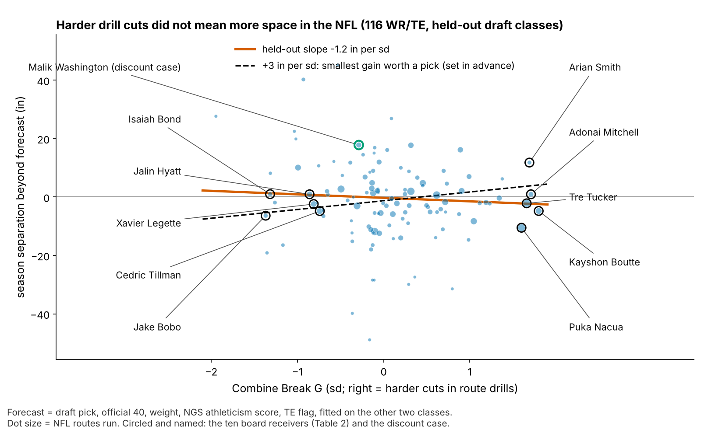
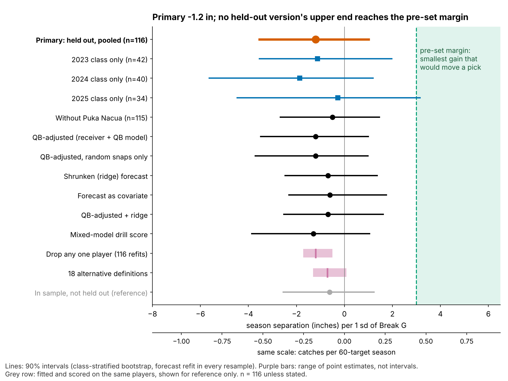
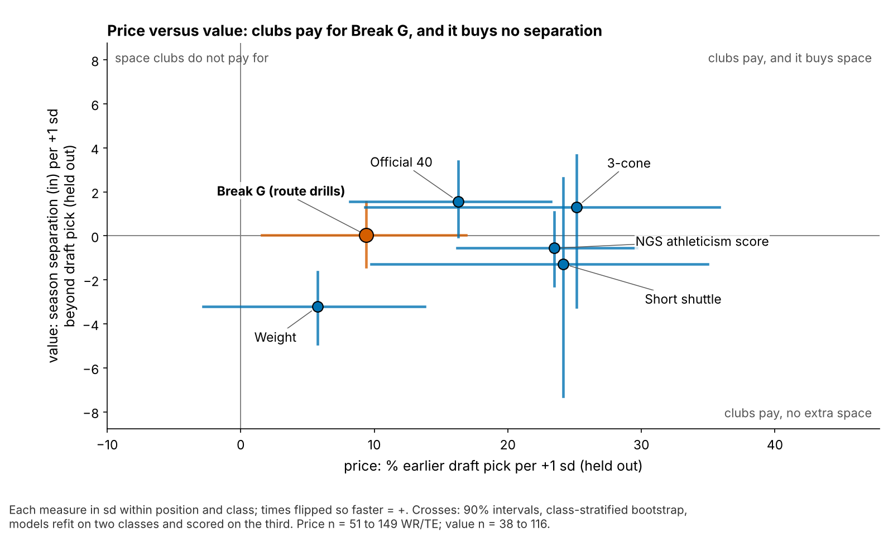

# Break G: A Harder Combine Cut Does Not Get Receivers Open

**A harder Combine cut does not get receivers open: −1.2 inches of season separation per sd (90% interval −3.5 to +1.0; 116 WR/TE, draft classes the model had not seen). Clubs still draft those receivers 14% earlier, though after counting the price tests that is only a lead. Grade the break on tape.**

*Separation over expected (SOE): yards of space at the throw beyond what the route, alignment and cushion predict.*

## So what for a team

1. **Leave Break G out of the separation grade.** No version of the test shows a gain. The best case, +1.0 inch per sd, is worth 0.15 catches a season.
2. **Don't pay for it, and use the discount.** Fit on two classes and tested on the third, +1 sd of Break G goes 14% earlier (pick 100 goes at 86) and buys no space (Figure 5). Soft drill cutters with good tape come cheap: Malik Washington (2024, pick 184) had Break G −0.3 sd and beat his forecast by 17.8 inches on 568 routes. Of 8 soft-cut day-3 or undrafted receivers, 5 beat their forecast.
3. **Run the cut drills twice.** Second reps of slant, dagger and comeback raise reliability from 0.53 to 0.62.

| Question (tests run) | Result | Verdict |
|---|---|---|
| **Season SOE per sd, held out (1)** | **−1.2 in [−3.5, +1.0]; chance alone gives a slope this large 38% of the time** | **No gain; +3 in ruled out** |
| Same test, 8 other versions (Figure 4) | −1.3 to −0.5; highest upper end +1.8 | Same |
| 18 alternative definitions (18) | −1.3 to +0.1 | Same |
| Break G and its 3 coach pieces (4) | best of four: chance 95% | None |
| Drill to NFL chain (3) | repeats 0.28; carries −0.11; in-game +1.5 in, crosses 0 | Real drill trait, does not transfer |
| Within-player game splits (4) and do scheme splits repeat (3) | best split: chance 26%; man/zone and slot/wide repeat at −0.06 and −0.11 | Noise at 40 snaps |
| Usage outcomes (3) | targets per route +2.0 pts held out, +0.8 without Puka Nacua | Fragile |
| **Draft price of Break G (3)** | **14% earlier [5, 23]; better pick forecast in 2 of 3 classes** | **Lead only: 16% by chance after adjusting for 3 tests** |
| Price and value of 5 other measures (10) | heavier: −3.2 in per sd | Context |

Every estimate that could have become a claim counts: 1 + 8 + 18 + 4 + 3 + 4 + 3 + 3 + 3 + 10 = 57.

## Why receivers, why now

Combine tracking is public for the first time, and vendors will sell "suddenness" scores on one idea: sudden cutters get open. WR/TE route drills are the fairest test. They are the only Combine drills that copy a football action, the same code finds that break on NFL snaps, and the outcome is measured. Season SOE repeats at 0.44 [0.23, 0.62] year to year (53 pairs), so it is a skill and not noise.

## The metric

**For a coach.** Break G is how hard a receiver pushes into the ground in the second around his cut. Rounding and drifting score low. Sinking, snapping and driving out score high.

**In code.** Smoothed acceleration (in g) averaged over the 1.0 s centred on the sharpest point of the first real turn, standardized within drill and Combine year, averaged over a player's route drills (median 7) and shrunk when he ran few. The same code runs on sampled NFL snaps of the same routes: slant, out, hitch, in and corner. Thresholds are in the Appendix; the rule was frozen and hashed before the test.

On NFL snaps all six cut softer than in drills (0.38 to 0.48 g against 0.51 to 0.65 g), and none of their separation intervals clears zero.

## The chain: does the drill reach the snap?

1. **The drill trait holds.** Break G from five route drills predicts Break G from the other five at ρ = 0.28 [0.16, 0.40] (145 players). It is not a speed score (ρ with the 40: −0.01).
2. **It does not carry to the same NFL routes.** Across 115 players the correlation is −0.11 [−0.25, 0.04], inside the band random pairings fill and well under the ceiling of 0.46 that one shared skill would allow.
3. **A harder NFL cut does not buy space.** Within a player, one sd more cut force goes with +1.5 inches of snap SOE [−2.5, +5.3] (89 receivers, 862 snaps). 78% of individual intervals cross zero.

## The test: season separation on unseen classes

**Data and baseline.** The outcome is full-season NGS separation at the throw, adjusted for cushion, alignment, tight end and season, route-weighted over each career (213 player-seasons, 116 players, median 231 routes). The forecast without tracking uses log pick, official 40, weight, NGS athleticism score and a TE flag.

**One test.** For each draft class, the forecast is fit on the other two; on the held-out class we ask whether Break G explains what the forecast missed. The interval refits the forecast in each of 2,000 resamples. The slope is negative in all three classes (−1.1, −1.9 and −0.3).

**Checks, one line each.** Without Puka Nacua, the most influential player: −0.5 [−2.7, +1.5]. Quarterback: a receiver-plus-quarterback model of 4,071 sampled snaps gives passers 0.0% of snap-to-snap variance (upper end 0.5%), the same on the random half of the sample, and the adjusted slope stays −1.2. Shrinking the forecast or estimating how much to trust it: −0.7 and −0.6. Dropping any one player: −1.7 to −0.5.

**In football units.** Catch rate rises 8.8 points per yard of separation when targeted, and the median receiver with 200+ routes draws 60 targets, so the +3-inch margin is 0.4 catches a season. No version's upper end reaches it.

## Price versus value

Beyond the 40, weight and NGS score, +1 sd of Break G goes 14% earlier [5, 23] on held-out classes (149 WR/TE; 15%, 24% and 4% by class; 12% to 15% dropping any one player). Adding Break G to the no-tracking pick forecast lifts held-out R² from 8.3% to 9.7% (+1.4 points [−3.6, +5.9]; better in 2 of 3 classes). Chance alone does as well 5.4% and 6.3% of the time, and 16% after adjusting for the three price tests. It does not survive all 57. Read it as a lead: scouts may pay for route detail seen in the same drill. It buys no space either way.

Figure 5 also puts Break G next to the stopwatch. The 40 costs 16% per sd and returns +1.6 inches [0.0, +3.4]; the NGS athleticism score costs 23% and returns −0.6. Weight costs separation (−3.2 inches [−4.9, −1.6]), the price of the contested-catch body.

## The board

The ten qualifying wide receivers (5+ route drills, 200+ NFL routes; 46 qualify) with the hardest and softest drill cuts. Every pick is checked against the nflverse draft record (116 of 116 match); Isaiah Bond and Jake Bobo went undrafted. Scheme splits from 40 sampled snaps do not repeat (split-half −0.06 man/zone, −0.11 slot/wide; pairing halves from different receivers reaches 0.24 to 0.26), so the actions use deployment and full-season SOE, not splits. They are football judgement, not model output.

| Receiver (class, pick) | Break G (sd) | Season SOE vs forecast, in [90%] | Action |
|---|---|---|---|
| Kayshon Boutte (2023, 187) | +1.8 | −4.8 [−16.3, +6.7] | 88% outside, 35% go routes: grade his release and vertical tracking, not the drill cut |
| Adonai Mitchell (2024, 52) | +1.7 | +0.9 [−8.3, +10.2] | On forecast from 78% outside snaps; keep his role, pay nothing for the cut |
| Arian Smith (2025, 110) | +1.7 | +11.8 [−3.0, +26.6] | One season, 231 routes; re-grade after 2026 before adding slot work (42% now) |
| Tre Tucker (2023, 100) | +1.7 | −2.2 [−10.0, +5.6] | 35% go routes: a vertical role where the cut rarely matters |
| Puka Nacua (2023, 177) | +1.6 | −10.5 [−19.1, −1.9] | Wins in tight windows: separation understates him; never grade him on SOE alone |
| Cedric Tillman (2023, 74) | −0.7 | −4.8 [−12.3, +2.7] | 80% outside and below forecast; contested-catch tape decides his role |
| Xavier Legette (2024, 32) | −0.8 | −2.4 [−8.6, +3.7] | 45% slot: test him outside before calling the soft cut a flaw |
| Jalin Hyatt (2023, 73) | −0.9 | +0.9 [−14.6, +16.5] | On forecast, 88% outside; the soft cut costs him nothing |
| Isaiah Bond (2025, undrafted) | −1.3 | +1.0 [−10.2, +12.2] | 32% go routes, on forecast as an undrafted rookie: keep him on the vertical plan |
| Jake Bobo (2023, undrafted) | −1.4 | −6.4 [−24.4, +11.7] | Wide interval; judge him on special teams and red-zone tape |

## Combine-week protocol

Only 14% of one rep's variance belongs to the player, so seven single-rep drills reach a reliability of 0.53. Slant, dagger and comeback track a player's other drills best; repeating them reaches 0.62.

## Limitations

- **Not a blind test.** The rule was frozen before this test, but earlier work had seen all three classes. The 2026 class is the first true out-of-sample score; adding it gives power 0.85 against 3 inches.
- **The downside is open.** The interval rules out gains above +1.0 inch, not losses down to −3.5.
- **Game tracking is a sample.** Up to 40 plays per player, half chosen for high EPA, with no defenders and no ball. NFL break reliability (0.23 over a median 16 breaks) caps every drill-to-game correlation, and scheme splits from 40 snaps are noise.
- **Outcome and price.** The 2025 class has one season. The price is an association and does not survive correction for every test run.
- **Targets per route.** +2.0 points held out [0.0, 4.2], but +0.8 without Puka Nacua (p = 0.27).

## Appendix

**Thresholds.** Break: first turn of 30° or more after 1.5 yards, entered above 2.5 yd/s; found in 96% of 926 route-drill reps. Window 1.0 s, smoothing Savitzky–Golay (7 frames). **Terms.** "Chance alone" is a shuffle test: Break G is shuffled among players of the same class 2,000 times and the share of shuffles at least as large is reported. "Best of four" uses the largest of the four shuffled results, which accounts for looking four times. "Adjusting for three tests" is Holm's step-down correction. **Bounds.** Gain under +3 inches, one-sided p = 0.0015. **Reliability.** A mixed model (player and player × drill effects) gives 0.53 for seven drills; its score correlates 0.99 with ours. The ceiling is the square root of the drill and NFL reliabilities' product. Split-half: each receiver's sampled snaps split at random 200 times; placebo pairs half A with another receiver's half B. **Quarterback model.** Snap SOE = receiver effect + quarterback effect + noise, both random, fit by REML; interval by profile likelihood. **Forecast calibration** (held-out slope of SOE on forecast, 2023 / 2024 / 2025): 0.40, 0.64, 1.33; ridge 0.52, 3.95, 1.86. **Jackknife** interval −3.5 to +1.1.

Reproduce: `uv run python writeup/candidates/round_12/revised/analysis.py` (about three minutes). It writes every quoted number to `numbers.json` and the rule hash to `frozen_rule.json`.
