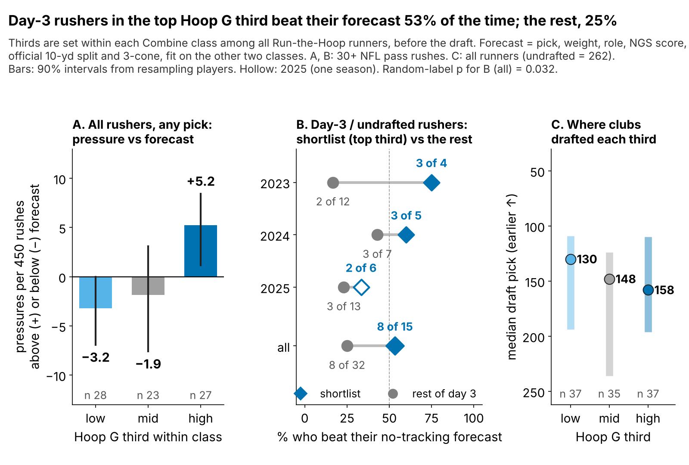
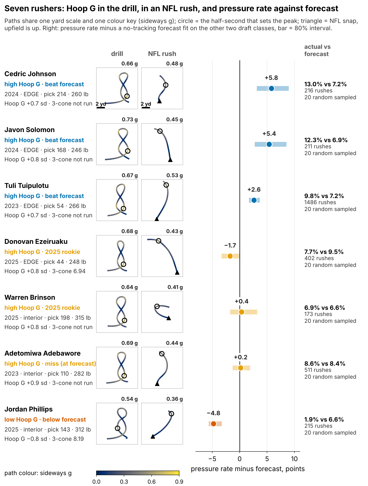
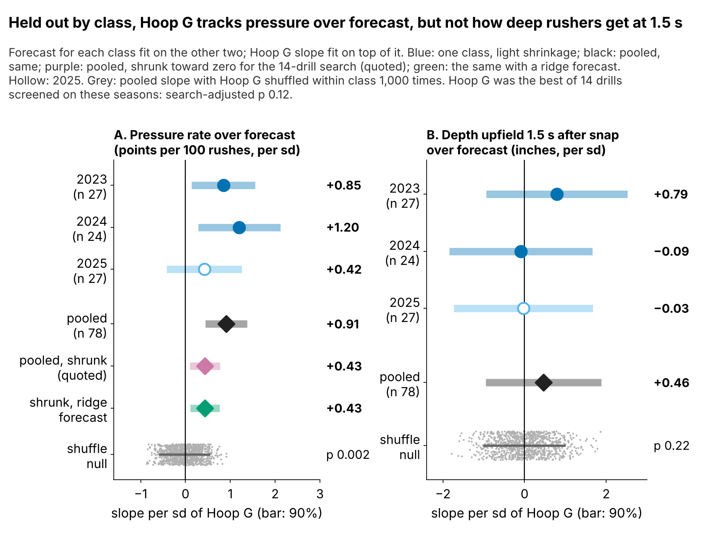

# Hoop G: A Free Day-3 Shortlist for Pass Rushers

**Hoop G is how hard a defensive lineman pushes sideways while rounding the Run-the-Hoop curve, compared with his Combine class. Shortlist day-3 and undrafted rushers in the top third of their class on it: 8 of 15 (53%) beat a no-tracking forecast of their NFL pressure rate, against 8 of 32 (25%) of the other day-3 rushers. Clubs do not pay for it. The edge is small, the 2025 class barely shows it, and we cannot see why it works: a shortlist for film, not a grade.**

## Why it matters

A pressure is what a rusher is paid for: on 1681 sampled NFL pass plays of our rookies, the offense lost 0.53 more expected points on pressured snaps (90% interval 0.37 to 0.68).

Day 3 is where pass rushers are cheap and boards are thin. The usual agility number, the 3-cone, makes a big man stop, plant and bend around a cone, the hip bend he needs to dip under a tackle's hands. But only 43 of 118 linemen in the 2023–25 classes ran an official 3-cone, and it does not hold up on classes it was not fit on (ρ = 0.36, 95% interval −0.22 to 0.67). Another 69 ran Run-the-Hoop, a figure-eight around two hoops, and no 3-cone. Nobody times it; the 10 Hz Combine tracking can: we take the hardest half-second of sideways acceleration on the curve, in g, and standardize it within each Combine year, because drill conditions shift between years.

## The shortlist, scored on classes it never saw

**The bar.** Every lineman gets a forecast of his NFL pressure rate from what clubs already have: draft pick, weight, EDGE share, NGS athleticism score and the official 10-yard split and 3-cone. Each class is forecast by a model fit only on the other two. It ranks rushers in every held-out class, though its spread varies by class (appendix); a shrunken (ridge) version cuts its error from 2.42 to 2.29 points.

**The rule.** Pick 103 or later, or undrafted, and Hoop G in the top third of all hoop runners in his class. Thirds are set at the Combine, before anyone plays, and nothing in the rule is fit on NFL data. A shortlisted rusher with 30+ NFL rushes "hits" if his pressure rate beats his forecast. The rule is frozen (SHA-256 `e68244604495`) and will score the 2026 class, unchanged, after the 2027 season.

| Test, held out by class | n | Result [90% interval] |
|---|---|---|
| **Day-3 shortlist beat its forecast** | 15 vs 32 | **8 of 15 (53%) vs 8 of 32 (25%)**; random-label p 0.032 |
| … pressures per 450 rushes, shortlist minus rest | 15 vs 32 | +5.4 [−0.5, 11.5] |
| Hoop G slope over forecast, all 78 rushers | 78 | +0.43 per 100 rushes per sd [0.09, 0.77]; ridge forecast +0.43; rescaled forecast +0.43 |
| … priced for picking the best of 14 drills | 78 | p 0.12 |
| Clubs' price: draft slot per sd of Hoop G | 109 | 3% later [18% later, 11% earlier] |

The shortlist was ahead in 3 of 3 classes (Figure 1B). Relabelling Hoop G at random within class gives a gap this large 0.032 of the time. In pressures, the shortlist ran 0.1 per 450 rushes against its forecast while the other day-3 rushers ran −5.3: a gap of 5.4 pressures a season, about 2.9 expected points, with an interval that touches zero. The honest reading is that Hoop G **flags day-3 rushers who hold their forecast while their peers fall short of it**.

Two traps we checked. Survival: shortlisted rushers were no more likely to reach 30 NFL rushes (15 of 24 against 32 of 52), so the result is not a playing-time filter. One player: without Cedric Johnson, the shortlist is still 7 of 14.

Across all 78 rushers with 30+ rushes, the same signal shows as a slope: 0.43 more pressures per 100 rushes per sd of Hoop G, after shrinking toward zero because Hoop G was the best of 14 drills we screened. Three versions of the bar (least squares, ridge, forecast rescaled per class) give the same slope (Figure 3A). Priced for that 14-drill search, though, p = 0.12.

## Get-off carries over; Hoop G has no visible mechanism

The angle we started from was the pass-rush drill's get-off burst. It does carry over: its first-second burst tracks NFL get-off on the sampled game frames (ρ = 0.32, 85 linemen). But get-off is not pressure once pick, weight, role and NGS score are known (ρ = −0.03, 68 linemen), so the burst is not the edge.

Hoop G is the reverse: it predicts pressure but leaves no trace in the frames. Pressure on 20 sampled rushes is noisy (split-half reliability 0.07), so we built a steadier outcome, **depth upfield 1.5 seconds after the snap**: it repeats (reliability 0.85, 86 linemen) and tracks season pressure (ρ = 0.33). Hoop G does not move it (Figure 3B), nor how sharply rushers turn after the snap. Our best guess is a rusher who keeps speed through contact, which we cannot see without blockers in the data.

## When the call is wrong

| Player (class, pick, lb, team) | Call | Pressure vs forecast (rushes) | 2+ yd sideways by 1.5 s (random sampled) | Film cut and cue |
|---|---|---|---|---|
| **Cedric Johnson** (2024, 214, 260, CIN) | Shortlist | 13.0% vs 7.2% (216) | 20% (of 20) | Pull: wide rushes from a 7/9 technique. Cue: does he dip under the tackle's hands and flatten to the quarterback within two steps? |
| **Adetomiwa Adebawore** (2023, 110, 282, IND) | Shortlist | 8.6% vs 8.4% (511) | 15% (of 20) | Pull: 3-technique rushes and his loops on stunts. Cue: the bend shows when he loops, but does he finish, or stall once the guard re-anchors? |
| **Jordan Phillips** (2025, 143, 312, MIA) | Bottom third | 1.9% vs 6.6% (215) | 40% (of 20) | Pull: rushes where the play moves away and his stunt loops. Cue: does he redirect at all, or only push the pocket? |
| **Yahya Black** (2025, 164, 336, PIT) | Bottom third | 5.8% vs 5.2% (189) | 0% (of 19) | Pull: odd-front nose snaps in Pittsburgh's 3-4. Cue: is he asked to two-gap first? A flag on a two-gap nose is a role question, not a skill read. |

**Johnson** is the case the shortlist is for (Figure 2): a day-3 EDGE who beat his forecast. **Adebawore** is the miss: top-third Hoop G, a rate on his forecast over 511 rushes. Where drill and tape disagree like this, tape decides. **Phillips and Black** share a low Hoop G with opposite results. Scheme is the likely reason: Miami moved Phillips 2+ yards sideways early on 40% of his sampled rushes (interior median 15%); Pittsburgh's odd front sent Black straight ahead.

## So what for a team

| 2025 shortlist (pick, team) | Role | Hoop G (sd) | Rookie pressure vs forecast (rushes) | Plan |
|---|---|---|---|---|
| **Ethan Downs** (UDFA, KC) | EDGE | +2.3 | — (7) | Audition: third-down sub rusher, 10–15 snaps a game |
| **Jah Joyner** (UDFA, FA) | EDGE | +1.5 | — (0) | Audition: third-down sub rusher, 10–15 snaps a game |
| **Jack Sawyer** (123, PIT) | EDGE | +1.4 | 9.7% vs 8.5% (176) | Grow third-down snaps from a wide (7/9) alignment |
| **Warren Brinson** (198, GB) | interior | +1.3 | 6.9% vs 6.6% (173) | Make him the looper on interior stunts |
| **Kyle Kennard** (125, LAC) | EDGE | +1.2 | 2.0% vs 8.2% (50) | Audition: third-down sub rusher, 10–15 snaps a game |
| **Antwaun Powell-Ryland** (209, CIN) | EDGE | +1.1 | — (0) | Audition: third-down sub rusher, 10–15 snaps a game |
| **Tyrion Ingram-Dawkins** (139, MIN) | EDGE | +1.0 | 5.3% vs 8.0% (113) | Hold snaps; grade his wide-arc rushes before cutting them |
| **Zeek Biggers** (253, MIA) | interior | +0.9 | 4.9% vs 6.4% (142) | Early downs; re-test as stunt looper in camp |
| **Nazir Stackhouse** (UDFA, TEN) | interior | +0.4 | 1.4% vs 5.9% (71) | Audition: stunt package on passing downs |
| **Tim Smith** (190, IND) | interior | +0.4 | — (0) | Audition: stunt package on passing downs |

1. **Build the day-3 film list from it.** Top-third Hoop G linemen went at a median pick of 158, no earlier than the bottom third (130): clubs priced Hoop G at 3% later per sd (90%: 18% later to 11% earlier). The shortlist costs no draft capital.
2. **Match the role to the trait.** Shortlisted EDGEs get third-down snaps from wide alignments, where sideways force should matter most; shortlisted interior players get the looper role on stunts. A low Hoop G on a two-gap nose is a role question, not a flag.
3. **Run the hoop twice.** 20 of 24 shortlisted linemen have one run; a second, at a pro day or in a camp tracker, lifts reliability from 0.41 to 0.58.

## Limitations

- **Chosen, then tested on the same seasons.** Holding out classes checks the forecast, not the drill choice (search-adjusted p = 0.12). The shortlist rule was written this round, after earlier rounds had seen the slope; the frozen 2026 test is the clean one.
- **Small and early.** 15 shortlisted and 32 comparison rushers; 9 shortlisted linemen have under 30 NFL rushes. The 2025 class has one season and is the weakest in every test.
- **Forecast level.** The forecast is fit on 100+-rush regulars, so most day-3 rushers fall below it; the test compares day-3 rushers with each other, not with 50%.
- **Thin NFL data.** Pressure counts ignore opponents and quarterbacks; sampled tracking has about 20 random rushes per player and no blockers or ball, so scheme reads come from loop rates, not play calls.

## Appendix: every other check

| Check | Result |
|---|---|
| Shortlist, ridge forecast as yardstick | 8/15 vs 6/32 |
| Shortlist without its best rusher (Cedric Johnson) | 7/14 vs 8/32 |
| Shortlist by class (2023, 2024, 2025) | 3/4 vs 2/12; 3/5 vs 3/7; 2/6 vs 3/13 |
| Reached 30+ NFL rushes (all day-3 runners) | 15/24 vs 32/52 |
| Same rule on the 3-cone (day-3, ran it) | 1/3 vs 3/13 |
| Slope: resample players; drop any one | [0.19, 0.64]; 0.35 to 0.46 |
| Tie-break pairs (forecast within 1 pt) | 136/212, p 0.008 |
| Hoop G → NFL depth at 1.5 s; turning rate | 0.5 in [−0.9, 1.9]; ρ −0.04 |
| Rush-drill get-off → NFL get-off; → pressure | ρ 0.32 (n 85); −0.03 (n 68) |
| Forecast calibration slope (2023, 2024, 2025; 1 = perfect) | 0.89, 2.01, 0.63; ridge 1.39, 1.89, 0.58 |
| 3-cone → pressure over forecast | ρ 0.36 [−0.22, 0.67], n 27 |

*Reproducible: `uv run python writeup/candidates/round_13/cand_1/analysis.py` writes `numbers.json`, `claims.json`, `frozen_rule.json`, `frozen_shortlist.json`, the board CSV and the three figures, then fills this text from `writeup_template.md`.*
