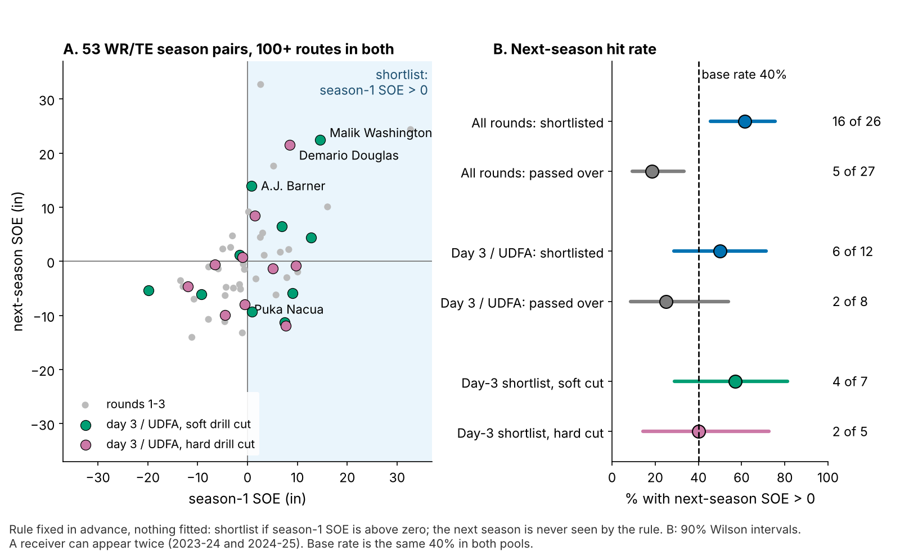

# Break G: A Hard Combine Cut Does Not Get Receivers Open. Last Season's Separation Does.

**How hard a receiver cuts in Combine route drills (Break G) bought no NFL separation for 116 WR/TE from draft classes the model had not seen: −0.4 inches per sd (90% interval −2.2 to +1.7). What does carry is separation itself. Receivers who beat expectation one season did it again 62% of the time, against 19% for the rest. Shortlist late-round receivers on that, and grade the cut on tape.**

*Separation over expected (SOE): yards of space at the throw beyond what alignment, cushion and position predict (NGS, full season).*

## So what for a team

1. **Shortlist day-3 and undrafted receivers on last season's SOE, not on the drill cut.** The rule: 100+ routes and SOE above zero. Scored on the following season, which the rule never sees, it is right 62% of the time against a 40% base rate (Figure 2). Inside the day-3 shortlist, soft cutters hit 4 of 7 and hard cutters 2 of 5, so Break G does not sort them. The 2026 list has 13 names, 7 of them soft cutters, led by Malik Washington (2024, pick 184; Break G −0.3 sd; +22.5 inches in 2025).
2. **Leave Break G out of the separation grade and out of the price.** The best case, +1.7 inches per sd, is worth 0.25 catches a season. Clubs already draft high-Break-G receivers 14% earlier.
3. **If you time cut drills, run slant, dagger and comeback twice.** One rep carries little of the player (14% of its variance). A second rep on those three drills lifts reliability from 0.53 to 0.62.

| Question | Result, 90% interval | Verdict |
|---|---|---|
| **Does Break G add season SOE beyond pick, 40, weight and NGS score?** (116, held out) | **−0.4 in [−2.2, +1.7]** | **No; a +3 in gain is ruled out** |
| Production: yards per route run, catch rate over expected | +0.24 yd and +1.8 pts; without Puka Nacua +0.10 and +0.1 | One-player lead |
| Does the drill cut show up on NFL snaps? | drill repeats at 0.28; carries at −0.11 | Real drill trait; does not transfer |
| Do clubs pay for it? | 14% earlier pick [5, 23] | Lead only (16% by chance after 3 price tests) |
| **Does last season's SOE flag next season's?** (53 season pairs) | **62% vs 19% hit rate** | **Yes; use it** |

## Why it matters

Receiver grades lean on "suddenness", and this is the first year Combine route drills come with 10 Hz tracking, so the cut can be measured instead of described. Clubs already act on something like it: beyond the 40, weight and NGS score, +1 sd of Break G moves pick 100 to pick 86. Season SOE is a skill, not noise: it repeats at 0.44 [0.23, 0.62] from one year to the next (53 pairs).

## The metric

Break G is how hard a receiver pushes into the ground in the second around his cut, in g (1 g = his body weight). Rounding and drifting score low. Sinking, snapping and driving out score high. The same code finds the first real break on Combine reps and on sampled NFL snaps of the same routes (slant, out, hitch, in, corner). Scores are standardized within drill and Combine year and averaged over a player's route drills (median 7). The rule was frozen and hashed before testing (Appendix).

## The shortlist

Across all rounds (53 pairs, 38 receivers), 16 of 26 shortlisted receivers had positive SOE again the next season, against 5 of 27 passed over: a gap of 43 points [21, 63], Fisher p = 0.002. The day-3 and undrafted pool alone points the same way but is small: 6 of 12 against 2 of 8 (gap 25 points [−14, 58]). Use it as a pre-camp shortlist, not a cut-down list: a 50% hit rate on a pick-184 price is cheap.

## The chain: does the drill reach the snap?

1. **The drill trait holds.** Break G from five route drills predicts the other five at ρ = 0.28 [0.16, 0.40] (145 players). It is not a speed score: ρ with the 40 is −0.01.
2. **It does not carry to NFL routes.** Across 115 players the correlation is −0.11 [−0.25, 0.04]. That is inside the random-pairing band and well under the 0.46 ceiling one shared skill would allow.
3. **A harder NFL cut does not buy space.** Within a player, one sd more cut force goes with +1.5 inches of snap SOE [−2.5, +5.3]. 78% of individual intervals cross zero.

## The test: season separation on unseen classes

**Data and baseline.** The outcome is full-season SOE, route-weighted over each career (213 player-seasons, 116 players, median 231 routes). The forecast without tracking uses log pick, official 40, weight, NGS athleticism score and a TE flag.

**One test.** For each draft class the forecast is fit on the other two, shrunk by ridge regression, and entered on the held-out class with its weight estimated there. Round 12's plain forecast was over-confident out of class, so this replaces it. Break G then has to explain what the forecast misses. The interval resamples players within class and refits everything 2,000 times. The slope is negative in all three classes (−0.3, −1.6 and −0.3).

**Versions.** Without Puka Nacua, the most influential player, the slope is 0.0 [−1.7, +2.3]. Adjusting season SOE for route mix and depth at the throw (from 1,902 random snaps) gives −1.1 [−2.7, +1.3]. Adjusting for the quarterback gives −0.4. Round 12's plain forecast gives −1.2. No version's upper end passes +2.3 inches.

**Other outcomes.** Yards per route run rise 0.24 yd per sd [0.03, 0.47], and catch rate over expected rises 1.8 points [−1.3, +3.9]. Without Nacua these fall to 0.10 [−0.01, 0.25] and 0.1. One receiver drives both.

**In football units.** Catch rate rises 8.8 points per yard of separation when targeted, and the median 200-route receiver draws 60 targets. The +3-inch margin is therefore 0.4 catches a season.

**Price.** Beyond the 40, weight and NGS score, +1 sd of Break G goes 14% earlier [5, 23] on held-out classes. Adding it to a no-tracking pick forecast lifts held-out R² from 8.3% to 9.7%. Chance alone does that well 5.4% of the time, and 16% after correcting for the three price tests, so it is a lead. In Figure 4B, the 40 costs 16% per sd and returns +1.6 inches [0.0, +3.4]. Weight costs separation: −3.2 inches [−4.9, −1.6].

## The board

The six receivers in Figure 1; picks match the nflverse draft record (116 of 116). Actions follow deployment, since scheme splits from 40 sampled snaps do not repeat (Appendix).

| Receiver (class, pick) | Break G (sd) | SOE vs forecast, in [90%] | Deployment | Action |
|---|---|---|---|---|
| Kayshon Boutte (2023, 187) | +1.8 | −4.8 [−16.3, +6.7] | 88% outside, 35% go | **Drill and tape disagree.** On NFL breaks he enters faster than the median receiver (5.4 vs 4.9 yd/s) and cuts at 0.48 g, against 0.62 in drills. Coach: gear down at the stem on outs and comebacks against off coverage |
| Adonai Mitchell (2024, 52) | +1.7 | +0.9 [−8.3, +10.2] | 78% outside, 20% go | Flanker on intermediate in-breakers; pay nothing for the cut |
| Arian Smith (2025, 110) | +1.7 | +11.8 [−3.0, +26.6] | 42% slot, 32% go | On the 2026 shortlist: keep the vertical-slot role (seams, overs); re-grade after 2026 |
| Jalin Hyatt (2023, 73) | −0.9 | +0.9 [−14.6, +16.5] | 88% outside, 25% go | Boundary vertical X: the soft cut costs nothing on go and post |
| Isaiah Bond (2025, UDFA) | −1.3 | +1.0 [−10.2, +12.2] | 40% slot, 32% go | Softest cutter on the 2026 shortlist (+4.3 in): keep his slot reps |
| Jake Bobo (2023, UDFA) | −1.4 | −6.4 [−24.4, +11.7] | 70% outside, 20% go | Wide interval: red-zone and special-teams role; judge contested catches |

## Limitations

- **Not a blind test.** The metric was frozen before this test, but earlier rounds had seen all three classes. The ridge version was adopted after the plain one (−1.2) was known; both are shown. The 2026 class is the first true out-of-sample score, with power 0.85 against a 3-inch gain.
- **The downside is open.** The interval rules out gains above +1.7 inches per sd, not losses down to −2.2. The price is an association and only a lead.
- **The shortlist is small.** It has 53 pairs from 38 receivers, some counted twice, and only 20 late-round pairs. The 2025 class has one season, so it enters only the 2026 list.
- **Game tracking is a sample.** Up to 40 plays per player, half chosen for high EPA, with no defenders and no ball. NFL break reliability is 0.23 over a median 16 breaks, which caps every drill-to-game correlation.

## Appendix

**Thresholds.** A break is the first turn of 30° or more after 1.5 yards, entered above 2.5 yd/s; it was found in 96% of 926 route-drill reps. Window 1.0 s; Savitzky–Golay smoothing (7 frames). **Forecast.** Ridge penalty is chosen by leave-one-class-out inside the two training classes. Pooled weight on the held-out forecast is 0.72. Plain-forecast calibration slopes by class are 0.40, 0.64 and 1.33. **Chance.** Shuffle tests permute Break G within class 2,000 times. The main slope's shuffle p is 0.74. The upper-end test against +3 inches gives p = 0.0025. The price p values are Holm-corrected over three tests. Of the 70 estimates run across rounds (ledger in `numbers.json`), the shortlist gap is the strongest; Bonferroni over all 70 would leave none below 5%. **Reliability.** A mixed model (player, player × drill, drill × year) gives 0.53 for seven drills. The ceiling is the square root of the product of drill and NFL reliabilities. Scheme splits were tested split-half over 200 random splits: man/zone −0.04 and slot/wide −0.09. **Quarterback.** A crossed receiver + quarterback REML model on 4,071 sampled snaps gives passers 0.0% of snap variance (upper end 0.5%). **Route mix:** separation modelled on route and depth over random snaps, averaged per player-season, added to the SOE adjustment. **Catch over expected:** catches beyond a model on targeted separation, slot and TE.

Reproduce: `uv run python writeup/candidates/round_13/cand_2/analysis.py` (about five minutes). It writes every quoted number to `numbers.json`, the rule hash to `frozen_rule.json` and the 2026 list to `shortlist_2026.csv`.
