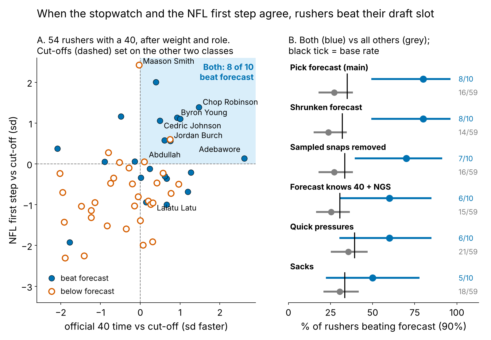

# Speed That Translates: Rushers Fast on the Stopwatch and on Sundays Beat Their Draft Slot

**We laid every 2023–25 defensive lineman's tracked Combine 40 start over his own random NFL pass-rush starts. Once size is removed, the shape of the start does not carry over. Agreement does. Rushers fast on the official 40 *and* in about 20 NFL starts beat a pressure forecast from draft slot, weight and role {{sl_ks}} times in {{sl_ns}}, against {{sl_ko}} in {{sl_no}} for everyone else, on classes the forecast never saw.**

## So what for a team

1. **Pro personnel: keep a "speed that translates" shortlist.** After about 20 random rushes, flag rushers with a top-third NFL first step and a top-half 40 time. On held-out classes they produced +{{sl_exs_s}} pressures a season over forecast; everyone else, {{sl_exs_o}}. Use it to hand out third-down snaps and to order extension talks.
2. **Draft room: pay for the stopwatch, not the trace.** The official 40 adds pressure beyond draft slot; the tracked 40 start adds nothing.
3. **Tape: a fast start alone is not a buy.** A top NFL first step without the 40 time is a hands-and-counter question (Maason Smith, below).

{{TABLE:ledger}}

*Table 1. Pressure-rate points per sd (DL average about 8%), 90% interval, each draft class held out in turn; p from shuffling the measure within class.*

## The metric

**First step = how fast a lineman is moving 0.3 to 0.5 s after he first moves.** In that window the 40 and a pass rush are the same movement: a big man leaving a stance. By 1.5 s they part (median {{dr_med_40}} yd/s in the 40, {{dr_med_sunday}} on a rush, because he has met a blocker). Both are in standard deviations after weight and role (share of snaps at EDGE). **Translation** asks whether the Combine number previews the NFL number.

**Data.** Every tracked Combine 40 rep, standardized within year. NFL: random sampled pass plays only (the top-EPA half oversamples sacks), alignment-adjusted: {{n_snaps_dl}} starts by {{n_gplayer}} linemen, median {{snaps_med}} each, reliability {{rel_fs_game}}, tracking NGS get-off snap by snap (ρ = {{rho_fs_ngs_snap}}). Outcome: career pressures per rush for {{n_pay}} rushers with 100+ rushes. **Baseline without tracking:** draft pick, weight and role; the stronger one adds the official 40 time and season NGS get-off.

## Finding 1: the Combine start does not translate

Raw, the 40 ranks NFL speed at 1.5 s at {{tr_raw_15}}, but that is weight (heavier linemen are slower on Sundays, ρ = {{rho_w_dr_sunday}}, and in the 40, {{rho_w_dr_40}}). After weight and role, the 40 first step previews the NFL first step at ρ = {{tr_fs}} [{{tr_fs_lo}}, {{tr_fs_hi}}] (n = {{n_tr}}). No tenth of a second exceeds {{tr_adj_absmax}} (Figure 2A); corrected for measurement noise the link is at most {{tr_fs_ceiling}}. The pass-rush drill start does no better ({{tr_prd}}, n = {{tr_prd_n}}). Five per-player similarity scores (gap, two speed ratios, curve shape, distance) never exceed {{sim_absmax}} in rank correlation with pressure beyond pick, and carry-over fails on held-out classes (Table 1).

## Finding 2: two signals that agree beat the forecast

What carries is the official 40 time, +{{x_f40_pick_pp}} points per sd [{{x_f40_pick_lo}}, {{x_f40_pick_hi}}] in {{x_f40_pick_pos}} of 3 classes, and the NFL first step, +{{ht_nfl_pp}} [{{ht_nfl_lo}}, {{ht_nfl_hi}}]. They overlap: with the 40 and NGS get-off in the forecast, the first step keeps +{{x_nfl_full_pp}} [{{x_nfl_full_lo}}, {{x_nfl_full_hi}}]. So we ask one football question: does the speed he showed in Indianapolis show up when he leaves his stance on Sundays?

**The rule.** *Both* = NFL first step in the top third and 40 time in the top half, with each class's cut-offs set on the other two classes.

**The test.** A rusher "hits" if his career pressure rate beats the held-out forecast; the base rate is {{sl_base}}%. Both hits {{sl_ps}}% ({{sl_ks}} of {{sl_ns}}), all others {{sl_po}}% ({{sl_ko}} of {{sl_no}}): a gap of {{sl_gap}} points [{{sl_gap_lo}}, {{sl_gap_hi}}], shuffle p = {{sl_p}}. Dropping any one shortlisted rusher leaves at least {{sl_loo_min}}%. By class: {{sl_2023_ks}} of {{sl_2023_ns}} (2023), {{sl_2024_ks}} of {{sl_2024_ns}} (2024), {{sl_2025_ks}} of {{sl_2025_ns}} (2025).

**Checks (Figure 3B).** Shrunken forecast: {{sl_ridge_ks}} of {{sl_ridge_ns}} against {{sl_ridge_ko}} of {{sl_ridge_no}}. The first step is read from sampled snaps, so we removed all {{sl_snaps_removed}} per rusher from the outcome: {{sl_x_ks}} of {{sl_x_ns}} against {{sl_x_ko}} of {{sl_x_no}}, so it is not scoring its own pressures. The edge shrinks when the forecast already knows the 40 time and NGS get-off ({{sl_full_ks}} of {{sl_full_ns}} against {{sl_full_ko}} of {{sl_full_no}}, p = {{sl_full_p}}) and on the rarer quick pressures and sacks ({{sl_q_ks}} and {{sl_s_ks}} of {{sl_ns}}; p = {{sl_q_p}}, {{sl_s_p}}). The lift is the combination, not a new athlete score.

## Why it works: the same rusher, faster snap

On {{sn_n}} random rushes by {{sn_players}} linemen ({{sn_k}} pressures), a first step one sd faster than *his own* average multiplies the odds of pressure on that snap by {{sn_or}} [{{sn_or_lo}}, {{sn_or_hi}}]. His fastest fifth of starts ended in pressure {{sn_top5}}% of the time, his slowest fifth {{sn_bot5}}% (Figure 4). It holds with that snap's NGS get-off, sideways movement, down and alignment controlled ({{sn_or_ctl}}), and for EDGE ({{sn_or_e}}) and interior ({{sn_or_i}}). Reach the blocker's set point first and the tackle opens early. The 40 says the speed exists; the NFL starts say he uses it from a stance.

**Price.** Clubs already pay for the 40: one sd faster goes {{price_40}}% earlier in pick number after weight and role (n = {{price_n}}), while a fast tracked start goes {{price_cfs}}% *later* if anything (p = {{price_cfs_p}}). Since the 40 still adds +{{x_f40_pick_pp}} beyond the pick, clubs appear to under-pay for it (an association).

## The board

Percentiles among the {{n_pay}} rushers with 100+ rushes; * = 2025 class (one season). Actions are football judgement tied to role and front, not model output.

{{TABLE:card}}

*Table 2.*

**Where the rule disagrees with the tape: Maason Smith.** Jacksonville's 2024 second-rounder has the cohort's best NFL first step, a {{b_smith_t}}th-percentile 40, and {{b_smith_rate}}% pressure against a {{b_smith_fc}}% forecast; only {{b_smith_q}}% of his pressures came quickly. His curve is fast through half a second, then flat (Figure 1): he arrives, he does not win. His starts are among the straightest ({{b_smith_lat}}th percentile sideways), so stunts do not explain it. The coaching fix is hands and a counter, not more get-off work. **The shortlist miss: Jordan Burch** (2025, Arizona) sits top right at {{b_burch_rate}}% against {{b_burch_fc}}% after one season; as the only 2025 rusher on the list, the cleanest class has not tested the rule yet.

## Limitations

- **Not blind.** The two-signal form was chosen in an earlier round after seeing all three classes; only the cut-offs are held out. The rule is frozen and hashed (`{{rule_hash}}`, `frozen_rule.json`); 2026 is its first true test.
- **Ten rushers.** The shortlist is small, its 90% interval wide (Figure 3B), and nine of ten come from 2023–24. One new class gives the slope test only {{pow_cls}}% power.
- **Translation itself is a null.** The tracking contribution is the NFL first step; the Combine contribution is the stopwatch. DL was the clearest of five groups screened; for WR, OL, DB and TE the NFL start cannot be read reliably from about 20 sampled snaps.
- **Sampled tape, no blockers.** A slow start can be a two-gap call, a fast one a free rush. A forward test (rookie-year first step against later pressure) has {{fw_n}} rushers and is inconclusive (p = {{fw_p}}).
- **Outcome.** Pressure is charted and usage-dependent; injuries are not modelled.

## Appendix

**Slope test (Table 1).** The forecast, fit on two classes, is a fixed logit offset in a quasi-binomial model of the held-out class's pressures out of rushes; class slopes are pooled with random-effects shrinkage; p shuffles the measure within class 2,000 times. The first-step window was read off the payoff curve in an earlier round; the best of {{ht_nwin}} windows under the same shuffle gives p = {{ht_nfl_p_adj}}. Rerunning everything on resampled rushers gives [{{cb_lo}}, {{cb_hi}}]; dropping any one rusher, {{loo_min}} to {{loo_max}}; a ridge forecast, +{{x_ridge_pp}}. Ridge (penalty chosen inside training classes) does not improve calibration (held-out slopes {{cal_ridge_2023}}, {{cal_ridge_2024}}, {{cal_ridge_2025}} against {{cal_ols_2023}}, {{cal_ols_2024}}, {{cal_ols_2025}}; 1 is ideal), so least squares stays primary. **Shortlist.** The gap interval resamples rushers within class; the shuffle p permutes the Both label within class 2,000 times. **Sample.** 40 first-step repeatability {{rel40_fs}} (n = {{rel40_n}}); sampled-snap pressure tracks career pressure at ρ = {{rho_sample_season}}.

*Reproduce: `uv run python writeup/candidates/round_13/cand_3/analysis.py` (about 3 minutes, one core).*
