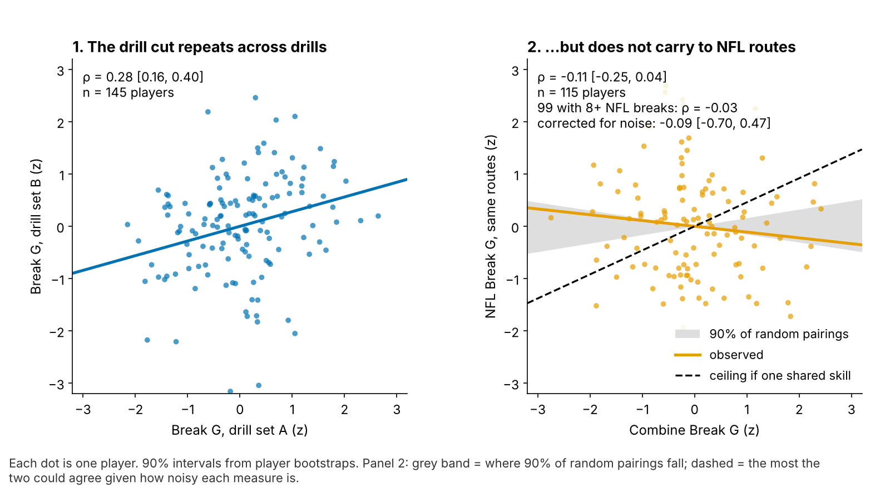

# Break G: A Hard Combine Cut Does Not Get Receivers Open

**Break G is how hard a receiver drives into the ground in the second around his cut, measured on the 10 Hz Combine route drills. On 116 WR/TE from draft classes the model had not seen, it bought no NFL separation: −1.4 inches per sd (90% interval −3.3 to +0.8), a 90% probability that the true effect lies within ±3 inches. For the day-3 and undrafted pool, the better filter is last season's separation over expected, but that result is directional only: 6 of 12 shortlisted receivers beat expectation again, against 2 of 8 passed over (gap 25 points [−14, 58]; base rate 40%; receiver-clustered interval).**

*Separation over expected (SOE): yards of space at the throw beyond what alignment, cushion and position predict (NGS, full season), here also adjusted for route mix and depth at the throw.*

## Why it matters

Separation is the receiver trait scouts argue about most and measure least. Space at the catch point mixes the receiver with coverage, quarterback timing and route mix, so tape grades of "suddenness" stay subjective. A cut-force number is a plausible fix: space is made at the break, when the defender has to react to a plant he cannot see coming. Clubs already pay for it: beyond the 40, weight and NGS score, a +1 sd Break G receiver went 14% earlier [5, 23] on held-out classes. The 2023–2025 classes are the first with 10 Hz tracking of Combine route drills, so the cut can finally be measured, not described.

## The metric

For coaches: Break G is how hard a receiver drives into the ground in the second around his cut, in g (1 g = his body weight). Rounding and drifting score low; sinking, snapping and driving out score high.

Technically: mean acceleration over the 1.0 s centred on the sharpest point of the first break (30°+ turn after 1.5 yards), standardized within drill and Combine year, averaged over a player's route drills (median 7) and shrunk for reliability. The same code grades NFL breaks on the same route families (slant, out, hitch, in, corner).

| Question (players) | Result, 90% interval | Verdict |
|---|---|---|
| Does Break G add target-quality-adjusted season SOE beyond pick, 40, weight and NGS score? (116, held out) | −1.4 in [−3.3, +0.8] | No; 90% of the posterior lies within ±3 in |
| Does the drill cut show on NFL snaps? (99 with 8+ breaks) | ρ −0.03; corrected for noise −0.09 [−0.70, 0.47] | Real drill trait; no sign it transfers |
| Day-3 / UDFA: does last season's SOE flag next season's? (20 pairs) | 6 of 12 vs 2 of 8; gap 25 pts [−14, 58] | Directional only; grade it on 2026 |

## So what for a team

1. **Pre-camp shortlist for day-3 and undrafted receivers: last season 100+ routes and SOE above zero.** It is a cheap filter, not a verdict: the 2024→25 pairs went 5 of 8 against 1 of 6, the 2023→24 pairs 1 of 4 against 1 of 2. It picked better than a forecast from pick, routes and position (3 of 12).
2. **Leave Break G out of the separation grade and the price.** The best case, +0.8 inch per sd, is worth 0.12 catches a season.
3. **Grade the cut on tape, by route family.** The drill cut is a real trait, but each hard cutter lost most on one NFL route (board below). Coach that route.

## The shortlist

The rule has no fitted parts, so scoring each season transition alone is its leave-one-season-out test: ahead in 2024→25, behind in 2023→24. Three checks:

- **Not just regression to the mean.** A forecast of next-season SOE from pick, season-1 routes and position (fitted on the other receivers) picks 3 of 12 hits. Net of that forecast the shortlist adds 14 points [−28, 50] in the day-3 pool.
- **Drop-outs.** Shortlisted day-3 receivers were more likely to reach 100 routes again (12 of 16 against 8 of 17). Counting every drop-out as a miss, the rule hits 6 of 16 against 2 of 17.
- **Across all rounds** (53 pairs, 38 receivers) the same SOE persists firmly beyond the pick forecast: +0.52 inches next season per inch this season [0.25, 0.73]. That is why the day-3 rule is worth grading, not proof that it works.

Break G does not sort the shortlist: soft cutters hit 4 of 7, hard cutters 2 of 5.

**The 2026 list (day 3 / UDFA, 2025 SOE above zero).** Soft cutters (Break G below 0, starred) are the test cases: if they hit as often as the hard cutters in 2026, the cut adds nothing to the filter.

| Receiver (class, pick) | 2025 SOE (in) | Routes | Break G (sd) |
|---|---|---|---|
| Malik Washington* (2024, 184) | +22.5 | 339 | −0.3 |
| Demario Douglas (2023, 210) | +21.6 | 220 | +0.5 |
| Gunnar Helm (2025, 120) | +16.4 | 231 | 0.0 |
| Tez Johnson* (2025, 235) | +16.2 | 282 | −0.1 |
| Arian Smith (2025, 110) | +15.8 | 231 | +1.7 |
| A.J. Barner* (2024, 121) | +14.0 | 330 | −0.1 |
| Mitchell Evans* (2025, 163) | +13.9 | 123 | −0.1 |
| Ja'Tavion Sanders* (2024, 101) | +6.4 | 220 | −0.2 |
| Jaylin Lane (2025, 128) | +4.8 | 186 | +0.2 |
| Troy Franklin* (2024, 102) | +4.4 | 461 | −0.1 |
| Isaiah Bond* (2025, UDFA) | +4.3 | 333 | −1.3 |
| Mitch Tinsley (2023, UDFA) | +3.6 | 134 | +0.5 |
| Kayshon Boutte (2023, 187) | +0.8 | 357 | +1.8 |

## The chain: does the drill reach the snap?

1. **The drill trait holds.** Break G from five route drills predicts the other five at ρ = 0.28 [0.16, 0.40] (145 players). It is not a speed score: ρ with the 40 is −0.01.
2. **It does not carry to NFL routes.** Across 115 players ρ = −0.11 [−0.25, 0.04], inside the random-pairing band. Keeping the 99 players with 8+ graded NFL breaks and correcting for both reliabilities gives −0.09 [−0.70, 0.47]: no sign of transfer, but the sample cannot exclude a moderate one.
3. **A harder NFL cut does not buy space.** Within a player, one sd more cut force goes with +1.5 inches of snap SOE [−2.5, +5.3].

## The test: season separation on unseen classes

The outcome is full-season SOE, adjusted for route mix and depth at the throw (from 1,902 random sampled snaps), route-weighted over each career (116 players, median 231 routes). The baseline without tracking is log pick, official 40, weight, NGS athleticism score and a TE flag, fit on the other two draft classes, plain and shrunken (ridge). The single estimate averages the two over the same 2,000 class-stratified resamples, which refit everything. The +3-inch margin was set in advance.

| Version (held out) | Season SOE per sd of Break G, 90% interval |
|---|---|
| Plain forecast only | −1.8 in [−4.1, +0.4] |
| Ridge forecast only | −1.1 in [−2.6, +1.3] |
| Without Puka Nacua | −0.7 in [−2.3, +1.3] |
| Raw SOE (no route-mix adjustment) | −0.8 in [−2.8, +1.3] |
| Quarterback-adjusted SOE | −0.8 in [−2.7, +1.3] |
| Yards per route run, without Nacua | +0.09 yd [−0.03, +0.24] |

No version's upper end passes +1.3 inches. Yards per route run, an outcome that does not depend on separation, shows nothing once Nacua is out.

## The board

Figure 1's receivers. The route is where NFL Break G fell furthest below drill Break G.

| Receiver (class, pick) | Break G drill → NFL (sd) | Biggest drop (g, NFL breaks) | Action |
|---|---|---|---|
| Kayshon Boutte (2023, 187) | +1.8 → +0.1 | out: 0.66 → 0.41 (2) | **Drill and tape disagree.** Teach the sink at the top of the out; clip below |
| Adonai Mitchell (2024, 52) | +1.7 → +0.3 | hitch/comeback: 0.73 → 0.40 (2) | Comeback: three-step stop, hips down before the turn |
| Isaiah Bond (2025, UDFA) | −1.3 → −0.5 | corner: 0.60 → 0.37 (1) | On the 2026 list; 4 graded breaks, no route read yet |
| Jake Bobo (2023, UDFA) | −1.4 → +0.1 | slant: 0.46 → 0.36 (7) | Slant: plant on the outside foot, not a drift |

**The Boutte clip.** The hardest drill cutter on the board lost the most on outs. On a 2nd-and-9 out (2024, week 12, first quarter, 14:24), he enters the break at 5.2 yd/s and his slowest point is still 5.2 yd/s: no gear-down, Break G 0.33 g, 1.5 yards of space at the throw. The scout's cue: does the speed drop at the top of the stem? His drills say he can; his outs say he does not.

## Limitations

- **The day-3 shortlist is not established.** Twenty pairs from 16 receivers, some counted twice; one of two transitions went the wrong way. The 2026 season is its first real test.
- **Not a blind test.** Earlier rounds saw all three classes; the target-quality outcome and the averaged forecast were chosen this round, after the plain and ridge results on raw SOE were known (both shown).
- **The downside is open.** The interval rules out gains above +0.8 inch per sd, not losses down to −3.3.
- **Game tracking is a sample.** Up to 40 plays per player, half chosen for high EPA, with no defenders and no ball. Board route reads rest on 1–7 NFL breaks.

## Appendix

**Thresholds.** Break entered above 2.5 yd/s; found in 96% of 926 route-drill reps. **Forecast.** Ridge penalty by leave-one-class-out inside the two training classes. Weight on the held-out ridge forecast, by class: 2023 0.52 [−0.45, 3.70], 2024 2.23 [−0.72, 7.34], 2025 1.83 [−0.57, 9.84]; pooled 0.79. Hence the averaging. **Chance.** Break G shuffled within class: p = 0.26 for the main estimate. Posterior: flat prior, normal approximation to the bootstrap. Of the tests run across rounds (ledger in `numbers.json`), none survives a Bonferroni correction. **Reliability.** A mixed model (player, player × drill, drill × year) gives 0.53 for seven drills; a second rep on slant, dagger and comeback lifts it to 0.62. Noise correction: split-half reliabilities, Spearman–Brown, one player bootstrap. **Price.** 14% [5, 23] is beyond the 40, weight and NGS score; beyond position alone it is 9% [2, 17]. **Other outcomes, with Nacua.** Yards per route run +0.24 [0.03, 0.47]; catch rate over expected +1.8 points (without Nacua +0.1). **Quarterback.** A crossed receiver + quarterback model on 4,071 sampled snaps gives passers 0.0% of snap variance.

Reproduce: `uv run python writeup/candidates/round_13/revised/analysis.py` (about seven minutes); it writes every quoted number to `numbers.json` and the 2026 list to `shortlist_2026.csv`.
