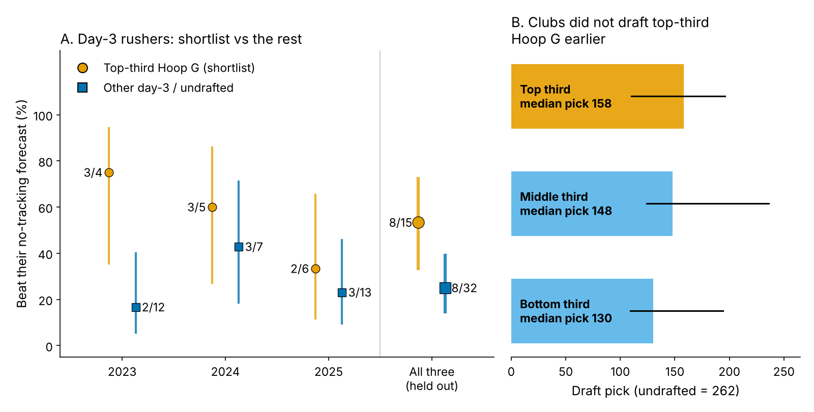
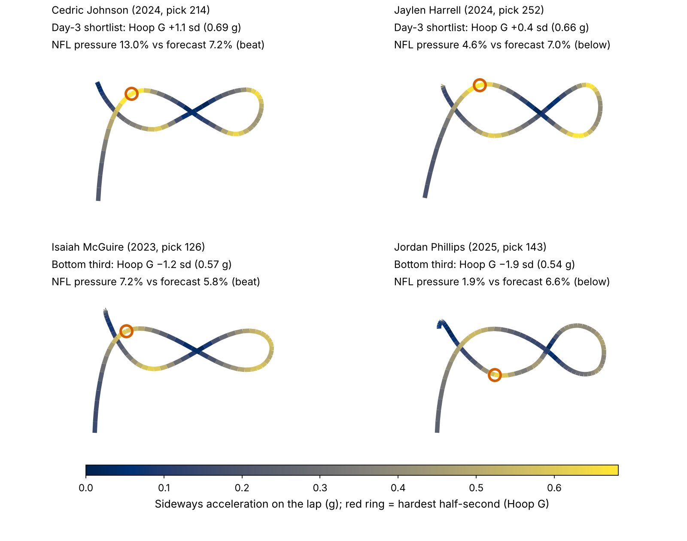
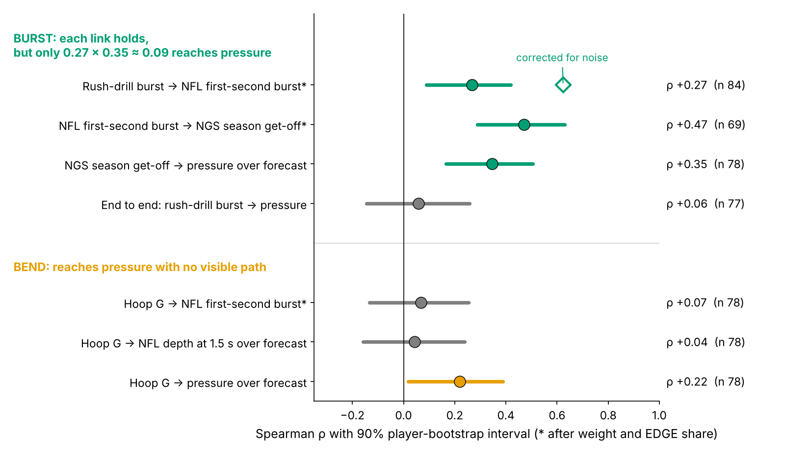

# Hoop G: Combine Bend Finds Day-3 Pass Rushers; Combine Burst Does Not

**One pool throughout: defensive linemen drafted on day 3 (pick 103 or later) or undrafted.** Among them, the {{main_n1}} who were in the top third of their Combine class on **Hoop G**, how hard they push sideways while rounding the Run-the-Hoop drill, beat a no-tracking forecast of their NFL pressure rate {{main_k1}} times (**{{main_p1}}%**). The other {{main_n0}} day-3 rushers did it {{main_k0}} times (**{{main_p0}}%**). Each class was scored by a forecast that never saw it, and clubs do not draft for Hoop G, so the list is free. It is a film list, not a grade: on the strictest time-forward test the gap shrinks and its interval crosses zero. The pass-rush drill's get-off burst shows up on NFL snaps but never reaches pressure.

## Why a day-3 rush list is worth building

A pressure is what a rusher is paid for: on {{epa_n}} randomly sampled NFL pass plays involving our rookies, a pressured snap cost the offense {{epa_press}} more expected points than a clean one (90% interval {{epa_press_lo}} to {{epa_press_hi}}). Day 3 is where clubs fill the rotation ({{pct_day3_hoop}}% of hoop runners went at pick 103 or later) and where the board is thinnest. The official agility test, the 3-cone, was run by only {{n_three_cone}} of {{n_dl}} linemen in the 2023–25 classes.

Every lineman, though, runs position drills under the 10 Hz Combine tracking, and nobody times them. Which drill movements carry over to an NFL rush, and can a club use one on day 3 at no cost?

## Two drill measures

- **Hoop G.** Run-the-Hoop is a figure-eight around two hoops; it rewards bending the hips at speed. We take the hardest {{win_s}}-second window of sideways (centripetal) acceleration on the lap, in g (median {{hoop_g_median}} g), and standardize it within Combine year, because drill conditions shift between years. {{n_hoop}} linemen have it, {{n_hoop_no3c}} of them with no official 3-cone.
- **Rush-drill burst.** Yards covered in the first second of movement in the pass-rush drill, standardized the same way.

Both are noisy. {{pct_one_run}}% of hoop runners have one run; among the {{rel_hoop_nrep}} with two, run-to-run reliability is {{rel_hoop1}}. One burst rep repeats at {{rel_d1_1}} ({{rel_d1_nrep}} linemen).

## The test

**The yardstick** is a forecast of each lineman's NFL pressure rate from what a club already has: draft pick, Combine weight, NFL EDGE share, NGS athleticism score, and the official 10-yard split and 3-cone (missing times are filled from weight, role and NGS score). Each class is forecast by a model fit only on the other two. On held-out classes it ranks regulars' pressure rates at ρ = {{fc_rho}} ({{fc_rho_n}} linemen with 100+ rushes).

**The rule** is one primary comparison, fixed in the previous round. Shortlist = pick 103 or later (or undrafted) AND top third of Hoop G among all hoop runners in his class. Thirds are set at the Combine; nothing in the rule is fit on NFL data. A rusher with 30+ NFL rushes "hits" if his pressure rate beats his forecast. Each player is one row, so intervals resample players, not snaps.

**Result.** {{main_k1}} of {{main_n1}} shortlisted rushers hit against {{main_k0}} of {{main_n0}} others. That is a gap of **+{{main_gap}} points (90% interval {{main_lo}} to {{main_hi}})**. With flat priors, the shortlist's true hit rate is higher with probability {{bayes_pgt0}}%, and at least 10 points higher with {{bayes_p10}}%. Relabelling Hoop G at random within class gives a gap this large with p = {{perm_p}}. The shortlist was ahead in {{cls_ahead}} of 3 classes. In pressures, the gap is +{{ex_gap}} per 450 rushes, a regular's season (90%: {{ex_gap_lo}} to {{ex_gap_hi}}), about {{ex_gap_epa}} expected points.

{{TABLE:robust}}

The pick-and-role-only row shows the shortlist is not just cheap players beating a forecast anchored on draft slot. The time-forward row is the strictest: 2024 scored by a model fit on 2023 alone, 2025 by 2023–24. There the gap shrinks to +{{tf_gap}} points and crosses zero. Shortlisted rushers were no more likely to reach 30 NFL rushes ({{surv_k1}} of {{surv_n1}} vs {{surv_k0}} of {{surv_n0}}), so playing time is not the filter.

Across all {{slope_n}} scored hoop runners (Figure 3), pressure rate over forecast rises {{slope}} percentage points per sd of Hoop G (90%: {{slope_lo}} to {{slope_hi}}), positive in {{slope_cls_pos}} of 3 classes. But Hoop G was the best of 14 drill-and-outcome pairs screened in earlier rounds; priced for that search, p = {{scr_p}}. Hence a shortlist, not a grade.

## Get-off: drill burst reaches the snap, not the pressure

Get-off is the textbook rush trait, so we started there. Each link holds on its own (Figure 4). Drill burst tracks how far a lineman travels in the first second of a sampled NFL rush, after weight and role: ρ = {{ch_bg}} (90%: {{ch_bg_lo}} to {{ch_bg_hi}}; {{ch_bg_n}} linemen with 8+ random rushes). Corrected for the noise in both measures, that is {{ch_bg_da}} ({{ch_bg_da_lo}} to {{ch_bg_da_hi}}). That first-second burst agrees with NGS season get-off ({{ch_gq}}). Season get-off then predicts pressure over forecast ({{ch_gp}}; {{ch_gp_lo}} to {{ch_gp_hi}}).

Multiplied through, the chain leaves about {{ch_prod}}, and the observed drill-to-pressure link is {{ch_bp}} (90%: {{ch_bp_lo}} to {{ch_bp_hi}}): at most a weak effect. Against NGS season get-off directly, drill burst shows nothing ({{ch_bs}}). The bottleneck is the drill: one rep repeats at {{rel_d1_1}}.

Hoop G is the reverse. It moves pressure ({{ch_hp}}) but not first-second burst ({{ch_hg}}). Nor does it move depth upfield {{dep_s}} seconds after the snap ({{ch_hd}}), a steadier sampled measure (reliability {{rel_dep}}) that does track pressure ({{ch_dp}}). Our best guess is a rusher who keeps speed around the corner and through contact, which we cannot see without blockers in the data.

## When drill and tape disagree

| Player (class, pick) | Hoop G call | Pressure vs forecast (rushes) | Sideways 2+ yd by {{dep_s}} s | Scout action and film cue |
|---|---|---|---|---|
| **Cedric Johnson** (2024, {{johnson_pick}}) | Shortlist, +{{johnson_hz}} sd | {{johnson_pr}}% vs {{johnson_pb}}% ({{johnson_n}}) | {{johnson_loop}}% | The case the list is for. Cue on wide rushes: does he dip under the tackle's hands and flatten within two steps? |
| **Jaylen Harrell** (2024, {{harrell_pick}}) | Shortlist, +{{harrell_hz}} sd | {{harrell_pr}}% vs {{harrell_pb}}% ({{harrell_n}}) | {{harrell_loop}}% | Drill said yes, the NFL said no; tape decides. Cue: he bends at the top of the arc, but does he convert speed to power when the tackle sets short? If not, rotate him rather than build a sub package around him. |
| **Isaiah McGuire** (2023, {{mcguire_pick}}) | Bottom third, {{mcguire_hz}} sd | {{mcguire_pr}}% vs {{mcguire_pb}}% ({{mcguire_n}}) | {{mcguire_loop}}% | The rule's miss: a power rusher who wins straight ahead. Low Hoop G is not a cut signal. |
| **Jordan Phillips** (2025, {{phillips_pick}}) | Bottom third, {{phillips_hz}} sd | {{phillips_pr}}% vs {{phillips_pb}}% ({{phillips_n}}) | {{phillips_loop}}% (interior median {{int_loop_med}}%) | Miami looped him often. Cue: does he redirect on stunts or only push the pocket? Grade the role first. |

## So what for a team

1. **Build the day-3 film list from Hoop G.** Top-third linemen went at a median pick of {{pick_t2}}, no earlier than the bottom third ({{pick_t0}}). Per sd of Hoop G, clubs drafted {{price_later}}% later (90%: {{price_earlier}}% earlier to {{price_hi}}% later). The list costs no draft capital.
2. **Match the role to the trait.** Shortlisted EDGEs get third-down snaps from wide alignments, where bend matters most. Shortlisted interior players get the looper job on stunts.
3. **Do not draft on drill burst.** Time get-off on tape or in camp instead; one drill rep is too noisy to carry it.
4. **Run the hoop twice.** A second run, at a pro day or in camp, lifts reliability from {{rel_hoop1}} to {{rel_hoop2}}.

The 2025 shortlist, with 2026 plans set by role and rookie numbers:

{{TABLE:card25}}

The same rule, unchanged, will score the 2026 class after the 2027 season.

## Limitations

- **One rule, chosen after looking.** Holding classes out checks the forecast, not the drill choice (search-adjusted p = {{scr_p}}). The time-forward version is weaker, and the 2026 class is the clean test.
- **Small counts.** {{main_n1}} shortlisted vs {{main_n0}} comparison rushers; {{c2025_n1}} shortlisted 2025 rookies have one season. Hoop G reliability rests on {{rel_hoop_nrep}} linemen with two runs.
- **Forecast level.** Fit on 100+ rush regulars, the forecast sits above most day-3 rushers; the test compares day-3 rushers with each other, not with 50%.
- **Thin NFL tracking.** About 20 random sampled rushes per player, no blockers, no ball. Sampled pressure barely repeats (split-half {{rel_prs}}), so pressure comes from season totals and scheme reads from loop rates, not play calls.

## Appendix

| Check | Result |
|---|---|
| Shortlist vs rest by class (2023, 2024, 2025) | {{c2023_k1}}/{{c2023_n1}} vs {{c2023_k0}}/{{c2023_n0}}; {{c2024_k1}}/{{c2024_n1}} vs {{c2024_k0}}/{{c2024_n0}}; {{c2025_k1}}/{{c2025_n1}} vs {{c2025_k0}}/{{c2025_n0}} |
| Bayesian 90% interval for the gap (flat priors) | {{bayes_lo}} to {{bayes_hi}} points |
| Same rule on the official 3-cone (day 3, ran it) | {{t3_k1}}/{{t3_n1}} vs {{t3_k0}}/{{t3_n0}} |
| Top-third Hoop G on days 1–2 (not part of the rule) | {{d12_top_k}}/{{d12_top_n}} vs {{d12_rest_k}}/{{d12_rest_n}} |
| Drill burst → NGS season get-off, after weight and role: 90% interval | {{ch_bs_lo}} to {{ch_bs_hi}}, n {{ch_bs_n}} |
| Reliability: burst over a lineman's reps; NFL first-second burst over 8+ sampled rushes | {{rel_d1}}; {{rel_game_d1}} |

*Reproduce: `uv run python writeup/candidates/round_14/cand_1/analysis.py` writes `numbers.json`, the board, the 2026 rule and all figures, and fills this text.*
