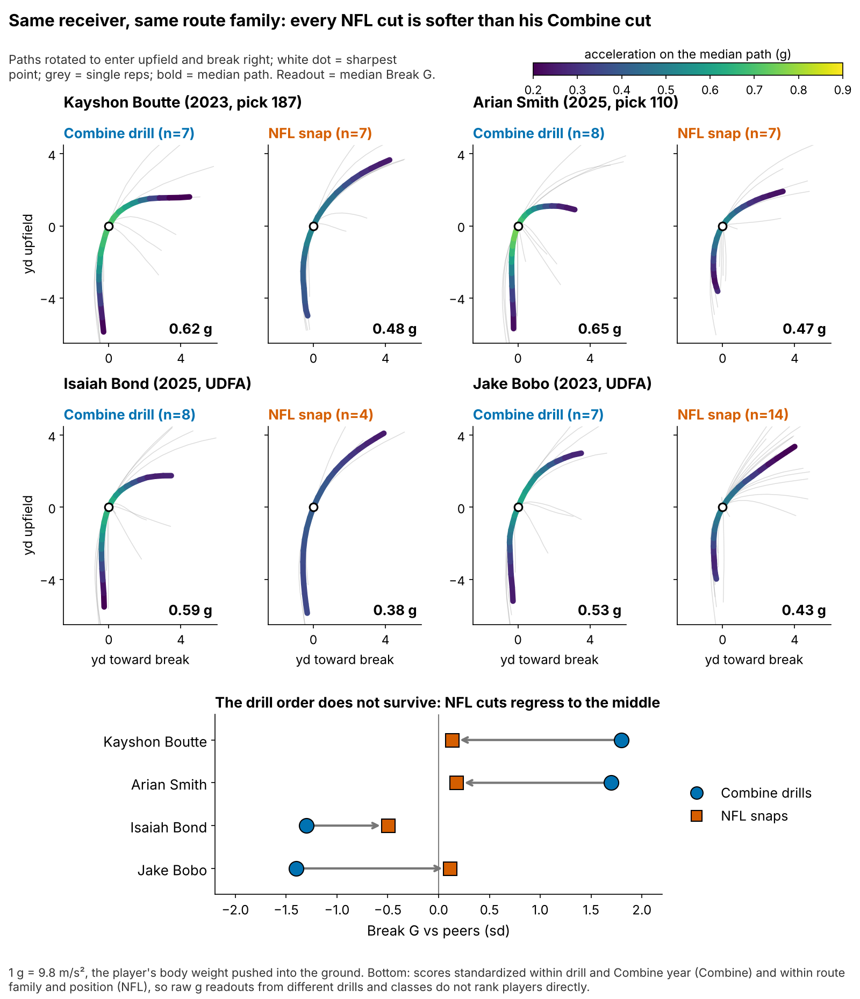
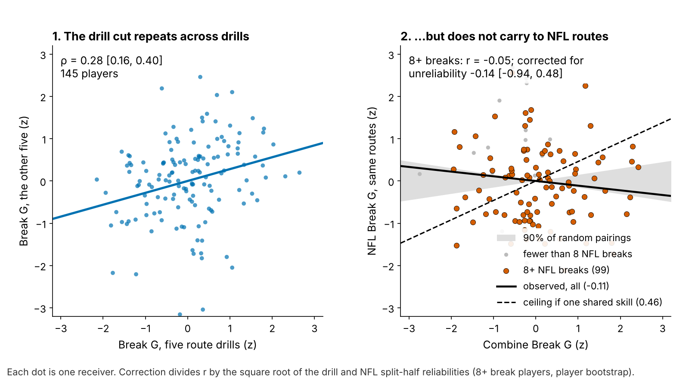

# Combine Cuts Don't Predict NFL Separation for Receivers. Last Season's Separation Does.

**How hard a receiver cuts in Combine route drills (Break G) bought no NFL separation for 116 WR/TE from draft classes the model had not seen: −0.8 inches per sd (90% interval −2.8 to +1.3); the chance it is worth +3 inches is 0.1%. What carries into next season is separation itself, beyond pick and playing time. For day-3 and undrafted receivers that signal is real but small: as a yes/no shortlist it ties a ranking by pick and routes (6 of 12 hits each, 40% base rate).**

*Separation over expected (SOE): yards of space at the throw beyond what alignment, cushion and position predict (NGS, full season).*

## Why it matters

Getting open is the receiver's job and the hardest trait to grade off tape: every rep is tangled with the call, the coverage and the quarterback. Scouts fall back on "suddenness" at the top of the route. For the 2023 to 2025 classes the Combine route drills were tracked at 10 Hz, so the cut can be measured instead of described. Clubs already pay for something like it: beyond the 40, weight and NGS score, +1 sd of Break G goes 14% earlier [5, 23] on held-out classes. If the cut does not become separation, those picks buy a drill trait; a cheaper signal sits in last season's tracking.

## So what for a team

1. **Rank day-3 and undrafted receivers by last season's SOE, not by the drill cut.** In that pool each inch of SOE carries 0.45 inch into the next season beyond pick and routes [0.09, 0.90] (20 season pairs, 16 receivers); as a yes/no rule it is only directional. Seven of the 13 names on the 2026 list are soft drill cutters.
2. **Take Break G out of the price.** Even its best case (+1.3 inches per sd) is worth 0.19 catches a season.
3. **If you time cut drills anyway, run slant, dagger and comeback twice.** A single rep is 14% player and 86% noise; a second rep on those three lifts reliability from 0.53 to 0.62.

| Question (n) | Result, 90% interval | Verdict |
|---|---|---|
| Does Break G add season SOE on unseen classes? (116) | −0.8 in [−2.8, +1.3] | No; +3 in ruled out |
| Does the drill cut show up on NFL snaps? (115) | ρ −0.11 [−0.25, 0.04] | Real drill trait that does not transfer |
| Does last season's SOE carry beyond pick and routes? (53 pairs) | 0.57 in per in [0.33, 0.73] | Yes; day-3 pool 0.45 [0.09, 0.90] |

## The metric

Break G is how hard a receiver drives into the ground in the second around his cut, in g (1 g = his body weight). Rounding and drifting score low; sinking, snapping and driving out score high. The break is the first turn of 30° or more after 1.5 yards (found on 96% of 926 drill reps). Reps are standardized within drill and Combine year and averaged over a player's route drills (median 7). NFL snaps on the same five route families are graded the same way.

## The chain: does the drill reach the snap?

- **The drill trait holds.** Break G on five drills predicts the other five at ρ = 0.28 [0.16, 0.40] (145 players). It is not a speed score: ρ with the 40 is −0.01.
- **It does not carry to NFL routes.** Across 115 players, ρ = −0.11. That is inside the random-pairing band and under the 0.46 ceiling.
- **More NFL reps do not rescue it.** Among the 99 receivers with 8+ NFL breaks (median 17), r = −0.05 [−0.21, 0.12]; corrected for both measures' unreliability, −0.14 [−0.94, 0.48]. Forty sampled plays cannot rule out a moderate shared skill, only a strong one.

## The test: season separation on unseen classes

**Set-up.** The outcome is full-season SOE, route-weighted over each career (213 player-seasons, 116 players, median 231 routes). The forecast without tracking (log pick, official 40, weight, NGS athleticism score, TE flag) is fitted on two draft classes and scored on the third; Break G must explain what it misses. Earlier rounds used two forecast versions (plain and ridge); the primary number is their average, both refitted in each of 2,000 class-stratified resamples.

| Version (n) | Season SOE per +1 sd of Break G, inches [90%] |
|---|---|
| **Primary: average of the two forecasts (116)** | **−0.8 [−2.8, +1.3]** |
| Plain forecast only | −1.2 [−3.6, +1.0] |
| Ridge forecast only | −0.4 [−2.2, +1.8] |
| Without Puka Nacua, the most influential player (115) | −0.2 [−2.1, +1.9] |
| SOE adjusted for route mix and depth at the throw | −1.4 [−3.3, +0.7] |
| SOE adjusted for quarterback | −0.8 [−2.8, +1.2] |

**Bounded null.** No version's upper end reaches +3 inches. Under a prior giving a +3-inch effect a 16% chance, the posterior is −0.7 inches [−2.6, +1.2]: 0.1% chance of +3 or more, 27% of any gain.

**In football units.** At 8.8 catch-rate points per yard of separation and 60 targets for a median 200-route receiver, the +3-inch margin is 0.44 catches a season.

**Price against value** (Figure 3B). The 40 costs 16% of a pick per sd and returns +1.6 inches [0.0, +3.4]. Break G costs 14% and returns −0.8. Weight costs separation: −3.2 inches [−4.9, −1.6].

## The shortlist

**Day 3 and undrafted (the pool that matters).** Of 12 shortlisted pairs, 6 hit again, against 2 of 8 passed over (base rate 40%; gap 25 points [−14, 58], receivers resampled as clusters). A pick-and-routes ranking fitted on the other season pair also hits 6 of 12; the lists share 7 names. The continuous signal is firmer than the cut-off: 0.45 inch carried per inch [0.09, 0.90].

**All rounds.** 16 of 26 shortlisted receivers hit again, against 5 of 27 passed over and 13 of 26 for pick and routes: an edge of 12 points [−7, 28]. Fifteen receivers appear twice. Time-forward (2024 to 2025 pairs, forecast fitted on 2023 to 2024): 9 of 15, against 3 of 18 passed over and 6 of 15 for pick and routes.

**Break G does not sort the day-3 shortlist.** Soft cutters hit 4 of 7, hard cutters 2 of 5. Malik Washington (2024, pick 184; Break G −0.3 sd) posted +14.6 inches in 2024: the drill said discount, the rule kept him, and he posted +22.5 in 2025. Trey Palmer (2023, pick 191; +1.3 sd) had both signals after +5.0 in 2023 and fell to −1.3.

**2026 list** (day-3/UDFA, 100+ routes and SOE above zero in 2025; ranked by SOE; soft cutters in italics are the test cases):

| Receiver (class, pick) | 2025 routes | 2025 SOE, in | Break G, sd |
|---|---|---|---|
| *Malik Washington (2024, 184)* | 339 | +22.5 | −0.3 |
| Demario Douglas (2023, 210) | 220 | +21.6 | +0.5 |
| Gunnar Helm, TE (2025, 120) | 231 | +16.4 | 0.0 |
| *Tez Johnson (2025, 235)* | 282 | +16.2 | −0.1 |
| Arian Smith (2025, 110) | 231 | +15.8 | +1.7 |
| *A.J. Barner, TE (2024, 121)* | 330 | +14.0 | −0.1 |
| *Mitchell Evans, TE (2025, 163)* | 123 | +13.9 | −0.1 |
| *Ja'Tavion Sanders, TE (2024, 101)* | 220 | +6.4 | −0.2 |
| Jaylin Lane (2025, 128) | 186 | +4.8 | +0.2 |
| *Troy Franklin (2024, 102)* | 461 | +4.4 | −0.1 |
| *Isaiah Bond (2025, UDFA)* | 333 | +4.3 | −1.3 |
| Mitch Tinsley (2023, UDFA) | 134 | +3.6 | +0.5 |
| Kayshon Boutte (2023, 187) | 357 | +0.8 | +1.8 |

## Where drill and tape disagree

| Receiver | Break G: drill → NFL | Read and action |
|---|---|---|
| Kayshon Boutte (2023, 187) | +1.8 → +0.1 sd; 0.62 → 0.48 g | Hardest drill cutter, last name on the 2026 list. He enters NFL breaks faster than the median receiver (5.4 vs 4.9 yd/s) and does not gear down. **Coach:** sink at the top of outs and hitches against off coverage. **Board:** listed on SOE; the cut does not move him up |
| Arian Smith (2025, 110) | +1.7 → +0.2 sd; 0.65 → 0.47 g | Both signals agree (+15.8 in). **Keep his 42% slot share; re-grade after 2026** |
| Isaiah Bond (2025, UDFA) | −1.3 → −0.5 sd; 0.59 → 0.38 g | Soft in drill and game, yet open (+4.3 in) on rounded breaks (corner, go). **Keep him there; do not grade him on speed-outs** |
| Jake Bobo (2023, UDFA) | −1.4 → +0.1 sd; 0.53 → 0.43 g | Off the list; cuts like an average NFL receiver. Judge contested catches |

Route-level notes rest on 3 to 14 sampled snaps: film-room leads, not grades.

## Limitations

- **Not a blind test.** Earlier rounds saw all three classes, and each forecast version was chosen after a result was known; hence the average and every version shown. The 2026 class is the first true out-of-sample score (power 0.85 against a 3-inch gain).
- **The downside is open.** The interval excludes gains above +1.3 inches per sd, not losses down to −2.8. The ridge forecast's held-out weight is unstable (0.72 [−0.65, 1.69]), so the forecast adjusts for little.
- **The shortlist is small.** 53 pairs from 38 receivers, only 20 day-3 pairs, where the yes/no rule ties pick and routes. The 2025 class enters only the 2026 list.
- **Game tracking is a sample.** Up to 40 plays per player, half chosen for high EPA, with no defenders and no ball. NFL break reliability is 0.23 over a median 16 breaks, which caps every drill-to-game correlation.

## Appendix

**Detection.** 1.0 s window centred on the sharpest point; Savitzky–Golay smoothing (7 frames); entry above 2.5 yd/s. **Chance.** Within-class shuffles (2,000): primary p = 0.55; one-sided test against +3 inches p = 0.0012. **Reliability.** Mixed model (player, player × drill, drill × year): 0.53 for seven drills. Figure 2's correction uses split-half reliabilities on the 99 players (drill 0.35, NFL 0.30). **Quarterback.** A crossed receiver + quarterback model on 4,071 sampled snaps gives passers 0.0% of snap variance. **Route mix.** Separation on route and depth over 1,902 random (non-EPA) snaps. **Other outcomes.** Yards per route run +0.24 per sd [0.03, 0.47]; without Nacua 0.10 [−0.01, 0.25].

Reproduce: `uv run python writeup/candidates/round_14/cand_2/analysis.py` (about six minutes). It writes every quoted number to `numbers.json` and the 2026 list to `shortlist_2026.csv`.
